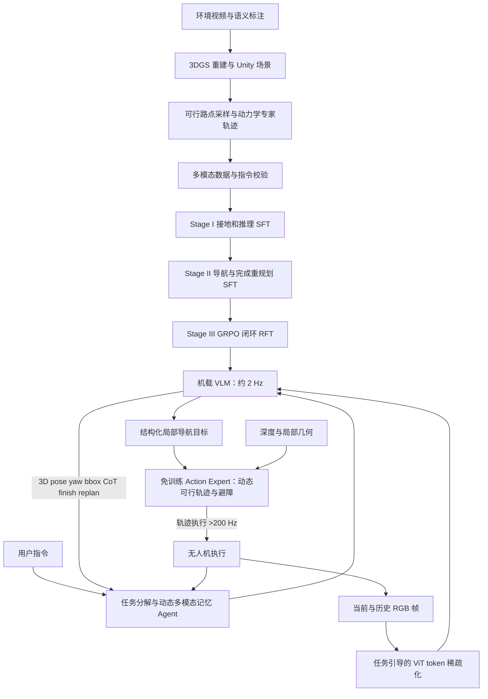

# VLN-AR：面向复杂环境空中机器人的分层机载视觉–语言导航 / A Hierarchical Onboard Vision-Language-Navigation Framework for Aerial Robots in Complex Environments

**论文：** Yuze Wu、Mo Zhu、Xingxing Li 等；浙江大学工业控制技术全国重点实验室、Differential Robotics；[arXiv:2611.23930v1](https://arxiv.org/abs/2611.23930v1)（2026-11-18）；*IEEE Transactions on Robotics*，2026-11-09 接收，[DOI:10.1109/TRO.2026.3754505](https://doi.org/10.1109/TRO.2026.3754505)。[官方项目页](https://wyz000.github.io/VLN-AR/)。

## 一句话定义

**VLN-AR** 将无人机的开放词汇视觉–语言导航拆为 **低频 VLM 生成 3D 目标与任务状态**、**免训练运动规划专家高速生成安全可执行轨迹**，并用历史记忆处理多步骤任务，在机载资源限制下异步闭环执行（论文 III–IV）。

## 英文缩写速查

| 缩写 | 英文全称 | 简要说明 |
|------|----------|----------|
| VLN | Vision-Language Navigation | 语言指定语义目标、视觉观测下持续导航 |
| UAV | Unmanned Aerial Vehicle | 具备 3D 运动和严格载荷预算的无人机平台 |
| VLM | Vision-Language Model | 从图像和指令预测导航意图与中层目标 |
| 3DGS | 3D Gaussian Splatting | 重建真实外观并在 Unity 合成无人机视角 |
| SFT | Supervised Fine-Tuning | 前两阶段分别训练接地推理及专用导航 |
| GRPO | Group Relative Policy Optimization | 第三阶段闭环强化微调的分组优势方法 |
| CoT | Chain-of-Thought | 未找到目标时用于探索与子任务更新的推理 |
| ViT | Vision Transformer | 在编码器内部按任务语义筛选视觉 token |
| AWQ | Activation-aware Weight Quantization | 机载 2B/4B/7B 性能表中的量化模型标识 |
| SR | Success Rate | 依评测阈值定义的无碰撞任务成功率 |

## 为什么重要

地面 VLN 的离散动作或通用 VLA 的直接低层动作，难以同时满足无人机 **连续 3D 避障、长程语言接地、视觉遮挡、有限算力**。VLN-AR 的工程价值不在于让大模型直接跑飞控内环，而在于明确 **语义目标—几何可行轨迹—控制执行** 的职责边界，以及机载推理和高频执行的异步接口（I、III、IV）。

## 核心原理

### 流程总览

据论文 Fig. 1、Fig. 3、Fig. 5–6、III–IV 与 Algorithm 1 整理的**论文架构流程**，不是源码调用图：

- **结构化输出（III-A，式 4）：** `[pose, bbox, reason, finish, replan]`；pose 是**机体系**中的 3D 航点和期望 yaw，bbox 提供图像目标，finish 判断当前子任务完成，replan 决定是否继续主动搜索。免训练 action expert 基于 Ego-Planner 改进并结合局部几何修正。
- **数据生成（III-B）：** 视频→3DGS→Unity + 物体/布局标注→可行起终点→受动力学约束的专家轨迹→10 Hz RGB/深度/LiDAR/6-DoF 同步采集→语言增强与验真。论文报告约 **400 万训练样本**，并非已提供公开下载。
- **训练（IV-A）：** I：Grounding/Reasoning/VQA SFT；II：目标位姿、完成标记和重规划的导航 SFT；III：将 VLM + action expert 接入闭环，GRPO 使用稀疏成功回报、组内相对优势及多阶段折扣奖励。
- **长程 Agent（IV-B、Algorithm 1）：** 子任务队列 + 历史关键帧/轨迹/状态记忆；找不到目标时先 360° 主动观察，仍失败才 CoT 探索或标不可达。VLM/Agent **2 Hz**，action expert **>200 Hz** 异步执行，低频语义绝不代表低频运动执行。
- **推理压缩（III-A2、IV-C）：** 历史帧降采样，ViT 第 12/15/22 层依据指令–视觉余弦相似度逐级 Top-K，最终保留 25% 视觉 token；训练期间关闭该稀疏化；叠加算子调度、量化、Flash-Attention、KV cache 优化。

## 实验与评测

### 不同导航基准与真机（Table II、IV）

| 评测设置 | 成功率 SR | 口径与边界 |
|----------|----------:|------------|
| AerialVLN | 78.15% | 室外目标距离阈值 5 m，测试基准未参与训练 |
| OpenFly | 76.88% | 室外目标距离阈值 5 m，测试基准未参与训练 |
| 自建未见室内 3DGS | 92.66% | 室内阈值 1 m，约 10k 测试样本 |
| 两款无人机真实飞行 | **91/101 = 90.1%** | NCS、NCS-α + RealSense + Jetson Orin NX；含不同场景任务 |
| 真实世界鲁棒性小样本 | 悬浮障碍 18/20；高差 19/20；夜间 17/20；动态障碍 17/20；未见场景 18/20 | 每个条件 20 次，不能当作通用避障保证 |

**指标口径：** SR 要同时满足无碰撞、目标距离阈值和完整子任务；NE 为终点位置误差（长程任务累积各段），TT 仅统计成功的任务时长，跨基准不能只按 SR 横向定论（V-A）。

### 训练与 Agent 消融（Table V–VI）

- 全三阶段：精确导航 **85.7%**、长程导航 **88.0%**（Table V），不能误当整机真实飞行成功率。
- 去除 Agent：长程成功率从 **88.0% 降至 57.4%**；单目标物体导航 98.1%→95.7%、空间推理 94.6%→92.4%（Table VI）。
- 长程 976 个模拟 episode 有 13 次 finish 错误：11 个误判完成、2 个漏判完成；到达阈值附近的少量位置误差会影响任务队列状态（V-D4）。

### 机载速度要区分两个实验量（Table III、Fig. 14）

- Jetson Orin NX **30 W**、2B/4B/7B AWQ：**单 token 解码**相对未经优化基线加速 **7.1–9.4 倍**（不是飞行速度倍率），4B 为 0.508→0.062 s/token。
- 单次模型整体推理另外报告 **4100→494 ms（8.3 倍）**，不能把单 token 延迟等同单次完整 VLM 推理时延。
- 系统以 **2 Hz 高层 + >200 Hz 轨迹执行** 异步耦合；>200 Hz 描述的是专家规划/执行侧，而非 VLM token 生成频率。

## 结论

**在无人机机载约束下，用结构化 3D 路点对接免训练运动专家比让通用 VLA 直接输出低层飞行动作更便于保证几何可行性；长程收益与 Agent 的历史记忆、完成判定密切相关。**

1. **先验证接口：** 将 `pose/yaw` 坐标系、`finish/replan` 时序与 action expert 深度输入对齐，再考虑替换 VLM。
2. **分频设计：** 论文报告 2 Hz 多模态决策和 >200 Hz 运动侧执行，不能用后一数字宣传 VLM 实时推理。
3. **训练分阶段：** Grounding → Navigation → GRPO；消融显示单阶段擅长项不同，三阶段整体更均衡。
4. **数据策略：** 3DGS 合成数据与丰富的 VQA/空间推理数据联合，优于只扩大低真实感 mesh 路径样本的论文对照配置。
5. **成果边界：** 90.1% 来自 101 次指定真机试验；开源复现入口当前缺失，未验证第三方设备或安全认证。

## 与其他工作对比

- [WorldVLN](./paper-worldvln-aerial-vln-wam.md) 是**自回归潜世界–动作预测**的空中 VLN/WAM，关键模型推理曾依赖服务器；VLN-AR 以**机载结构化路点 + 可行轨迹专家**为核心，重点攻克 SWaP/机载推理频率与长程 Agent。
- [NavVerse](./paper-navverse.md) 侧重室内–室外连通环境的导航评测，VLN-AR 则同时提供封闭测试与真实 UAV 性能，任务、机器人和成功标准不同，不直接排名。
- 与 OpenVLA、π₀、GR00T N1.5 的对比中，论文按各模型设定训练/微调；零样本 MLLM 被要求输出同样的 3D 位姿交给相同 expert。表 II 的方法比较含训练与架构差异，不是纯粹“换规划器”的受控消融。

## 工程实践

| 检查项 | 可依论文执行的验证 |
|--------|--------------------|
| 输入契约 | 当前/历史相机帧、语言提示、机体系 pose/yaw、深度几何 |
| 异步频率 | 区分 VLM 2 Hz、action expert >200 Hz，监测规划更新间隙是否还能避障 |
| 长程状态 | 验证 finish 误触发与 `replan` 搜索条件，复核空间接地到 3D 目标的误差 |
| 指令相关裁剪 | 单测低 token 保留率下的目标 token recall / navigation SR，而不只量吞吐 |
| 代码/权重/数据 | 2026-11-22 项目页未列公开仓库、权重或数据集入口；上述是论文架构检查清单，不是复现命令 |

## 源码运行时序图

**不适用**：截至 2026-11-22 官方项目页没有公布可运行训练/推理/机载部署代码或 README 入口。上方 Mermaid 是按论文 Fig. 1/3 与 Algorithm 1 绘制的**架构数据/控制流**，不能假装已检查源码函数与调用顺序。

## 局限与风险

- **语义与几何误差：** 相似目标会误接地；远处小物体从 2D 目标投影到 3D 时出现偏差，可能提前停下或飞过目标（V-C4）。
- **训练外与开放性：** 作者的 3DGS 数据、权重及整套源码截至本次核查未提供下载，复现只能基于论文重建，不能报告已跑通。
- **比较口径：** 自建室内与 AerialVLN/OpenFly 的目标阈值和场景不同；不同模型训练方案也不完全一致；几何避障对未知场景的具体安全风险仍需独立验证。
- **未来目标：** 作者计划进一步融合点云与语义地图、时间因果推理，并提升端到端推理至 >10 Hz，**当前并未实现这一目标**（VI）。

## 关联页面

- [视觉–语言导航（VLN）](../tasks/vision-language-navigation.md)
- [VLA](../methods/vla.md)
- [WorldVLN 空中世界–动作导航](./paper-worldvln-aerial-vln-wam.md)
- [NavVerse 导航评测](./paper-navverse.md)
- [导航纵深路线](../../roadmap/depth-navigation.md)

## 参考来源

- [论文 v1 全文（I–VI、Fig. 1–14、Table I–VI）归档](../../sources/papers/vln_ar_arxiv_2611_23930.md)
- [官方项目页核查及开源状态](../../sources/sites/vln-ar-aerial-navigation.md)
- [原始 PDF](https://arxiv.org/pdf/2611.23930v1)

## 推荐继续阅读

- [VLN-AR 官网：方法示意、真实飞行视频和评测](https://wyz000.github.io/VLN-AR/)
- [IEEE Transactions on Robotics 官方 DOI](https://doi.org/10.1109/TRO.2026.3754505)
