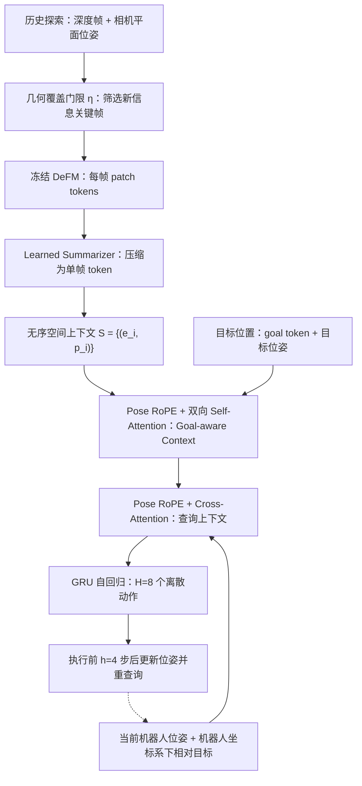
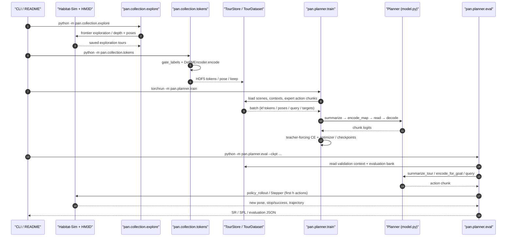

# VNT-PA：基于位姿注意力的视觉导航 Transformer
*Visual Navigation Transformer with Pose Attention*

## 一句话定义

**VNT-PA** 把已探索环境中的**深度关键帧及其相机位姿**组织为无序的空间上下文，用 **Pose RoPE** 令注意力直接利用帧间位姿差，并结合当前位置与目标坐标预测导航动作块，**不需要在规划时先构建显式占据地图/拓扑图**。

## 英文缩写速查

| 缩写 | 英文全称 | 简要说明 |
|---|---|---|
| VNT-PA | Visual Navigation Transformer with Pose Attention | 本文的位姿注意力规划器 |
| RoPE | Rotary Position Embedding | 作用于 Q/K 的旋转位置编码 |
| DeFM | Depth Foundation Model | 冻结的深度帧特征提取器 |
| HM3D | Habitat-Matterport 3D | 室内 3D 扫描场景数据集 |
| SR | Success Rate | 点目标导航成功率 |
| SPL | Success weighted by Path Length | 同时考虑成功与路径效率 |
| GRU | Gated Recurrent Unit | 自回归预测离散动作块 |
| PointGoal | Point-Goal Navigation | 已知目标坐标的导航设置 |

## 核心信息

| 字段 | 内容 |
|---|---|
| 论文 / 版本 | [arXiv:2609.21212v1](https://arxiv.org/abs/2609.21212)（2026-09-18） |
| 作者 | Beiming Li、Jaime Romero、Jonathan Diller、Vijay Kumar、Alejandro Ribeiro |
| 机构 | **宾夕法尼亚大学（University of Pennsylvania）**；GRASP Laboratory / ESE |
| 官方来源 | [第一作者主页](https://beimingli0626.github.io/) 的 VNT-PA 条目 |
| 官方源码 | [beimingli0626/VNT-PA](https://github.com/beimingli0626/VNT-PA)（MIT，可运行训练与评估入口） |
| 任务 | 已探索环境的室内 PointGoal；使用先前采集的深度关键帧、平面位姿和目标坐标 |
| 论文主成绩 | HM3D 验证集 **SR 93.3 ± 1.2% / SPL 90.4 ± 1.1%**（3 个训练种子） |
| 实验环境 | Habitat-Sim、HM3D（800 训练场景 / 100 验证场景） |

## 为什么重要

1. **记忆索引由「何时看见」改为「在哪里看见」。** 时间序列不易并入此前或其他轨迹的观察；位姿集合允许新旧帧直接融合。
2. **空间关系成为注意力的归纳偏置。** 关键帧顺序无关；长程绕行时，位姿差比时间顺序更适合表达空间连通线索。
3. **将深度观测直接用作隐式环境表示。** 与「先融合占据地图，再 A*」区别在于规划器直接读取姿态标记的特征，而非预先栅格化后检索。
4. **对机器人部署的启发是“压缩可复用的几何经验”，不是免定位。** 仍须把当前机器人位姿与记忆中帧位姿放在同一坐标系；与 [State Estimation](../concepts/state-estimation.md)、[导航/SLAM 全栈](../overview/navigation-slam-autonomy-stack.md) 互补。

## 流程总览

依据论文 III-A～III-E（公式 1～7）整理，下图区分**环境经验预处理**与**在线规划查询**：

## 核心原理

### 1. 无序 Pose-indexed Spatial Context

每条经验是深度帧特征与其相机位姿的配对：

\[
\mathcal S=\{(e_i,p_i)\}, \quad p_i=(x_i,y_i,\psi_i).
\]

视觉侧使用冻结 **DeFM ViT-S/14** 得到每帧 16×16 个 patch token（384 维），再由学习的 attention pooling summarizer 汇聚为一个 `e_i`。关键帧过滤以 patch 深度反投影后的**带观察方向体素新增覆盖量**为依据，论文阈值 `η=10`；每条探索轨迹平均由 **313 帧筛成 67 个关键帧**。注意：体素仅用于过滤关键帧，**不是供规划器 A* 使用的显式导航地图**。

### 2. Pose RoPE 的相对空间约束

将注意力 head 的子空间分配给两个平面坐标分量及周期航向角，以 RoPE 旋转 Q/K。对两帧 `i, j`，注意力中与位置有关的部分可写为：

\[
(\mathbf R(p_i)\mathbf q_i)^\top
(\mathbf R(p_j)\mathbf k_j)
=\mathbf q_i^\top \mathbf R(p_j-p_i)\mathbf k_j.
\]

因此位置影响取决于**相对位姿**，对世界坐标的**平移**不变；**不自动对整体旋转不变**，论文靠训练时旋转增强解决。平面位置频率基数 `b=100`、尺度 `s=0.25m`；航向部分采用整数谐波，保证 `2π` 周期。

### 3. Goal-aware Context → Query → Action Chunk

- 把**目标 token**（附目标坐标，无航向）与空间集合交给 **6 层双向 self-attention**，构造面向目标的空间记忆。
- 用**当前位置**和**机器人坐标系下的相对目标距离/方向**构造查询 token，经 **4 层 cross-attention** 读取空间记忆。
- **自回归 GRU** 输出 `forward / turn-left / turn-right / stop` 中的 8 步动作序列；每次只执行前 4 步，再定位并重规划。
- **重要限定：** 标准评测查询**不需要当前帧图像**。论文的「在线添加当前帧」是独立的**测试时上下文扩展**实验，不能反写成标准模型每步必摄像。

### 4. 最短路专家模仿学习

在 **Habitat-Sim 真值导航网格**上由最短路专家生成目标动作序列；训练对 8 步动作块做 teacher-forcing 交叉熵，随机旋转坐标系并给关键帧/机器人位姿注入噪声。论文 30,000 训练步、单 L40S 约 **4 小时**；模型 **74.3M 可训练参数**。这些是论文环境的报告值，非本仓实测。

## 评测与对照

### 主实验（论文表 I，3 seeds，HM3D 2220 个闭环任务）

| 方法 | SR ↑ | SPL ↑ |
|---|---:|---:|
| **VNT-PA** | **93.3 ± 1.2** | **90.4 ± 1.1** |
| VNT-TA（时间 RoPE） | 87.1 ± 3.5 | 83.9 ± 3.8 |
| VNT-PF（位姿仅作特征） | 89.5 ± 0.3 | 86.5 ± 0.4 |
| Causal Transformer | 90.3 ± 0.5 | 87.3 ± 0.5 |
| VNT-PA（只有位姿、无深度特征） | 66.4 ± 0.8 | 62.8 ± 0.8 |

**≥15m 长路径**的 SPL 为 VNT-PA **82.0** vs VNT-TA **64.9**（+17.1 点）。训练达到 80% SPL：VNT-PA 约 **5000 步以内**，比较的其它 Transformer 基线需要 **>20000 步**。

### 测试时扩充与噪声（论文表 II、III，单 seed；不可与表 I 混淆）

- **加入历史全帧 + 在线当前视图**：SR/SPL 从关键帧基线 **94.6/91.7** 提到 **97.1/94.0**（测试时直接扩充输入，未重新训练）。
- **带噪关键帧**：`±0.1m`、`±0.2rad` 的设置下，OctoMap + A* SR **96.2→54.1**，VNT-PA **94.6→86.6**。这是该噪声模型和数据条件下的比较，不能推广为所有真实定位漂移情形。
- **推理成本**：作者报告一张 L40S，300 帧上下文单次 Planner 调用约 **14ms**；冻结 DeFM 的编码约 3.6ms/帧且可离线预处理，不能混成整套部署端到端时延。

## 结论

**VNT-PA 证明：在已探索且可定位的环境中，姿态标记的深度关键帧集合可以直接成为学习式路径规划器的有效几何记忆；Pose RoPE 比单纯时间排序更利于长程路径推断。**

- 若目标是**重访环境的 PointGoal**，优先考虑复用带位姿的历史观察；跨轨迹追加新帧无需重新定义时间索引。
- **Pose RoPE 是关键变量**：相同视觉特征与近似架构下，VNT-PA SPL **90.4**，时间 RoPE **83.9**，位姿作为特征 **86.5**。
- **深度几何不可省**：只保留相机位姿时 SR 降至 **66.4**，说明其不是单纯沿关键帧轨迹跟随。
- 对带噪定位的鲁棒性优势需限定在论文的独立位姿扰动设定；真实系统的持续漂移、重定位和动态障碍尚未覆盖。
- **不是开箱即用的 ROS2/Nav2 替代品**：仍需外部定位、数据准备、动作接口与碰撞安全栈；公开代码可做 Habitat-Sim 复现。

## 源码运行时序图

依据 [官方 README](https://github.com/beimingli0626/VNT-PA/blob/main/README.md) 与已读 `collection/explore.py`、`tokens.py`、`planner/dataset.py`、`model.py`、`train.py`、`eval.py` 的入口及调用关系；这是**静态源码核查，不表示已执行复现实验**。

复现时 `pan.collection.bank` 需在验证集 `explore/tokens` 完成后生成 episode bank，再进入 `train / eval`；完整命令、路径与依赖见 [源码归档](../../sources/repos/vnt-pa.md)。

## 工程实践

| 步骤/指标 | 具体建议 |
|---|---|
| 依赖环境 | README 指定 Linux/NVIDIA、Python 3.10、PyTorch 2.5.1 CUDA 12.1、Habitat-Sim 0.3.3 headless/Bullet |
| 数据/权重 | 获取 **HM3D v0.2**（整套约 240GB）；首用从 `leggedrobotics/defm` 拉取 DeFM；未核实有可下载的 VNT-PA 预训练 checkpoint |
| 数据流水线 | `pan.collection.explore` → `pan.collection.tokens` → `pan.collection.bank`（验证） |
| 训练与测试 | `torchrun -m pan.planner.train`；`python -m pan.planner.eval` 或 `eval_accum` 检查测试时加帧 |
| Debug 指标 | `SR/SPL`、长程 `≥15m` 分组、keyframe 数量、不同 `η` 下召回与性能、`kf-noise-pos/yaw` / `query-noise-pos/yaw` |
| 坐标系 | 论文用平面 `(x,y,ψ)`；实现里惯用 Habitat 的地面 `(x,z,yaw)`。对接 ROS `map/odom/base_link` 时必须显式换轴 |
| 开源边界 | **可运行源码已发布（MIT）**；独立训练出的模型权重与本地实测成绩并未在本次核实，不能直接宣称零配置可用 |

## 局限与风险

- **规划是二维**且相机高度近似固定；不覆盖楼梯、飞行、立体障碍绕行的完整 `SE(3)` 规划。
- **动作空间离散**，未在真实机器人连续速度/力矩环节、动态障碍、人机混行中验证。
- **先验定位依赖**：前序帧的相机位姿与实时机器人位姿必须配准在同一参考系；并未解决 SLAM 的重定位与累积漂移。
- **非语义导航**：输入只用深度几何，不是根据自然语言或 RGB 语义目标的 VLN/VLA。
- **评测口径**：表 I 为三种子均值，表 II、III 是单种子、指定扰动条件；不要拿不一致设定直接横比。
- **源码验证范围**：已读论文全文及官方 README/关键脚本，尚未安装、跑通 240GB 数据准备或复现指标。

## 关联页面

- [导航·SLAM·自动驾驶开源栈总览](../overview/navigation-slam-autonomy-stack.md) — 相对显式地图 + Nav2/A* 的学习式规划路线。
- [State Estimation](../concepts/state-estimation.md) — 关键帧/机器人位姿处于共同坐标系的前提。
- [SE(3) 表示](../formalizations/se3-representation.md) — 本文二维位姿与全 3D 相对变换的差别。
- [Vision-Language Navigation](../tasks/vision-language-navigation.md) — 与语义目标、视觉语言导航方法分开比较。
- [Navigation2](./navigation2.md) — ROS 2 经典导航栈（工程接口对照）。

## 参考来源

- [VNT-PA 一手论文全文章节摘录](../../sources/papers/vnt-pa_arxiv_2609_21212.md)
- [VNT-PA 作者主页与官方代码链接核验](../../sources/sites/beimingli-vnt-pa.md)
- [VNT-PA 官方源码入口与模块核查](../../sources/repos/vnt-pa.md)
- Li et al., *Visual Navigation Transformer with Pose Attention*, arXiv:2609.21212v1：<https://arxiv.org/html/2609.21212>
- 官方代码：<https://github.com/beimingli0626/VNT-PA>（静态读取 2026-11-08）

## 推荐继续阅读

- 原论文完整 HTML：<https://arxiv.org/html/2609.21212>
- 官方代码运行手册：<https://github.com/beimingli0626/VNT-PA#readme>
- Habitat-Matterport 3D 数据集入口：<https://aihabitat.org/datasets/hm3d/>
