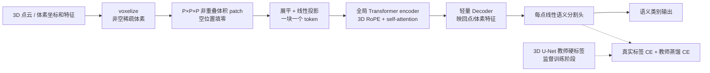
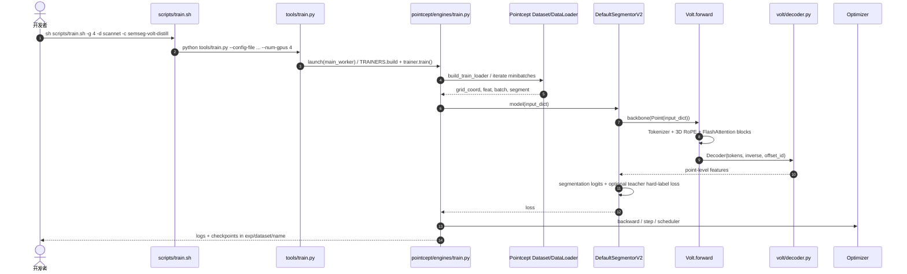

# Volt（Volume Transformer）：用于三维场景理解的标准 Transformer 骨干

## 一句话定义

**Volt（Volume Transformer: Revisiting Vanilla Transformers for 3D Scene Understanding）** 将 3D 点云体素化成**非空立方 patch tokens**，交给带 **3D RoPE** 的标准全局自注意力 Transformer 编码，并以轻量解码器恢复细粒度分割特征。论文为 [ECCV 2026 Long Oral](https://yilmazkadir.github.io/Volt/)（arXiv:2604.19609v2），已开放官方实现与权重；与基于它的 [VINO 自监督方法](./paper-vino.md) 是**两篇独立研究**。

## 英文缩写速查

| 缩写 | 英文全称 | 简要说明 |
|---|---|---|
| Volt | Volume Transformer | 基于体积 patch token 的 3D 全局 Transformer |
| RoPE | Rotary Position Embedding | x/y/z 三轴旋转位置编码 |
| ViT | Vision Transformer | 本工作借鉴其单尺度编码器 |
| PTv3 | Point Transformer V3 | 对照用局部注意力/多分辨率 3D 骨干 |
| CNN | Convolutional Neural Network | 用于提供分割硬标签的 3D U-Net 教师 |
| mIoU | mean Intersection over Union | 语义分割指标，不等于实例分割 mAP |

## 为什么重要

- **结构简单：** 由 3D patch token + 全局 Transformer 构成，不依赖层级稀疏卷积编码器。
- **训练 recipe 比架构口号重要：** 在训练数据不足时，Volt 比 PTv3 更易过拟合；增强/正则/监督蒸馏后才显著提升。
- **可承接 3D 自监督：** [VINO](./paper-vino.md) 用 Volt 单尺度特征做 dense SSL；Volt 原论文本身是监督分割方法。
- **运行更可控：** 官方 Pointcept-based 仓库提供配置、代码、训练 shell 命令与 Hugging Face checkpoint。

## 核心信息

| 项 | 内容 |
|---|---|
| 机构 | 亚琛工业大学（RWTH Aachen University）；埃因霍温理工大学（Eindhoven University of Technology） |
| 论文 | [arXiv:2604.19609v2](https://arxiv.org/html/2604.19609) |
| 会议 | ECCV 2026 Long Oral（作者项目页明确标注） |
| 项目页 | [Volt](https://yilmazkadir.github.io/Volt/) |
| 开源 | **已开源**：[YilmazKadir/Volt](https://github.com/YilmazKadir/Volt)（MIT）与 [Hugging Face 权重](https://huggingface.co/KadirYilmaz/Volt) |

## 核心原理

### 流程总览

**与传统点 Transformer 的差异：** Volt 为非空体积 patch 建 token，注意力直接覆盖整张场景的 patch 序列；没有 PTv3 的多层 U-Net 样式局部 group。训练时另用 3D CNN 教师的 hard labels 进行**监督蒸馏**，推理不保留该教师。

### 训练配方与公式

- **增强与正则：** 强 3D 随机增广 + stochastic depth、AdamW weight decay、label smoothing。
- **监督蒸馏：** 用 3D U-Net 对同一增强场景产生的硬类别预测作为 distillation head 监督，并以真实类别监督 segmentation head；原文损失为 **0.5 × 分割 CE + 0.5 × 教师 CE**。
- **增加数据：** 室内 RGB-D 数据联合、室外 LiDAR 数据联合；不同语义空间保留各 dataset 分类头。
- **位置编码：** 3D 轴向 RoPE，对离散 token 坐标施加旋转编码；论文优于 Fourier PE。
- **patch 权衡：** 以 P=5 作为精度/速度折中，而不是“patch 越大越好”。

## 实验与评测

原文主表与官方 README 的部分预处理版本略有差异；下表**使用官方仓库 README 的模型实验目录 mIoU（val）**，不与论文测试集或 VINO 的 frozen-linear-probe 分数混比。

| 训练协议 / 模型 | ScanNet | ScanNet200 | nuScenes | Waymo |
|---|---:|---:|---:|---:|
| 单数据集 Volt-S | 77.3 | 36.1 | 81.1 | 71.2 |
| 联合训练 Volt-S | 80.2 | 38.5 | 81.8 | 72.5 |
| 联合训练 Volt-B | 80.5 | 40.0 | 82.2 | 73.7 |

- **配方消融（论文 Figure 3 / ScanNet200）：** naive 31.0 → 强增强 32.9 → 正则 34.1 → CNN 蒸馏 36.2 → 扩数据 38.1 → 扩模型 40.0 mIoU。
- **patch 消融（论文 Table 5）：** P=3、5、7 对应 ScanNet200 **37.7 / 36.2 / 33.5 mIoU**，速度分别 **67 / 27 / 26 ms**（论文测试环境）。
- **效率：** 在论文 ScanNet 基准测试条件下，Volt-B 比 PTv3-S 约 **2× 快、显存低 38%**；不能无条件套用于任意 GPU。

## 与其他工作对比

| 方法 | 区别 |
|---|---|
| [VINO](./paper-vino.md) | **基于 Volt 的 3D 场景自监督预训练**；不能将它的无标签线性探测结果记作 Volt 监督实验 |
| PTv3 | 分层、局部注意力、强 3D 归纳偏置；Volt 单尺度 global attention 更能从扩展监督中受益 |
| MinkUNet | 稀疏卷积主干；Volt 骨干 token 化后主要使用 standard Transformer 算子 |
| [DINOv2](./paper-dinov2.md) | 2D 预训练的代表；Volt 是 3D 骨干，VINO 则是 3D SSL 训练法 |

## 结论

**Volt 的贡献是证明简单全局 Transformer 也能成为实用 3D 骨干，但精度来自恰当的 patch/token 设计、监督蒸馏及更多训练数据，而不是“全局注意力必胜”。**

- **结构复现：** 先核对 voxel size、P=5 patch 分块、3D RoPE、Decoder 的 reverse mapping。
- **监督设置：** teacher weights + dataset labels 是原论文 recipe，不属于无标签 SSL。
- **公平比较：** 固定数据和 val/test split，再比较同规模 PTv3；勿混入 VINO 的 linear probing。
- **复现优先级：** 使用发布的 config 和 HF checkpoint 核对指标，再开展自主训练。
- **具身边界：** 静态点云分割基准不是 SLAM 几何占据推断，也未证明机器人控制延迟。

## 工程实践

| 项 | 建议 |
|---|---|
| 环境 | 官方 README 以 CUDA 12.6 + `uv sync` 安装，额外依赖具体 dataset preprocessing |
| 预处理 | 按 Pointcept 约定；nuScenes/Waymo 使用 repo 内专用脚本 |
| 训练入口 | `sh scripts/train.sh -g 4 -d scannet -c semseg-volt-distill -n semseg-volt-distill` |
| 模型路径 | `pointcept/models/volt/volt_base.py`（Tokenizer / Block / Volt.forward） |
| 公开状态 | 代码 MIT + HF checkpoint，**已公开**；数据集不由该仓统一打包分发 |
| 与 VINO 的关系 | 该仓库不能直接运行 VINO 的自监督训练；VINO 独立仓库尚未发布实现 |

## 源码运行时序图

**源码依据：** [train.sh](https://github.com/YilmazKadir/Volt/blob/main/scripts/train.sh) → [tools/train.py](https://github.com/YilmazKadir/Volt/blob/main/tools/train.py) → [Trainer.run_step](https://github.com/YilmazKadir/Volt/blob/main/pointcept/engines/train.py) → [DefaultSegmentorV2](https://github.com/YilmazKadir/Volt/blob/main/pointcept/models/default.py) → [Volt.forward](https://github.com/YilmazKadir/Volt/blob/main/pointcept/models/volt/volt_base.py)。如配置换成不带 teacher 的实验，时序中的蒸馏分支不启用。

## 局限与风险

- **监督依赖：** 原论文需人工语义标签与教师预测；不要误写“无标签学会 3D 语义”。
- **资源：** 全局注意力随非空 patch 数增长，极大场景或微小 voxel 会增加显存与时延；README 推荐 CUDA、GPU 环境。
- **场景分布：** 扩展数据有效但跨域不是无条件成立；室内/外用不同模型、语义标签头。
- **语义 ≠ 距离场：** 分割精度不直接保证机器人避障、实时 occupancy / ESDF 质量。
- **版本差异：** arXiv v2 论文数值与后续 README 模型 zoo 可能不同，必须保留指标来源与验证/测试 split。

## 关联页面

- [机器人视觉感知栈选型闭环](../queries/robot-perception-stack-selection-loop.md) — 按语义/实例分割需求选择 3D 骨干，并核对地图接口与部署延迟。
- [VINO：三维自监督表征学习](./paper-vino.md)
- [DINOv2：2D 自监督表征](./paper-dinov2.md)
- [具身感知六种空间表征](../concepts/embodied-perception-six-spatial-representations.md)
- [视觉表征作为策略输入](../concepts/visual-representation-for-policy.md)

## 参考来源

- [Volt 原始论文与代码核对](../../sources/papers/volt_arxiv_2604_19609.md)
- [Volt 官方项目页](../../sources/sites/volt-project.md)
- [Volt 官方源码入口](../../sources/repos/yilmazkadir-volt.md)
- [arXiv HTML 原文 v2](https://arxiv.org/html/2604.19609)

## 推荐继续阅读

- [Volt 作者主页与图示](https://yilmazkadir.github.io/Volt/)
- [官方 GitHub 实现](https://github.com/YilmazKadir/Volt)
- [Hugging Face 实验与权重](https://huggingface.co/KadirYilmaz/Volt)
