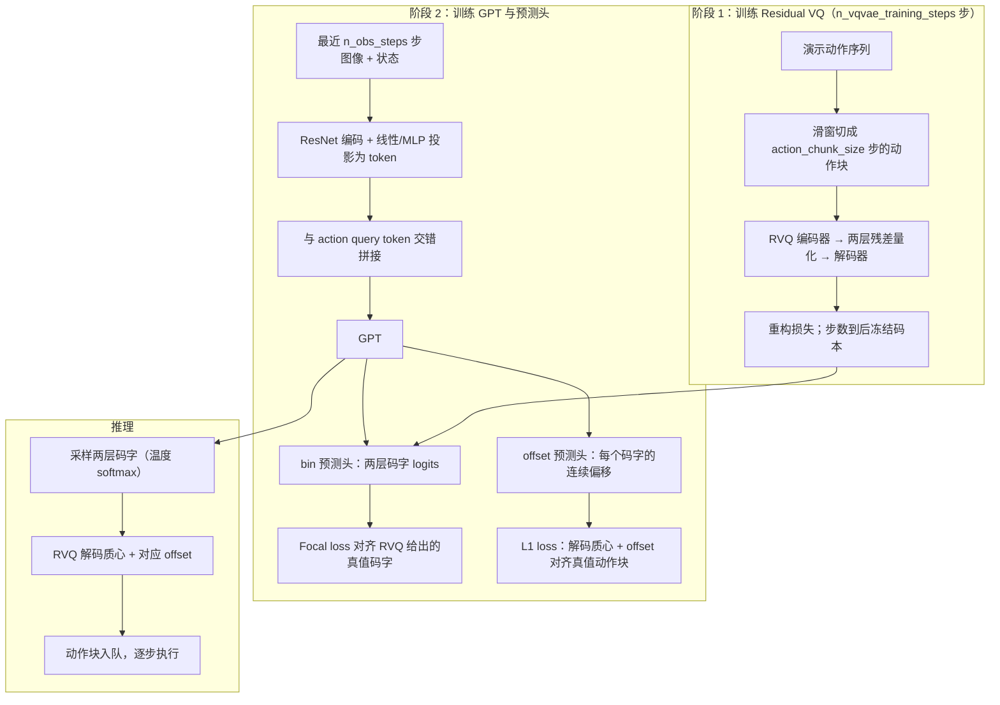
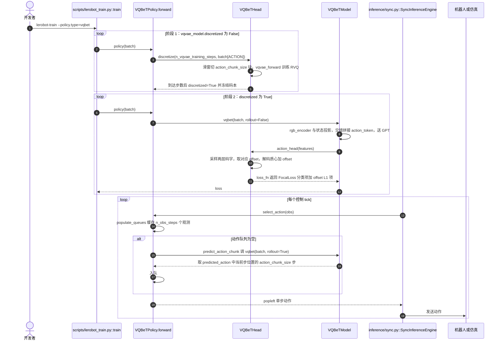

# VQ-BeT：用潜在动作码字做行为生成

**VQ-BeT**（*Behavior Generation with Latent Actions*，[arXiv:2403.03181](https://arxiv.org/abs/2403.03181)，[项目页](https://sjlee.cc/vq-bet/)，[官方代码](https://github.com/jayLEE0301/vq_bet_official)）是 Lee、Wang、Etukuru、Kim、Shafiullah、Pinto 等人在 ICML 2024 发表的模仿学习策略，是 LeRobot README「模仿学习」类里的 **VQ-BeT**。本页依据 arXiv PDF 与 LeRobot 固定提交 `9e5ee98` 的 `policies/vqbet/` 源码；官方仓库源码本次未读。

## 一句话定义

**VQ-BeT 先用 Residual VQ-VAE 把连续动作 chunk 压成两层离散码字，再让 GPT 式 Transformer 预测「码字 + 连续 offset」，一次前向就能采样出多峰动作。**

## 英文缩写速查

| 缩写 | 英文全称 | 简要说明 |
|------|----------|----------|
| VQ-BeT | Vector-Quantized Behavior Transformer | 本方法 |
| BeT | Behavior Transformer | 前作，用 k-means 离散化动作 |
| VQ-VAE | Vector-Quantized Variational Autoencoder | 带离散码本的自编码器 |
| RVQ | Residual Vector Quantization | 多层残差量化，本文用 2 层 |
| GPT | Generative Pre-trained Transformer（此处指 minGPT 式因果 Transformer） | 序列骨干 |

## 为什么重要

- 论文指出 BeT 的 k-means 动作离散化在高维动作或 action chunk 上难扩展，且没有梯度；VQ-BeT 用可学习的层级量化替换它。
- 单次前向（无迭代去噪），论文称相对多步扩散模型仿真中快 5 倍、真机上快 25 倍（作者表述，见 §1）。
- 在 LeRobot 里是少数「离散码字 + 连续 offset」路线的策略，与 [ACT](./paper-act.md)（CVAE 回归）、[Diffusion Policy](./paper-diffusion-policy.md)（去噪）形成三种动作生成对照。

## 流程总览

图依据：论文 §3.2–3.3（Fig.2）与 LeRobot `modeling_vqbet.py` 中 `VQBeTHead.discretize` / `VQBeTModel.forward` / `VQBeTHead.loss_fn`。

## 核心方法

- **动作离散化（§3.2）：** 用 Residual VQ-VAE，论文实验中 2 层残差量化即够用；第一层量化输入向量，残差再送下一层，量化结果为各层码字向量之和。直觉上第一层码字做粗聚类，第二层补细节。
- **预测（§3.3）：** 训练好 RVQ 后，GPT 式 Transformer 以观测序列为条件，对各层码字做分类（Lcode），同时预测连续 offset（Loffset）修正量化误差，总损失 L = Lcode + Loffset。
- **条件与非条件（§3.4）：** 同一模型既可做目标条件（额外输入目标观测）也可做非条件行为生成。LeRobot 实现里没有目标条件输入分支（`VQBeTModel.forward` 只用图像与状态，推断，未逐行核对所有路径）。
- **执行方式：** 论文在真机上因 receding horizon 对其低成本机器人失效，所有策略完全闭环执行（§5）；LeRobot 的 `select_action` 则是一次预测 `action_chunk_size` 步后逐步出队。

## 评测

- 本页**未搬运**论文的完整成功率表；只记录读到的结论性表述：七个环境（含仿真操作、自动驾驶 nuScenes、真机，摘要称 seven environments）上 VQ-BeT 优于 BeT 与 Diffusion Policy 等基线（摘要）；真机长时程任务上较此前工作提升 73%（§1，作者表述，未核对原表）。
- 消融（正文）称 offset 预测对性能重要，residual VQ 相比普通 VQ 提供更强表达力；附录 B.1 称把码本组合数扩大 10 至 250 倍对性能影响很小。
- 推理速度结论受执行方式影响：真机的 25× 差距建立在「所有策略都完全闭环」之上，若 Diffusion Policy 用 receding horizon 则差距会小很多（论文 §5 的说明，推理）。

## 结论

**VQ-BeT 用「RVQ 码字 + offset」把多峰动作建模变成分类问题，换来单次前向的低延迟；代价是两阶段训练和对 RVQ 质量的依赖。**

- 想要比扩散策略更低的推理延迟、又要保留多峰性时，它是 LeRobot 里的候选
- 两阶段训练：先 `n_vqvae_training_steps`（默认 20000）步训练 RVQ，再训练 GPT；评估前 RVQ 必须已完成离散化，否则 `select_action` 会警告
- 动作块与观测历史都偏短（LeRobot 默认 `action_chunk_size=5`、`n_obs_steps=5`），与 ACT 的 100 步 chunk 取向不同
- 官方源码与论文超参未逐条与 LeRobot 默认值核对，迁移结果前请先对照 Table 13（论文超参表）

## 源码运行时序图

以下节点来自 LeRobot 固定提交 `9e5ee98`（路径相对 `src/lerobot/`），已对照 `policies/vqbet/modeling_vqbet.py`、`configuration_vqbet.py`、`scripts/lerobot_train.py`、`inference/sync.py`。

官方原仓库 `jayLEE0301/vq_bet_official` 的入口脚本本次未读，故不另画；不要把上图当作官方实现的时序。

## LeRobot 实现要点

- **身份核对：** `docs/source/policy_vqbet_README.md` 给出项目页 `sjlee.cc/vq-bet/` 与 BibTeX（arXiv:2403.03181）；`policies/vqbet/modeling_vqbet.py` 注释直接引用论文 §3.2 与 BeT 论文 §2.2。arXiv 摘要页核对标题、作者与日期与此一致。
- **默认配置（`configuration_vqbet.py` 读到的值）：** `n_obs_steps=5`、`n_action_pred_token=3`、`action_chunk_size=5`；ResNet-18（ImageNet 预训练，裁剪 84×84）+ SpatialSoftmax；RVQ 码本 `vqvae_n_embed=16`、`vqvae_embedding_dim=256`；GPT 8 层 8 头、`gpt_input_dim=512`；`offset_loss_weight=10000`、`primary_code_loss_weight=5`、`secondary_code_loss_weight=0.5`；`bet_softmax_temperature=0.1`；`optimizer_lr=1e-4`。
- **RVQ 层数固定为 2：** 源码注释写明 `vqvae_num_layers` 固定为 2（与论文 Nq=2 一致）。
- **限制：** 要求有 `observation.state`（缺失时抛 `ValueError`）与图像输入；没有语言条件；评估前 RVQ 必须已训练完（`select_action` 里的警告）。
- **训练入口复用通用脚本：** 两阶段不是两个命令，而是 `VQBeTPolicy.forward` 内部按 `discretized` 标志切换。

## 局限与风险

- 两阶段训练：RVQ 质量决定上限，码本使用情况可用 `n_different_codes` 等指标观察（`VQBeTPolicy.forward` 返回）。
- 论文自述的 25× 推理加速依赖其真机闭环设定，换成其他部署方式不能直接套用。
- 本页未核对官方仓库与 LeRobot 在细节（如 offset 初始化、GPT 结构）上的差异。

## 与其他工作对比

| 工作 | 动作表示 | 生成方式 |
|------|----------|----------|
| VQ-BeT（本页） | 两层 RVQ 码字 + 连续 offset | 单次前向分类采样 |
| [ACT](./paper-act.md) | 连续 chunk | CVAE + Transformer 回归 |
| [Diffusion Policy](./paper-diffusion-policy.md) | 连续轨迹 | 多步去噪 |
| BeT（前作，本库无独立页） | k-means 码字 + 连续 offset | 单次前向分类 |

## 关联页面

- [Action Chunking](../methods/action-chunking.md)
- [Diffusion Policy 方法页](../methods/diffusion-policy.md)
- [滚动预测执行](../concepts/receding-horizon-policy-execution.md)
- [ACT](./paper-act.md)
- [Diffusion Policy](./paper-diffusion-policy.md)
- [LeRobot](./lerobot.md)

## 参考来源

- [vq_bet_arxiv_2403_03181](../../sources/papers/vq_bet_arxiv_2403_03181.md)
- [lerobot](../../sources/repos/lerobot.md) — 固定提交 9e5ee98 的 `policies/vqbet/` 与文档
- [arXiv:2403.03181](https://arxiv.org/abs/2403.03181)
- [项目页](https://sjlee.cc/vq-bet/)
- [LeRobot VQ-BeT 文档](https://github.com/huggingface/lerobot/blob/9e5ee9859480e425a97a6836bb3fee479539beb5/docs/source/policy_vqbet_README.md)
