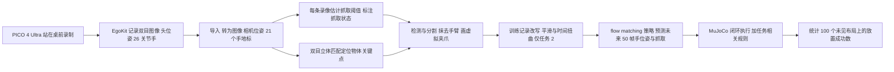

# VREgo（arXiv:2611.07272）

**VREgo**（*VREgo: Consumer VR Headsets for Learning Robot Manipulation from Egocentric Demonstrations*，[arXiv:2611.07272](https://arxiv.org/abs/2611.07272)，v1，2026-11-05，cs.RO）：用消费级 VR 头显 PICO 4 Ultra 录制第一视角示范，沿用 [HumanEgo](./paper-sa-2605-24934-humanego-zero-shot-robot-learning-from-minutes-o.md) 的示范表示与策略，把采集换成头显设备端追踪加双目立体定位，并在 MuJoCo 仿真里评测。作者：Liuchuan Yu（单作者，首页仅给邮箱 liuchuany@acm.org，**论文首页未写机构**）。

## 一句话定义

**一条「消费级头显 → 第一视角示范 → 抹去手臂并画虚拟夹爪的训练图像 → 操作策略」的采集与训练管线；相对 HumanEgo 改了采集设备、物体定位（双目）、预处理细节与两步任务的执行规则，全部结果来自仿真。**（论文摘要与 §1）

## 英文缩写速查

| 缩写 | 英文全称 | 简要说明 |
|------|----------|----------|
| VR | Virtual Reality | 虚拟现实头显，这里用其设备端头手追踪与 see-through 相机 |
| PICO 4 Ultra | — | 本文采集设备；两个 see-through 相机相距 64 mm（§1） |
| EgoKit | — | 作者团队的第一视角采集工作流，记录双目图像、头位姿与 26 关节手追踪（§1、§3.2；论文称其修订稿未发表） |
| HumanEgo | — | 本文参照：手轨迹 + 物体关键点 + 去臂图像（§1） |
| Aria / MPS | Project Aria / Machine Perception Services | Meta 眼镜与其云端位姿估计服务，作为对照设备（§1、Table 1） |
| SLAM | Simultaneous Localization and Mapping | 同步定位与建图，Aria 的头位姿来自 MPS SLAM |
| OpenXR | — | 头显的开放接口标准，输出 26 个手关节（§3.2） |
| SAM 2 | Segment Anything Model 2 | 分割模型，VREgo 用其视频模式在关键帧间传播掩码（§3.5） |
| Grounding DINO | — | 开放词汇检测器，与 SAM 2 一起检测并分割物体和手臂（§3.1） |
| CoTracker3 | — | 点跟踪器，用于追踪物体上的 20 个关键点（§3.1） |
| MuJoCo | Multi-Joint dynamics with Contact | 物理仿真，本文用 Trossen WidowX AI 机械臂模型评测（§3.6） |

## 为什么重要

- **作者自述的动机：** 头戴相机录示范不需要操作者遥操作机器人；消费级头显在设备端追踪头和双手，部分机型开放 see-through 相机，是 Aria 眼镜之外的另一种采集形态（§1）。
- **论文给出的实证价值：** 41 条任务 1 录像存储 PICO 1.3 GB 对 Aria 15 GB，且 PICO 录完即可处理、Aria 须上传 MPS（§5.5、Table 1）；任务 2 的物体靠双目定位，头部在物体窗口内仅移动中位 0.8 cm，因此无需走近（§3.4）。
- **阅读价值（我的判断）：** 论文用不少篇幅诊断「模仿学习策略为何到不了第二步」（重规划使释放被推迟、张开的夹爪先碰到物体），这类失败分析对其他示范到策略的管线有参考价值；但这是仿真中的诊断，不能当作真机结论。
- **周报说法核对（具身运控lab，Y21u 周报）：** 「使用 PICO 4 Ultra 等消费级头显记录头部、手部和物体运动」与论文相符，但论文只用了 PICO 4 Ultra 一款头显，结论部分明确说需要「其他头显」的验证，「等」字过宽；「物体运动」不是头显直接记录的，而是由双目图像经检测、跟踪和立体匹配算出（§3.1、§3.3）。「分析动作重规划和夹爪接触对执行结果的影响」与 §5.3 相符。周报「机构待核实」：论文首页仅有邮箱，无机构信息。

## 核心机制

### 流程总览

### 表示与策略（§3.1，继承自 HumanEgo）

- 抓取标签来自拇指与食指指尖距离（参照配置为小于 10.5 cm 记为闭合）；Grounding DINO 与 SAM 2 检测并分割物体和手臂；每个物体取 20 个轮廓关键点，用 CoTracker3 跟踪并三角化；手臂用图像修复去除，在手的位置画虚拟夹爪；flow-matching 策略以图像加手和物体的 token 为输入，预测未来 50 帧手位姿与抓取状态，机器人夹爪闭环跟随。

### 与参照的差异（§1 四点）

| 差异 | 做法 | 论文数据 |
|------|------|----------|
| 采集设备 | PICO 4 Ultra，设备端头手追踪，EgoKit 记录 | 左眼缩放到 640×480、30 fps；Aria 为 640×480 去畸变 90 度（Table 1） |
| 物体定位 | 在三角化时为每个视角加入另一只眼的同时刻图像，沿极线做归一化互相关匹配 | 静止点重复性 1.1~4.3 mm，对比仅靠头动 9~925 mm（§3.3） |
| 数据采集 | 站在桌前开录，无走近 | 任务 2 物体窗口内头部中位移动 0.8 cm（0.3~1.9），任务 1 的 PICO 为 6.0 cm，Aria 为 36.5 cm（§3.4） |
| 执行 | 两步任务重写训练记录、加执行规则 | 见下文「两步堆叠」 |

### 导入一致性检验（§3.2）

作者把 HumanEgo 发布的一条录像改写成 EgoKit episode 走 PICO 路径：相机位姿、手帧、抓取标签、阶段和物体位姿与 Aria 路径一致（报告精度 0.00 mm 和 0.00 度），864 张训练帧完全相同，仅重建的掌心朝向不同（中位 0.61 度，且不进入训练目标）。注意这检验的是**格式转换**，不是两种设备真实追踪质量的比较。

### 管线改动（§3.5、Table 2）

- **每条录像单独的抓取阈值：** 本操作者张开手在 PICO 上读 7.6~9.6 cm，握持读 2.1~6.5 cm；取指尖距离的开合两态分割（引用 Otsu），阈值取两态中点；主数据集阈值范围 PICO 5.9~8.4 cm、Aria 8.3~9.0 cm。固定阈值下 9 条试飞录像里只有 7 条每步标签正确闭合一次，每条单独估计后 11 条试飞录像全部正确（Table 2）。
- **释放后重新定位被搬运物体：** 参照把物体放在手标签打开时的位置，12 次试飞持握中物体落点与相机所见相差 0.3~2.8 cm（中位 1.5）；改后相差中位 0.3 cm（块）和 0.2 cm（方块）（§5.2）。
- **视频分割：** 关键帧检测加 SAM 2 视频传播，task-2 take 000 分割耗时 455 s 降为 114 s（Table 3）。作者也试了 SAM 3.1（488 s，在 38 条中有 9 条手臂掩码与默认差异大），**未采用**。
- **修复参照代码缺陷：** 批处理丢后续录像、抓取输出解码、NumPy 兼容、MPS 手位姿晚 1~2 帧配对（Table 2）。

### 仿真评测与回放检查（§3.6）

- 以 MuJoCo 和 Trossen WidowX AI 机械臂实现模板的相机、手臂和感知接口；仿真提供物体掩码并渲染不含手臂的场景。
- 参照论文已发布策略在其自己任务上放置成功 47/61（77%），作为仿真闭环的合理性检查；用模板默认抓取阈值时为 0/21。
- 每条示范训练前过「质量门」，并让仿真机械臂回放该示范自己的手路径（replay），衡量记录轨迹能否转移到仿真夹爪。

## 实验与结果

### 任务设置（§4）

- 任务 1：5 cm 绿色立方体放到白色托盘（26×18 cm）上。任务 2：红色 LEGO 积木先放到托盘，再把立方体放到积木凸点上，第二步要求落在约 ±2 cm 内。物体都必须正对桌沿。
- 41 个布局固定种子，一名操作者录全部。任务 1 用 PICO 与 Aria 各录一遍；任务 2 仅用 PICO，且无走近，两次共约两小时。
- 训练沿用参照配方（400 epoch），用 take 000 之后的前 10 / 20 / 40 条，take 000 留作验证；任务 1 的 40 条策略有三个种子，其余只有一个种子。评测为 100 个录制中没出现的布局，最多 110（任务 1）或 170（任务 2）个策略步。

### 任务 1：设备对比（§5.1、Table 4、Fig.4）

| 40 条示范 / 种子 | 7 | 8 | 9 |
|------|------|------|------|
| PICO 放置成功（/100 未见布局） | 67 | 74 | 60 |
| Aria 放置成功 | 73 | 78 | 0（第一步即宣告任务完成） |

- 成对符号检验：种子 7 PICO 独成功 16 对 Aria 22，p=0.42；种子 8 为 12 对 16，p=0.57。
- 10 条示范时 Aria 领先（59 对 35，各一个种子）。20 或 40 条时除 Aria 种子 9 外为 60~78。
- 通过全部质量门的录像数：PICO 33，Aria 39；回放放置成功 PICO 29，Aria 33。
- **作者自己的解读：** 种子数少，限制设备间差异的结论。

### 任务 2：两步堆叠（§5.2~5.4、Table 4~6）

| 阶段 | 积木上托盘 / 两步都成功（/100） |
|------|------|
| 基线策略，10 / 20 / 40 条示范 | 28 / 71 / 94；0 / 3 / 2 |
| 重写记录重训，循环不变 | 两步 18.0 |
| + 承诺释放 | 24.8 |
| + 对齐抓取并等待 | 33.0 |
| + 放置规则 | 71.0 |
| + 够取规则 | 78.0 |
| + 从上方接近 | 93.8（SD 1.9，四个噪声种子 91 / 95 / 95 / 94） |

两个失败原因（§5.3）：

1. **重规划推迟释放：** 40 条基线策略在探查的布局里，闭合时 155 个预测块中 144 个含释放，总在第 48 步；循环每次只执行 8 步，手静止所以下一次观测相同，释放始终不来。
2. **抓取前接触：** 回放中方块放到积木上的仅 8/41，而真实录像里每条结束时都是方块在积木上；闭合时方块已被张开的夹爪推动中位 1.5 cm，22 次被检查的抓取中 16 次超过 1 cm。

### 成本（§5.5）

PICO 录像无需上传，任务 1 的 41 条存储 1.3 GB 对 Aria 15 GB；预处理每条中位 8.3 / 9.0 / 12.8 min（PICO 任务 1 / Aria / PICO 任务 2），40 条示范训练 5.2~5.3 h（任务 1）、8.8 h（任务 2）。

## 结论

**VREgo 说明消费级头显可以替代 Aria 眼镜录制第一视角示范、且存储与处理更省，但全部结论来自仿真；两步堆叠的 93.8% 主要来自在评测布局上开发的执行规则，不是数据采集本身的收益。**

1. **设备对比看任务 1 的成对检验**：40 条示范下 PICO 与 Aria 差异不显著（p=0.42、0.57），只有三个种子且 Aria 种子 9 退化为 0（§5.1、Table 4）；不足以判断哪种设备更好。
2. **纯数据侧收益看 2 → 18.0**：任务 2 只改训练记录、循环不变即从 2 升到 18.0；之后到 93.8 的部分依赖承诺释放、放置 / 够取规则等，其中放置规则用到仿真器物体关键点（§5.4）。
3. **失败诊断最有迁移价值**：重规划推迟释放（144/155 个预测块含释放却总在第 48 步）与抓取前接触（16/22 次推动超过 1 cm）是示范到策略管线的通用风险（§5.3）。
4. **次要但实在的收益是成本**：41 条录像 1.3 GB 对 15 GB，录完即可本地处理，无需上传 MPS（§5.5、Table 1）。
5. **部署读法**：需真机、第二位操作者、其他头显与独立留出布局的验证；录制仍有站位与注视物体等操作规范（§3.4、§6）。

## 工程实践

- **复现门槛：** 论文称 VREgo 可在 <https://vrego.chuange.org/> 获取（摘要），本次未核对项目页的具体开放内容；依赖 HumanEgo 的发布实现、Grounding DINO、SAM 2、CoTracker3、图像修复模型，以及一块被他人共享的 NVIDIA H200（§4）。
- **录制规范：** 任务 2 协议要求操作者站在地面标记处，手垂下约两秒并看着物体，之后做任务；试飞 7 条中有 3 条操作者看着地面，物体只在最后一秒可见（§3.4），所以「站着就能录」仍有操作规范。
- **物体需正对桌沿：** 管线只定位位置，物体朝向被假设为固定直立（§4、§6）。
- **回放检查：** 先用示范自己的手路径回放，再训练，可提前发现数据本身转不到夹爪的问题（§3.6；任务 2 中仅约五分之一布局成功，§5.2）。
- **本页对工程取舍的判断：** 若要借鉴，更值得拿来用的是「每条录像单独估计抓取阈值」「释放后重新定位」「回放检查」这类可独立移植的步骤，而不是 §5.4 里依赖仿真器物体位置的任务规则。

## 局限

**论文自己承认的（§6、§7）：**

- 所有结果都来自仿真；仿真提供物体掩码并无臂渲染，评分的是策略产生的动作，不是部署系统的感知；成功率比较的是数据、设备和管线改动，不是真机预测。
- 夹爪与记录手的对齐装置是作者自己设的，按设备用规则设定；机械臂每个布局相对第一个被抓物体位置相同，所以够取能力没有被测试。
- 一名操作者、一个房间；任务 2 每个条件只有一个训练种子，且没有 Aria 对照，设备对第二步精度的贡献只靠试飞推断。
- 物体朝向是假设；修复后的图像仍带手臂阴影，作者未隔离其影响。
- §5.4 的规则是在评测用的同一 100 个布局上、看着失败案例设计的，只有一个训练种子，所以 93.8% 是乐观估计；部分规则用任务专用信息（下一个要抓的物体、方块和立方体高度）；放置规则依赖理想重检测（用仿真器物体关键点），真实系统需要自己的跟踪。

**我看到的未验证之处（我的判断）：**

- 「PICO 对比 Aria」只有任务 1 的三个种子，且 Aria 种子 9 策略退化为零，使得均值对比很不稳；论文本身也说不足以下结论。
- 93.8% 的提升来自「重写轨迹 + 执行规则」，其中规则部分把仿真器真值带入循环，不能当作示范数据质量或头显采集本身的收益；基线 2 到 18.0 的那一步（只改训练记录）才是纯数据侧改动。
- 摘要说「PICO 与 Aria 的 41 个布局相同」，但对照只在任务 1；任务 2 的优势不能外推到「头显比眼镜更好」。
- 没有真机、没有第二位操作者，也没有其他头显，「消费级 VR 头显」的泛化性未验证。
- 未与 EgoMimic、EgoZero 等做同条件对比，论文只以 HumanEgo 作参照并复现了其发布策略（47/61）。

## 与其他工作对比

| 对照 | 差异读法 |
|------|----------|
| [HumanEgo（arXiv:2605.24934）](./paper-sa-2605-24934-humanego-zero-shot-robot-learning-from-minutes-o.md) | VREgo 沿用其表示与策略，换采集设备并改预处理和执行；HumanEgo 的真机成绩不能用来推断 VREgo |
| [EgoMimic](./paper-ego-03-egomimic.md) | 论文称其与人类和机器人示范联合训练；VREgo 只用人类示范（§1 相关工作） |
| [EgoDex](./paper-notebook-egodex-learning-dexterous-manipulation-from-larg.md) | 论文称它用 Apple Vision Pro 自带手追踪采集 829 小时（§2）；VREgo 规模仅 123 条示范 |
| [DexCap](./paper-notebook-dexcap-scalable-and-portable-mocap-data-collecti.md) | 动捕手套方案；VREgo 不需要额外穿戴设备 |
| [XRoboToolkit](./paper-xrobotoolkit.md) | 论文称其用头显遥操作机器人（支持 PICO）；VREgo 是不遥操作的示范录制 |

## 关联页面

- [PICO 4 Ultra 第一视角采集](./pico-4-ultra-egocentric-capture.md)
- [HumanEgo 论文页](./paper-sa-2605-24934-humanego-zero-shot-robot-learning-from-minutes-o.md)
- [EgoMimic](./paper-ego-03-egomimic.md)
- [EgoDex](./paper-notebook-egodex-learning-dexterous-manipulation-from-larg.md)
- [DexCap](./paper-notebook-dexcap-scalable-and-portable-mocap-data-collecti.md)
- [XRoboToolkit](./paper-xrobotoolkit.md)
- [MuJoCo](./mujoco.md)
- [模仿学习](../methods/imitation-learning.md)
- [行为克隆](../methods/behavior-cloning.md)
- [Flow Matching 具身策略](../concepts/flow-matching-embodied-policy.md)
- [Manipulation 任务](../tasks/manipulation.md)
- [遥操作](../tasks/teleoperation.md)

## 参考来源

- [sources/papers/vrego_arxiv_2611_07272.md](../../sources/papers/vrego_arxiv_2611_07272.md)
- [arXiv:2611.07272](https://arxiv.org/abs/2611.07272)（v1，PDF 全文）
- 具身运控lab 周报「11.02-11.06 前沿论文动态」Manipulation 条目（二手资料，仅用于核对说法，不作原文依据）

## 继续阅读

- [arXiv PDF v1](https://arxiv.org/pdf/2611.07272v1)
- 项目页：<https://vrego.chuange.org/>
- [PICO 4 Ultra 第一视角采集](./pico-4-ultra-egocentric-capture.md)
- [HumanEgo 论文页](./paper-sa-2605-24934-humanego-zero-shot-robot-learning-from-minutes-o.md)
