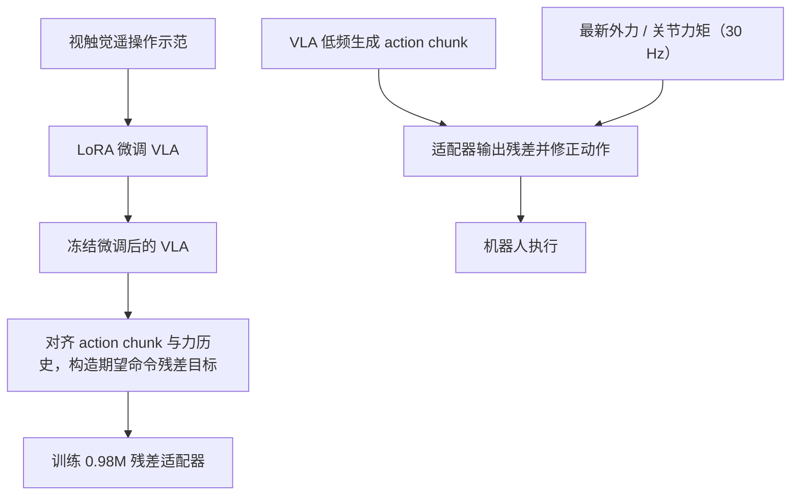

# VT-Bridge：用轻量残差适配把预训练 VLA 接入触觉

**VT-Bridge**（*Bridging Pretrained Foundation VLAs to VTLAs via Lightweight Residual Adaptation*，[arXiv:2609.22606](https://arxiv.org/abs/2609.22606)）保留预训练视觉–语言–动作（VLA）主干，并叠加一个小型触觉残差适配器，在执行动作前根据接触反馈高频修正其 action chunk。

## 一句话定义

**用低频 VLA 负责“做什么、怎么动”，再让一个约 0.98M 参数的高频残差头依照力觉反馈修正“接触时具体怎么使力”，把现有 VLA 适配成 VTLA。**

## 英文缩写速查

| 缩写 | 英文全称 | 简要说明 |
|------|----------|----------|
| VLA | Vision-Language-Action | 产生语言条件动作块的预训练策略主干 |
| VTLA | Vision-Tactile-Language-Action | 在 VLA 输入/控制中加入触觉反馈的策略 |
| LoRA | Low-Rank Adaptation | 先以低秩参数更新微调任务主干 |
| MLP | Multi-Layer Perceptron | 把动作特征与接触反馈特征映射为残差动作 |
| F/T | Force/Torque | 末端外力或关节外部力矩反馈 |

## 核心信息

| 项 | 内容 |
|----|------|
| 论文 / 日期 | arXiv:2609.22606，2026-09-18 |
| 作者 / 机构 | Yansong Wu、Tuo Yang、Rongping Zhao、Lingyun Chen、Xiao Chen、Junnan Li、Fan Wu、Alois Knoll；慕尼黑工业大学，Lingyun Chen 另署 Mohamed bin Zayed University of Artificial Intelligence，Fan Wu 署 Shanghai University |
| 主干 | π₀、π₀.₅、SmolVLA |
| 机器人 / 传感 | Franka Emika Panda；两台 Intel RealSense D435i 相机；Cartesian 动作配末端外力，关节动作配外部关节力矩 |
| 数据与模型 | 每任务最多 50 条视触觉遥操作示范；残差适配器 0.98M 参数 |
| 运行频率 | 论文设置 30 Hz 演示采样与动作执行；action chunk horizon 50，力历史窗口 50 |
| 计算 | VLA LoRA 微调约 8 小时（4×A100）；残差头约 30 分钟（RTX 3090）；adapter 推理约 0.7 ms（项目页报告） |
| 开源状态（2026-10-16） | **研究实现未公开**。官方 GitHub 仓库是静态项目页，并非训练/推理代码；Code 按钮显示 “Coming soon” |

## 为什么重要

- **把增加触觉的成本压到小适配器：** 无需重做 VLA 主干或从头训练一个 VTLA；利用原 VLA 的语义理解和动作先验。
- **解决接触末端的小误差：** action chunk 在预测后会经历执行过程，接触力与摩擦变化可能让名义动作无法完成插入、按压等任务；残差头在执行频率用当前时刻的接触信号做微调。
- **明确触觉适配的监督目标：** 示范里期望下发的命令与 VLA 对齐预测之间的差值，直接作为残差目标；这样能学到控制器柔顺性造成的执行偏差。
- **有跨主干证据：** 同一适配器架构在 π₀、π₀.₅ 与 SmolVLA 上验证，证明其能跨不同 VLA 主干复用架构（每个主干分别训练权重）。

## 流程总览



## 核心原理

### 两种频率，分工执行

VLA 以较低频率解释语言指令和视觉场景，生成一段表达任务意图与粗运动的 action chunk。残差适配器工作在 **30 Hz 动作执行频率**：它读取当前名义动作、预先编码的动作趋势特征，以及最近一段末端外力或关节力矩历史，输出一个小残差，在当前命令执行前加到名义动作上。

在 Cartesian 动作设置中，反馈采用估计的末端外力；在关节空间动作中，反馈采用外部关节力矩。动作 chunk 的特征在 chunk 开始时编码一次并复用，接触历史则逐步更新。VLA 与适配器在同一 GPU 上按 chunk 交替运行，避免同时竞争 GPU 算力。

### 两阶段训练与残差目标

1. 用任务演示对预训练 VLA 做 LoRA 微调。
2. 冻结已微调的 VLA，构建配对的动作 chunk、力反馈窗口和目标残差。
3. 以示范中的期望命令减去对齐后的 VLA 名义动作，作为残差监督目标。
4. 将非接触样本残差设为零，让适配器在自由空间保留 VLA 决策，重点学习接触后的力学调节。

### 方法图

```text
视觉 + 语言 → VLA action chunk ──────────────┐
                                             ├→ 残差适配器 → 修正动作 → 执行
末端外力 / 关节外部力矩 → 接触历史编码 ──────┘
```

## 实验与评测

论文在 Franka Panda 机械臂上测试四项真实接触丰富操作：按压洗手液瓶、擦白板、插入插头、拨动翘板开关。每个任务收集 50 条遥操作示范，每种主干和方法组合做 20 次试验。

| VLA 主干 | 仅任务微调 | VLA-Touch | VT-Bridge |
|----------|------------:|----------:|----------:|
| π₀ | 6.3% | 13.8% | 65.0% |
| π₀.₅ | 22.5% | 20.0% | 68.8% |
| SmolVLA | 6.3% | 7.5% | 55.0% |
| 平均 | 11.7% | 13.8% | 62.9% |

- VT-Bridge 在 12 个主干–任务组合中均优于对应的任务微调基线。
- 插头插入的基线任务微调在三种主干上均为 0%；VT-Bridge 分别达到 70%、70%、65%。
- 论文还报告“最后一英寸”条件完成率：只看已达到宽松几何接近的试次，衡量能否完成最后的接触敏感步骤。
- 结果适用于论文给定的机械臂、传感器、控制与演示设置，不应直接外推到其他机器人。

## 与其他工作对比

| 路线 | 触觉如何进入策略 | 主要取舍 |
|------|------------------|----------|
| OmniVTLA | 把触觉表征做语义对齐，再与视觉/语言用于 VTLA | 着重触觉表征与多模态模型训练 |
| Tactile-VLA | 在 VLA 中整合视触觉并面向接触操作训练 | 重点是 VTLA 策略本体与任务表现 |
| OmniTacTune | 冻结视觉基策略，用真机强化学习训练触觉残差 | 残差靠在线试错，不依赖离线视触觉示范 |
| **VT-Bridge** | LoRA 微调 VLA 后冻结主干，以视触觉示范监督残差头 | adapter 小、动作执行频率适配；仍需先花算力微调主干 |

## 结论

**VT-Bridge 的主要价值是证明：触觉可以作为冻结 VLA 上方的高频残差控制层接入，而不必把整套系统重训成一个大 VTLA。**

1. **先看部署切分** — 低频 VLA 给出动作意图，高频 adapter 用每步触觉/力反馈管接触。
2. **监督依赖命令目标** — 训练目标使用示范期望命令与 VLA 预测之差；接触任务的柔顺误差不能简单忽略。
3. **小 adapter 不代表零成本** — 主干仍要 LoRA 微调，论文使用 4×A100，时间约 8 小时。
4. **指标是限定设置下的证据** — 四个 Panda 真机任务的平均完成率升至 62.9%，尚不足以证明跨本体泛化。
5. **复现状态要分清** — 网站仓库可看页面与图表辅助脚本；训练、权重和完整数据集没有公开入口。

## 源码运行时序图

**不适用（截至 2026-10-16）**：官方项目页链接的 GitHub 仓库是静态网站源码；项目页 Code 按钮为 “Coming soon”，没有可运行的训练、推理或部署实现可供绘制。论文方法的推理分工见上方流程总览与 [官方项目页](https://hoxnocha.github.io/vt-bridge-web/)。

## 局限与风险

- **真机评测范围窄：** 一种 Franka 机械臂、四项接触任务；跨手臂、传感器和控制器的迁移仍待验证。
- **数据少但并非零数据：** 每项任务最多 50 条视触觉示范，精细力控遥操作仍有成本。
- **部署依赖双模型编排：** VLA chunk 生成和 adapter 高频更新必须按时序对接；论文的 GPU 交替调度与硬件配置需要在部署时重新评估。
- **性能数字需结合严格成功定义：** 结果是功能任务完成率，不能只看动作接近目标的宽松几何指标。
- **研究代码未公开：** 当前无法按仓库 README 直接复现训练和部署；发布状态以官方项目页后续更新为准。

## 关联页面

- [VLA 方法](../methods/vla.md) — 预训练语言视觉动作策略主干
- [视触觉融合](../concepts/visuo-tactile-fusion.md) — 视触觉融合范式，含残差适应
- [接触丰富操作](../concepts/contact-rich-manipulation.md) — 插入、按压等任务及力控挑战
- [Tactile-VLA](./paper-sa-2507-09160-tactile-vla-unlocking-vision-language-action-mod.md) — 视触觉输入与操作策略
- [OmniVTLA](./paper-sa-2508-08706-omnivtla-vision-tactile-language-action-model-wi.md) — 语义对齐触觉表征

## 参考来源

- [arXiv 论文归档](../../sources/papers/vt_bridge_arxiv_2609_22606.md)
- [官方项目页核查](../../sources/sites/vt-bridge-project-page.md)
- [官方项目页源码仓库](../../sources/repos/hoxnocha-vt-bridge-web.md)

## 推荐继续阅读

- [arXiv:2609.22606](https://arxiv.org/abs/2609.22606) — 论文方法与实验
- [VT-Bridge 项目页](https://hoxnocha.github.io/vt-bridge-web/) — 查看方法图与实验视频
- [视触觉融合](../concepts/visuo-tactile-fusion.md) — 对比融合、在线适应与残差路线
