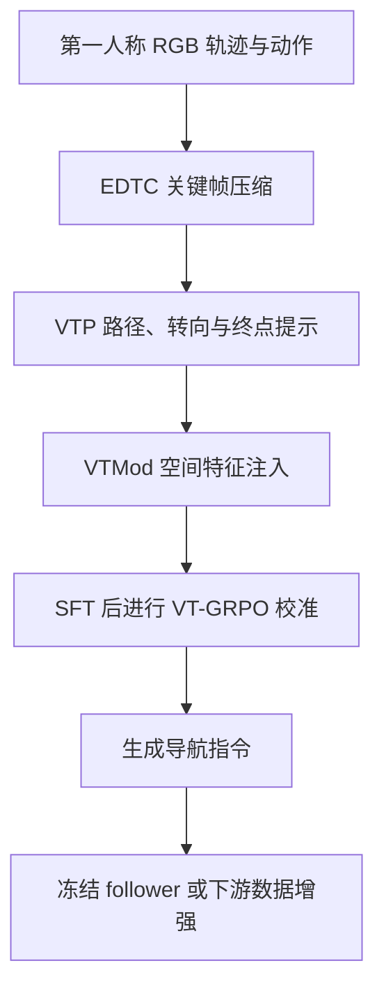
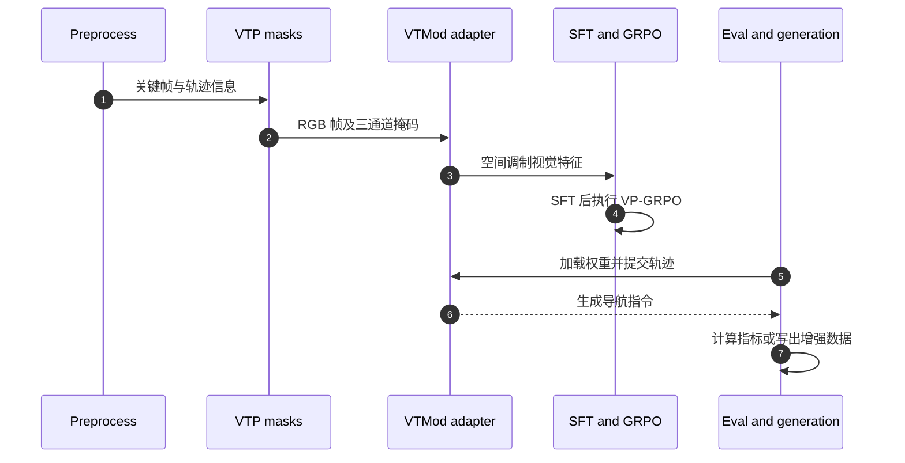

---
type: entity
tags: [vln, navigation, embodied-ai, egocentric-video, instruction-generation, pku]
topic: [navigation]
status: complete
updated: 2026-10-11
project_id: vtinstructor-navigation-instruction-generation
arxiv: 2608.15284
project: https://tidalharley.github.io/VTInstructor/
code: https://github.com/TidalHarley/VTInstructor
summary: "VTInstructor 把连续第一人称 RGB 轨迹压缩为导航关键帧，并将路径、转向、终点提示注入视觉编码器，生成指令后再以冻结导航 follower 验证下游效用。"
related:
  - ../tasks/vision-language-navigation.md
  - ./habitat-sim.md
  - ./paper-crosstracer.md
  - ./paper-navila-legged-robot-vision-language-action-model.md
sources:
  - ../../sources/papers/vtinstructor_arxiv_2608_15284.md
  - ../../sources/sites/vtinstructor.md
  - ../../sources/repos/vtinstructor.md
---

# VTInstructor: Visual Trajectory Prompting for Navigation Instruction Generation in Continuous Environments

**一句话定义：** VTInstructor 是面向连续环境视觉–语言导航（VLN）的指令生成框架；它将路线几何显式绘制回第一人称关键帧，让视觉语言模型据此生成自然语言指路。

## 英文缩写速查

| 缩写 | 英文全称 | 简要说明 |
|---|---|---|
| VLN | Vision-and-Language Navigation | 依据第一人称视觉与语言指令在环境中导航 |
| VLN-CE | Vision-and-Language Navigation in Continuous Environments | 连续观测与动作空间下的 VLN 设定 |
| EDTC | Event-Driven Trajectory Compression | 事件驱动的导航关键帧压缩 |
| VTP | Visual Trajectory Prompt | 绘在关键帧上的路径、转向与终点提示 |
| VTMod | Visual Trajectory Modulator | 将轨迹掩码特征注入视觉骨干 |
| GRPO | Group Relative Policy Optimization | 以组内相对奖励优化生成策略 |
| SFT | Supervised Fine-Tuning | 先用轨迹–指令样本监督微调 |
| CIDEr | Consensus-based Image Description Evaluation | 衡量生成文本与参考描述一致性的指标 |

## 核心信息

| 项 | 内容 |
|---|---|
| 任务 | 从连续环境第一人称 RGB 轨迹生成符合路径的自然语言指令 |
| 作者 | Haolin Yang、Yuxing Long（共同一作）、Zihan Yang、Hao Dong（通讯作者） |
| 机构 | 北京大学计算机学院（CFCS）；项目页另列 PrimeBot |
| 论文 | arXiv:2608.15284；ACM Multimedia 2026 accepted |
| 基准 | R2R-CE、RxR-CE Val Unseen |
| 代码/权重 | [官方 GitHub](https://github.com/TidalHarley/VTInstructor)；[Hugging Face](https://huggingface.co/TidalYang/VTInstructor-8b) |
| 开源状态 | **部分开源**：主要训练、生成和评测代码及模型可用；EDTC 的 DPC 子模块未公开，数据与底座许可仍适用 |

## 为什么重要

连续环境指令生成不只是“看视频并描述”：模型必须把转向、地标、路径和停止点组织成空间一致的语言。离散视点图能显式提供拓扑，密集 RGB 流却不天然包含可读的路线结构。VTInstructor 的方法把路线几何显式编码到观察图像，并通过文本指标与冻结 follower 的任务效果双重检验，而不只依赖语言相似度。

## 方法栈与流程总览

### EDTC：保留导航事件，而非均匀抽帧
项目页将 EDTC 描述为动作游程编码、小步组合、视觉与几何联合打分的动态关键帧选择，关键帧数量不超过 32。目标是保留路线中发生的方向和场景变化，而不是平均采样许多近重复图像。README 特别指出 EDTC 中的 DPC 子模块尚未公开，复现时不能假设每个论文组件都有可运行实现。

### VTP：把隐式路线变成视觉提示
对关键帧绘制路径带、旋转箭头和终点标记，并编码为 3 通道二值掩码。它不是替代图像理解，而是把动作轨迹中的空间线索显式映射回视觉观察，减轻模型从长视频中自行重建路线的负担。项目页还描述了对指令–关键帧配对进行质量过滤。

### VTMod 与两阶段训练
VTMod 将掩码编码为与视觉 patch 对齐的特征，在 Qwen3-VL 视觉编码器第 7 层进行逐 token 调制。接近零初始化的门控使模型逐步学习何时使用路线提示，降低训练初期扰动预训练表征的风险。训练采用 SFT → VT-GRPO：SFT 学习轨迹到语言的映射；GRPO 阶段用多候选回答的加权 NLG 奖励优化语言解码器与空间注入门控，并辅以门控对比损失。

## 源码运行时序图

官方仓库开放主要的预处理、提示生成、训练、评测和指令生成入口；DPC 未公开的边界见工程实践。

代码路径对应 preprocess/rendering、visual_prompt、vtmod、train、eval、metrics 与 generate。推理可使用无 VTP 的 RGB 模式；若要复现提示条件设置，应先确认评测 split 已生成掩码。

## 实验与评测

| 评测问题 | 论文报告 | 工程读法 |
|---|---|---|
| 指令文本质量 | R2R-CE、RxR-CE Val Unseen 标准 NLG 指标报告新高；相对最强 baseline，CIDEr 分别 +0.357、+0.109 | 文本指标衡量与参考指令相似度，不等于路径可执行 |
| 下游 follower 效用 | 冻结 CorrectNav 在 R2R-CE Val Unseen 上 SR 为 63.3%，高于最强竞争指令来源 14.7 个百分点；项目页列人工指令 SR 61.6% | 比单纯文本分数更接近导航效用，但仍是基准结果 |
| 指令数据增强 | 增加生成指令后，R2R-CE 与 RxR-CE 下游 SR 均约 +3 个百分点 | 需结合数据配比和相同训练/评测协议理解 |

### 与其他工作对比

| 路线 | 路径结构如何进入模型 | 侧重点 |
|---|---|---|
| 离散视点图 speaker | 图节点、全景观察或离散动作提供拓扑 | 已知图结构上的指令生成 |
| VTInstructor | 关键帧与 VTP 将连续路线显式编码到图像 | 不需导航图、预建地图或场景重建；兼顾指令质量与 follower 效用 |
| 通用视频模型直接描述 | 从视频上下文隐式推断路线与动作 | 更通用，但需检查转弯、地标、终点等事实错误 |

它改进的是“轨迹 → 指令”的 speaker/数据生成环节，不是新的导航 follower；论文将其生成结果交给冻结 follower 测试，避免将指令改进误称为直接控制能力。

## 结论

**一句话总判：** VTInstructor 的核心价值是把连续路径几何转为可见、可训练的视觉条件，并用冻结 follower 检验可执行性；结论仍受基准范围、数据许可与 DPC 未公开限制。

1. 复现前先可视化关键帧与 VTP mask，确认方向、转弯和终点映射正确。
2. CIDEr 增益说明文本更贴近参考；冻结 follower SR 才是下游效用证据，两者不能互相替代。
3. 官方代码覆盖主要路径但不完整包含 DPC，论文数字不应被当作开箱即得的复现保证。
4. Apache-2.0 代码许可不会覆盖数据、权重底座的额外约束。
5. 将其定位为连续 VLN 的指令生成与数据增强模块，而非自主导航控制策略。

## 局限与风险

- R2R-CE / RxR-CE Val Unseen 的表现不能直接外推到真实机器人、不同相机或新场景。
- DPC 未公开，论文方法与可复现源码之间存在明确缺口。
- VTP 依赖轨迹、相机和场景坐标的一致性；投影偏差可能显式强化错误空间线索。
- 模型卡提示 R2R/RxR、Matterport3D 数据条款和 Qwen3-VL 底座许可仍适用；模型定位为非商业研究用途。
- BLEU、CIDEr 等 NLG 指标不能独立验证安全性、可通行性和现实指路质量。

## 工程实践

1. 依仓库 ENVIRONMENT.md 配置依赖，并准备 Habitat 场景与 VLN-CE 数据。
2. 运行轨迹渲染，检查关键帧是否保留重要转弯、地标和终点。
3. 运行 visual_prompt 掩码生成并逐帧检查路径带、箭头和终点，再启动训练。
4. 按仓库入口先做 SFT，再做 GRPO；固定 Qwen3-VL、Transformers 版本及训练设置。
5. 先复现 NLG 指标，再把输出交给冻结 CorrectNav follower 做任务级评价。
6. 生成增强数据时记录数据集版本、VTP 模式、checkpoint 和过滤规则。

## 关联页面

- [视觉–语言导航（VLN）](../tasks/vision-language-navigation.md) — 任务、数据集与路线谱系。
- [Habitat-Sim](./habitat-sim.md) — VLN-CE 常见连续环境仿真基础。
- [CrossTracer](./paper-crosstracer.md) — 通过空间航点支持跨本体导航的另一条路线。
- [NaVILA](./paper-navila-legged-robot-vision-language-action-model.md) — 腿式机器人 VLA 导航。

## 参考来源

- [原始论文归档](../../sources/papers/vtinstructor_arxiv_2608_15284.md)
- [官方项目页归档](../../sources/sites/vtinstructor.md)
- [官方源码归档](../../sources/repos/vtinstructor.md)
- [arXiv:2608.15284](https://arxiv.org/abs/2608.15284)

## 推荐继续阅读

- [VTInstructor 项目页](https://tidalharley.github.io/VTInstructor/) — 方法图示与结果。
- [VTInstructor-8B 模型卡](https://huggingface.co/TidalYang/VTInstructor-8b) — 权重、推理配方和许可。
- [官方代码仓库](https://github.com/TidalHarley/VTInstructor) — 训练、评测和数据生成脚本。
