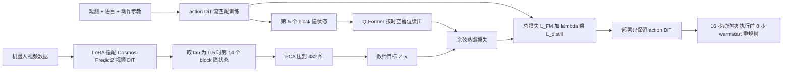

# W2A（arXiv:2611.02600）

**W2A**（*W2A: Distilling World Priors into Action Models for Real-Time Robotic Control*，[arXiv:2611.02600](https://arxiv.org/abs/2611.02600)，[项目页](https://misaka0502.github.io/W2A)）来自哈尔滨工业大学（深圳），线索见 [具身智能小站 2026-11-04 盘点](../../sources/blogs/wechat_embodied_station_57_papers_da_reward_model_failure_2026-11-04.md)，也列入 CoRL 2026 Glen Berseth 阅读清单第 080 条（P2）。本页依据论文 v1 全文通读（归档见[来源归档](../../sources/papers/w2a_world_priors_action_models_arxiv_2611_02600.md)）。

## 一句话定义

**两阶段蒸馏框架：训练时把视频扩散 Transformer 的中间去噪隐变量（PCA 压缩后）蒸馏进一个从零训练的 action DiT，部署时只保留 action DiT、不再运行任何视频模型。**（论文摘要、§4）

## 英文缩写速查

| 缩写 | 英文全称 | 简要说明 |
|------|----------|----------|
| WAM | World Action Model | 把视频世界模型用于动作生成的模型，多数测试时仍要想象未来（§1） |
| DiT | Diffusion Transformer | 本文的视频教师（Cosmos-Predict2）与动作学生都是 DiT |
| PCA | Principal Component Analysis | 把教师隐变量从 2048 维压到 K=482 维（附录 A.1、表 8） |
| LoRA | Low-Rank Adaptation | 阶段 I 用来把视频 DiT 适配到机器人视频（§4.1） |
| Q-Former | Querying Transformer（BLIP-2） | 本文用 1 层、可学习查询读出 action 隐变量以对齐教师（§4.2、表 7） |
| FM | Flow Matching | 动作 DiT 的主训练目标（§3.2） |
| PnP | Pick-and-Place | 真机三类任务之一（§5.1） |
| EPE | Endpoint Error | 线性探针的像素位置误差（附录 D.2） |

## 为什么重要

- 作者问题：WAM 受益于视频先验，但测试时显式想象未来带来算力与延迟，不适合实时控制（摘要、§1）。W2A 的答案是把视频模型只当训练期教师，部署图与普通动作模型一致（§4.3、附录 J）。
- 作者自述结果：LIBERO 平均 95.9%，单卡 A100 40GB 上 55 ms 每次动作预测，部署显存约 6 GB（§5.2、§5.3）。
- 与「让测试时世界建模更便宜」的路线（如 [Fast-WAM](paper-fast-wam.md)）互补：W2A 的问法是能否把先验内化进动作模型而不再需要测试时世界建模（附录 J）。
- 同期同组工作见 [具身智能小站 11-04 期 57 篇阅读坐标](../overview/embodied-station-2026-11-04-57-papers-technology-map.md)。

## 核心原理与流程总览

要点（均见 §4 与附录 B）：

- **阶段 I：** 教师是 Cosmos-Predict2 视频 DiT，LoRA 适配后取去噪中间时刻（τv=0.5）第 14 个 block 的隐状态，形状 [B,24,14,14,2048]，PCA 后 [B,24,14,14,482]（表 8）。K=482 对应约 99% 累计解释方差（附录 A.1）。
- **阶段 II：** action DiT（隐维 768、10 层、8 头，表 7）从零训练。取第 5 个 block 输出（形状 [B,16,768]），16 个动作 token 按视频 VAE 的时间压缩比 4 分成 4 组，每组用可学习的空间查询通过交叉注意力读出，与教师对应位置的 482 维向量算余弦距离（式 9–11、附录 B.4）。
- **损失：** L = L_FM + λdist·L_distill，λdist=1.0；蒸馏项乘以以动作流时间 τc=0.5 为中心、σw=0.1 的高斯权重（式 10–12、表 11）。
- **推理：** 视频 DiT 与 Q-Former 全部移除，20 步去噪，预测 16 步、执行 8 步，warmstart τws=0.5（§4.3、表 12）。
- **假设（作者自述）：** 视频隐变量虽高维，但一个压缩的低维子空间足以监督动作生成（摘要）；视频隐变量与动作隐变量「共享动作条件的动力学」，所以蒸馏是合理的（§1，属作者的概念性论证，非实验证明）。

## 工程实践

- **配置速记：** 输入 224×224 前视 + 腕部图像、ResNet-18 编码、观测历史 2 步、T5 预计算语言嵌入；batch 128、100 epoch、AdamW、学习率 1e-4、EMA 0.999、训练流时间采样 logit-normal（表 7、10、11）。
- **延迟 / 显存测量用的是 CLIP 文本编码器变体**，与默认 T5 变体性能「相当」，论文未给后者数字（附录 B.3）。读延迟数字时注意这一点。
- **真机：** Franka Research 3，前视 RealSense D435i + 腕部 D405，Omega 7 遥操作；每个子任务 50 条示教共 750 条；策略在真机上 15 Hz（§5.1、附录 F）。
- **数据口径：** 「scratch」只表示不用外部机器人动作数据，允许通用视频预训练；W2A 的视频教师来自通用视频预训练并在目标基准视频上做 LoRA 适配（附录 B.2、表 9）。与 π0.5 等「finetuned」比较时口径不同，与 mimic-video、DreamZero 同属 scratch。
- **关键消融（LIBERO 平均，表 4–6，作者报告）：** 去蒸馏 84.4（-11.5），去 PCA 88.6（-7.3），打乱教师 78.2，随机教师 69.2，ResNet 未来帧特征当教师 87.8，全局 MLP 代替 Q-Former 82.7。教师深度 50% 最优（图 10）。
- **代码：** 论文未给代码链接；入库时项目页核查未见 GitHub（2026-11-04），因此本页不写 `code:`。复现信息以论文附录 B 的配置表为准。

## 实验结果速览

| 基准 | 结果（W2A） | 对照（论文表内） | 出处 |
|------|-------------|------------------|------|
| LIBERO 四套件平均（scratch） | 95.9% | mimic-video 91.6，DreamZero-5B 88.7，Diffusion Policy 72.4；finetuned：π0.5 96.9，OpenVLA 76.5 | §5.2 表 1 |
| LIBERO-Long | 93.6% | π0.5 92.4 | 表 1 |
| CALVIN ABC→D 平均长度 | 4.30（±0.04） | VPP 4.33，OpenVLA 3.27，GR-1 3.06 | 表 2、附录 G |
| 真机 PnP / Cube / Long | 78.3 / 65.0 / 54.2 | OpenVLA 50.8 / 35.0 / 18.3，DP 29.2 / 10.0 / 2.5 | 表 3 |
| 真机 毛巾 / 清桌 / USB | 76.7 / 63.3 / 50.0 | OpenVLA 50.0 / 26.7 / 20.0 | 表 3 |
| 推理延迟 | 55 ms | mimic-video 约 21×（图 6 读数约 1162 ms，推测） | §5.3 |
| 线性探针 Pos EPE（t+10） | 13.1 px | 无蒸馏 23.8 px | 附录 D.2 表 14 |

## 与清单说法的核对

清单（Glen Berseth，CoRL 2026 阅读清单第 080 条，作者说明为 LLM 据摘要起草）一句话：「Distills video-diffusion features into an action model during training so no video is generated at test time.」

- **基本对得上：** 训练时蒸馏视频扩散特征、测试时不生成视频，都与论文摘要和 §4.3 一致。
- **细节补充：** 蒸馏对象是视频 DiT 的中间层隐状态（τv=0.5，第 14 个 block），不是生成出的视频或最终输出，且先经 PCA 压缩，再由 Q-Former 对齐（§4.1–4.2）。教师在训练中是被 LoRA 适配过的视频模型，所以训练期仍要跑视频 DiT。
- **清单未提及的限定：** 效率结论（约 21×、55 ms）只对 mimic-video 一个 WAM 基线、在单卡 A100 上、用 CLIP 变体测得（§5.3）；真机实验只对比 Diffusion Policy 和 OpenVLA，没有任何 WAM 基线（表 3）；LIBERO 平均 95.9% 低于 finetuned 的 π0.5（96.9），CALVIN 平均长度 4.30 略低于 VPP 的 4.33。
- **作者名：** 清单写作 "Zhang, Yongjin, Weng et al."，论文首页作者为 Xiaopeng Zhang, Yongjin Mu, Yueyang Weng, Chengzhi Zhao, Yanjie Li，清单是把三位作者的名 / 姓拼接写出，不影响理解。
- **排序提示：** 清单排序是作者用自己的研究兴趣模型打分，不是论文质量评价（P2 档不代表论文弱）。

## 局限

**论文自己承认的（§7、附录 I）：**

- 放弃视频骨干的额外容量与显式未来想象，大分布偏移、未见物体动力学、需更长程适应的任务上鲁棒性可能受限。
- 教师隐变量被压进固定低维子空间，可能丢失任务相关的高阶结构，限制复杂规划或更广泛泛化。
- 真机上遇到完全未见的物体 / 任务，或初始布局明显偏离训练分布时会失败，错误会在重规划中累积（图 17）。

**我在核对中看到的未验证之处（读者判断，非作者结论）：**

- 效率对比只有 mimic-video 一个 WAM；延迟具体读数来自图 6，且不同方法的骨干大小、是否使用同一加速手段在文中没有展开；论文也没有对比 Fast-WAM 这类同样去掉测试时想象的方法（相关工作 §2 与附录 J 仅作讨论）。
- 真机每个子任务 30 次 rollout，未报告真机多随机种子或置信区间；真机基线仅 DP 与 OpenVLA，无法回答相对其他 WAM 的真机优势。
- 「scratch」口径允许通用视频预训练与目标基准视频，而 DP 不使用视频，不同 scratch 方法的数据量并不完全等价（表 9）。
- 机制解释（热力图、掩码富集度、线性探针）是相关性证据；「视频与动作共享动作条件动力学」是作者的概念性假设（§1）。
- 论文与项目页（入库时核查）均未见公开代码，复现依赖附录配置表。

## 关联页面

- [vla](../methods/vla.md)
- [imitation-learning](../methods/imitation-learning.md)
- [diffusion-policy](../methods/diffusion-policy.md)
- [action-chunking](../methods/action-chunking.md)
- [world-action-models](../concepts/world-action-models.md)
- [diffusion-transformer](../concepts/diffusion-transformer.md)
- [flow-matching-embodied-policy](../concepts/flow-matching-embodied-policy.md)
- [paper-fast-wam](paper-fast-wam.md)
- [libero-benchmark](libero-benchmark.md)
- [calvin-benchmark](calvin-benchmark.md)
- [embodied-station-2026-11-04-57-papers-technology-map](../overview/embodied-station-2026-11-04-57-papers-technology-map.md)

## 参考来源

- [w2a_world_priors_action_models_arxiv_2611_02600.md](../../sources/papers/w2a_world_priors_action_models_arxiv_2611_02600.md)
- [w2a-world-priors-action-models.md](../../sources/sites/w2a-world-priors-action-models.md)
- [wechat_embodied_station_57_papers_da_reward_model_failure_2026-11-04.md](../../sources/blogs/wechat_embodied_station_57_papers_da_reward_model_failure_2026-11-04.md)
- [arXiv:2611.02600](https://arxiv.org/abs/2611.02600)

## 继续阅读

- [arXiv PDF](https://arxiv.org/pdf/2611.02600)
- [项目页](https://misaka0502.github.io/W2A)
- 论文相关工作入口：mimic-video（arXiv:2512.15692）、Video Prediction Policy（arXiv:2412.14803）、Fast-WAM（arXiv:2603.16666）、DreamZero（arXiv:2602.15922）
