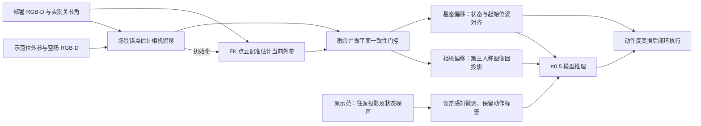
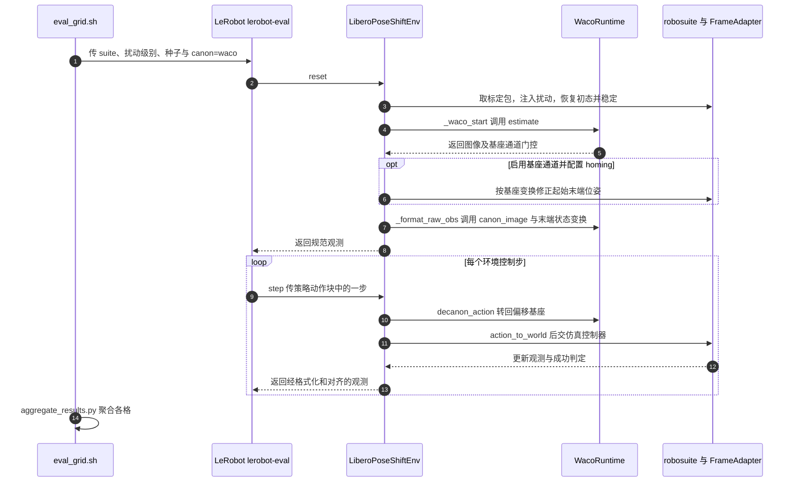

# WACO：面向位姿扰动的少样本视觉语言动作模型 / Towards Pose-Robust Few-Shot Vision-Language-Action Models

## 一句话定义

WACO 先判断偏移来自相机、机器人基座还是两者，再分别把画面与动作坐标对齐到示范条件，让原有 VLA 策略更耐受相机挪动和基座对位误差。

## 英文缩写速查

| 缩写 | 英文全称 | 含义 |
|---|---|---|
| WACO | World-Anchored Canonicalization | 以静态工作区为世界锚点的坐标对齐 |
| VLA | Vision-Language-Action | 从图像、语言与机器人状态生成动作 |
| RGB-D | Red, Green, Blue and Depth | 彩色与深度联合观测 |
| FK | Forward Kinematics | 从关节角求各连杆位姿 |
| ICP | Iterative Closest Point | 迭代对齐三维点云 |
| RANSAC | Random Sample Consensus | 从带外点的匹配中拟合稳健变换 |

## 为什么重要

少样本示范可能全部来自同一个机位和基座位置。挪动第三人称相机改变图像，却不改变正确的基座动作；挪动基座反而让物体在基座坐标中的位置变了，静态背景画面可能几乎没变。只做图像增广无法补偿后者。默认的 LIBERO 世界帧接口还可能在仿真里替策略吸收一部分基座移位，掩盖部署问题。

| 项目 | 核心信息 |
|---|---|
| 作者 | Wenhao Li、Zhongyi Han、Yuhao Wei、Liang Han、Yilong Yin、Liqiang Nie |
| 机构 | 山东大学、深圳河套研究院、西安电子科技大学、哈尔滨工业大学（深圳） |
| 原文 | arXiv:2611.24360v1，2026-11-18 |
| 验证 | LIBERO-PoseShift、LIBERO-Plus 相机轨、UR5e 四项桌面任务 |

## 核心原理与方法

1. **一次示范位标定，两条独立约束。** 先存名义相机到基座外参、名义基座位姿和空工作区 RGB-D。部署时，从实测关节角放置机械臂点云，做带可见性约束的多假设 ICP，估计当前相机到基座外参；以静态场景 RGB-D 与空场参考匹配，单独估计相机相对工作区的变化。臂锚点只知道相对外参，无法独自判断是谁动了。
2. **融合再分通道。** 用两个估计解出基座变化，投影到只含平面位移和偏航的 SE(2)；以被舍弃的高度、横滚和俯仰等残差做门控。通道 A 只用相机偏移重投影第三人称画面，不改腕部图像；通道 B 只用基座偏移转换末端状态、反变换动作增量，并在必要时把末端送回示范起始位姿。平移和旋转增量按方向变换，不把坐标系的平移量加到增量动作。
3. **让策略在训练时看见运行时误差。** 用原示范的逐帧深度做往返回投影，模拟空洞、边缘缺失和对齐残差；另加符合基座估计误差的结构化状态噪声。二者各以 0.5 概率应用，动作标签和 π0.5 的架构不变。只启用运行时可用已有权重，完整结果还用了这一微调。
4. **大视角单独处理。** LIBERO-Plus 相机轨可绕转至 75°；加空场十二视点短扫描、支撑平面约束的全局搜索、别名检查及受静态深度检验的臂锚点回退，用逆向采样与空场参考填不可见处。填入的是空场背景，不是恢复被遮掉的物体。

## 源码运行时序图

这张图对应公开仿真实现，不是论文真机控制栈。默认采用 `action_frame=base`；仿真知道真实基座位姿以实现环境接口，WACO 估计仍依赖传感与参考标定。另有相机轨入口 `scripts/eval_liberoplus_camera.sh`；训练入口 `scripts/train_pi05.sh` 在数据层应用 `rt_aug.py`。

## 工程实践

- **最小评测矩阵。** 先锁定同一场景种子，分别比无扰动、只动相机、只动基座和两者同时动。PoseShift 设 L1/L2/L3，平移上限均为 2/5/10 cm，相机每轴旋转上限 3°/5°/10°，基座偏航上限 3°/8°/15°。主网格为两个 suite、每个十任务、十条件、每任务条件十次，共 2,000 episodes/模型。
- **复现顺序。** 先跑官方无仿真测试，再以 LeRobot 插件和校准包跑单格，随后扩大网格。公开代码及配套资产采用 Apache-2.0（资产另核上游许可）；公开 `WACO-pi05-LIBERO` 是相机轨微调权重，遵循 Gemma 条款。不要把它当成真机权重，也不要仅加载权重就期待整套系统成绩。
- **量产诊断。** 将 reset 估计、图像处理、策略推理和 homing 分开计时。论文表 IV 报 reset 中位 771 ms（单 CPU 线程、36 次）、启用时图像每步 11 ms、共享 GPU 的十步动作块推理不超过 320 ms；这些不是可直接套用的现场控制周期。

## 评测与局限

| 协议 | 可比结果（作者报告） | 读法 |
|---|---|---|
| LIBERO-PoseShift 主网格 | 标准少样本 74.0%；只加运行时 81.4%；只加误差训练 81.1%；完整 87.2%；同微调权重真值 oracle 88.7% | 九个扰动条件均值，不含 clean；最大复合档 44.5% → 79.0% |
| LIBERO-Plus 相机轨 | 发布提示：公开策略 62.5%，只加运行时 89.4% / 88.0%，完整 93.7% / 92.4%；原任务指令：完整 93.7% / 92.0% | 1,599 个变体，斜杠依次为种子 0／三种子均值；发布提示带变体参数 |
| UR5e 四项桌面任务 | 标准少样本 43.3%；只加运行时 70.0%；完整 80.0%；同微调权重真值 oracle 85.4% | 各任务各条件 20 次，偏移均值，不含名义位姿；基座相对偏移通过搬工作台及外置相机来模拟 |

- PoseShift 中完整方法每任务 10 条示范达 82.4%，超过标准训练用 50 条的 74.0%。不能据此承诺所有任务都能把示范数降到五分之一。
- 门控不是安全保证：仿真 240 次 reset 中否决了 41 个严重错误中的 23 个，也误拒了 9 个准确估计。低纹理平面可能出现平面内滑移假解，大视角超出原图的物体也不能由空场参考补回。
- 依赖相对静态背景、可见机械臂、RGB-D 与初始标定；主要估计假设基座只在平面内动，未宣称跟踪回合中的连续位移或跨机器人通用。论文保留 L3 的物理不可行样本，不宜把结果只归因于模型对坐标扰动的能力。

## 与其他工作对比

- [LIBERO-Plus](paper-rcl-2510-13626-libero-plus-in-depth-robustness-analysis-of-visi.md) 在多个因素上诊断 VLA 鲁棒性；WACO 重用其相机轨，并用 LIBERO-PoseShift 单独施加基座和复合偏移，控制动作帧的评测口径。
- **图像增广与几何补偿不是替代关系。** 同篇论文的 B1+2D 增广提高 PoseShift 偏移均值至 77.5%，但复合 L3 仅 53.0%；WACO 同时调整坐标及观测为 79.0%。和跨视角重渲染方法比较时要区分是否用了目标扰动数据、提示后缀和真值外参。

## 结论

WACO 的主要贡献是把相机和基座偏移拆成可分别验证的坐标问题，而不是逼策略用更多示范记住每种摆放。

- 先明确相机、基座、世界三个帧和动作增量的约定。
- 部署前保留空场参考；实测遮挡、低纹理与大视角下的接受和回退行为。
- 将名义条件、三类位姿偏移和真值 oracle 分组汇报，不混用提示协议。
- 先验证 homing 行程与工作区约束，再单独评估时间和残余误差。

## 关联页面

- [视觉-语言-动作模型（VLA）](../methods/vla.md)
- [模仿学习](../methods/imitation-learning.md)
- [机器人操作](../tasks/manipulation.md)
- [LIBERO 基准](libero-benchmark.md)
- [具身大模型评测基准选型闭环](../queries/embodied-eval-benchmark-selection-loop.md)：先区分坐标系扰动、指令变化与任务成功判定，再选择评测协议。
- [VLA 纵深路线 · Stage 4](../../roadmap/depth-vla.md#stage-4-部署与系统整合)

## 参考来源

- [论文全文核对归档](../../sources/papers/waco_arxiv_2611_24360.md)
- [官方项目页归档](../../sources/sites/waco-project.md)
- [训练、评测和运行时源码归档](../../sources/repos/waco.md)
- [LIBERO-PoseShift 配套数据](../../sources/datasets/libero-poseshift.md)
- [相机轨模型卡](../../sources/models/waco-pi05-libero.md)

## 推荐继续阅读

- [arXiv v1 全文及补充材料](https://arxiv.org/html/2611.24360v1)：先读 §III 的坐标分解，再对照表 VI、VII 和 IX 的评测协议。
- [WACO 官方实现](https://github.com/peacelwh/WACO)：从评测网格进入运行时，区分 WACO 和 oracle 参数。
