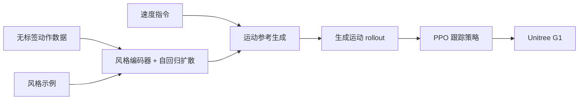

# Walk Like This：示例驱动的风格化人形行走

**一句话定义：** Walk Like This 将任意时长的动作示例编码为风格条件，用自回归扩散生成可由 joystick 控速的运动参考，再由强化学习跟踪策略转成物理可执行动作；论文在 Unitree G1 上演示了零样本部署。

## 英文缩写速查

| 缩写 | 英文全称 | 简要说明 |
|------|----------|----------|
| RL | Reinforcement Learning | 训练低层策略跟踪生成的运动参考 |
| PPO | Proximal Policy Optimization | 训练 tracking policy 的策略梯度算法 |
| CFG | Classifier-Free Guidance | 对比用的扩散引导方法，需额外模型评估 |
| FID | Fréchet Inception Distance | 论文用于比较生成动作分布与动捕数据的指标 |
| DoF | Degrees of Freedom | G1 实验机器人为 29 自由度 |

## 为什么重要

传统风格化运动生成依赖固定风格标签或离线风格迁移，难以从未见示例即时适配；只生成关节动作又不保证真实机器人能稳定跟踪。本文把**示例条件生成、用户速度指令和物理跟踪控制**接在一起，让风格成为部署时可替换的输入。

## 核心原理

### 方法栈

1. **风格编码：** Transformer 将一段参考动作压缩为归一化风格向量。训练时，风格窗口与待生成窗口从同一轨迹的不同位置独立采样，迫使模型保留动作风格、忽略片段具体内容；该采样消融若共用同一窗口，生成多样性显著下降。
2. **运动生成：** 自回归扩散模型以历史运动、未来根部轨迹、风格向量为条件，逐段产生未来全身运动。用户 joystick 指令转换为未来根轨迹。
3. **推理期调节：** 对注意力分数加入风格 / 历史偏置控制风格强度；速度反馈修正抑制轨迹漂移。风格向量可球面插值以混合风格。
4. **物理执行：** 用生成模型 rollout 离线构造运动数据，训练 PPO tracking policy。部署时扩散模型按自己的历史预测开环生成，RL 策略根据机器人实测状态闭环跟踪。

### 流程总览

## 源码运行时序图

**不适用**：截至 2026-10-20，项目页未列可运行代码仓库或部署入口；arXiv TeX / PDF 仅为论文源材料，不能据此绘制官方实现时序。

## 实验与评测

- **风格生成：** 对比 CAMDM，本文 FID 从 0.27 降至 0.22、风格准确率从 86.0% 升至 88.1%，轨迹位置误差相近。加入 attention bias 后本文 FID 为 0.07、风格准确率 96.3%，但足滑指标由 0.66 增至 0.93，体现风格强度与运动物理质量间的代价。
- **未见风格：** 在 100STYLE 留出的 10 种风格上，风格准确率为 93.0%；可从视频姿态估计结果提取动作片段作风格输入，未见风格的细节保真度仍较弱（FID 0.34）。
- **速度跟随：** 速度修正将每米漂移由 0.117 降至 0.003，平均速度误差由 0.271 m/s 降至 0.075 m/s。
- **控制器训练分布：** 用扩散生成动作训练 tracker 相比仅用原始动捕，降低跟踪生成动作时的跌倒率；无强扰动时生成数据训练的 open-loop 结果为 0.001 falls/min。
- **真机：** 29-DoF Unitree G1，约 4 小时部署测试报告多种风格和指令下无失败；Jetson Thor 扩散推理约 11 ms/步、指令到动作约 17 ms。此结果证明可行性，不代表长时可靠性或复杂地形能力。

## 结论

**主要价值是把动作风格变成运行时可替换的示例条件，并用专门训练的 RL tracker 承接生成动作与机器人动力学间的落差。**

1. **把风格示例与动作内容分开采样**，是避免模型照抄输入片段、获得风格迁移能力的关键训练设计。
2. **Attention bias 可调风格强度且比 CFG 省推理**；强 stylization 会增加足滑，需用物理跟踪和任务约束共同评估。
3. **速度修正值得保留在交互回路中**：它显著减少长时间自回归 rollout 的累计漂移。
4. **Tracker 训练数据应覆盖生成模型本身的输出分布**，否则会因扩散运动伪影而跌倒；生成质量和物理可跟踪性要分开优化。
5. **G1 / Jetson Thor 结果适合证明实时原型可行**；当前项目页未提供复现代码，且论文指出强扰动、方向相关风格和根轨迹风格仍有限制。

## 局限与风险

- 使用生成模型自身过去预测作为条件更利于维持风格，但不让扩散生成器根据真实机器人状态闭环纠偏；较大扰动仍会降低运动质量并增加跌倒。
- 对 moonwalk、侧手翻等与移动方向紧密耦合的风格，需要匹配 joystick 指令；与速度指令冲突的根部旋转风格优先服从用户指令。
- 风格由隐式向量表达，目前难以只迁移上身或下身等局部属性。
- 项目页公开论文和视频；截至 2026-10-20 未发现训练 / 推理代码、模型权重或数据下载链接。

## 与其他工作对比

相较 CAMDM 的离散已知风格标签，本文用参考动作编码器支持未见风格；相较纯运动生成模型，加入 RL tracking policy 实现物理执行。与 [HUMBLE](paper-humble-human-motion-driven-behavior.md) 一样以人类动作驱动机器人行为，但本工作聚焦可交互风格化行走，并以 joystick 控速、扩散生成和 G1 实机跟踪构成主要链路。

## 关联页面

- [类人机器人运动](../tasks/humanoid-locomotion.md) — 任务与控制路线
- [扩散式运动生成](../methods/diffusion-motion-generation.md) — 生成运动模型的机制与应用
- [强化学习](../methods/reinforcement-learning.md) — PPO 跟踪策略

## 参考来源

- [论文原始资料](../../sources/papers/walk_like_this_corl2026.md)
- [Disney Research 项目页](../../sources/sites/disneyresearch-walk-like-this.md)

## 推荐继续阅读

- [arXiv:2610.18147](https://arxiv.org/abs/2610.18147) — 论文、补充材料与实验设置
- [项目页](https://la.disneyresearch.com/publication/walk-like-this-stylized-locomotion-for-physics-based-characters-through-example-driven-diffusion/) — 论文摘要与演示视频
