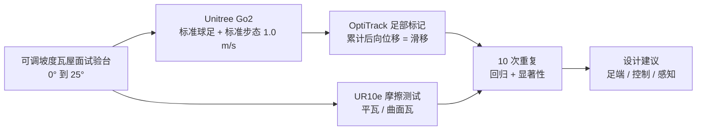

# Walking on Roofs：商用四足能在屋顶上干活吗

**Walking on Roofs**（[arXiv:2610.12272](https://arxiv.org/abs/2610.12272)，Bjoern-Felix Dettmar 与 Arne Roennau，卡尔斯鲁厄理工学院 Machine Intelligence and Robotics Lab，CLAWAR 2026 预印本）用一个可调坡度的瓦屋面试验台，系统测量 **未经改造的 Unitree Go2 + 标准球形足** 在 0°–25° 斜屋面上的站立、行走、起身与趴下能力。

## 一句话定义

**一项“先问现有硬件到底行不行”的实测研究：量化商用四足在斜瓦屋面上的摩擦、滑移与动作可行域，为屋顶施工机器人的足端、接触力学与控制设计划定起点。**

## 英文缩写速查

| 缩写 | 英文全称 | 简要说明 |
|------|----------|----------|
| COM | Center of Mass | 坡上后移，使前足法向力下降 |
| FLF / RLF | Front/Rear Left Foot | 论文回归分析所用的前左/后左足标记 |
| RL | Reinforcement Learning | 作者提出的后续方向：屋顶专用步态学习 |
| CLAWAR | Climbing and Walking Robots conference | 论文发表的会议 |
| WebRTC | Web Real-Time Communication | 论文用来从 Python 驱动 Go2 的通道 |

## 为什么重要

- **补了“空白验证”：** 之前的四足爬坡多在平整斜面或仿真中报告；这里用真实 Frankfurter Pfanne 瓦（德国最常见瓦型）做屋顶场景，且有动捕精度的滑移数据。
- **揭示“静摩擦≠动态可行”：** 摩擦推得的最大坡度为 48.84°（平瓦）/ 55.03°（曲瓦），而站立临界角只有 27.58°，行走在 25° 就频繁摔倒——选型不能只看摩擦系数。
- **提出可执行的工程清单：** 足端、质心管理、落足感知和起身策略各自对应一个失败机制，便于后续单项攻关。

## 核心信息

| 项 | 内容 |
|----|------|
| **机构** | 卡尔斯鲁厄理工学院（KIT）Machine Intelligence and Robotics Lab |
| **平台** | Unitree Go2（软件 1.4.4），标准橡胶球形足，标准步态 1.0 m/s |
| **试验台** | 可调坡度屋面，Frankfurter Pfanne 瓦，0°–25°；尺寸原文未报告 |
| **测量** | OptiTrack 红外动捕（<1.0 mm）；UR10e 力矩传感器测摩擦 |
| **开源** | **无**：arXiv 页面与正文均未列项目页、仓库或数据 |

## 核心原理

### 测试矩阵

| 实验 | 变量 | 读出 |
|------|------|------|
| 摩擦 | 平瓦 / 曲面瓦；60 N 法向力、拖动 100 mm，各 10 次 | 动态摩擦系数 f = F_T/F_N |
| 坡上站立 | 坡度由 0° 递增直到失稳 | 临界角 |
| 起身/趴下 | 上坡、下坡、侧向朝向 | 全成功的最大坡度 |
| 坡上行走 | 0°–25° | 行进距离、滑移、轨迹偏差，回归分析 |

### 流程总览

## 方法

这是一篇没有新算法的测评论文，关键在测量定义：

- **滑移：** 前/后足标记 X 方向累计后向位移，仅当竖直位移小于 1.0 mm（即足处于支撑相）才累计，排除摆动相；严重失败（摔倒）的试验不计入滑移统计。
- **起身/趴下成功：** 上坡、下坡、侧向三种朝向都完成。
- **控制：** 通过 Python 的 WebRTC 驱动调用 Go2 内置标准步态，没有自研控制器。

## 实验与评测

| 项目 | 结果 |
|------|------|
| 动态摩擦（球足） | 平瓦 1.144 ± 0.1299；曲面瓦 1.430 ± 0.1298 |
| 摩擦推得最大坡度 | 48.84° ± 3.22°（平）/ 55.03° ± 2.44°（曲） |
| 站立临界角 | 27.58° ± 0.72° |
| 起身/趴下全成功 | 头上坡最高 11°；头下坡最高 11°；侧向最高 7° |
| 行走距离 | 随坡度线性下降，前左足 y = −0.01175x + 0.7343（R² = 0.937） |
| 行走滑移 | 二次拟合优于线性：前左 R² = 0.986，后左 R² = 0.997 |
| 25° 行走 | 频繁严重失败（各角度失败率原文未报告） |

- 厂商宣称的 40° 爬坡能力在该屋面上未实现。
- 起身/趴下的所有失败都发生在质心移出支撑多边形时，因为动作是预编程的、不考虑机体朝向。
- 文内有两处不一致：表 3 写最大行走坡度 20°，正文写 25° 频繁摔倒；轨迹偏差正文称无可解释相关，表 2 却给出前左足显著线性拟合（R² = 0.970），读数时应以正文与表交叉核对。

## 源码运行时序图

**不适用**：论文没有发布代码、控制脚本或数据，截至 2026-10-12 arXiv 页面未列项目页或仓库；控制仅调用 Go2 自带步态。

## 工程实践

- **复现要点：** 只需 Go2、倾斜瓦台与动捕；关键是按论文的滑移定义（支撑相、竖直位移 <1 mm）处理标记数据，否则摆动相会被误计入。
- **选型提示：** 在 25° 以内的瓦屋面，标准球足的实际余量远小于摩擦测试推算值；落地前应先在目标瓦型上重做动态试验。
- **开源状态：** 无代码、无项目页，数据未公开；复现依赖自己搭建试验台。
- **作者建议的改进：** 大接触面或可适应瓦片的足端、高摩擦材料、主动踝；坡度自适应步态与力调制；感知落足避开瓦片台阶；只在水平脚手架平台上执行起身/趴下。

## 结论

**商用四足在屋顶上的瓶颈是动态接触与质心管理，而不是静摩擦系数；标准 Go2 球足在约 25° 已不可靠。**

1. **读动态指标：** 以站立临界角（27.58°）和行走失败坡度为准，而不是由 f 推出的 48° 以上。
2. **起身是更紧的约束：** 全成功仅到 11°（侧向 7°），屋顶作业应避免在斜面上趴下再起身。
3. **滑移二次增长：** 坡度每增加一档，滑移增幅变大，预算要留非线性余量。
4. **控制不是黑盒可用的：** 内置步态对坡度无感知，同样蹬地力用于所有坡度。
5. **下一步优先级：** 足端硬件与坡度自适应控制并行，而不是单点改进。

## 与其他工作对比

| 对照 | 差异读法 |
|------|----------|
| [G1 坡度自适应屋顶行走](./paper-g1-slope-adaptive-roofing-locomotion.md) | 该页面向人形机器人上的屋顶行走控制；本文给出商用四足的**未改造基线**，可作为对照下限 |
| [人形机器人进入建筑业](./paper-toward-humanoid-robots-in-construction.md) | 从应用面谈施工场景；本文提供一个具体场景的定量数据 |
| [地形适应](../concepts/terrain-adaptation.md) | 通用地形适应多在仿真或平整斜面；本文强调瓦屋面的不连续性（瓦片台阶、曲面） |

## 局限与风险

- **适用边界：** 仅 Go2 一个平台、一种步态、一个速度（1.0 m/s）；理想条件，无碎屑、植被、天气与负载。
- **统计：** 每项实验仅 10 次；严重失败试验被排除出滑移统计，会让滑移均值偏乐观。
- **开源：** 无代码与数据。
- **未评估：** 新的 AI 行走模式只做了初步测试（作者称有中等改善），未纳入主实验。

## 关联页面

- [人形/四足前沿周报 2026-10-05~10-09](../overview/frontier-humanoid-quadruped-2026-10-05-10-09.md)
- [运动控制任务页](../tasks/locomotion.md)
- [地形适应](../concepts/terrain-adaptation.md)
- [四足机器人](../entities/quadruped-robot.md)
- [Unitree](../entities/unitree.md)

## 参考来源

- [Walking on Roofs 论文归档](../../sources/papers/walking_on_roofs_arxiv_2610_12272.md)
- [人形/四足周报来源](../../sources/blogs/frontier_humanoid_quadruped_2026_10_05_10_09.md)

## 推荐继续阅读

- [arXiv HTML 全文](https://arxiv.org/html/2610.12272v1)
- [CLAWAR 会议](https://clawar.org/)
