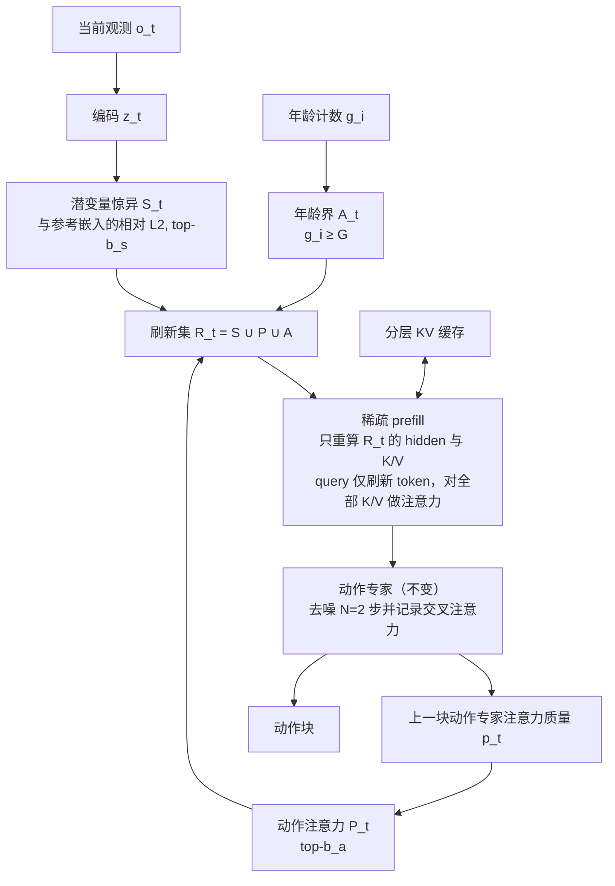

# WAM-Cache

**WAM-Cache**（*Staleness-Bounded KV Reuse for Efficient World Action Models*，arXiv:2610.11401，2026-10-08）是一个 **免训练** 的世界–动作模型推理加速方法：在闭环控制中，跨动作块复用视频 DiT 的逐层 KV，只对一个稀疏的“刷新集”重算 token，并用严格的年龄上界限制陈旧误差累积。

## 英文缩写速查

| 缩写 | 英文全称 | 简要说明 |
|------|----------|----------|
| WAM | World Action Model | 用视频 DiT 表征引导动作专家的世界–动作模型 |
| KV | Key-Value | 注意力层缓存的键值，复用即可省去重算 |
| DiT | Diffusion Transformer | 扩散 Transformer，此处指 Wan2.2-5B 视频主干 |
| Prefill | Prefill | 对观测 token 一次性前向以得到 KV 的阶段，每个动作块执行一次 |
| FLOPs | Floating Point Operations | 浮点运算量，作为 prefill 成本代理 |
| SR | Success Rate | 任务成功率 |

## 为什么重要

- **瓶颈明确：** WAM 闭环里视频 DiT 每个动作块都要跑一次 prefill，占主要算力；已有免训练加速方法在这一步仍是稠密的。
- **反直觉发现：** 即便有“知道真实 KV 漂移”的 oracle，按视觉变化选刷新 token 也只有 65.34%（稠密 90.16%）；决定动作精度的是动作专家在看哪里。
- **免训练、即插即用：** 不改权重，不需重训，可与 Fast-WAM 一类 MoT 结构的 WAM 叠加。

## 方法栈与流程总览

## 方法

- **基座 Fast-WAM：** Wan2.2-5B 视频 DiT + 1B 动作专家，MoT 共享注意力；多相机拼成一帧后 VAE 编码（RoboTwin 2.0 为 120 个视觉 token，LIBERO 为 98）；测试时只编码当前观测，每块一次 prefill。
- **每 token 状态：** 缓存的各层 K/V、上次刷新时的参考嵌入、年龄 g_i、动作专家上一块的注意力质量 p_t[i]。
- **刷新集三准则：** 惊异 S_t 为当前嵌入与参考嵌入的 L2 距离（按两者范数均值归一）的 top-b_s；动作注意力 P_t 为动作专家各层各 query 平均后的注意力质量 top-b_a，取上一块第一去噪步已算好的值，不增加额外计算；年龄界 A_t 为 g_i≥G 的 token 无条件刷新。刷新 token 年龄清零，其余加 1，首块稠密初始化。
- **成本：** prefill 成本按 ρ_t=|R_t|/S_v 线性缩放，上界 ρ̄ ≤ b_s+b_a+1/(G+1)；默认消融配置实测 ρ̄=0.584。
- **超参：** 去噪步 N=2，G=2 全程固定；(b_a,b_s) 默认 RoboTwin clean (0.4,0.1)、randomized (0.4,0.2)、LIBERO (0.5,0.1)、真机 (0.4,0.1)。

## 实验与评测

设置：bfloat16、单张 RTX PRO 6000 Blackwell；基线 FastV、ToMe、Eventful Transformer、VLA-Cache 均校准到同量级 FLOPs。

| 基准 | 稠密 | WAM-Cache（默认） | 同 FLOPs 基线 |
|------|------|------|------|
| RoboTwin 2.0 clean | 90.16%，1.053 T | 88.36%（−1.8），0.615 T（−41.6%） | VLA-Cache 86.16、ToMe 77.92、FastV 62.72、Eventful 52.94 |
| RoboTwin 2.0 randomized | 89.66% | 88.32%（−1.3），−39.3% | VLA-Cache 84.26、ToMe 74.14、FastV 60.18、Eventful 51.36 |
| LIBERO 平均 | 96.50%，0.859 T | 95.85%，0.582 T（−32.3%） | VLA-Cache 94.85、Eventful 93.65、ToMe 91.95、FastV 78.80 |
| 真机 AIRBOT Play（2 任务×20 次） | 85.0%，1.123 T | 82.5%，0.672 T（−40.2%） | 未与基线对比 |

- **较大预算：** RoboTwin clean 90.08%（−28.2% FLOPs）、randomized 89.56%（−37.0%）、LIBERO 96.50%（−26.1%），几乎追平稠密。
- **真机细节：** Carrot in Bowl 90.0→90.0，Stack Cubes 80.0→75.0；每任务 100 条遥操作示范、训练 30k 步，使用 clean 默认预算未重调。
- **延迟（CUDA graph）：** 原生 120 token 下 clean prefill 加速 1.23×，480 token 1.47×，1080 token 1.67×（达 1.71× 上界的 98%）；randomized 1.58×。大分辨率为按原生刷新比例回放的成本测量，未训练对应 checkpoint。
- **刷新规则消融（clean，内容预算 0.5）：** Random 26.88%、像素差 60.40%、Oracle K/V 漂移 65.34%、仅惊异 60.62%、仅动作注意力 81.46%、注意力∪惊异 88.36%。去年龄界为 80.7%，G=2 贡献 7.7 点；G=1→2 省 10.2 点 FLOPs 仅换 0.6 点 SR。
- **去噪步数：** 稠密下 N=1 在 RoboTwin 掉 20 点以上，N=2 比 N=10 低 1.3–1.5 点；N=10 时 WAM-Cache 距稠密 0.6/1.1 点内。

## 源码运行时序图

不适用：仓库 [DingKai0302/wam-cache](https://github.com/DingKai0302/wam-cache) 截至 2026-10-12 只含 `docs/`（项目页）与 `README.md`，README 写 “Code coming soon”，没有可对齐的脚本或目录。

## 工程实践

- 实现要点（从论文推断，非官方代码）：在 Fast-WAM 视频 DiT 每层维护 K/V 缓冲与每 token 年龄；动作专家第一去噪步的交叉注意力需导出给下一块使用；刷新 token 数需固定以便 CUDA graph 回放（论文用 CUDA graph 测延迟，推测其刷新数为定长）。
- 调参顺序：先固定 G=2，再扫 b_a（0.4 前陡升、之后饱和），惊异预算作小幅补充。
- 加速收益依赖视觉 token 数：原生 120 token 下实测 1.23× 远低于 FLOPs 降幅，高分辨率输入更划算。

## 结论

**WAM-Cache 证明了 WAM 的 prefill 可以在不训练的前提下省约 40% 算力，关键是按“动作专家关注哪里”而不是“画面哪里变了”决定重算哪些 token。**

1. **选择准则比预算更重要** — 仅动作注意力 81.46%，加惊异后 88.36%，远胜 oracle 漂移 65.34%。
2. **年龄界是必需的安全阀** — 去掉后降 7.7 点，G=2 是效率-精度折中点。
3. **默认配置丢 1–2 点，加预算可近零损失** — 想要无损用较大预算，节省降到 26–37%。
4. **延迟低于 FLOPs 降幅** — 小 token 数时固定开销占比高，先测实际延迟再决定是否值得。
5. **长程多阶段任务最吃亏** — LIBERO-Long 90.40 对 93.80，阶段切换时继承的注意力滞后。
6. **真机证据薄** — 两任务各 20 次，2.5 点差在抽样噪声量级（推测）。

## 与其他工作对比

| 对照 | 差异读法 |
|------|----------|
| [Fast-WAM](./paper-fast-wam.md) | 被加速的基座；Fast-WAM 本身通过去掉测试时视频想象降低延迟，WAM-Cache 在其保留的 prefill 上再省算力 |
| VLA-Cache / FastV / ToMe / Eventful Transformer | 论文中的同 FLOPs 免训练基线，按视觉相似度或 token 重要性裁剪，在 WAM 上显著更差 |
| [CF-WAM](./paper-cf-wam-dynamic-next-state-prediction.md) | 关注未来表示的选择而非推理成本，二者正交 |

## 局限与风险

- **开源状态：** 代码未发布（仓库占位，见 [wam-cache-project.md](../../sources/sites/wam-cache-project.md)）。
- **适用范围：** 只在 Fast-WAM 一个基座上验证；陈旧误差的大小不受年龄界约束；真机仅 AIRBOT Play 两任务。
- **单位信息：** arXiv 页未列作者单位，本页不标机构。

## 关联页面

- [周报汇总：Manipulation 2026-10-05 至 10-09](../overview/frontier-manipulation-2026-10-05-10-09.md)
- [World Action Models](../concepts/world-action-models.md)
- [生成式世界模型](../methods/generative-world-models.md)
- [Fast-WAM](./paper-fast-wam.md)
- [LIBERO 基准](./libero-benchmark.md)、[RoboTwin](./robotwin.md)

## 参考来源

- [wam_cache_arxiv_2610_11401.md](../../sources/papers/wam_cache_arxiv_2610_11401.md) — 论文归档
- [wam-cache-project.md](../../sources/sites/wam-cache-project.md) — 项目页与开源核查
- [frontier_manipulation_2026_10_05_10_09.md](../../sources/blogs/frontier_manipulation_2026_10_05_10_09.md) — 周报线索
- 论文：<https://arxiv.org/abs/2610.11401>

## 推荐继续阅读

- [WAM-Cache 项目页](https://dingkai0302.github.io/wam-cache/)
- [WAM-Cache GitHub（占位）](https://github.com/DingKai0302/wam-cache)
- [arXiv HTML 全文](https://arxiv.org/html/2610.11401v1)
