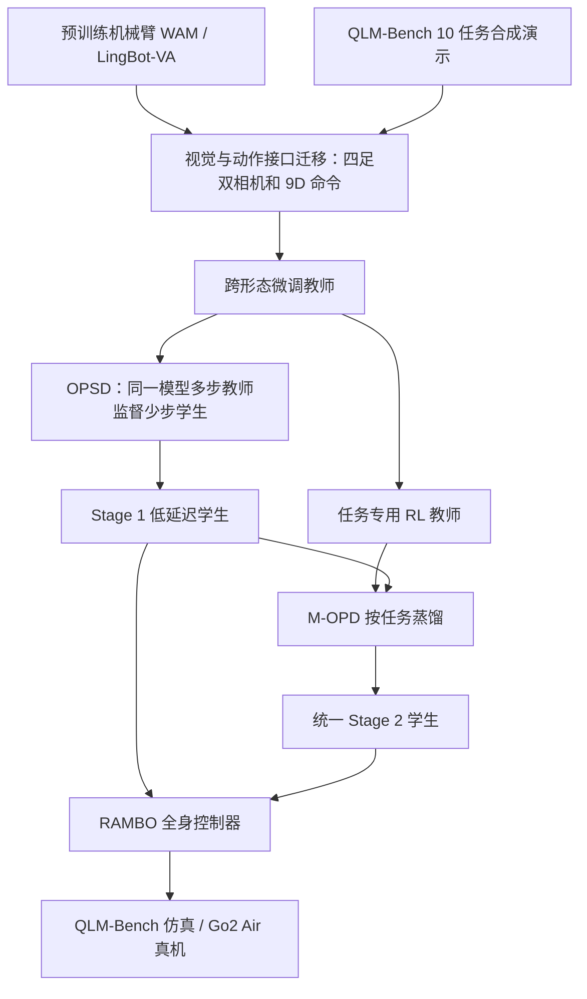
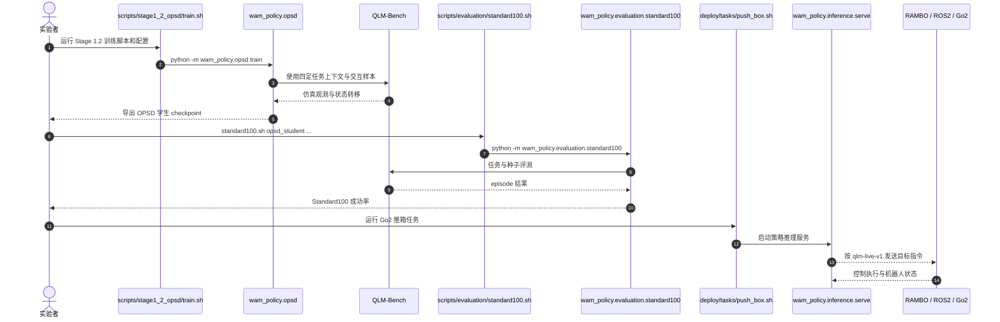

# WAM-Policy：四足前腿操作的世界动作模型迁移与蒸馏 / World Action Models with On-Policy Distillation for Quadrupedal Loco-Manipulation

## 一句话定义

WAM-Policy 将原先为机械臂设计的世界动作模型（WAM）迁移至四足机器人，以前腿代替机械臂执行操作，并通过在线分布上的自蒸馏和任务专用强化学习改进精度与推理成本。

## 英文缩写速查

| 缩写 | 英文全称 | 简要说明 |
|---|---|---|
| WAM | World Action Model | 预测未来视觉和动作的生成式策略 |
| QLM | Quadrupedal Loco-Manipulation | 四足机器人行走与操作耦合任务 |
| OPSD | On-Policy Self-Distillation | 用自身采样分布上多步教师监督少步学生 |
| M-OPD | Multi-Teacher On-Policy Distillation | 按任务路由多个 RL 专家蒸馏统一学生 |
| RL | Reinforcement Learning | 对难任务专用教师做后训练 |

## 核心信息

| 项 | 资料 |
|---|---|
| 官方入口 | [项目或论文](https://aigeeksgroup.github.io/WAM-Policy/) |
| 论文 | [arXiv:2611.24011](https://arxiv.org/abs/2611.24011) |
| 官方源码 | [GitHub](https://github.com/AIGeeksGroup/WAM-Policy) |
| 开放程度 | 官方代码/资料可访问，详见归档与许可边界 |
| 本次检查 | 2026-11-23，一手材料静态核对，未独立复现 |

## 为什么重要

无机械臂四足机器人要用前腿推箱或开门时，运动平衡与操作耦合；机械臂动作空间无法原样执行，而且视频-动作生成慢。本文把形态迁移、加速和增强分为可检查的阶段。

## 核心机制

1. **跨形态迁移**：以 LingBot-VA 系列预训练 WAM 为起点，更改四足视觉接口，把原手臂动作映射为底座运动与前腿末端命令，再由 RAMBO 全身控制器执行。
2. **Stage 1 OPSD**：从有较多采样步的同一教师出发，在学生自身采样分布上提供训练信号，蒸馏为 1 视频步、2 动作步的低延迟策略。
3. **Stage 2**：分别对推箱、开门等难例用 RL 微调任务教师，再经 M-OPD 将多名专家合并为一个学生。
4. **QLM-Bench**：10 项合成四足移动操作任务，1,000 条语言标注示范；仿真分数、实际 Go2 Air 完成率和真实推理-控制节拍分开报告。

## 流程总览

## 源码运行时序图

依据仓库 README、官方可运行入口及相应模块文件编写；仅核对静态源码，未声称已执行训练或真机运行。

## 实验与评测

| 协议 | 作者报告 | 边界 |
|---|---|---|
| QLM-Bench Stage 1 教师 | 77.0% | 10 项仿真任务 |
| Stage 1 OPSD 学生 | 76.7%，采样约快 14 倍 | 仿真，效率和小幅精度差需一起读 |
| Stage 2 M-OPD 学生 | 85.0% | 强化学习与专家蒸馏后，仍是仿真 |
| Unitree Go2 Air 实机 | 7/30 次任务成功 | Stage 1 学生；不能用 85.0% 代替真机结果 |

## 与其他工作对比

| 技术路线 | 优势 | 与本文区别 |
|---|---|---|
| 机械臂 WAM | 预训练动作/视觉先验 | 操作本体、动作接口不同 |
| [Loco-Manipulation](../tasks/loco-manipulation.md) 中传统分层策略 | 可显式分离行走与操作 | 本文迁移生成式 WAM 并做自蒸馏 |

## 结论

**WAM-Policy 将原先为机械臂设计的世界动作模型（WAM）迁移至四足机器人，以前腿代替机械臂执行操作，并通过在线分布上的自蒸馏和任务专用强化学习改进精度与推理成本；使用时必须区分作者报告和可独立复现的验证结果。**

1. 形态迁移关键是观测/动作接口和下游全身控制器，不是把机械臂关节角直接套到前腿。
2. OPSD 的主收益是采样加速；验证任务成功率同时记录完整控制回路耗时。
3. RL 教师用于弥补示范模仿瓶颈，再通过 M-OPD 合成统一学生。
4. 仿真 85.0% 与 Go2 真机 7/30 是不同阶段、不同实验协议，不可混为一谈。
5. 部署检查须包含双相机标定、ROS 2 接口、底层 WBC 安全约束与接触力。

## 工程实践

官方代码 main 分支包含策略训练/评测，另有 qlm-bench 分支；`scripts/stage1_1_transfer/`、`scripts/stage1_2_opsd/train.sh`、`scripts/stage2_1_task_rl/`、`scripts/stage2_2_mopd/` 均有明确入口。评测脚本调用 `python -m wam_policy.evaluation.standard100`，真机 `deploy/tasks/` 配置基于 RAMBO 控制器。主分支 Apache-2.0；`deploy/` 和 QLM-Bench 目录另有 CC BY-NC 4.0 许可。

## 局限与风险

Stage 2 后的 85.0% 只证明作者指定仿真分布内的结果。真机视角额外相机、物理预算、底层稳定性和控制回路延迟可能形成落差；不同分支和许可条件需单独核查。

## 关联页面

- [相关知识与路线](../tasks/loco-manipulation.md)
- [相关知识与路线](../tasks/manipulation.md)
- [相关知识与路线](../methods/reinforcement-learning.md)
- [相关知识与路线](../methods/vla.md)
- [相关知识与路线](../../roadmap/depth-loco-manipulation.md)
- [相关知识与路线](../../roadmap/depth-wam.md)

## 参考来源

- [原始资料归档](../../sources/papers/wam-policy-arxiv-2611-24011.md)
- [原始资料归档](../../sources/sites/wam-policy-project.md)
- [原始资料归档](../../sources/repos/wam-policy.md)

## 推荐继续阅读

- [论文与补充材料](https://arxiv.org/abs/2611.24011)
- [训练/评测代码](https://github.com/AIGeeksGroup/WAM-Policy)
- [QLM-Bench 数据](https://huggingface.co/datasets/AIGeeksGroup/QLM-Bench)
