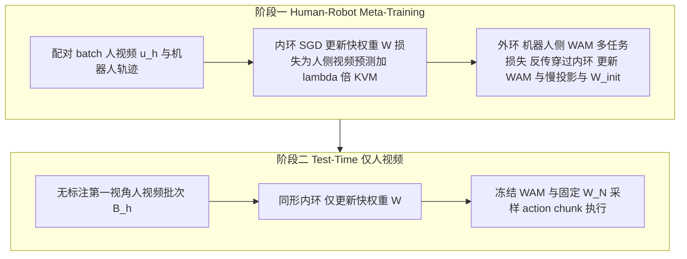

# WAM-TTT（人视频 · 测试时训练 · WAM Steering）

**WAM-TTT**（*Steering World-Action Models by Watching Human Play at Test Time*，[arXiv:2607.06988](https://arxiv.org/abs/2607.06988)，北京大学 · Galbot · 中科院自动化所 · 清华大学）把人类第一视角玩耍视频当作部署时的技能记忆：不把人视频当可模仿轨迹，也不做 in-context 长上下文堆叠，而是在 LDA-1B World Action Model 的 video expert 上外挂快权重分支，用自监督视频预测加逐层 Key–Value 记忆重建更新快权重，经 WAM 共享的视频–动作表示影响机器人动作生成（论文 §1、§3）。

## 一句话定义

**在预训练 WAM 的 video expert 里加一条可写的 fast-weight 记忆分支：meta-training 学会让人视频的 Key/Value 能被机器人 Query 读出；部署时只用少量无标注人视频做内环 SGD 写入快权重，不改 WAM 主体与 action expert，即可 steer 新任务变体。**

## 英文缩写速查

| 缩写 | 英文全称 | 简要说明 |
|------|----------|----------|
| WAM | World Action Model | 联合未来视觉预测与动作生成的具身策略 |
| TTT | Test-Time Training | 测试时对一小部分参数（此处是快权重）做在线梯度更新 |
| KVM | Key–Value Memory reconstruction | 令 f_W(K_h) 逼近 V_h 的逐层重建损失（Eq. 3） |
| LDA | Latent Dynamics Action | 本文底座 LDA-1B，Qwen3-VL-4B + DiT-L MMDiT 动作头（Table B.1） |
| ICL | In-Context Learning | 把人视频当上下文输入冻结模型；本文对照基线 WAM-ICL |
| RFM | Robot Foundation Model | 大规模预训练机器人基础模型 |
| OOD | Out-of-Distribution | 分布外；本文 New 设置是光照、桌高、物体同时变化 |

## 为什么重要

- **新的 steering 接口（作者主张，§1）：** 用户只需拍一段人怎么摆弄物体的第一视角视频，无需机器人动作、手姿或重定向，也无需任务专用全模型微调。
- **记忆写入对比上下文条件（Table 1、C.1）：** 同样吃人视频，New 家庭场景平均 progress WAM-TTT 46.2% 对 WAM-ICL 7.1%；而在 Orig. cubicle 里 WAM-ICL 为 48.4%，只比 LDA 50.2% 略低——ICL 的崩溃主要发生在场景迁移时（New/Orig 保持率 0.15）。
- **与训练期人数据路线互补：** [EgoWAM](./paper-egowam-egocentric-human-wam-co-training.md) 在训练期共训；WAM-TTT 在部署期用快权重吸收人视频（时间尺度之分为本页的归纳，非论文表述）。
- **负面结果有参考价值（附录 E.6）：** 加 MANO 重定向伪动作与前向动力学损失后，4 任务平均由 72.3 降到 28.9；作者据此主张人视频保持无动作更好。

## 核心原理与流程总览

| 模块 | 作用（出处） |
|------|------|
| LDA WAM 骨干 | video expert 与 action expert 经 joint attention 通信，仅 video expert 加 TTT 残差（§3.1，Eq. 1） |
| Video TTT 残差 | Δz_TTT=θ_O f_W(θ_Q(z))；动作流 x(ℓ+1)=x̂(ℓ+1) 不变（Eq. 1–2） |
| 慢权重 θ_{K,V,Q,O}、W_init | meta-training 外环优化，部署时冻结（§3.2–3.3） |
| 快权重 W | 内环 SGD 更新，meta 与 test-time 的步数 N 均为 1（Table B.1），每个训练样本后重置为 W_init |
| L_KVM | 人 Key 经 f_W 重建人 Value（Eq. 3）；线性特例下等价于无 softmax 线性注意力读出（附录 A，作者说明非线性 MLP 下仅为类比） |
| 相位同步配对 | 机器人 t/T_r 取配对人视频最近相位帧，无需 retargeting（§3.2） |

### 内环 / 外环目标（§3.2–3.3）

| 损失 | 监督侧 | 作用 |
|------|--------|------|
| L_vg^human | 人视频（无动作） | 标准 LDA 视频预测损失，驱动快权重吸收视觉动力学 |
| L_KVM^(ℓ) | 人 token 的 K/V | 结构化写入，使 f_W(K_h)≈V_h |
| L_WAM^robot | 机器人视频 + 动作 | 仅外环：让 TTT 残差后的表示仍产生可执行控制 |

## 工程实践

- **骨干与规模（Table B.1）：** LDA = Qwen3-VL-4B-Instruct + DiT-L MMDiT；16 个 block、hidden 1536、32 头；TTT head dim 48、快权重隐层 128；λ=4×10⁻²；内环学习率 meta 0.1、test-time 0.01；meta-training 100k 步，全局 batch 128，8×H800。
- **数据（附录 B）：** 2286 对 episode（G1 600、Galbot gripper 544、Galbot sharpa 1142）；机器人在标准 cubicle 遥操作，人侧 GoPro 第一视角、直接在后来作为 New 评测的真实家庭里录制，无手姿或关节标注；部署时在部署场景重录人视频供 TTT。数据配比（附录 E.4）默认每任务 100 条机器人加 100 条人。
- **评测（§4.1、附录 D）：** 3 种具身、9 项任务、Orig. 与 New 两种设置，每格 25 次试验；progress 是按子目标加权的部分给分，权重集中在关键里程碑，由末端位姿与物体位姿自动打分。
- **结果速览（New 平均，Table 1）：** WAM-TTT 46.2；LDA 32.5；WAM-Cotrain 25.3；EgoScale 15.0（作者自行复现）；π0.5 14.8；WAM-ICL 7.1。Orig. 平均（Table C.1）：61.1 / 50.2 / 29.8 / 30.1 / 31.8 / 48.4。
- **消融（Table 2，New，每格 10 次）：** Table Bussing / Swap Place 完整模型 100.0 / 88.9；[LoRA](../concepts/lora.md) 替换 30.0 / 0.0；去 meta-training 9.0 / 0.0；去 memory recon. 66.7 / 72.0；去 TTT 40.0 / 74.1。
- **扰动（Table 3，Deliver Drink）：** 光照 WAM-TTT 66.0、LDA 54.0、π0.5 28.0、WAM-ICL 12.0；空间扰动 56.0、28.0、0.0、20.0。
- **数据配比（Table E.1，3 任务平均）：** (100,0) 59.5；(100,100) 74.1；(200,0) 73.7；(10,190) 51.4；(100,200) 73.3。
- **复现状态：** 论文全文未给出代码或项目页地址，本页不填 `code:`；复现需自备 LDA-1B 与配对人–机数据。

## 评测证据与清单说法的对比核对

Glen Berseth 的 CoRL 2026 阅读清单（第 054/101 条，P1，分组 Learning from Human Video）对该论文的一句话摘要（作者说明由 LLM 据摘要起草；排序来自作者自己的兴趣模型打分，不是质量评价）：

> Test-time training of a world-action model on human egocentric play to handle out-of-distribution object configurations.

逐项核对：

| 清单措辞 | 论文实际 |
|----------|----------|
| test-time training of a world-action model | 基本准确，但训练的不是整个 WAM：测试时只更新 video expert 里 TTT 分支的快权重，WAM、慢投影、W_init、action expert 全冻结（§3.3）。前提是有 100k 步 meta-training（Table B.1）。 |
| on human egocentric play | 准确：GoPro 第一视角人视频、无标注（§4.1）；部署时需在部署场景重录。 |
| out-of-distribution object configurations | 偏窄。New 设置是光照、桌高、物体实例同时变化的联合 OOD（§4.1），另有光照 / 空间扰动（Table 3）和六轴单因素定性展示（附录 E.3）；并非只处理物体配置。 |
| 遗漏的限定 | 全部为真机（G1 人形 + Galbot 双臂），无仿真；依赖 2286 对相位同步配对数据做 meta-training；9 项任务中并非全胜（见下）；「只需人视频」仅指部署阶段，meta-training 仍需机器人数据与配对人视频。 |

另一处与论文正文自述对不上：§4.2 写「9 项里 7 项完全领先、Flip Steak 以 10.0 打平、唯一例外 Stamp Paper」，但 Table 1 显示 Transfer Bottle 55.6 低于 LDA 56.0，Pyramid Stacking 10.4 低于 WAM-Cotrain 12.0，Flip Steak 为 34.3 对 Cotrain 34.2（10.0 是 LDA / WAM-ICL 的值），Stamp Paper 8.3 对 LDA 33.3。按表格数字，第一名为 6 项（Flip Steak 仅领先 0.1 个点）。

## 结论

WAM-TTT 以人类视频更新快权重改善部分场景进度，但依赖人机技能相位对齐。

- 部署前核对 meta-training 配对与内环适配分布，不能仅凭低重建损失确认对齐正确。
- 把 progress 与二值成功率分开报告，并保留 Stamp Paper 等退化任务。
- 对照等量机器人数据与人类数据时固定总量，几乎持平的配置不能解释为额外迁移红利。

## 局限

**论文自己承认的（§5）：**
- meta-training 假设配对人 episode 与机器人 episode 的技能相位分布对齐，错位会让内环信号劣化而损失不报警。
- 部署适配受快权重网络表达力与慢投影所限，任务偏离 meta 配对分布越远适配越弱，边界未实证刻画。
- 部署接口仅用第一视角 RGB，未用手姿、接触或 3D 线索。

**我读下来看到的未验证之处：**
- progress 是部分给分，不是二元成功率，46.2% 不等于完成率；各任务评分细则见附录 D。
- Stamp Paper 上 WAM-TTT 8.3，低于 LDA 的 33.3，作者归因于印章姿态几何很紧（§4.2，解释未被实验验证）。
- 消融（Table 2、E.2）每格只有 10 次试验，且 Table 2 里 New 设置下 Swap Place 完整模型为 88.9，而 Table 1 的 25 次试验为 66.7，论文未解释差异。
- 附录 E.4 中 (200,0) 的 73.7 与 (100,100) 的 74.1 几乎持平：在该设置下配对人数据只是和等量机器人数据等效，并非额外增益；(10,190) 仅 51.4。
- 对比基线中 EgoScale 为作者自行复现（原模型未开源，§4.2），WAM-Cotrain 在 Orig. 下低于 π0.5（Table C.1），说明基线调参情况需谨慎对待；WAM-ICL 的具体实现细节论文正文未展开。
- 「保留预训练泛化」的证据主要是单任务 Deliver Drink 的 Table 3，其余扰动与实验室场景（附录 E.2、E.3）只有定性 rollout，没有定量表。
- 「零梯度」仅指对主干零梯度，测试时仍对快权重做内环 SGD。
- 作者 §4.4 用 Table 3 论证 TTT「不只是记忆示教轨迹」，但没有测试人视频与机器人行为不一致时的结果（推测：这是更严的检验）。

## 关联页面

- [World Action Models（WAM）](../concepts/world-action-models.md) — Joint WAM 族中部署期人视频 steering 的实例
- [EgoWAM](./paper-egowam-egocentric-human-wam-co-training.md) — 训练期人–机共训与世界目标消融
- [RoboTTT](./paper-robottt-test-time-training-vla-context.md) — VLA 内在线 fast-weight 上下文；信息源（机器人 vs 人视频）与层位置不同
- [StellaVLA](./paper-stellavla-structured-icl-vla.md)、[Zero-WAM](./paper-zero-wam.md) — 同批 embodied ICL / WAM 路线对照
- [WAM-TTT × RoboTTT × StellaVLA × Zero-WAM 对比](../comparisons/wam-ttt-robottt-stellavla-zero-wam-embodied-icl.md)
- [EgoScale](../methods/egoscale.md) — 本文 Table 1 中的人视频缩放基线（15.0% New 平均）
- [LoRA](../concepts/lora.md) — Table 2 中替换 TTT 的通用低秩适应对照
- [Imitation Learning](../methods/imitation-learning.md)、[VLA](../methods/vla.md)、[Manipulation](../tasks/manipulation.md)、[Bimanual Manipulation](../tasks/bimanual-manipulation.md)

## 参考来源

- [WAM-TTT 论文通读归档（arXiv v2）](../../sources/papers/wam_ttt_arxiv_2607_06988.md)
- [每日智能四篇 ICL 纵横向解读（2026-08-31）](../../sources/blogs/wechat_meiri_zhineng_embodied_icl_four_papers_2026-08-31.md)
- [`sources/papers/sun_awesome_wm_2607_06988_wam-ttt-steering-world-action-models-by.md`](../../sources/papers/sun_awesome_wm_2607_06988_wam-ttt-steering-world-action-models-by.md) — 策展摘录
- [`sources/papers/sun_awesome_wm_catalog.md`](../../sources/papers/sun_awesome_wm_catalog.md) — 列表总表
- [`sources/repos/awesome-world-models.md`](../../sources/repos/awesome-world-models.md)

## 继续阅读

- [WAM-TTT 论文（arXiv:2607.06988）](https://arxiv.org/abs/2607.06988)
- [LDA-1B 底座论文（arXiv:2602.12215）](https://arxiv.org/abs/2602.12215)
- [Spatial-TTT（arXiv:2603.12255）](https://arxiv.org/abs/2603.12255) — fast-weight 公式与 meta-training 反传参照
- [EgoWAM 实体页](./paper-egowam-egocentric-human-wam-co-training.md) — 训练期 WAM 人数据共训对照
