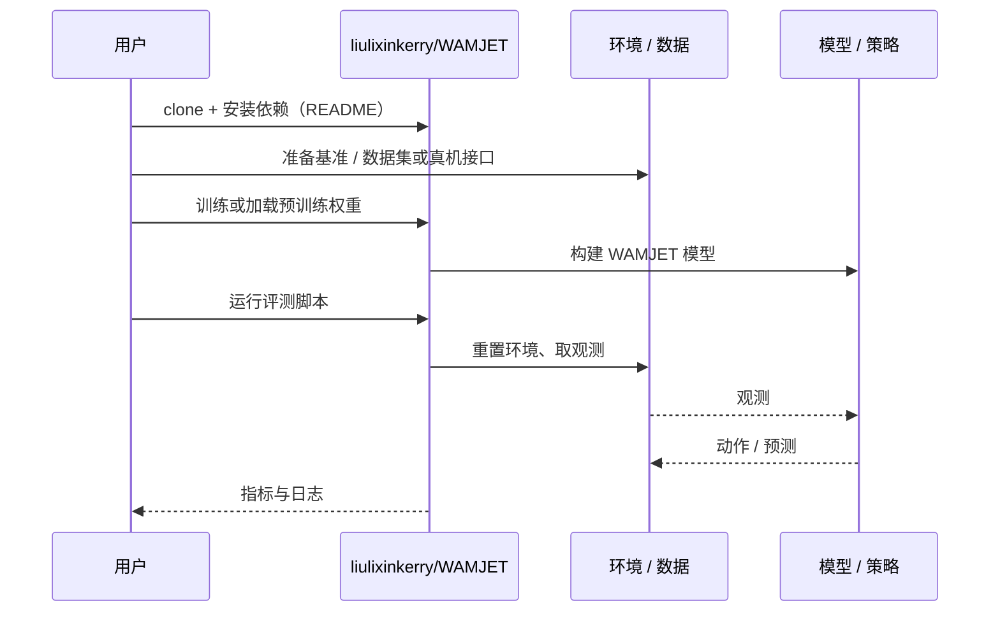

# WAMJET（arXiv:2610.03797）

**WAMJET**（*WAMJET: A Harness for World Action Model Acceleration*，[arXiv:2610.03797](https://arxiv.org/abs/2610.03797)，[项目页](https://liulixinkerry.github.io/WAMJET/index.html)，[代码](https://github.com/liulixinkerry/WAMJET)）来自 [具身智能小站 2026-10-13 盘点](../../sources/blogs/wechat_embodied_station_34_papers_mulligan_2026-10-13.md)，属「世界模型与仿真」组。

## 一句话定义

**用测量、修改、验证工具让编码智能体围绕瓶颈优化 WAM 推理，跨模型、智能体与显卡测试。**

## 英文缩写速查

| 缩写 | 英文全称 | 简要说明 |
|------|----------|----------|
| WAM | World Action Model | 世界动作模型 |
| GPU | Graphics Processing Unit | 显卡 |
| Agent | Coding Agent | 编码智能体 |

## 为什么重要

- WAM 推理加速是工程活；让 agent 系统化做可复现。
- 开源结论：**已开源**（步骤 2.5，2026-10-14）。仓库可达。
- 同期同组工作见 [失败导向采集与可组合世界动作模型：具身智能小站 10-13 期 34 篇阅读坐标](../overview/embodied-station-2026-10-13-34-papers-technology-map.md)。

## 核心机制

| 项 | 内容 |
|----|------|
| **arXiv** | [2610.03797](https://arxiv.org/abs/2610.03797) |
| **开源** | **已开源** |
| **要点** | 区分保持输出质量的工程优化与引入近似后的延迟收益。 |
| **文内指标** | 以原文为准。 |

## 源码运行时序图

以下为按仓库入口（`liulixinkerry/WAMJET`）推断的通用运行链路；入库日仅核实仓库可达，未逐文件阅读，具体脚本名以 README 为准。

## 实验与评测

- 以原文为准。
- **读法：** 本页为索引级摘要，依据公众号转述的官方摘要与仓库信息整理；逐项数字与 baseline 以原文 PDF 为准。

## 与其他工作对比

- 横向索引见 [失败导向采集与可组合世界动作模型：具身智能小站 10-13 期 34 篇阅读坐标](../overview/embodied-station-2026-10-13-34-papers-technology-map.md)；同 arXiv 不重复造页。

## 结论

**加速结果要按「是否改变输出」分类报告。**

1. 开源边界：**已开源** — 仓库可达。
2. 核心机制：区分保持输出质量的工程优化与引入近似后的延迟收益。
3. 复现与选型前核对任务协议、硬件与基准口径，勿直接横比公众号摘录数字。

## 关联页面

- [world-action-models](../concepts/world-action-models.md)
- [paper-realtimewam-training-free-wam-acceleration](./paper-realtimewam-training-free-wam-acceleration.md)
- [agentic-coding-software-fundamentals](../concepts/agentic-coding-software-fundamentals.md)
- [embodied-station-2026-10-13-34-papers-technology-map](../overview/embodied-station-2026-10-13-34-papers-technology-map.md)

## 参考来源

- [wamjet_wam_acceleration_harness_arxiv_2610_03797.md](../../sources/papers/wamjet_wam_acceleration_harness_arxiv_2610_03797.md)
- [wechat_embodied_station_34_papers_mulligan_2026-10-13.md](../../sources/blogs/wechat_embodied_station_34_papers_mulligan_2026-10-13.md)
- [arXiv:2610.03797](https://arxiv.org/abs/2610.03797)

## 推荐继续阅读

- [arXiv PDF](https://arxiv.org/pdf/2610.03797)
- [项目页](https://liulixinkerry.github.io/WAMJET/index.html)
- [https://github.com/liulixinkerry/WAMJET](https://github.com/liulixinkerry/WAMJET)
