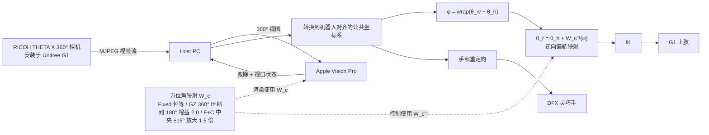

# Warping the Workspace：工作空间扭曲：通过可调触达映射扩展人形遥操作视觉范围

**Warping the Workspace**（*Warping the Workspace: Expanding Visual Access with Adjustable Reach Mapping for Humanoid Teleoperation*，[arXiv:2610.28712](https://arxiv.org/abs/2610.28712)）收录于 senlanke「具身运控lab」10-19–10-23 前沿论文动态（人形/四足）。本页依据**周报条目 + arXiv 摘要页**整理，流程图依据论文方法部分（见参考来源），未逐页核对实验数字；指标与结论以论文为准。

## 一句话定义

**Warping the Workspace：工作空间扭曲：通过可调触达映射扩展人形遥操作视觉范围——联合设计全景方位角视觉扭曲和逆向手臂偏航映射，使侧后方目标被压缩到正面视野，同时保持机器人手臂指向真实目标。**

## 英文缩写速查

| 缩写 | 英文全称 | 简要说明 |
|------|----------|----------|
| RL | Reinforcement Learning | 强化学习 |
| WBC | Whole-Body Control | 全身控制 |

## 为什么重要

- 周报所述待解决的问题：第一视角遥操作时，侧后方目标通常要求操作者和机器人同步大幅转身，降低操作效率。

## 流程总览

图依据：论文 §2 System / Fig.2 / Fig.3 / 式 (1)

## 核心机制

| 项 | 内容 |
|----|------|
| **arXiv** | [2610.28712](https://arxiv.org/abs/2610.28712) · [PDF](https://arxiv.org/pdf/2610.28712) |
| **作者（arXiv）** | Keigo Minamida, Koya Dendo, Yuto Nakamura, Jun Rekimoto |
| **机构（周报所述，未逐条核实）** | 东京大学、Sony Computer Science Laboratories 京都 |
| **arXiv 评论栏** | （无） |
| **开源** | arXiv 摘要页与评论未见代码或项目页链接（仅核对 arXiv 摘要页，不代表未发布）（2026-10-26） |
| **周报所述创新点** | 联合设计全景方位角视觉扭曲和逆向手臂偏航映射，使侧后方目标被压缩到正面视野，同时保持机器人手臂指向真实目标。 |

### arXiv 摘要节选（英文原文）

> First-person humanoid teleoperation ties access to side and rear targets to operator rotation. We present coupled visual--motor remapping, pairing a panoramic azimuth warp with its inverse upper-limb yaw transform.

## 源码运行时序图

**不适用**：arXiv 摘要页与评论未见代码或项目页链接（仅核对 arXiv 摘要页，不代表未发布），无可对齐的官方代码流程。

## 实验与评测

- 周报与摘要给出的数字/场景已写入上表「创新点」与摘要节选；其余实验细节、基线与成功率定义请回到论文正文。
- 读法：先对齐任务设定、传感器与成功定义（仿真/真机），再解读 headline 数字，勿跨论文直接比较。

## 与其他工作对比

| 维度 | 读法 |
|------|------|
| **同周对照** | 见 [人形/四足周报技术地图](../overview/senlanke-weekly-2026-10-19-23-humanoid-quadruped-technology-map.md)，按方向浏览同期论文 |
| **开源状态** | arXiv 摘要页与评论未见代码或项目页链接（仅核对 arXiv 摘要页，不代表未发布） |

## 结论

**Warping the Workspace：工作空间扭曲：通过可调触达映射扩展人形遥操作视觉范围。**

1. 本页是入库级摘要，复现前请核对论文正文、附录与代码仓库。
2. 指标须连同实验条件解读。
3. 关注 arXiv 版本更新与代码发布。

## 关联页面

- [senlanke-weekly-2026-10-19-23-humanoid-quadruped-technology-map](../overview/senlanke-weekly-2026-10-19-23-humanoid-quadruped-technology-map.md)
- [humanoid-locomotion](../tasks/humanoid-locomotion.md)
- [reinforcement-learning](../methods/reinforcement-learning.md)

## 参考来源

- [warping-workspace-adjustable-reach-teleop_arxiv_2610_28712.md](../../sources/papers/warping-workspace-adjustable-reach-teleop_arxiv_2610_28712.md)
- [wechat_senlanke_weekly_humanoid_quadruped_2026-10-19_23.md](../../sources/blogs/wechat_senlanke_weekly_humanoid_quadruped_2026-10-19_23.md)
- [arXiv:2610.28712](https://arxiv.org/abs/2610.28712)
- [arXiv PDF](https://arxiv.org/pdf/2610.28712)：已通读方法部分（实验与附录以略读为准）：全文（3 页短文：引言、系统、评估、结论）

## 推荐继续阅读

- [arXiv PDF](https://arxiv.org/pdf/2610.28712)
