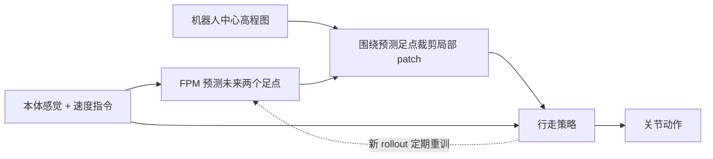
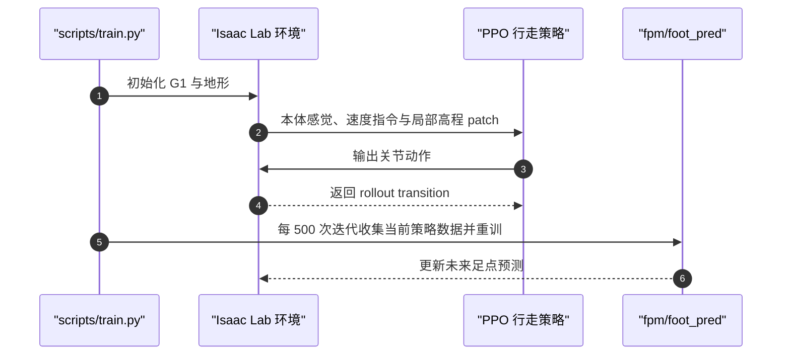

# Watch Your Step（arXiv:2610.29612）

**Watch Your Step**（*Anticipated Perception for Humanoid Locomotion*）由 ETH Zürich Robotic Systems Lab 提出：先用本体感觉和速度指令预测未来落脚点，再只向行走策略提供落脚点附近的地形高程 patch，让感知聚焦在即将影响动作的区域。

## 英文缩写速查

| 缩写 | 英文全称 | 简要说明 |
|------|----------|----------|
| FPM | Foothold Prediction Model | 从本体感觉和速度指令预测未来足点的模型 |
| PPO | Proximal Policy Optimization | 官方仓库提供的策略优化配置 |
| DoF | Degrees of Freedom | G1 仿真模型为 29 自由度 |
| USD | Universal Scene Description | 仓库中的 G1 仿真资产格式 |

## 为什么重要

稠密高程图包含大量与当前落脚决策无关的信息。传统做法让编码器或策略从完整地图中自行学习相关区域；该工作在策略输入前用预测足点筛选局部地形，使策略学习负担更集中。

论文报告，在达到给定地形难度时，该方法约需完整地图策略三分之一的训练迭代；在足点稀疏的地形、狭窄围墙走廊和未见地形上优于完整地图策略，并以更低训练成本达到与注意力编码器相当的表现。

## 核心原理

FPM 只读取本体感觉和速度指令，不读取地形图；它预测未来两个落脚点。系统在 elevation map 上围绕这些位置采样小块 patch，再把局部高度信息送入 locomotion policy。策略和 FPM 联合训练，FPM 周期性利用策略的新 rollout 更新，使预测足点随步态成熟而调整。

### 流程总览

### 训练与评测配置（官方仓库）

| 项目 | README 所示内容 |
|------|----------------|
| 仿真平台 | Isaac Sim 5.1、Isaac Lab 2.3.0 |
| 机器人 | Unitree G1，29 DoF |
| 强化学习配置 | PPO 配置位于 `fpm/agents/` |
| FPM 更新 | 前 500 次迭代使用固定足点；之后每 500 次迭代用当前策略的 5×10^5 条 transition 重训 |
| 入口 | `scripts/train.py`、`scripts/play.py`、`scripts/validate_locomotion.py`、`scripts/validate_corridor.py`、`scripts/validate_foot_pred.py` |
| 依赖 | Isaac Sim 5.1、Isaac Lab 2.3.0、`rsl-rl-lib==3.3.0` |

## 源码运行时序图

仓库还提供播放、行走、走廊及足点预测验证脚本；真机零样本迁移结果由论文摘要报告，README 的主要可运行入口面向 Isaac Lab 仿真。

## 实验与评测

- **训练效率：** 论文摘要报告达到同一地形难度约需全图输入策略三分之一的训练迭代；这是论文设定下的迭代数比较，不等于所有平台上的墙钟时间都缩短为三分之一。
- **地形泛化：** 在稀疏落脚点、狭窄围墙走廊和未见地形上优于观察完整地图的策略。
- **对比注意力编码器：** 论文报告方法用明显更低的训练成本匹配注意力式编码器表现。
- **真机迁移：** 论文摘要报告策略零样本迁移到 Unitree G1，在室内外跨越障碍、楼梯、沟隙和下台阶，包括训练分布外地形。

## 与其他工作对比

| 路线 | 地形信息处理 | 主要取舍 |
|------|--------------|----------|
| 完整地图输入 | 把稠密高程图交给策略或编码器 | 保留全图信息，但要让模型自行学习关注区域 |
| 注意力式地图编码 | 学习对地图区域加权 | 可表达全局关注，但论文指出训练成本更高 |
| Watch Your Step | 根据预测足点裁剪局部 patch | 先验聚焦下一步相关区域，减少输入冗余；依赖 FPM 足点预测质量 |

## 局限与风险

- **预测偏差会影响采样位置：** FPM 若把未来落脚点预测错，局部 patch 可能遗漏实际相关地形。
- **局部观察有信息边界：** 只看足点周围 patch 并不等价于拥有完整全局地图；需要结合目标地形与任务评估观察范围是否足够。
- **复现环境要求：** 官方 README 指定 Isaac Sim 5.1、Isaac Lab 2.3.0 和对应 RSL-RL 版本；切换版本需重新验证。
- **真机结论来源：** 论文摘要报告零样本迁移；仓库公开的运行脚本和资产以仿真训练、播放和验证为主，不能仅据仓库结构推断完整真机部署栈已公开。

## 结论

**该工作的关键取舍是把地形感知从“压缩整张地图”改为“先预测落脚点、再读取局部地图”，以任务相关输入换取训练效率和泛化表现。**

1. **优先复现闭环：** 同时理解 FPM 与 locomotion policy 的交替更新，单独训练一个足点预测器不足以复现论文方法。
2. **读取效率数据：** 约三分之一指达到给定地形难度所需的训练迭代，不直接代表相同比例的实际耗时。
3. **检查走廊与稀疏落脚：** 这些场景是局部足点信息相对完整地图的关键对照情形。
4. **区分发布边界：** 仿真训练与验证代码已发布；真机结果见论文，不要把它误读为仓库提供了完整硬件部署软件。
5. **跟踪足点误差：** 复现时同时看足点预测误差与策略任务成功率，避免只用最终回报定位问题。

## 关联页面

- [Locomotion](../tasks/locomotion.md)
- [台阶与障碍感知行走](../tasks/stair-obstacle-perceptive-locomotion.md)
- [PPO](../methods/ppo.md)
- [Unitree G1](./unitree-g1.md)

- [机器人视觉感知栈选型闭环知识链](../queries/robot-perception-stack-selection-loop.md) — 足点预测用于筛选与当前步态相关的地形感知输入。

## 参考来源

- [论文摘录：Watch Your Step](../../sources/papers/watch_your_step_arxiv_2610_29612.md)
- [项目页归档](../../sources/sites/watch-your-step.md)
- [官方代码仓库归档](../../sources/repos/foothold-prediction-model.md)

## 推荐继续阅读

- [arXiv:2610.29612](https://arxiv.org/abs/2610.29612)
- [官方训练与评估代码](https://github.com/leggedrobotics/foothold-prediction-model)
- [感知越障纵深路线](../../roadmap/depth-perceptive-locomotion.md)
