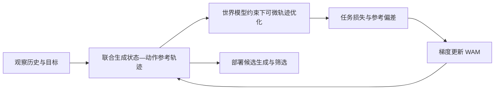

# Joint World Action Models through Differentiable Trajectory Optimization｜WATO：通过可微轨迹优化训练联合世界动作模型

## 一句话定义

**WATO：通过可微轨迹优化训练联合世界动作模型**：将预测轨迹投影到世界模型约束的动力学可行空间，再通过可微优化的任务损失更新 Joint WAM，部署时避免反复求解优化。

## 英文缩写速查

| 缩写 | 英文全称 | 简要说明 |
|---|---|---|
| WAM | World Action Model | 同时表征未来世界状态与动作的模型 |
| WATO | World Action Trajectory Optimization | 本文基于轨迹投影的训练方法 |
| CEM | Cross-Entropy Method | 测试时采样优化基线 |

## 为什么重要

单纯学习状态和动作轨迹匹配不保证动作物理合理、能完成任务；让优化解的任务损失反向驱动生成器可改善目标一致性。

## 核心信息

| 项目 | 核查来源 |
|---|---|
| 作者或机构 | 原文作者机构，见 arXiv v1 |
| 原文 | [一手全文/原始新闻稿](https://arxiv.org/html/2611.17626v1) |
| 代码状态 | 未核实与本研究/设备对应的可运行代码仓库 |
| 核查版本 | arXiv:2611.17626v1 |

## 核心原理

训练时，联合生成器产生状态—动作参考轨迹，预训练的动作条件世界模型用于定义可行的动力学变换；轨迹优化在任务目标和接近参考轨迹间平衡，再将优化后损失经可微求解传回生成器。部署时直接生成候选轨迹并由世界模型筛选，不再进行训练期完整优化循环。

## 流程总览

上述流程图是基于原始资料整理的方法主干，不代表已复现作者模型。

## 源码运行时序图

**不适用：** 论文 v1 未核实公开的可执行训练或部署源码入口；数学伪代码不冒充实现调用链。

## 工程实践

1. 区分训练用可微优化求解器和部署用候选采样及世界模型重排。
2. 消融未来状态参考损失、动作参考损失和动力学约束，确认它们对任务完成的独立影响。
3. 比较部署时延须明确 CEM 采样数、模型评估次数、视距和设备环境。

## 实验与评测

7 个视觉目标控制环境中，论文报告平均成功率由 Joint WAF 对照的 79.9% 增至 WATO 的 91.7%；部署对照 CEM 的延迟几何平均加速为约 11.5 倍。

## 与其他工作对比

同样面向 WAM，但不依赖 CloudRobo-WM1.2 尚未公开核验的完整模型实现；与 [PEAR](./paper-pear-robot-use-rl.md) 的交互奖励 RL 优化对象和监督信号不同。

## 结论

**将预测轨迹投影到世界模型约束的动力学可行空间，再通过可微优化的任务损失更新 Joint WAM，部署时避免反复求解优化。**

1. 不要把训练期的可微轨迹优化错认为部署时也在运行的 MPC。
2. 同时关注任务损失、动作和状态参考项的约束折中。
3. 11.5 倍仅是指定对照和计算环境的延迟比，不能泛化成机器人控制频率倍数。

## 局限与风险

收益依赖世界模型精度与动力学参数化，原文评测仍在限定的模拟视觉目标控制范围内。

## 关联页面

- [paper pear 2611 18562](./paper-pear-robot-use-rl.md)
- [paper budget vln 2611 17442](./paper-budget-vln-2611-17442.md)
- [paper agentic teacher 2611 17394](./paper-agentic-teacher-2611-17394.md)
- [轨迹优化](../methods/trajectory-optimization.md)
- [生成式世界模型](../methods/generative-world-models.md)
- [wam 路线](../../roadmap/depth-wam.md)

## 参考来源

- [一手原文核对记录](../../sources/papers/wato-2611-17626.md)

## 推荐继续阅读

- [一手正文](https://arxiv.org/html/2611.17626v1)
- [作者/扩展资料](https://arxiv.org/abs/2611.17626)

