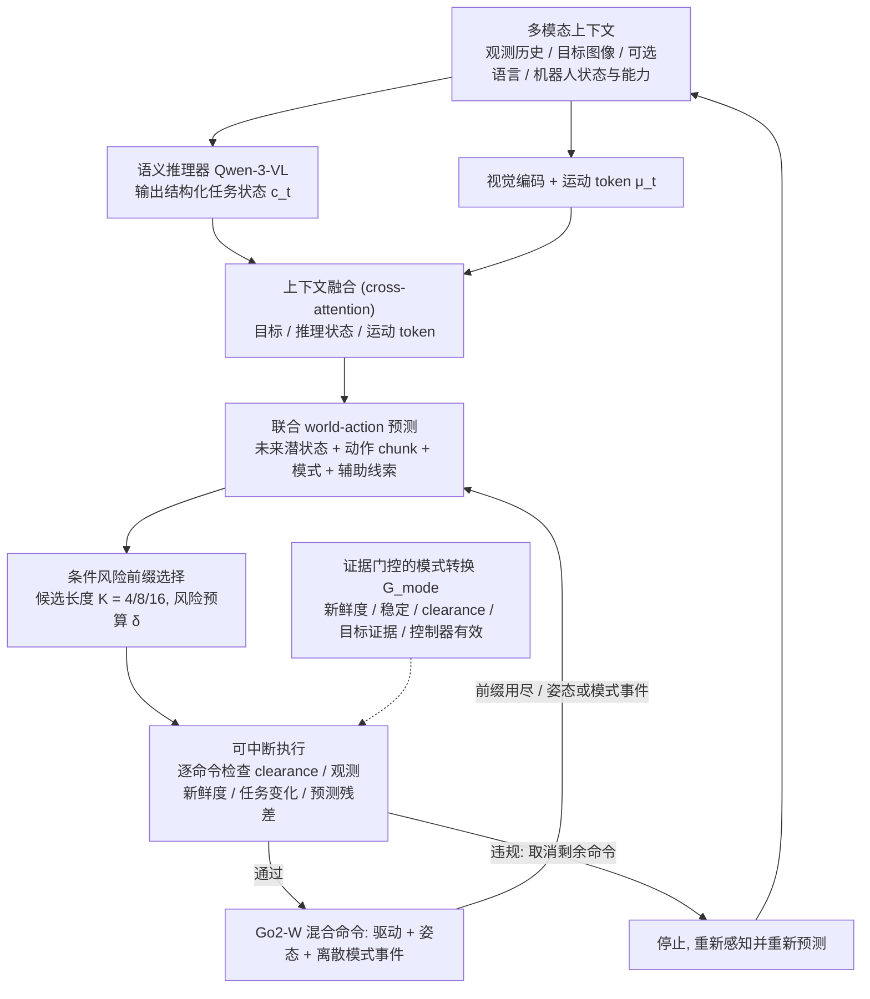

# WAVE-Go（arXiv:2609.18193）

**WAVE-Go**（*WAVE-Go: World-Model Navigation with Adaptive Execution for Wheel-Legged Robots*，[arXiv:2609.18193](https://arxiv.org/abs/2609.18193)）来自 [senlanke 具身运控lab 周更盘点](../../sources/blogs/wechat_senlanke_weekly_humanoid_quadruped_2026-09-14_18.md)（2026-09-14–18）。

## 一句话定义

**按累计失败风险选 4/8/16 步最长可执行前缀；RGB-D/LiDAR 持续重验证并可中断；模式切换需空间/稳定/任务证据。**

## 英文缩写速查

| 缩写 | 英文全称 | 简要说明 |
|------|----------|----------|
| WM | World Model | 世界模型 |
| LiDAR | Light Detection and Ranging | 激光雷达 |
| RGB-D | RGB-Depth | 彩色深度传感 |

## 为什么重要

- 轮足导航需在 walk/drive 间切换；世界模型前缀执行降低盲目长 horizon 风险。

## 流程总览

图依据：论文 §IV-B–G（式 4–11）/ Fig. 1

## 核心机制

| 项 | 内容 |
|----|------|
| **arXiv** | [2609.18193](https://arxiv.org/abs/2609.18193) |
| **开源** | **已开源**（步骤 2.5，2026-09-20） |
| **方法摘要** | World-model navigation + adaptive prefix execution + mode-switch evidence checks. |

## 源码运行时序图

**不适用**（截至 2026-09-20 未发布可运行官方代码或待核实）。

## 实验与评测

- Wheel-legged robot navigation（以 PDF 为准）。
- 读法：先对齐任务设定、传感器与成功定义，再解读 headline 数字。

## 与其他工作对比

| 维度 | 读法 |
|------|------|
| **同周对照** | 见对应 [周更盘点](../../sources/blogs/wechat_senlanke_weekly_humanoid_quadruped_2026-09-14_18.md) 映射表，勿跨任务直接比 SR |
| **开源状态** | **已开源** — 部署前以项目页/arXiv 为准 |

## 结论

**WAVE-Go 用自适应前缀执行把世界模型导航落到轮足异构运动切换。**

1. 开源：**已开源**；勿凭公众号摘要臆断可复现性。
2. 指标须连同实验条件解读（仿真/真机、平台、成功阈值）。
3. 关注 arXiv 版本更新与代码发布。

## 关联页面

- [generative-world-models](../methods/generative-world-models.md)
- [locomotion](../tasks/locomotion.md)
- [sim2real](../concepts/sim2real.md)

## 参考来源

- [wave-go_arxiv_2609_18193.md](../../sources/papers/wave-go_arxiv_2609_18193.md)
- [wechat_senlanke_weekly_humanoid_quadruped_2026-09-14_18.md](../../sources/blogs/wechat_senlanke_weekly_humanoid_quadruped_2026-09-14_18.md)
- [arXiv:2609.18193](https://arxiv.org/abs/2609.18193)
- [arXiv PDF](https://arxiv.org/pdf/2609.18193)：已通读方法部分（实验与附录以略读为准）：§IV 方法（A 预测器适应、B 多模态上下文、C 世界-动作学习、D 混合命令、E 条件风险前缀选择、F 证据门控转换、G 多速率执行）、§V-A 实验设定

## 推荐继续阅读

- [arXiv PDF](https://arxiv.org/pdf/2609.18193)
