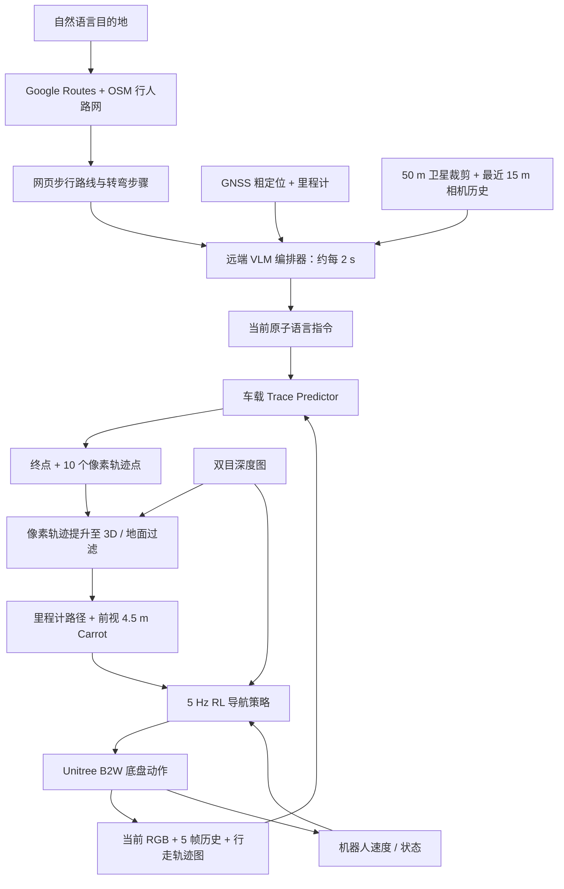

# WayTrace: A Map-to-Language-to-Trace Hierarchy for Embodied Urban Navigation / WayTrace：面向具身城市导航的地图—语言—轨迹分层架构

**论文：** Manthan Patel 等，2026-11-03，arXiv:2611.05129v1（Under Review）｜[论文原文](https://arxiv.org/html/2611.05129v1)｜[项目主页](https://way-trace.github.io/)。

## 一句话定义

**WayTrace 用网页步行地图组织长程目标，用远端 VLM 选择短时原子语言指令，再由车载模型预测图像空间轨迹、深度与 RL 策略负责身体执行：GNSS 主要决定“下一步是什么”，相机决定“脚下往哪走”。**

## 英文缩写速查

| 缩写 | 英文全称 | 简要说明 |
|------|----------|----------|
| VLM | Vision-Language Model | 远端编排器与车载图像轨迹模型所用视觉语言模型 |
| GNSS | Global Navigation Satellite System | 粗定位路由步骤，不直接提供可精确跟踪的过街路径 |
| RL | Reinforcement Learning | 在深度反馈下跟踪三维 carrot 目标并避障的底层导航策略 |
| OSM | OpenStreetMap | 步行路网与路口/人行横道拓扑来源 |
| ADE | Average Displacement Error | 像素轨迹的平均位移误差指标 |
| NT | NaviTrace Score | 图像轨迹评测指标，综合对齐和语义惩罚 |

## 为什么重要

- **解耦规划与控制：** 基于 GNSS 的米级路点会漂到马路上，而只靠单条长语言指令的 VLN/VLA 在开放城市环境中易偏航；WayTrace 把“何时执行何种动作”和“视觉上如何走”分开。
- **无需预先建图：** 接收目的地后利用通用地图路线与在线视觉，低层根据相机可见的斑马线、路沿、岔路决策局部路径。
- **实操价值：** 展示 B2W 轮腿底盘如何在高层 VLM 推理约 1.3 s、车载轨迹约 1.5 s 的情况下异步维持 5 Hz 深度闭环；但远未覆盖红灯/电车的安全关键反应。

## 核心信息

| 字段 | 内容 |
|------|------|
| 机构 | ETH Zurich Robotic Systems Lab、UC Berkeley、NVIDIA（论文署名关联） |
| 原文 | [arXiv:2611.05129v1](https://arxiv.org/abs/2611.05129v1)，2026-11-03，审稿中 |
| 场景 | 苏黎世户外步行导航；Isaac Sim 5.0 模拟城市 + Unitree B2W 实机 |
| 高层 | Google Routes/OSM + GNSS 粗路段定位 + Qwen3.8-Flash-Next 远端编排 |
| 中层 | RynnBrain-9B 衍生的语言条件 trace predictor，先 goal 后 10 点像素轨迹 |
| 低层 | 双目深度投影、地面过滤、4.5 m 前视目标、5 Hz RL 导航 |
| 公开资源状态 | **论文承诺未来发布**环境、基准、数据、模型、代码；**尚未验证到官方仓库 URL**；项目主页读取受阻，不能判定已开源 |

## 流程总览

依论文 Fig. 2、III-A–E 绘制：上层远端、车载视觉轨迹与 RL 低层异步运行；低层在新预测返回前继续执行上一条已投影轨迹。



## 核心原理与训练数据

### 地图到语言：何时执行原子动作

- Google Routes API 生成路线；以 OSM 行人网络调整人行道/过街路径；GNSS 投影到路线只用于选择当前步骤与粗距离。
- 编排器约每 2 s 阅读目的地、路线步骤、50 m 航向朝上的卫星图及近 15 m 相机序列，输出一条指令，例如进入横道、过街、离开横道、转弯或直行；通过少量规则拒绝过早过街/到达指令。
- 关键是**图像视觉决策局部几何，卫星地图/GNSS 不直接替代脚下横道定位**。

### 语言到图像轨迹：先 goal 再 trace

- 模型输入当前帧、过去 5 帧（约每 1.8 m 一帧）、近 16 m 里程计行走图和指令。
- 训练先用 goal token 选定分支，再生成 10 个归一化像素点；部署时用解码后的 goal 隐状态经 MLP 回归 10 点，节省逐点文本解码成本。
- 51,907 条 Mapillary 来源序列经 VGGT-Ω 几何重建与 VLM 标注，构造约 **288k** 真实步行重建样本；同图多指令 teacher 生成约 **863k** 意图条件轨迹。含手工/NaviTrace 重复抽样在内合计 **1,190,594** 条。
- 最终部署的轨迹模型是 **LoRA / 监督微调**；论文曾在单图 teacher 上尝试 GRPO，不能解读为最终 trace predictor 使用在线 RL 训练。

### 图像轨迹到运动：异步、深度过滤、实时反馈

- 以双目深度把像素点投影 3D，过滤非地面轨迹并固定到里程计坐标系。
- RL 策略依据最新深度图与运动状态在 **5 Hz** 下追踪前方 **4.5 m** carrot；新轨迹延迟 1.5–3 s 时继续跟踪旧路径。
- 系统**不**把 VLM 输出视作无碰撞轨迹；高层仍可能预测穿过动态/静态障碍的线，地面过滤与底层避障承担几何可执行性。

## 工程实践

| 模块 | 论文实现与复现关注点 |
|------|----------------------|
| 底盘与传感器 | Unitree B2W、ZED X 双目、LiDAR-inertial odometry、GNSS + Holistic Fusion |
| 远端编排 | Qwen3.8-Flash-Next FP8，4×H100 / vLLM，约 1.3 s；约每 2 s 一次请求 |
| 车载轨迹 | RynnBrain-9B + LoRA / goal-to-MLP，Jetson AGX Thor FP8，约 1.5 s |
| 车载低层 | Jetson AGX Orin 上深度条件 RL 策略，5 Hz |
| 轨迹刷新 | 新指令、前进 3 m、执行 40% 或超过 5 s 触发（附录 A-E） |
| 过街规则 | 横道入口→路面通行→远侧出口三阶段；高层指令须及时切换 |
| 延迟预算 | 从采图到新语言指令影响运动约 3 s；不能用作实时交通安全刹停模块 |
| 复现前置条件 | 论文承诺公开代码/数据；截至本次核查无法验证官方可运行仓库或权重 |

## 实验与评测

以下全部是**作者在 arXiv v1 报告**，未在本仓库独立复现。

| 实验 | WayTrace | 对照 / 解释 |
|------|----------|-------------|
| 完美 GNSS、10 条城市仿真路线、每条 3 次 | **83.3%** 长程成功率 | CityWalker 20.0%、VAMOS 13.3%、OmniVLA 0%；不同控制后端会影响结论 |
| GNSS 7 m RMS 漂移 | **63.3%** | CityWalker + 相同 RL 底层 23.3%；VAMOS + 相同 RL 底层 10.0% |
| 完美 GNSS 人行横道违规率 | **2.2%** | CityWalker + RL 54.8%、VAMOS + RL 31.8%（Table VII） |
| Human-Test（953 条人工 trace） | **83.2** NT，**97.9%** 转向侧正确率 | 评测使用双阶段模型；部署使用单调用模型，论文报告同等水平 |
| 带历史 vs 单帧（50 个短程 episode ×3） | **94.7% vs 74.7%** | 仅短指令级消融，不能视作长程完成率 |
| Intent-conditioned 增量 | **79.33 → 83.32** NT | Table X；加入约 863k 同图多意图样本 |

**真机四条线路（Table II）**

| 目的地 | 距离 | 均速 | 改写高层指令 | 自主里程占比 |
|--------|-----:|-----:|------------:|------------:|
| Starbucks | 426 m | 1.12 m/s | 0 | 100% |
| Snipes | 248 m | 1.01 m/s | 0 | 100% |
| Dieci | 312 m | 1.11 m/s | 0 | 100% |
| Mendokoro | 1,368 m | 1.19 m/s | **2** | **97.2%** |

注意：**最长 1.37 km 并非全程零干预**，两次由操作员替换原子语言指令，并非人工遥操作。Starbucks 线路还曾因电车安全检查由操作员短暂暂停（作者未计入 intervention，因为未修改路径/指令）。真机属于定性演示，**没有真机基线对照**。仿真场景虽有街道设施，却**没有模拟车辆和行人交通**。

## 结论

**WayTrace 的有效分层接口是“地图/指令负责语义路段，相机 trace 负责具体路面几何，深度 RL 负责身体控制”，而非依赖 GNSS 精确贴路点。**

1. **路线鲁棒性来自视觉局部接地**：GNSS 只用来定位下一步，对跨人行横道的路径不施加米级坐标误差。
2. **意图条件数据和时序记忆很关键**：同图多指令消融 NT 79.33→83.32；短时任务有历史 94.7% vs 单帧 74.7%。
3. **部署需把延迟与安全解耦**：新高层指令约 3 s 才作用于轨迹，5 Hz RL 只处理部分动态避障，红灯/电车等场景尚无可靠安全闭环。
4. **报告自主性需精确**：三条城市真机路线无“高层指令改写”，最长 1.37 km 路线 **两次改写、97.2% 自主里程**。
5. **复现边界必须保留**：论文计划开源不等于已有可运行代码；应先核验官方仓库、权重与许可证，再谈复现。

## 与其他工作对比

- [DA-Nav](paper-da-nav.md)：同样把商业地图导航指令作为语义接口，但侧重离散指令到图像网格/恢复；WayTrace 使用有历史的 10 点 trace 和深度 RL 跟踪，是**不同实验协议**。
- [CrossTracer](paper-crosstracer.md)：研究跨本体的像素路径与本体残差适配；WayTrace 侧重长程网页地图协调、指令时机与城市行人约束。
- GNSS 路点法与原子 VLN 法在论文 Table I 中有不同底层后端；解读时结合 Table VII（同一 RL 后端对照），避免将所有提升归因到高层 VLM。

## 局限与风险

- **高层时机是瓶颈：** 指令早/晚、转弯结束后没切回直行；长路线的关键决策错误率积累，不能由单次 83.3% 推导为任意公里级可靠性。
- **环境与安全：** 仿真无车辆/行人，未验证信号灯遵守、对电车反应；复杂交通不能把现有系统当作安全保证。
- **定位/联网依赖：** GNSS 长时失效会使步骤距离陈旧；远端编排器需要联网；地图可能漏标人行横道。
- **单前视与短历史：** 空旷广场、不可见路口、宽马路可能产生持续转向或过晚转向。
- **泛化边界：** 论文仅给 B2W 轮腿真机演示；移植人形等本体属于未来工作，不能宣称已验证。

## 源码运行时序图

**不适用（尚无可核实的官方可运行源码入口）。** 论文在 Introduction 承诺将发布仿真、基准、数据、模型和代码；项目页本次读取受阻。以上「流程总览」是**按论文方法图绘制**，不是按实际源码运行调用链绘制。官方代码链接与具体脚本入口确认后，才能补 ```mermaid 的 `sequenceDiagram`。

## 关联页面

- [视觉–语言导航（VLN）](../tasks/vision-language-navigation.md)
- [机器人运动（Locomotion）](../tasks/locomotion.md)
- [DA-Nav 地图指令导航](paper-da-nav.md)
- [CrossTracer 跨本体轨迹导航](paper-crosstracer.md)
- [11-05 43 篇具身论文技术图谱](../overview/embodied-station-2026-11-05-43-papers-technology-map.md)

## 参考来源

- [WayTrace arXiv v1 全文通读与逐项实验核对](../../sources/papers/waytrace_arxiv_2611_05129.md) — **本页一手技术依据**
- [WayTrace 项目主页核查记录](../../sources/sites/waytrace-project.md) — URL 可验证，项目主页正文与开源入口待核实
- [早期发现线索：具身智能小站 11-05 盘点](../../sources/blogs/wechat_embodied_station_43_papers_grasp_mesa_airoa_2026-11-05.md) — 不作为实验数据依据

## 推荐继续阅读

- [论文 HTML v1](https://arxiv.org/html/2611.05129v1)（含附录 A–F、表 V–XI）
- [论文 PDF v1](https://arxiv.org/pdf/2611.05129v1)
- [WayTrace 项目主页](https://way-trace.github.io/)（本次网页读取受阻）
