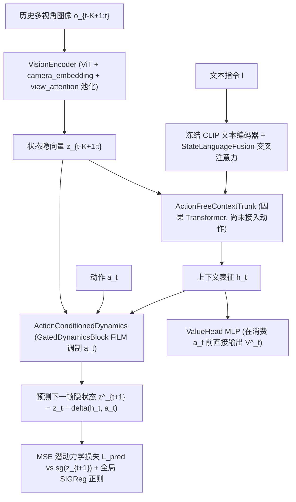
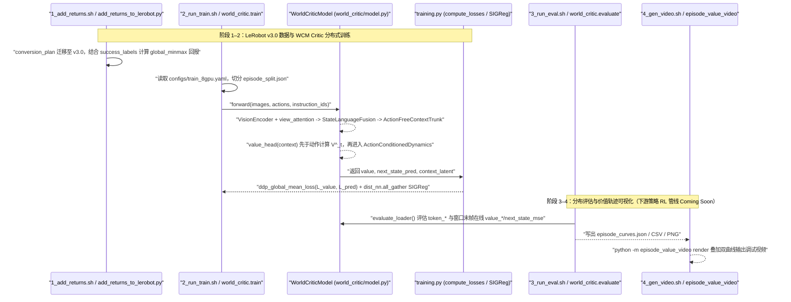

# World Critic Model (WCM)

## 一句话定义

**WCM**（World Critic Model，arXiv:2607.29613）是一种面向[视觉-语言-动作策略（VLA）](../methods/vla.md)后训练的[世界模型](../methods/generative-world-models.md) Critic 架构：通过因果历史 Transformer、**计算图先于动作消费**的价值分支与动作条件 FiLM 潜空间预测头（辅以 `SIGReg` 各向同性高斯正则化），解决单帧 Critic 在部分可观测控制（POMDP）下的进度混淆与稀疏回报下的表征坍缩。

## 英文缩写速查

| 缩写 | 英文全称 | 简要说明 |
| :--- | :--- | :--- |
| **WCM** | World Critic Model | 本文提出的联合价值估计与潜动力学预测 Critic 模型（约 107.2M 可学参数） |
| **LeJEPA / SIGReg** | Latent Joint Embedding Predictive Architecture / Sketch Isotropic Gaussian Regularizer | 无像素重建的潜空间未来状态预测范式及用于防止潜特征坍缩的多维高斯正则项 |
| **POMDP** | Partially Observable Markov Decision Process | 部分可观测马尔可夫决策过程；静态单帧观测不足以唯一确定任务真实阶段 |
| **VLA** | Vision-Language-Action Model | 视觉-语言-动作联合策略底座（本文涵盖 OpenVLA-OFT、$\pi_0$ 与 $\pi_{0.5}$） |
| **IND / OOD** | In-Distribution / Out-of-Distribution | 分布内（已见任务/环境）与分布外（视觉、语义或执行扰动）泛化评测设定 |

## 为什么重要

在 VLA 强化学习后训练（如 PPO、FlowSDE、RECAP、AWR）中，人们往往花大量精力改进策略更新器，却忽略了上游 Critic 的两类结构短板：

1. **单帧 Critic 无法建模 POMDP 时序语境：** 当机械臂在真机或长程任务中出现短暂停顿、遮挡或抓取回退时，仅靠当前帧图像 $o_t$ 无法区分“正要抓取”与“抓取失败后撤”，导致优势估计噪声极高。
2. **纯标量回报拟合引发特征坍缩与 OOD 崩溃：** 在每步 $-1$、失败 $-C_{\text{fail}}$ 的稀疏长程奖励下，若没有自监督动力学预测正则，Critic 会退化为仅记忆背景和轨迹步数的快捷映射；在未见过物体、光线或桌面布局下预测失真。
3. **跨异构策略可插拔复用：** WCM 以 107.2M 参数独立训练，既能替换 PPO/Flow-SDE/Flow-Noise 的在线价值网络，也可离线驱动 AWR/RECAP 加权微调，在每任务仅 1 条演示（One-SFT）下把策略推升到超越 50 条演示 Full-SFT 的水平。

## 核心原理与方法架构

WCM 将 Critic 构建为「多视角视觉编码 + 语言交叉融合 + 无动作因果上下文 + 双分支（结构化隔离价值头 & 门控动作条件动力学）」统一模型（Eq. 1–10）：

### 1. 历史上下文融合与结构级动作隔离（Eq. 1–4 & `model.py`）

- **编码与多视角融合：** 可训练 ViT 对过去 $K$ 帧多视角图像编码，加入可学习 `camera_embedding` 后通过 `view_attention` 查询池化得到单步隐表征 $z_t$；指令文本由冻结 `CLIP` 编码后经两层跨模态交叉注意力融入每步状态 token。
- **无动作因果骨干与严格先后顺序：** 序列 $[z_{t-K+1}, \dots, z_t]$ 经带因果掩码的 6 层 Transformer（`ActionFreeContextTrunk`）输出上下文 $h_t$。在 `WorldCriticModel.forward` 代码实现中，**`value = self.value_head(context)` 在张量 `actions` 进入计算图之前即完成前向计算**，从拓扑上杜绝 Critic 偷看当前动作捷径估分的风险。

### 2. 动作条件 FiLM 门控潜动力学与 SIGReg 正则（Eq. 5–7 & Eq. 10）

- **残差隐状态推演：** 仅在价值分支输出后，将当前动作 $a_t$ 编码为动作特征，经过 3 层 `GatedDynamicsBlock`（含 LayerNorm、FiLM `scale/shift` 调制及偏置初始化为 `-2.0` 的 `sigmoid` 门控残差）预测一步未来潜向量 $\hat{z}_{t+1} = z_t + \Delta(h_t, a_t)$，以 stop-gradient 的真实下一帧隐表征 $\operatorname{sg}(z_{t+1})$ 作为监督目标（$\mathcal{L}_{\text{pred}}$）。
- **防止特征坍缩与实用折中：** 引入来自 LeJEPA 的各向同性高斯正则 $\mathcal{L}_{\text{SIGReg}}$（`17` 个积分节点、`1024` 随机投影方向，全局 DDP `all_gather` 统计），联合目标为 $\mathcal{L} = \mathcal{L}_{\text{value}} + \lambda \mathcal{L}_{\text{pred}} + \eta \mathcal{L}_{\text{SIGReg}}$。作者同时在 Appendix D.1 指出，当直接复用高维 VLM 隐状态执行在线 RL 联合迭代时，`SIGReg` 在大规模张量上的计算/通信开销较大，因而实操中离线预训练阶段启用，在线策略微调阶段关闭该项。

### 3. 稀疏回报标准化与策略耦合（Eq. 8–9）

遵循统一稠密+惩罚回报定义：成功终止帧奖励 $0$，失败终止帧施加 $-C_{\text{fail}}$（真机设为 $300$），其余时间步固定 $-1$；将整个数据集的 Monte Carlo 回报做全局 `global_minmax` 映射到 $[-1, 1]$，由 MSE 损失训练价值头 $V_\theta$，用于计算 PPO/GAE 优势、FlowSDE/FlowNoise 引导或离线 AWR/RECAP 样本重加权。

## 实验评测与方法对比

### 1. ManiSkill 25 项 Pick-and-Place：IND 与三维 OOD 对比（Table 1）

跨三种 VLA 底座及零样本底座（均从同一 SFT 起步或直接 RL 起步），替换 Critic 为 WCM 后在分布内及视觉/语义/执行三维 OOD 均取得全线提升：

| VLA 底座 | 后训练方法 | IND (%) | OOD Vision (%) | OOD Semantic (%) | OOD Execution (%) | OOD Avg (%) |
| :--- | :--- | :---: | :---: | :---: | :---: | :---: |
| **$\pi_0$** | SFT 基线 | 38.4 | 32.6 | 8.4 | 13.2 | 18.1 |
| **$\pi_0$** | + FlowSDE / FlowNoise | 78.8 / 77.8 | 61.1 / 63.4 | 25.4 / 23.1 | 31.5 / 24.2 | 39.3 / 36.9 |
| **$\pi_0$** | + $\pi$-stepNFT | 79.2 | 69.1 | 49.1 | 33.1 | 50.4 |
| **$\pi_0$** | **+ WCM (Ours)** | **84.4 ± 1.2** | **69.1 ± 0.7** | **49.8 ± 2.2** | **35.6 ± 1.3** | **51.5 ± 1.5** |
| **$\pi_{0.5}$** | SFT 基线 | 47.0 | 40.2 | 16.6 | 22.4 | 26.4 |
| **$\pi_{0.5}$** | + FlowSDE / FlowNoise | 90.9 / 89.7 | 68.0 / 69.9 | 34.5 / 35.5 | 45.4 / 54.9 | 49.3 / 53.4 |
| **$\pi_{0.5}$** | + $\pi$-stepNFT | 85.4 | 76.9 | 56.6 | 45.1 | 59.5 |
| **$\pi_{0.5}$** | **+ WCM (Ours)** | **91.9 ± 0.4** | **78.1 ± 1.6** | **58.5 ± 1.0** | **56.5 ± 1.5** | **64.4 ± 1.4** |
| **OpenVLA-OFT** | SFT → GRPO → PPO | 28.1 → 94.1 → 97.7 | 27.7 → 84.7 → 92.1 | 13.0 → 45.5 → 64.8 | 11.7 → 44.7 → 73.6 | 18.3 → 60.6 → 77.1 |
| **OpenVLA-OFT** | **+ WCM (Ours)** | **99.0 ± 0.4** | **92.4 ± 0.5** | **65.9 ± 1.0** | **75.5 ± 0.7** | **77.9 ± 0.8** |
| **OpenVLA-OFT** | **Zero-Shot (0.8%) + WCM** | **98.7 ± 0.3** | **88.0 ± 1.2** | **62.4 ± 2.9** | **70.1 ± 0.3** | **73.5 ± 1.8** |

### 2. LIBERO-Plus 极低演示样本评测（1-Demo SFT + WCM，Table 2）

在每任务仅有 **1 条演示**（One-SFT）的情况下经过 WCM 在线强化学习，全部三种骨干的总成功率均反超 **50 条演示全量监督**（Full-SFT）：

| 底座模型 | Full-SFT (50 demos) | One-SFT (1 demo) | **One-SFT + WCM** | 总提升 ($\Delta$) |
| :--- | :---: | :---: | :---: | :---: |
| **$\pi_0$** | 71.2 ± 1.5 | 39.1 ± 2.1 | **72.8 ± 1.9** | +33.7 |
| **$\pi_{0.5}$** | 72.9 ± 1.8 | 38.0 ± 1.6 | **73.7 ± 1.4** | +35.7 |
| **OpenVLA-OFT** | 71.7 ± 1.3 | 29.3 ± 1.5 | **74.0 ± 1.8** | +44.7 |

### 3. WidowX-250S 真机七项任务对比（Table 3，前 50 次测试轨迹）

在 10 Hz、chunk=5（0.5 s）真机平台上从每任务 100 条演示起步，经过 8 轮每轮 50 条纠偏采样（总计 25 万 transitions），WCM 在离线加权场景下大幅领先 AWR 与 RECAP：

| 底座与方法 | 萝卜抓取 | 香蕉抓取 | 青椒抓取 | 叠布 | 叠毛巾 | 擦拭灶台 | 传送带夹寿司 |
| :--- | :---: | :---: | :---: | :---: | :---: | :---: | :---: |
| **OpenVLA-OFT SFT** | 24/50 | 11/50 | 19/50 | 15/50 | 16/50 | 1/50 | 9/50 |
| **OpenVLA-OFT + AWR** | 29/50 | 23/50 | 24/50 | 29/50 | 35/50 | 10/50 | 17/50 |
| **OpenVLA-OFT + WCM** | **32/50** | **26/50** | **26/50** | **38/50** | **40/50** | **15/50** | **22/50** |
| **$\pi_{0.5}$ SFT** | 25/50 | 31/50 | 34/50 | 21/50 | 24/50 | 4/50 | 13/50 |
| **$\pi_{0.5}$ + RECAP** | 33/50 | 37/50 | 40/50 | 32/50 | 33/50 | 27/50 | 18/50 |
| **$\pi_{0.5}$ + WCM** | **44/50** | **38/50** | **43/50** | **38/50** | **35/50** | **33/50** | **24/50** |

### 4. MetaWorld、CALVIN 与 Sim-to-Real 迁移（Fig. 4 & Table 4）

- **MetaWorld（50 任务）与 CALVIN（ABC→D）：** 结合 Fig. 4 评测结果，接入 WCM Critic 在两类长程/多任务基准上对比单帧 PPO/FlowSDE 均保持优势。
- **Sim-to-Real（Table 4）：** Sim SFT 在真机抓取上为 `0/25`，经过纯仿真 WCM RL 后零样本升至 `7/25, 7/25, 6/25`；若用 Real SFT（`13/25, 2/25, 4/25`）再叠加以仿真为环境的 WCM RL，Sim-IND 从 `6.9%` 提至 `73.5%`，真机三物抓取升至 `11/25, 8/25, 9/25`。

## 结论

**WCM 用约 107.2M 参数的轻量「历史记忆 + 动作隔离价值头 + 潜动力学预测」联合 Critic 替代无记忆单帧 Critic，在不改造底层 VLA 策略网络结构的前提下，将 ManiSkill OOD、1-shot LIBERO-Plus 与七项 WidowX 真机任务成功率推升至显著高于 RECAP/AWR 与无模型 RL 基线的水平。**

- **架构铁律：** 价值头必须严格在动作张量介入前提取特征，否则 Critic 会退化为记忆常见示范动作的快捷估计器而失去 OOD 鉴别力。
- **表征正则：** 为稀疏惩罚奖励增加 `SIGReg` 与下一帧隐态 MSE 约束（`next_state_weight`），能在样本不足或背景扰动时稳住隐藏特征流形。
- **极致样本效率：** 在 LIBERO-Plus 上仅靠 1 条演示做冷启动 SFT 再交由 WCM RL 探索，总成功率反超 50 条演示全量 SFT，证明好 Critic 可大幅替代繁重初期示教。
- **使用范围核查：** 若目前希望直接复用公开权重或训练脚本，官方 MIT 仓库已完整交付 Critic 训练、曲线评测和渲染工具，但完整的下游 VLA 策略强化学习耦合代码与全部权重仍在分批发布中。

## 工程实践

- **开源完整度：部分开源（Critic 完整 MIT 开源；下游 RL 策略与全量 ckpt Coming Soon）。**
  - **GitHub 仓库（<https://github.com/sylvestf/WCM>）：** 已完整发布 LeRobot v3.0 回报标记管线、8 卡 DDP Critic 训练、分布评测、逐帧曲线导出及视频覆盖工具，仓库 README 明确标注完整策略 RL 代码和论文中所有数据点权重将逐步开放。
  - **Hugging Face 集合（<https://huggingface.co/collections/Sylvest/wcm>）：** 目前已发布 `Sylvest/pick-place-wcm`、`Sylvest/pick-place-wcm-ckpt` 与 `Sylvest/libero_plus_lerobot`。
- **仓库默认配置与硬件建议（`configs/train_8gpu.yaml`）：**
  - **模型骨架：** 可训练 `google/vit-base-patch16-224-in21k` + 冻结 `openai/clip-vit-base-patch32`，`latent_dim=384`，`history_size=3`，`trunk_depth=6`，`dynamics_depth=3`，`max_views=16`。
  - **损失与优化：** `value_weight=1.0`, `next_state_weight=1.0`, `sigreg_weight=0.01`（`knots=17`, `projections=1024`），`lr=5e-5`，`per_device_batch_size=32`，`precision=bf16`；单步 `gradient_accumulation_steps` 强制设为 `1`（确保全局 DDP `SIGReg` 精确语义）。
  - **算力参考：** 论文实验训练采用 8×H100，真机 10 Hz 推理可部署在单张 RTX 5090 上。

## 源码运行时序图

以下时序图严格对应官方开源仓库 [`sylvestf/WCM`](https://github.com/sylvestf/WCM) 的实际四步脚本入口与核心 Python 模块（下游策略在线 RL 脚本暂未并入当前发布分支）：

## 局限与风险

1. **下游全量 RL 耦合代码未随初版释出：** 当前开源代码聚焦独立训练与可视化 Critic，若要接入 OpenVLA-OFT PPO 或 $\pi_0/\pi_{0.5}$ FlowSDE 闭环，工程团队需自行对接对应策略代码。
2. **高维在线联合 `SIGReg` 开销：** 若直接把 VLM 大模型隐表征（而非轻量 ViT 384 维特征）接入联合在线微调，`dist_nn.all_gather` 计算 `SIGReg` 会显著拖慢步频（作者在 Appendix D.1 中在在线 RL 停用了 VLM 端正则）。
3. **回报分布对失败惩罚 $C_{\text{fail}}$ 敏感：** 不同任务回合长度差异较大时，`-1` 步惩罚与 `-300` 终止失败惩罚的全局 `global_minmax` 缩放会改变相对斜率，跨域混训需按任务校准回报尺度。

## 关联页面

- 方法与核心范式：[基于模型的强化学习](../methods/model-based-rl.md) · [生成式世界模型](../methods/generative-world-models.md) · [VLA 综述](../methods/vla.md)
- 路线对比：[在线 RL vs 离线 RL](../comparisons/online-vs-offline-rl.md)
- 相关前置与衍生论文：[LeJEPA](./paper-lejepa.md) · [LeVJEPA](./paper-levjepa.md) · [OpenVLA](./paper-openvla.md) · [$\pi_{0.5}$](./paper-pi05-open-world-vla.md) · [Temporal-GRPO](./paper-temporal-grpo.md) · [ActFovea](./paper-actfovea.md)

## 参考来源

- **论文精读归档：** [arXiv:2607.29613 World Critic Model 论文归档](../../sources/papers/wcm_world_critic_arxiv_2607_29613.md)
- **开源仓库核对：** [sylvestf/WCM 代码结构与开源核查档案](../../sources/repos/wcm-world-critic-model.md)
- **官方项目主页：** [sylvestf.github.io/wcm-homepage 站点归档](../../sources/sites/sylvestf-wcm-homepage.md)

## 推荐继续阅读

- 想对比不需要拟合值函数、直接预测帧对相对时间步差分布的路线，请阅读：[STEAM 自监督时间集成优势建模](./paper-steam-advantage-modeling.md)。
- 想深入理解支撑 WCM 潜动力学防坍缩正则的理论源头，请阅读：[LeJEPA](./paper-lejepa.md) 与 [LeVJEPA](./paper-levjepa.md)。
