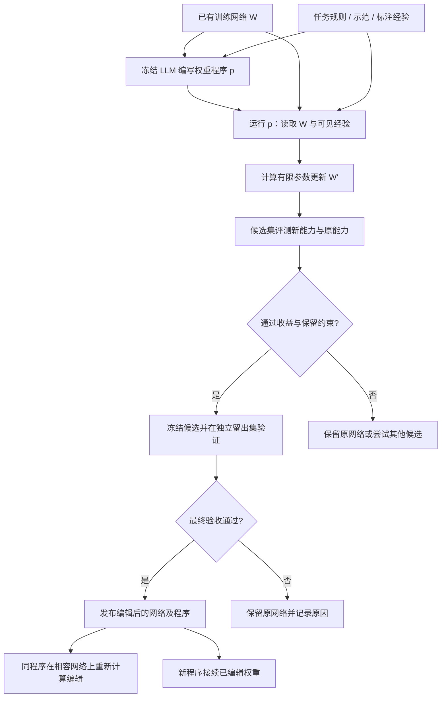
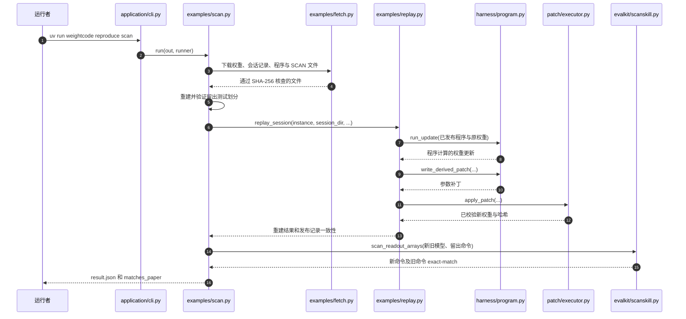

# WeightCode: Installing New Capabilities into Neural Networks via Weight Programming / WeightCode：通过权重编程为神经网络安装新能力

## 一句话定义

**WeightCode 让冻结的语言模型编写可执行的权重程序，根据任务规则、少量示范或标注样本直接计算网络参数更新，旨在加入新能力并保留已有行为；论文主要协议不做梯度训练。**

## 英文缩写速查

| 缩写 | 英文全称 | 简要说明 |
|------|----------|----------|
| LLM | Large Language Model | 冻结的程序编写者，不等于被修改的目标网络 |
| WSP | Weight-Space Programming | 根据网络内部权重和任务知识构造可执行参数编辑 |
| SCAN | Simplified Commands and Actions | 组合式指令到动作序列的评测基准 |
| ViT | Vision Transformer | 用于图像鲁棒性、程序迁移与连续编辑的视觉网络 |
| SHA-256 | Secure Hash Algorithm 256-bit | 验证发布程序、数据和重建参数的身份 |
| FP32 | 32-bit Floating Point | 当前公开应用适配器要求的浮点参数格式 |

## 核心信息

| 项目 | 内容 |
|------|------|
| 研究 | WeightCode: Installing New Capabilities into Neural Networks via Weight Programming |
| 论文 | [arXiv:2611.25476v1](https://arxiv.org/html/2611.25476v1)，预印本 |
| 项目 / 代码 | [项目主页](https://gen-verse.github.io/WeightCode/) · [Gen-Verse/WeightCode](https://github.com/Gen-Verse/WeightCode) |
| 发布材料 | [项目论文 PDF](https://github.com/Gen-Verse/WeightCode/blob/main/assets/WeightCode.pdf) · [数据和会话记录](https://huggingface.co/datasets/Boom5426/WeightCode) |
| 开放状态 | 代码、CLI、复现脚本、技能文件及部分公开数据已发布；仓库 pyproject 标明 MIT |
| 归档与核查 | [论文摘录](../../sources/papers/weightcode_arxiv_2611_25476.md) · [代码路径核查](../../sources/repos/weightcode.md) |

## 为什么重要

- **编辑的对象由“某组权重差值”上升为“可重复运行的参数计算程序”**：相同程序可在结构相容但随机初始化或训练结果不同的网络上重新计算修改，并非简单复制已经算出的数值增量。
- **外部验收而非仅看演示**：限制程序尝试与评测反馈，要求新能力提升并约束旧能力下降，冻结候选之后再使用留出测试。
- **可解释与可组合**：程序能定位网络已有表征、构造门控或线性更新，后续程序可在先前编辑过的网络上执行；这些能力需要按具体设置验证。

## 核心原理

### 参数更新、反馈与验收

输入是已训练网络参数 W、任务描述及少量已定义角色的数据。冻结的 LLM 先编写可运行程序 p，程序读取网络与可访问经验并产生新参数 W'。评估环节验证新条件收益与旧条件保持情况；未通过约束时不发布候选编辑。

- **无需梯度**是论文主要权重程序协议的约束，不代表完全不需要网络前向计算、示例数据或搜索反馈。
- **复用程序**意味着对另一个兼容网络重新执行 p；将某网络的 W'−W 原样相加到另一网络在论文主要迁移设置下不能取得相同收益。
- **连续安装**需要新程序明确以已编辑后的 W' 为起点，并复测旧能力；不能自动推出开放式 RSI 或无限次成功。

## 流程总览

这里区分研究内的程序探索、开发/选择数据与留出测试数据：选择过程的反馈不得被当作最终独立泛化证据。

## 源码运行时序图

以下为**官方已发布的 SCAN 复现命令**，依据实际入口 `weightcode/application/cli.py`、`weightcode/examples/scan.py`、`examples/replay.py`、`harness/program.py` 与 `patch/executor.py`。这是不调用语言模型的**已发布程序重放**，不是重新生成权重程序。

复现源码会核验下载文件、测试划分、已发布程序以及编辑后网络的哈希。没有传沙箱 Python 时，发布程序在 SHA-256 检查后以非隔离方式执行；运行任意新程序前须另行配置受限沙箱。

## 工程实践

| 场景 | 入口与验收要点 |
|------|----------------|
| 最小复现 | Linux x86-64，安装 uv；`git clone https://github.com/Gen-Verse/WeightCode.git` → `uv sync --locked` → `uv run weightcode reproduce scan` |
| 论文 SCAN 结果 | 读取仓库代码和公开 HF 发布物，重跑**已发布**程序；对照原模型、编辑模型与已发布 SHA-256；无 GPU/API Key 要求 |
| ImageNet 复现 | `uv sync --locked --extra train --extra t03`，登录并取得 ImageNet-1k 数据授权，`uv run weightcode reproduce imagenet`；默认仅检查 500 张留出图像并读取已发布编辑权重，不能等同完整训练重演 |
| 用户模型 | CLI 的 import-model → prepare-data → prepare-task → apply/synthesize；公开 Agent Skill **首批**仅支持 FP32 torchvision ResNet-18，需三组互不重叠的 experience/selection/final 数据 |
| 程序安全 | synthesize 使用 bubblewrap 隔离（要求 0.8+）；apply 无沙箱执行需要预先信任并指定程序 SHA-256，哈希校验不能代替沙箱 |
| 验收状态 | 以实际 `final/report.json` 为准：accepted 表示达到所设验证门槛，base-kept/final-rejected 交付原网络；不要仅凭生成器文本宣布成功 |
| 本次核查 | 阅读论文与官方 README、主要 CLI、复现/重放和补丁代码；没有下载权重重跑全部基准，也没有独立复现实测数字 |

## 实验与评测

| 场景 | 作者论文报告 | 解读边界 |
|------|---------------|----------|
| SCAN / jump 组合 | 2568 个新命令 0.0% → 99.8%；1000 个旧命令 99.6% → 99.6%；257 / 803975 个权重变化 | 特定序列模型及命令分布的精确匹配测试 |
| BabyAI | 8 个示范下，新任务 0% → 98.4%；旧任务约 +0.4 个百分点 | 语言导航模拟任务，非实体机器人 |
| ImageNet ResNet-18 / 高斯噪声 | 64+64 标注样本；两程序净增益 +10.47 / +17.62 pt，八种微调方法最优 +8.67 pt | 相同示例预算与干净准确率约束下的比较；净增益同时计入原条件变化 |
| CIFAR-10-C / ViT-Lite 门控 | 移去主要噪声门控，净增益 +31.75 → +10.05 pt | 论文分析集的机制消融，非所有视觉任务通用结果 |
| 跨网络复用 | 同程序重新运行于 5 个独立训练网络，原增益保留约 83–110%；简单复制编辑增量失败 | 结构兼容及研究所选网络条件下，证明的是“程序复算”而非数值差分普适 |
| 接续编辑 | 第二轮新增收益约 +5.2 至 +14.5 pt，先前能力变化 ≤0.23 pt | 有限组次与条件；不是无限递归自改进 |
| 失败案例 | 合成操作组合实验约 5.95%；CIFAR-100 增量五类 17.20% vs 简单对照 21.70% | 应同时记录失败实验，避免只按最佳结果外推 |

其中 pt 指百分点，非相对百分比；所有数字为论文与官方代码材料中的报告值，本次未执行独立复现。

## 结论

**WeightCode 在受控的小规模序列、模拟指令与视觉分类实验中证明，可执行的“权重程序”能够添加新能力、保持旧能力，并在相容网络上重算和接续；泛化到机器人控制仍属待验证方向。**

1. 把**程序身份与生成的参数身份**分开保存，记录两者的 SHA-256、基座版本和数据版本。
2. 严格分离 experience、selection、final，冻结选择后再验收，明确旧任务容忍的退化阈值。
3. 对同构不同初始化网络**重新运行程序**，不要把一次编辑的数值差分当通用模块。
4. 在接续安装第二项能力时同时测试第一项能力的保持程度；只报告新指标上涨不够。
5. 将 SCAN、BabyAI、ResNet-18 的结论视为具体基准证据；上机前仍须做机器人策略、时延、动力学及安全回归实测。

## 局限与风险

- **不是机器人策略论文**：原文没有真实机器人动作控制、传感器闭环、sim-to-real 与安全部署实验；不可直接把 BabyAI 成功率视作具身实机可用性。
- **工程适配受限**：论文测试多种研究网络，公开 Agent Skill 的应用适配器目前针对 FP32 torchvision ResNet-18；其他骨干和机器人策略需要额外适配。
- **模型结构与表示有前提**：程序可能依赖具体张量形状、模型内部已有特征和样本分布，不保证跨架构或困难新类学习可迁移；附录增量分类与组合任务有失败案例。
- **计算和安全成本**：冻结 LLM 不代表零计算成本，程序探索还需前向反馈；执行动态生成的 Python 有安全边界，应隔离并执行数据泄露检查。
- **协议区分**：附录涉及的有限差分探索不属于论文主评测的无梯度编程协议，不可混为同一结果；对比微调时需核对相同的数据、尝试次数及旧能力约束。

## 关联页面

- [Sparks of Weight-Space Programming（MIT 博客）](weight-space-programming.md)：同期不同团队对直接权重编程的早期探索，不是 WeightCode 的旧版本。
- [iWSP：可解释权重空间编程](paper-interpretable-weight-space-programming.md)：另一论文，关注透明 Transformer 与脑响应模型。
- [Robotics Weight Editing](robotics-weight-editing.md)：机器人控制策略的权重编辑探索，证据范围与 WeightCode 不同。
- [CapVector：VLA 能力向量](paper-capvector-capability-vectors-vla.md)：通过权重差分/能力向量迁移做对照。
- [强化学习](../methods/reinforcement-learning.md)：训练更新基线与目标函数背景。
- [Coding Agent 验证闭环](../methods/coding-agent-verification-loops.md)：候选程序生成、选择、冻结与独立验收的工作流对照。
- [RSI 纵深路线](../../roadmap/depth-rsi.md)：本论文属于有界权重改造的参考材料，但单独的编辑结果不构成递归自改进。

## 参考来源

- [论文一手归档及限定条件](../../sources/papers/weightcode_arxiv_2611_25476.md)
- [官方仓库可运行入口及部署边界](../../sources/repos/weightcode.md)
- [原论文 arXiv v1 全文](https://arxiv.org/html/2611.25476v1)

## 推荐继续阅读

- [WeightCode 官方仓库（README 中英双语）](https://github.com/Gen-Verse/WeightCode)
- [论文作者版 PDF](https://github.com/Gen-Verse/WeightCode/blob/main/assets/WeightCode.pdf)
- [WeightCode 官方 Agent Skill 使用约定](https://github.com/Gen-Verse/WeightCode/blob/main/skills/weightcode/SKILL.md)
- [实验数据和模型会话归档](https://huggingface.co/datasets/Boom5426/WeightCode)
