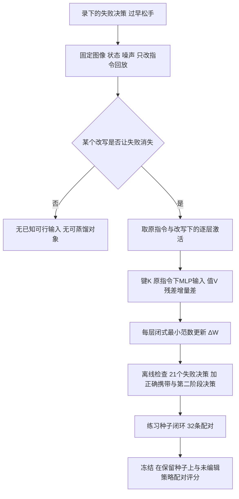

# Distilling Instructions into Weights（arXiv:2611.11894）

**Distilling Instructions into Weights: Closed-Form Edits Fix a Robot Policy's Misreading**（Ali-Adeeb Abbas、Esmaeil Seraj，Northeastern 大学 / General Motors；[arXiv:2611.11894](https://arxiv.org/abs/2611.11894) v1；代码 [adeeb10abbas/weightsmith](https://github.com/adeeb10abbas/weightsmith)；[项目页](https://ali-adeeb.com/weightsmith/)）。原文归档：[sources/papers/weightsmith_instruction_distillation_arxiv_2611_11894.md](../../sources/papers/weightsmith_instruction_distillation_arxiv_2611_11894.md)。

## 一句话定义

**当策略换一种说法就能做对、原说法却做错时，把「说法B」在网络内部产生的逐层激活变化，用一次闭式最小范数更新复制到「说法A」的权重路径上，让原指令不改、权重改，就能修复这种误读（论文第 2 节）。**

## 英文缩写速查

| 缩写 | 英文全称 | 简要说明 |
|------|----------|----------|
| VLA | Vision-Language-Action | 视觉-语言-动作策略，本文对象是 π0.5 |
| VLM | Vision-Language Model | π0.5 的 18 层 PaliGemma 部分，编辑的主要落点 |
| MLP | Multi-Layer Perceptron | Transformer 块里的前馈层，编辑改的是其下投影权重 |
| RoboLab | RoboLab benchmark | 基于 Isaac Sim 的任务泛化策略评测基准，本文用其 16 个任务 |
| McNemar | McNemar test | 配对二分类结果的精确检验，用于「修好 / 弄坏」配对数 |
| Wilson | Wilson interval | 单个比例的置信区间 |
| bf16 | bfloat16 | 编辑后权重取整的数值格式 |

## 为什么重要

- 这是一个对「失败是否可由改写修正」划边界的实证：作者称在没有梯度、训练数据和指令改动的前提下，把一个录下的失败决策修成了（第 1 节、4.1 节）。
- 论文把配对种子、重跑未编辑策略、保留种子确认写成评测要求：同权重重跑会让约三分之一配对结果翻转（4.8 节），这对任何「小样本显示涨点」的结论都是警示。
- 作者自述的规则：能证明网络在某种输入下做对时再编辑，做不到时才训练（第 5 节）；这是作者的解读，不是对一般 VLA 的定理。

## 核心原理与流程总览

**误读诊断（第 2 节）。** 原指令 "Put the cube then the banana in the bowl" 下未编辑 π0.5 成功 9/64，63/64 先抓立方体、抬起后在碗前松手。回放 21 个松手决策（固定图像、状态、噪声，只换指令）：把立方体改名仍有 21/21 松手，把 "in the bowl" 挪到立方体旁只剩 1 至 3 个（图 2a）。作者读作绑定错误：持立方体时把香蕉当成该进碗的物体。

**闭式编辑（式 1）。** 对 VLM 第 0–16 层，键 K 是原指令下 MLP 下投影的输入（6 个决策平均，72 个键 = 40 个提示 / 状态位置 + 32 个图像格），值 V 是显式指令减原指令的层残差增量，更新 ΔW = Kᵀ(KKᵀ + λI)⁻¹V，每层秩不超过 72。

**位置与消融。** 只加提示与状态位置的键仍剩 8 至 15 个松手，加上 32 个图像格后为 0（图 2b、第 5 节）；同一蒸馏放进动作专家或动作头，效果更小或为零且不迁移（4.4 节、表 1）。作者的工作假设是指令经双向注意力被读进图像表示，动作专家在决定是否继续握持时查阅这些表示（第 5 节，标为假设，未直接验证）。

## 实验结果

全部为 RoboLab / Isaac Sim 仿真，单一 zero-shot π0.5 DROID 检查点，与未编辑策略在相同种子上配对评分（第 3 节）。

| 实验 | 未编辑 | 编辑后 | 统计 | 出处 |
|------|--------|--------|------|------|
| cube-then-banana 保留 128 种子 | 27/128 | 106/128（修好 81、弄坏 2） | 配对差 +61.7 点（95% 区间 52.3–70.3），McNemar p=7.2×10⁻²² | 4.1 节 |
| 随机方向对照（同层同秩同奇异值） | 13/64 | 9/64 | p=0.45 | 4.1 节 |
| 0.16% 小编辑（仅图像格、第 8–16 层） | 19/128 | 102/128；但与完整编辑正面对比 41/64 对 55/64 | p=0.007 | 4.2 节 |
| 原样迁移到其余 15 个任务 | eyeglasses 22/64、cube left 8/64 | 44/64、36/64；cube right 仍 0/32，其余 13 个不显著 | p ≥ 0.12（不显著项） | 4.3 节 |
| 编辑位置（表 1） | 5/64 | VLM 55/64、动作专家 20/64、动作头最小范数 0/64 | 只有 VLM 编辑可迁移 | 4.4 节 |
| 感知 / 缺失能力 / 接触 / 夹爪阈值层级 | — | 均无提升，如夹爪单偏置 117/240 对 117/240 | — | 4.7 节 |

噪声底：同权重同种子重跑约 30% 配对结果翻转，80% 功效下 64 对只能检出约 19 点差（4.8 节、附录 B）。

## 与其他工作对比

| 工作 | 关注点 | 与本文的区别 |
|------|--------|--------------|
| 本文 weightsmith 指令蒸馏 | 把有效改写在网络内的激活差，用闭式最小范数更新写进原指令路径 | 无梯度、无训练数据，只修可由改写修正的语言误读 |
| 直接改写指令（论文对照） | 部署时换成显式措辞 | 未编辑策略用显式措辞 57/64（4.1 节），但需要改动指令；本文让原指令不变 |
| [LoRA](../concepts/lora.md) 微调 | 用梯度训练低秩适配器 | 需要数据与优化；本文同样低秩但闭式求解，且作者规则是「能证明做对时编辑，做不到时才训练」（第 5 节） |
| [推理时注意力引导](./paper-inference-time-attention-steering-vla-driving.md) | 推理时修改注意力以引导行为，不改权重 | 每次推理都需干预；本文把修正一次性写进权重 |

## 结论

**当 VLA 换一种说法就能做对时，把该说法在 VLM 各层产生的激活差闭式写进权重，可以在不改指令、不训练的前提下修好特定的语言误读。**

1. cube-then-banana 任务保留种子从 27/128 升到 106/128，同秩随机方向更新无效，说明增益来自蒸馏方向本身（4.1 节）。
2. 编辑只在 VLM 部分有效且可迁移，动作专家与动作头效果小或为零（表 1）。
3. 修复对象有明确边界：感知、缺失能力、接触物理、夹爪阈值类失败编辑均无提升（4.7 节）。
4. 局限：单一检查点、仅仿真、每个比较 16–128 对，编辑改动 13.4% 存储值且迁移事前不可预测；编辑由操作员会话写出，自动工具只在一个任务上验证（第 5 节）。

## 工程实践

- **环境：** OpenPI 的 π0.5 DROID joint-position 检查点（约 3.35B 参数），Isaac Sim 中 16 个 RoboLab 任务，每次评估 16 个并行环境；控制频率 15 Hz，动作块 15 步（第 3 节、图 1）。
- **评分：** 练习种子上开发，通过后冻结，由操作员在从未用于编辑的保留种子上评分；两种策略交替运行顺序；报告配对差的 bootstrap 区间与精确 McNemar（第 3 节）。
- **工具：** `weightsmith distill`（仓库 README 标 Experimental）在全新项目上由规则选决策，8/64 → 36/64（4.5 节），仅此一个任务。
- **盲编辑器：** 7 个 Claude Opus 盲编辑器，1 个提交通过：cube-then-banana 的 1,024 值门控动作头编辑 11/64 → 27/64（4.6 节、表 2）。
- 本页未运行任何代码，仓库 README 已静态读过，复现细节见仓库 docs/DISTILL.md（未读）。

## 与文章说法的核对

对照公众号文章《机器人动作块太长，什么时候该重新规划？》（2026-11-11）中该论文一段（原文：「从有效改写中提取激活，以闭式权重编辑修补特定语言误读，无需梯度训练。仿真中改善明显；编辑针对的是可由改写修正的错误，不能概括为普遍修复操作失败。」）。

| 文章说法 | 论文 / 仓库核对 |
|----------|------------------|
| 从有效改写中提取激活 | 一致。键取原指令激活，值取显式改写与原指令的残差差（第 2 节、式 1）。 |
| 闭式权重编辑、无需梯度训练 | 一致。第 3 节规定编辑者不得用梯度、优化器、微调或黑盒搜索。补充：编辑由 Claude Opus 操作会话在沙箱里写出（第 3 节、5 节），并不是全自动；全自动的盲编辑器 7 个里只有 1 个通过（4.6 节）。 |
| 修补特定语言误读 | 一致。作者称是「绑定错误」（第 2 节），属作者读法，用回放实验支持，未做因果证明。 |
| 仿真中改善明显 | 一致且有限定。27/128 → 106/128（4.1 节）；全部结果是 RoboLab / Isaac Sim 里一个 zero-shot 检查点，没有真机（第 5 节、6 节把真机列为未来工作）。 |
| 针对的是可由改写修正的错误 | 一致。作者明确需要已知可行措辞作输入（第 5 节）；找不到改写的任务无可蒸馏（lookalike 感知）。 |
| 不能概括为普遍修复操作失败 | 一致，且论文更具体：感知、缺失能力、接触物理、夹爪阈值的编辑均无提升（4.7 节）；stacking 门控编辑去掉了错误决策但成功率 39/64 对 35/64 不变（4.6 节）。 |

文章未提及、值得补充的：项目页称还在世界-动作模型和 GR00T N1.7 上测试了跨架构（项目页第 3 节标题「Does it carry over to other architectures?」），这些不在 v1 论文正文里，本次未核对；v1 里只有 π0.5。未发现文章与论文相矛盾的说法。

## 局限

论文自述（第 5 节）：

- 完整编辑低秩但不稀疏，改动 13.4% 的存储值；0.16% 变体应用后仍改 7.4%。
- 蒸馏编辑由操作员会话在编辑者规则下写出；工具只在一个任务上跑过，且需要已知可行措辞作输入。
- 位置对比只覆盖一个任务一个措辞；迁移事前不可预测（left 有效、right 无效），部署需要广泛回归检查。
- 全部是一个 zero-shot 检查点的仿真结果，每个比较 16 至 128 对；失败层级划分没有独立评分者。

本页读者判断（推测，非作者结论）：

- 保留种子之间未编辑策略的基线本身有波动（cube-then-banana 从 5/64 到 27/128，4.8 节），不同比较之间的绝对成功率不宜直接比较。
- 4.3 节的迁移成功没有在事前预测，两个任务的作用机制论文只给出「工作假设」（附录 E），未经检验。
- 项目页的跨架构结论和仓库中的 study 数据本次未逐项核对。

## 关联页面

- [VLA 方法页](../methods/vla.md)
- [机制可解释性](../concepts/mechanistic-interpretability.md)：本文先回放、取激活再编辑，与激活级诊断方法相邻
- [流匹配具身策略](../concepts/flow-matching-embodied-policy.md)：π0.5 动作专家以流匹配生成动作块
- [LoRA](../concepts/lora.md)：对照「低秩因子存储」，但本文无训练
- [RoboLab](./robolab.md)、[Isaac Sim](./isaac-sim.md)：评测环境
- [π0.5 开放世界 VLA](./paper-pi05-open-world-vla.md)：被编辑的基础策略系列

## 参考来源

- [原文归档](../../sources/papers/weightsmith_instruction_distillation_arxiv_2611_11894.md)
- [π0.5 阅读归档](../../sources/papers/pi05_reading_arxiv_2504_16054.md)
- [RoboLab 论文归档](../../sources/papers/robolab_arxiv_2604_09860.md)
- [arXiv:2611.11894](https://arxiv.org/abs/2611.11894)
- [weightsmith 仓库](https://github.com/adeeb10abbas/weightsmith)、[项目页](https://ali-adeeb.com/weightsmith/)

## 继续阅读

- [arXiv PDF v1](https://arxiv.org/pdf/2611.11894v1)
- 仓库中的 BENCHMARK.md、docs/DISTILL.md、LEADERBOARD.md（未读）
- [机制可解释性](../concepts/mechanistic-interpretability.md)
