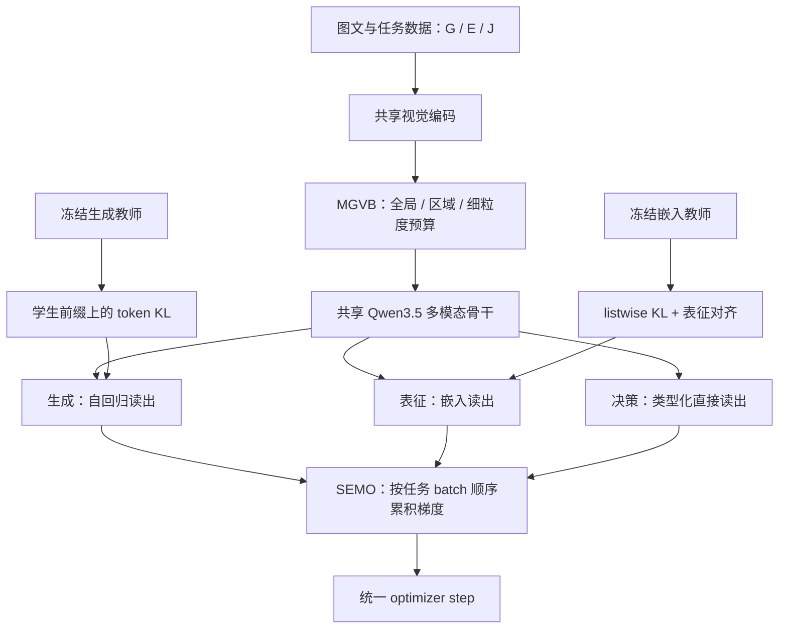
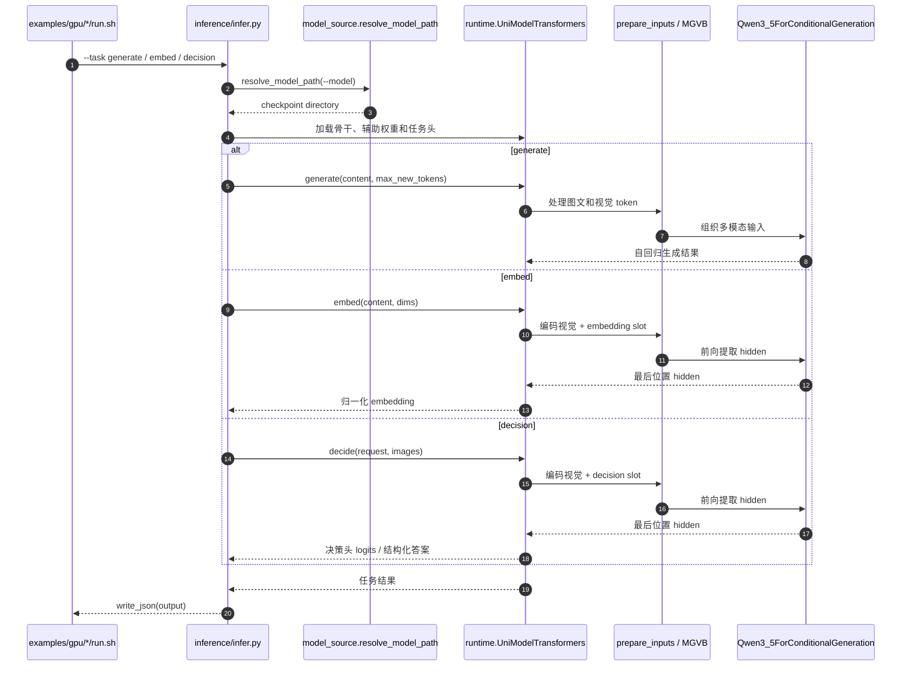

# WePM：统一多模态模型的层级冲突协调 / Hierarchical Conflict Reconciliation for Unified MLLMs

*WePM: Hierarchical Conflict Reconciliation for Unified MLLMs*（**WePM：统一多模态大语言模型的层级冲突协调**），微信 AI / 腾讯等，arXiv:2611.27365v1（2026-11-20）。论文、[公开推理源码](https://github.com/Tencent/WePocketModel)、[模型合集](https://huggingface.co/collections/tencent/wepocketmodel)。

## 一句话定义

**WePM 把视觉–语言理解中的表征检索（R）、自回归生成（G）与类型化决策（J）并入同一套可端侧部署的 2B/4B 模型，分别在视觉 token 颗粒度、监督目标、训练更新三个层面缓解任务冲突。** 它是统一 MLLM 方法，**不是已验证可直接输出机器人动作的 VLA**。

## 英文缩写速查

| 缩写 | 英文全称 | 简要说明 |
|---|---|---|
| WePM | WePocketModel | 腾讯微信 AI 的统一多模态口袋模型 |
| MLLM | Multimodal Large Language Model | 接收图文等模态的大语言模型 |
| MGVB | Multi-Granularity Vision Budgeting | 按全局、区域、细粒度分配视觉 token 预算 |
| ULKD | Unified Learning with Knowledge Distillation | 用生成及嵌入教师的软目标协调训练 |
| SEMO | Sequential Exposure-Mixed Optimization | 按 batch 曝光比例顺序累积多任务梯度 |
| OPD | On-Policy Distillation | 教师在学生生成的前缀状态提供 KL 监督 |
| HCD | Holistic Capability Density | 对能力覆盖、任务表现、驻留权重内存的综合密度指标 |
| GGUF | GPT-Generated Unified Format | 本项目 CPU 推理支持的权重封装格式 |

## 为什么重要

- **统一能力而非串接多模型：** 嵌入检索、图文问答/生成与类型化判断共享主骨干，可降低应用同时驻留多个权重文件的成本。
- **冲突分层处理：** 视觉压缩既要保 OCR 局部细节又要留全局语义；检索的对比目标与生成的 token 目标不一致；多任务训练的更新强度也不同，因而分别处理。
- **适合研究端侧语义模块：** 对机器人上游视觉语义检索、问答及结构化选择有参考价值，但论文并未测机器人动作控制、最坏闭环时延或真机安全性。

## 核心信息

| 项 | 一手来源核对 |
|---|---|
| 论文 | arXiv:2611.27365v1，2026-11-20，预印本 |
| 研究机构 | 腾讯微信 AI（WeChat AI, Tencent）、中国科学院大学、西安交通大学 |
| 骨干 | Qwen3.5-2B / Qwen3.5-4B dense 初始化，同一多模态骨干接任务专用读出 |
| 能力 | Representation/Embedding、Generation、Typed Decision 三族 |
| 训练 | 约一亿清洗样本；最大上下文 8192 token；三族曝光比 G:E:J 为 7:5:1 |
| 教师 | 生成 Qwen3.5-27B、嵌入 WeMM-9B（论文 §4.1） |
| 公开资源 | 2B/4B Transformers 与对应 GGUF 权重、推理 runtime 和示例；未确认完整多任务训练代码/数据已公开 |
| 方法 | 视觉端 MGVB、监督端 ULKD、更新端 SEMO |

## 核心机制

### 1. MGVB：分层视觉预算（§3.1）

视觉编码结果按 **global、regional、fine** 三层保留，满足 B_g+B_r+B_f=B。global 汇总全局信息，regional 分配到重要区域，fine 留下像 OCR 等任务所需的局部纹理与字符线索。带文本的请求可以借文本条件选择区域；**仅有图像、尚无未来 query 的离线索引**使用 query-independent 的选择策略，不应把未来检索问题偷送进预计算嵌入。

### 2. ULKD：双教师知识蒸馏（§3.2）

- **生成侧：** 冻结生成教师在学生采样前缀的状态上给 token 分布，用 KL 对齐，避免固定单一路径 pseudo-answer 的僵化监督。
- **表征侧：** 冻结嵌入教师提供候选相对排序的 listwise KL 与嵌入空间投影/对齐信号；不把检索任务简单改写成文本生成。
- **决策侧：** 类型化 choice、score、binary judgment 保留自己的直接监督目标和决策头。

### 3. SEMO：任务曝光与更新解耦（§3.3）

保持各任务损失权重 λ_i 与其在每次统一更新前出现的 microbatch 次数 n_i,t 两个独立旋钮：按 G/E/J 的任务 batch **逐次前向和反向，累积梯度后只做一次 optimizer step**。该方法减少同时保留三任务计算图的峰值显存，**不是梯度冲突方向投影，也不等于动态自动调权**。论文的 7:5:1 指数据曝光配比，不是损失 λ 的取值。

## 流程总览

按原文 §2–3、Fig. 1–4 汇总**训练方法的数据/监督流**（不是宣称训练代码已发布）：

## 源码运行时序图

阅读 [官方推理源码核查归档](../../sources/repos/wepocketmodel.md) 中 `examples/gpu/generation/run.sh`、`embedding/run.sh`、`decision/run.sh`、`inference/infer.py`、`inference/runtime.py`，整理可运行的 **GPU Transformers 推理分支**，非训练流程：

**路径限定：** 此图只对应 Transformers 实现。若加载的模型目录含 `bundle.json`，`infer.py` 另走 CPU GGUF 后端 `UniModelGGUF`，而不是本图的 Transformers；相关编译/运行说明见 [官方 inference README](https://github.com/Tencent/WePocketModel/blob/main/inference/README.md)。未发现可供等价绘制 ULKD/SEMO 完整训练时序的公开入口。

## 实验与评测（均为作者报告）

| 评测与口径 | WePM-4B | 比较/说明 |
|---|---:|---|
| Embedding / Representation（30 项） | **72.86** | 同表强基线约 72.82；是多数据集平均 |
| Generation（39 项） | **62.41** | 同表强基线约 61.83；不是任务成功率 |
| Typed Decision（7 项） | **61.11** | 同表强基线约 61.06 |
| 联合 R+G（Table 4，Joint） | **52.74** | 对比最强 ULME 为 38.15；**不含 decision** |
| 4B BF16 驻留权重 | **约 8 GB** | 三独立强模型组合约 21 GB，减少 **61.9%** |
| HCD（Fig.6） | **0.244** | 独立组合 **0.092**，比值 **2.64×** |

- **MGVB 预算消融（Table 5）：** B=128 / 256 / 512 的 Joint 为 39.58 / 41.55 / 41.90；B=128 的 OCR 降至 58.53，而未加入 MGVB 的参照是 64.59，说明预算过紧会伤害局部细节。
- **蒸馏策略（Table 6）：** 固定伪标签方案 49.33 vs 在学生前缀上提供监督的 OPD 方案 51.70（对应实验条件下）。
- **顺序梯度累积（Table 7）：** 峰值显存 76.23 GiB vs 同时构图方案 209.98 GiB；这属于**训练配置**测量，不是推理显存节省比例。
- **HCD 定义：** 能力族覆盖 K、任务性能的归一化加权调和均值，与**模型驻留权重** M 联合计算；不能把多个同类 benchmark 当多种能力，或把 BF16 权重体积当全系统 RAM。

## 与其他工作对比

- **单一生成式 MLLM：** 可以处理图文问答，但不自动具有适配搜索 ANN 索引的判别式嵌入或直接 typed decision 输出接口。
- **多个专用模型并行：** 可以分别优化生成/嵌入/决策，但驻留多个骨干权重；WePM 的权重共享收益应同时考虑联合任务质量与真实推理峰值。
- **ULME、CAFe 等统一方法：** 论文 Table 4 的 52.74 vs 38.15 **限定 representation+generation 联合实验**，不代表三族全能力均超越相同幅度。
- **[VLA](../methods/vla.md)：** WePM 的 decision 是候选选择/打分/二元判断，不是连续力矩、轨迹或动作块；与 VLA 的控制闭环、动作 I/O 不可混同。

## 结论

**WePM 提供可复用的「细节保留 + 软目标协调 + 顺序更新」多任务设计，统一骨干的价值需在同一负载下用能力质量、驻留权重与端到端延迟一起衡量。**

1. 先定义本应用是否真的需要 **R/G/J 三种能力**，不要把 OCR、caption、VQA 视为三个独立能力族。
2. 压缩视觉 token 时，应以小字符、目标区域等高分辨率任务做反例测试；预算 B 不能只看平均分。
3. 把蒸馏的 student-prefix OPD 和固定答案蒸馏区分，并分别记录表征质量与生成质量。
4. 多任务训练分别记录 loss 权重和 batch 曝光，不把 7:5:1 曝光比误当作 loss 权重。
5. 把 **8 GB BF16 权重**与激活、KV cache、视觉预处理及 GPU runtime 峰值显存分开测量。
6. 用作机器人语义上游层前，另行测试 P95/P99 时延、误决策及动作模块的真实闭环指标。

## 工程实践与复现

- **可运行的入口：** `bash examples/gpu/generation/run.sh single_text`、`bash examples/gpu/embedding/run.sh`、`bash examples/gpu/decision/run.sh`；它们调用 `inference/infer.py` 并输出 JSON。使用时应参照 [官方 inference README](https://github.com/Tencent/WePocketModel/blob/main/inference/README.md) 安装特定依赖并检查 GPU 可用空间。
- **开放权重：** [官方模型合集](../../sources/models/wepocketmodel-collection.md) 列出 2B、4B Transformers 与 CPU GGUF；模型许可依 checkpoint 卡片核对，不能从代码许可证推断。
- **代码安全：** `--trust-model-code` 会加载 checkpoint 中的 `runtime_sources/` 并执行代码，需人工审查与固定 Hub revision；默认使用仓库附带 runtime。
- **复现边界：** 此次核对到**可运行的推理源码及模型**，没有核对到完整约一亿样本联合训练流水线；作者分数未独立复跑。
- **机器人适配：** 可作为语义检索/理解候选模块，但真正部署仍需给 VLA/动作头单独建立接口与控制频率预算。

## 局限与风险

- 论文 §6 报告与原始骨干相比，某些 agentic/tool-use 性能下降；统一任务目标不保证所有外部任务无损。
- SEMO 的固定曝光与 λ 依赖任务分布设计，缺少对任意动态任务组合自动自适应的保证。
- MGVB 的精细预算会影响 OCR 等高分辨率任务；在不同图像/查询分布上须重测。
- 权重显存数字不代表包含 KV cache、视觉特征和框架碎片的运行峰值；尚无具身动作策略或真机实时/安全实验。

## 关联页面

- [多模态基础](../concepts/multimodality-basics.md) — 同一视觉语言骨干多输出能力的技术背景
- [视觉–语言特征融合](../concepts/vision-language-feature-fusion.md) — 理解 MGVB 和检索表征的边界
- [具身基础模型实时性与泛化取舍](../concepts/embodied-fm-latency-generalization-tradeoff.md) — 应用于机器人语义层时必须验收的时延预算
- [VLA 方法](../methods/vla.md) — 连续动作输出与此处 typed decision 的本质区别
- [模型架构纵深路线 Stage 5](../../roadmap/depth-model-architecture.md) — 端侧统一能力、权重共享与部署成本案例

## 参考来源

- [WePM 论文逐节核读归档](../../sources/papers/wepm_hierarchical_conflict_reconciliation_arxiv_2611_27365.md)
- [官方推理源码核对记录](../../sources/repos/wepocketmodel.md)
- [官方模型合集与开放状态](../../sources/models/wepocketmodel-collection.md)
- [arXiv:2611.27365v1 全文](https://arxiv.org/html/2611.27365v1)

## 推荐继续阅读

- [WePM 原始 PDF（方法、图表与限制）](https://arxiv.org/pdf/2611.27365)
- [官方代码仓库与推理文档](https://github.com/Tencent/WePocketModel)
