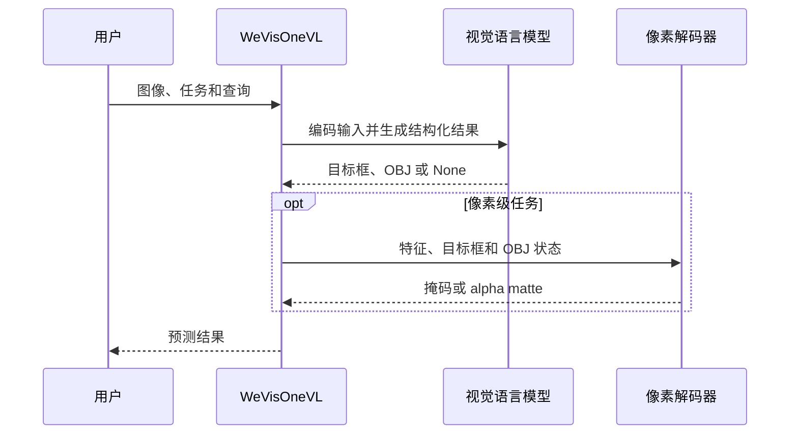

# WeVisOne-VL：从物体到像素的统一视觉感知

## 一句话定义

腾讯微信视觉团队提出的视觉语言模型，将目标级定位和像素级分割、抠图统一到同一接口，并支持缺失目标拒答。

## 英文缩写速查

| 缩写 | 英文全称 | 简要说明 |
|------|----------|----------|
| VLM | Vision-Language Model | 视觉语言模型 |
| OCR | Optical Character Recognition | 文字识别 |
| SFT | Supervised Fine-Tuning | 监督微调 |
| RL | Reinforcement Learning | 强化学习 |

## 核心信息

| 项 | 内容 |
|----|------|
| 机构 | 腾讯（Tencent）微信视觉团队 |
| 论文 | [arXiv:2610.31329](https://arxiv.org/abs/2610.31329)，预印本 |
| 模型 | 2B、4B；官方公开权重和推理代码 |
| 任务 | 检测、指代定位、计数、指点、OCR、分割、抠图 |

## 核心原理

模型以结构化文本表示坐标和缺失目标，输出 `None` 作为拒答；像素任务中，OBJ token 的隐藏状态、预测框和视觉特征输入约 9.6M 参数的像素解码器，得到掩码或连续 alpha matte。训练采用三阶段 SFT 和混合任务 RL。

## 源码运行时序图

官方 README 使用 `WeVisOneVL(...).predict(...)`；具体安装及任务选项见[仓库归档](../../sources/repos/wevisone-vl.md)。

## 评测

官方报告以检测 F1 在 IoU 0.5–0.95 上的均值及缺失目标拒答率为指标，采用 greedy decoding 和每图不超过 1,960 个视觉 token。下表为报告的百分数，非独立复现结果。

| 基准与指标 | LocateAnything-3B | WeVisOne-VL-4B |
|---|---:|---:|
| WeRef-Bench F1 Mean | 51.7 | 78.7 |
| WeRef-Bench 拒答率 | 73.0 | 96.4 |
| RefCOCOg 拒答率 | 0.6 | 67.4 |

两组拒答率来自不同基准，不能混为一项。官方表中 Qwen3-VL-8B 的 WeRef F1 为 36.7、拒答率为 18.3；不意味着所有任务或场景都优于该模型。

## 结论

统一的目标与像素接口有助于构建语言条件视觉感知，但评测优势需要结合任务和部署条件判断。

- 目标可能不存在时，分别测试定位质量和拒答率。
- 需要抠图时关注 alpha matte，与二值分割掩码区分。
- 机器人应用需自行测量延迟、视角变化和误拒答，并在控制回路外进行安全处理。
- 官方开放推理、评测和 2B/4B 权重；微调代码在 README 中仍列待办，不能据此假定训练全流程可复现。

## 关联页面

- [Sa2VA](./sa2va.md)：以多模态模型与分割模块结合输出掩码。
- [LISA](./lisa.md)：语言驱动的分割方法。

## 参考来源

- [论文归档](../../sources/papers/wevisone_vl_arxiv_2610_31329.md)
- [官方仓库归档](../../sources/repos/wevisone-vl.md)
- [官方论文](https://arxiv.org/abs/2610.31329)
