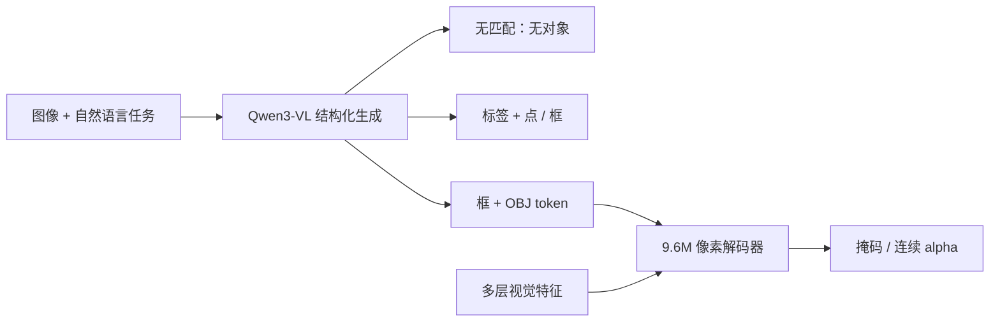
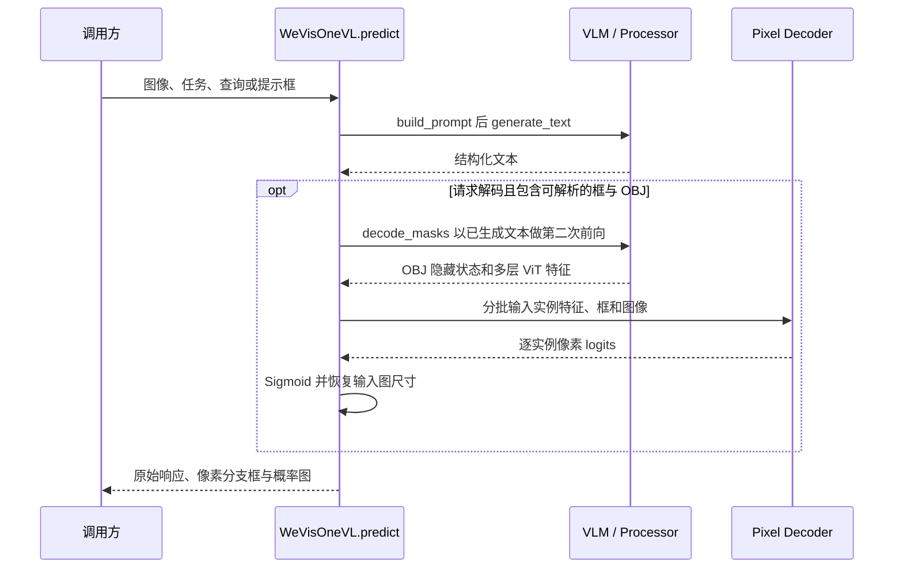

# WeVisOne-VL：从物体到像素的统一视觉感知

英文原题：*WeVisOne-VL: Unified Visual Perception from Objects to Pixels*。

## 一句话定义

腾讯微信视觉团队在 **Qwen3-VL** 上统一检测、指代定位、计数、指点、OCR、指代分割与抠图。同一模型可以输出点、框、二值掩码、连续 alpha，或者在未匹配到目标时不返回对象。

## 英文缩写速查

| 缩写 | 英文全称 | 简要说明 |
|---|---|---|
| VLM | Vision-Language Model | 视觉和语言条件的骨干 |
| OCR | Optical Character Recognition | 文字位置识别及转录 |
| SFT | Supervised Fine-Tuning | 分阶段监督微调 |
| GRPO | Group Relative Policy Optimization | 从一组结构化响应的相对奖励优化策略 |
| IoU | Intersection over Union | 预测与标注的交并比 |
| MAD | Mean Absolute Difference | alpha 抠图的平均绝对差 |

## 为什么重要

给机器人自然语言指令时，视觉系统不只要识别「这是杯子」，还要区分目标是否存在、是哪个实例、以及边界是否足够精细。点和框适合粗定位，掩码用于区域级后处理，alpha 适合分数透明度和细边界。它们都不是三维位姿、可抓性或控制置信度。

## 核心机制

1. **统一对象语法。** 语言模型生成标签和归一化坐标，坐标用 `[0,1000]` 的 token 表示；无匹配可输出 `<box>none</box>`。数据引擎用对难负例的整图复核区分真不存在和检测漏报；论文报告逾 1 亿图像、约 36 亿框标注。
2. **用对象 token 请求像素输出。** 预测框后附 `<OBJ>`。约 9.6M 参数的解码器用 token 隐藏状态、框位置和多层 ViT 特征构造实例查询，并输出全图概率；抠图增加边界精细化，不依赖另行调用 SAM。
3. **先对齐输出，再加像素监督。** 论文训练依次建立任务语法、提高分辨率和密集目标覆盖、联合 token 与像素训练并细化 alpha，最后做混合任务 GRPO。定位奖励在类别内做 Hungarian 匹配并累加匹配 IoU 的三次方；分割/抠图的 RL 奖励仍基于框和 `<OBJ>`，不是直接像素奖励。

## 源码运行时序图

固定提交 `80ecbdd` 的推理路径。SDK 的 `response` 保留结构化文字；通用检测框需解析响应，不要把仅为像素分支返回的 `result.boxes` 直接当全部检测结果。

## 实验与评测

数值均来自 [论文 v2](https://arxiv.org/pdf/2610.31329v2) 4B 行，非独立复现。§5 使用温度 0 贪心解码，每图最多 1,960 个视觉 token。

| 基准（论文表） | 4B 结果 | 读法 |
|---|---:|---|
| LVIS / Dense200（表 2） | F1 Mean 55.3 / 71.3 | 在 IoU 0.50–0.95 上求均值，不是 AP |
| WeRef-Bench（表 3） | F1 Mean 78.7；拒答 96.4% | LocateAnything-3B 为 51.7、73.0%；拒答只看缺失目标 |
| RefCOCOg-Rej（表 3） | 拒答 67.4% | 另一数据集；不可与上行合成通用拒答率 |
| PixMo-Count test / PointBench（表 4–5） | 89.6% / 71.9% | 分别是计数 exact match 和指点评测 |
| ReasonSeg val / Ref-ZOM（表 7） | gIoU 71.2；Ref-ZOM cIoU 72.2、拒答 86.0% | 分割重叠和空结果是不同指标 |
| WeRefMat 指代提示（表 8） | MAD×10³ = 9.8 | 越低越好，和给定真值框的抠图协议不同 |

## 与相关工作对比

- [LISA](lisa.md)也用特殊 token 驱动像素解码，但这里还用预测框约束实例查询，并支持连续 alpha。
- [Sa2VA](sa2va.md)以 SEG token 结合 SAM 2，覆盖视频指代分割；WeVisOne-VL 侧重单图上统一更多目标和像素任务。
- LocateAnything 更接近[目标检测](../methods/object-detection.md)和空间定位基线。是否要额外运行像素分支，应由[机器人视觉感知](../methods/robot-visual-perception.md)的延时、边界质量和安全需求决定，不只比较单一 F1。

## 工程实践

- **截至 2026-11-26：** [官方代码](https://github.com/Tencent/WeVisOne-VL)已有推理、示例、评测、[2B/4B 权重与模型卡](../../sources/sites/wevisone-vl.md)、独立 Mask2Alpha 分支，以及 11 月 23 日公开的 SFT/GRPO 微调代码。自备数据的微调入口不等于完整论文训练集或原始课程全部可复现。
- 机器人接入时分开记录「合法拒答」「格式错误」「解析为空」「目标存在但漏报」。源码小测发现，负样本奖励可把部分无对象的畸形文本和显式 `none` 同样计分。不能用一个空数组代替环境中不存在的判定；执行前仍要核对相机时间戳、场景和独立安全条件。
- 需要像素分支时测额外前向与解码时延。需要空间动作时，核对 2D 坐标与图像尺寸，另做深度、相机外参和安全检查。

## 局限与风险

论文主要是单轮单图输出；长程时序、模糊指令和通用推理未由该结果保证。本文没有跑公开权重、GPU 微调或论文评测，也未在机械臂上部署。

## 结论

WeVisOne-VL 的可复用点是明确的「对象语法 → 可选像素解码」接口。部署价值需要同时验证有效目标定位、缺失目标拒答、格式失败率与端到端延迟。

## 关联页面

- [Sa2VA](sa2va.md)、[LISA](lisa.md)
- [感知栈选型闭环](../queries/robot-perception-stack-selection-loop.md)
- [具身评测枢纽](../overview/hub-embodied-eval-benchmark.md)

## 参考来源

- [arXiv v2 PDF](https://arxiv.org/pdf/2610.31329v2) · [HTML](https://arxiv.org/html/2610.31329v2)
- [腾讯项目主页](https://tencent.github.io/WeVisOne-VL/) · [GitHub](https://github.com/Tencent/WeVisOne-VL)
- [论文](../../sources/papers/wevisone_vl_arxiv_2610_31329.md)、[源码](../../sources/repos/wevisone-vl.md)、[模型发布](../../sources/sites/wevisone-vl.md)归档

## 推荐继续阅读

- [目标检测](../methods/object-detection.md)：区分 IoU、F1 与 AP。
- [感知栈选型闭环](../queries/robot-perception-stack-selection-loop.md)：将语言定位接到可观测的机器人感知链路。
