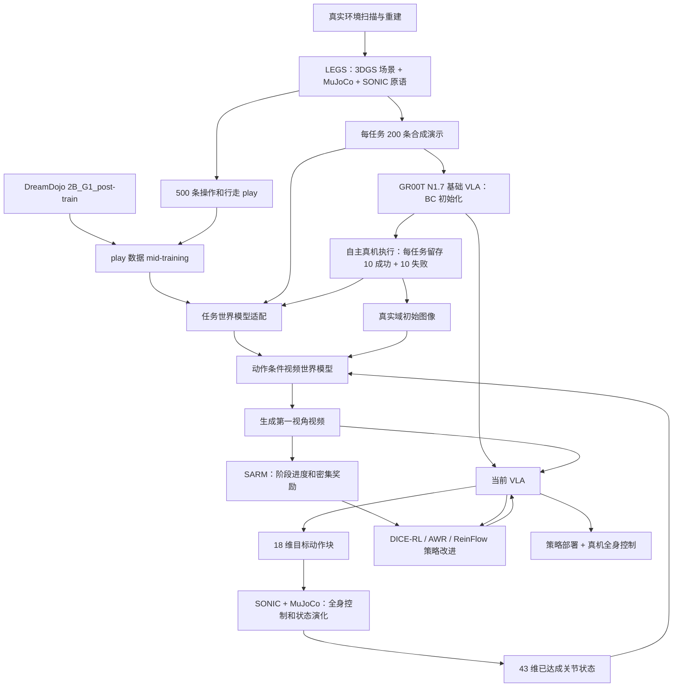

# WEVO：世界模型驱动的全身移动操作 VLA 优化（World Model-Enabled VLA Optimization for Whole-Body Loco-Manipulation）

**WEVO**（Qianzhong Chen 等，[arXiv:2611.25251v1](https://arxiv.org/abs/2611.25251v1)，2026-11-18 预印本）由**亚马逊（Amazon）、斯坦福大学（Stanford University）、得克萨斯大学奥斯汀分校（The University of Texas at Austin）**合作提出，面向 Unitree G1 的自主行走与双臂物体操作。

## 一句话定义

**先用 LEGS 仿真训练可自主采样的全身 VLA，再以少量真实机器人执行记录对齐动作条件视频世界模型，最后在 VLA–WBC–世界模型闭环中用密集进度奖励做强化学习后训练；目标任务无人工遥操作示范。**

## 英文缩写速查

| 缩写 | 英文全称 | 简要说明 |
|------|----------|----------|
| WEVO | World Model-Enabled VLA Optimization | 借世界模型做 VLA 后训练的完整方案 |
| VLA | Vision-Language-Action | 以图像、语言和命令空间状态预测动作块 |
| WM | World Model | 按真实达成的全身关节状态预测未来第一视角视频 |
| WBC | Whole-Body Controller | 将任务空间目标转为关节运动与接触动力学 |
| BC | Behavior Cloning | 合成演示训练的基础策略与对照组 |
| RL | Reinforcement Learning | 在视频世界模型生成的交互轨迹上改进策略 |
| 3DGS | 3D Gaussian Splatting | LEGS 的真实场景视觉重建表示 |
| SARM | Stage-Aware Reward Model | 用任务阶段和完成进度预测密集奖励 |
| DICE-RL | Diffusion/flow Policy RL via Critic-guided Exploration | 冻结生成策略先验并优化残差和 critic 的方法（本文采用的最优规则） |
| PSNR / iPSNR | Peak Signal-to-Noise Ratio / interaction PSNR | 全图 / 手与被操作物体区域的视频预测保真度 |

## 为什么重要

- **规避高风险硬件探索：** 高自由度人形在真机上大规模在线 RL 有碰撞与成本问题；WEVO 用世界模型生成持续更新的探索轨迹，而不是频繁触碰实机。
- **不让仿真偏差主导后训练：** 同一 LEGS 仿真器能生成初始成功策略，但在它里面直接做 RL，三任务平均真机成功率反而降到 10.0%，说明它不是天然可靠的最终优化环境。
- **保留真实域对齐：** 世界模型不仅学习仿真物理，还从每任务保留的 20 条真机自主轨迹学习实际观测外观与成败模式。
- **允许失败样本提供梯度信息：** 分阶段进度奖励比二值终局奖励能更有效地利用生成视频中的部分成功和失败步骤。

## 核心信息

| 项目 | 原文核验 |
|------|----------|
| 硬件与任务 | Unitree G1；拿起瓶子置于桌上盒内、拿瓶转身放入地面篮子、双臂搬运篮子 |
| 基础仿真与策略 | LEGS（3DGS 场景 + MuJoCo 接触）；SONIC 全身原语；GR00T N1.7 VLA，任务专属 BC 初始化 |
| 世界模型 | DreamDojo 的 2B_G1_post-train 起点，先操作/行走 play mid-train，再合成 + 真机数据按任务适配 |
| 数据规模 | 每任务 200 条合成演示；play 共 500 条/11 h；每任务留存 20 条自主真机 rollout（10 成功 + 10 失败） |
| 闭环 | VLA 20 Hz / 18 维全身命令，SONIC–MuJoCo WBC 50 Hz / 43 维已达成关节状态，WM 10 fps |
| 后训练 | 每任务 15 轮 × 32 条当前策略 WM rollout = 480 条；奖励由 SARM 进度增量生成 |
| 最优结果 | DICE-RL：三任务真机平均成功率 75.0%；BC 23.3%，Real RL 48.3%，Sim RL 10.0% |
| 开放状态 | 截至 2026-11-21 官方项目页写 "Code (coming soon)"；WEVO 完整训练/部署代码与权重未提供下载地址 |

## 流程总览

**数据流关键：** LEGS 给初始化与物理覆盖，20 条自主真机轨迹给世界模型部署域对齐，SONIC–MuJoCo 推动关节运动，视频 WM 推动视觉观测，SARM 为生成轨迹评估进度。**WM 不是替代 WBC 的物理动力学仿真器**。

## 核心原理

### 1. R2S2R 基础 VLA 与自主真机数据（论文 `III-A）

在机器人搭载的 ZED 2i 视角下重建工作场景，LEGS 将 3DGS 静态背景、可交互物体网格、MuJoCo 接触与 SONIC 原语结合。每任务采样 **200 条合成示范**，使用 **8×L40S 小于 30 min**；GR00T N1.7 的视觉语言主干冻结、任务动作部分微调 **50,000 步（8×H100 约 3.5 h）**。

初始化策略自行在真机执行，**每任务保留 20 条轨迹（成功 10 条、失败 10 条）**。基础策略成功率低于 50%，因此为了凑够 10 条成功案例，真机实际尝试次数**可能超过 20 次**；未保留的失败轨迹不参与世界模型适配。真机基线 Real RL 使用同一组保留数据，数据预算可比。

### 2. 接触 play + 行走 play 的双阶段世界模型适配（`III-B）

- 从 DreamDojo `II-C 的 **2B_G1_post-train** 初始化。操作 play：400 条、10 h，随机 5–8 物体、抓取偏差、漏抓/滑动/碰撞均保留；行走 play：100 条、1 h，接近、转弯和半圆移动以覆盖自我视角改变。
- **共享 mid-training：** 500 条、11 h，15,000 步（8×H100 约 10 h），提升接触和视角预测；**按任务 fine-tuning：** 每任务 200 条合成演示 + 20 条保留真机轨迹，再训 30,000 步（约 17 h）。
- 与总训练步数相同的无 play 对照相比，论文三任务全图 **PSNR 平均 +0.93 dB**、交互区域 **iPSNR +1.17 dB**；PSNR、iPSNR、SSIM、LPIPS、FID 各项方向均改善（Table I）。

### 3. VLA–SONIC–WM 的多频率状态闭环（`III-C）

VLA 输入 RGB、**15 维命令空间本体状态**与文本指令；每个 chunk 是 **40 × 18** 的目标序列，执行前 **24** 个 20 Hz 目标后再次查询。18 维动作由**双手 6D 位姿及夹爪开合（各 7 维）+ 基座三个平面速度分量与目标高度（4 维）**组成；15 维输入不直接含 43 个关节角。

SONIC–MuJoCo WBC 以 **50 Hz** 迭代控制，产生**达成的 43 维关节状态**；WM 用一帧初始 RGB 和下采样的已达成关节轨迹预测 **12 帧未来视角**。选取 **rho=2** 将 20 Hz 控制与 10 fps 世界模型数据匹配；最终生成帧作为下一次闭环生成的种子。只用期望位置而不用已达成状态，会错误忽视 WBC/动力学误差。

### 4. 密集进度奖励与三种 RL 更新（`III-D–F）

SARM 基于冻结的 DINOv3 视觉特征预测任务阶段及阶段内进度；对进度按 **EMA alpha=0.7** 平滑，再取相邻进度差作密集奖励。**连续五次**预测进度达到 0.9 后停止该条生成轨迹，避免完成后的空转干扰训练。

在统一 rollout 接口比较 DICE-RL、AWR 和 ReinFlow：DICE-RL 冻结原 flow prior，训练残差 actor 与 **20 个 critic**，奖励与最终成败回报联合稳定训练；ReinFlow 通过可算似然的随机流匹配做 PPO；AWR 用 advantage-conditioned 回归。每任务 **15 轮，每轮 32 条当前策略轨迹、1000 次参数更新**，总计 480 条生成轨迹和 15,000 次更新；WM 在策略后训练阶段冻结。

## 源码运行时序图

**不适用（2026-11-21 核对项目主页，WEVO 官方代码仍为 "coming soon"）。** 虽然论文列出 GR00T、SONIC、MuJoCo、DreamDojo 等第三方组件与训练模块，当前没有可审阅的**WEVO 训练 / 推理 / 部署入口**，不应根据方法图虚构 `sequenceDiagram` 的代码调用链。

## 工程实践

| 复现与部署事项 | 从原文得到的工程边界 |
|---|---|
| 动作空间 | 18D task-space VLA 命令 ≠ 43D robot joint state；WBC 负责将目标落实为运动，不要直接用期望动作条件化未来视觉 |
| 多频率耦合 | VLA 20 Hz，SONIC–MuJoCo 50 Hz，WM 10 fps，stride rho=2；按关节**实际位移**对齐 WM 视频时间窗 |
| 真实数据预算 | 20 条是均衡留存的轨迹/任务，不等于采集操作仅发生 20 次；不需要目标任务遥操作 |
| 失败监督 | play 保留抓取失败/碰撞，SARM 给部分完成的 dense progress；别只筛成功视频做监督 |
| RL 数据分布 | 每轮从当前策略重新采样 32 条 WM 轨迹，避免固定离线数据随策略偏移 |
| 算力 | WM-RL 每任务完整一轮流程约 12 h/8×H100，75% 时间花在视频生成；并未给出可在边缘端复制的 GPU 配置或延迟证明 |
| 代码复现 | 官方 "Code (coming soon)"；第三方项目代码开放不等于此整套流水线已开源 |

## 实验与评测

**三项 Unitree G1 真机任务（论文 Table II；每方法、每任务最终 checkpoint 评估 20 次；每方法/任务一个训练 run）：**

| 方法 | 取瓶放盒 PNP | 取瓶转身放地篮 PTP | 双臂搬篮 Basket | 平均成功率 |
|---|---:|---:|---:|---:|
| BC（无 RL） | 40% | 20% | 10% | 23.3% |
| Sim RL（LEGS） | 30% | 0% | 0% | 10.0% |
| Real RL（同 20 条保留真机数据） | 60% | 45% | 40% | 48.3% |
| VLAW（成功世界轨迹 BC） | 45% | 20% | 35% | 33.3% |
| WMPO（WM + sparse GRPO） | 55% | 30% | 35% | 40.0% |
| AWR（WEVO） | 75% | 70% | 70% | 71.7% |
| ReinFlow（WEVO） | 60% | 50% | 45% | 51.7% |
| **DICE-RL（WEVO）** | **85%** | **75%** | **65%** | **75.0%** |

**消融（同 DICE-RL 管线）：** 稀疏奖励平均 **45.0%**；固定离线 480 条世界模型轨迹 **58.3%**；无 play mid-training **63.3%**；完整闭环 **75.0%**。本文表格不能证明跨任务/多种子的统计显著性；每任务 20 次评测间隔对应成功率最小 5 个百分点。

## 结论

**WEVO 的关键贡献不是以视频生成替代物理控制，而是给「仿真初始化 → 少量自主真机校准 → 部署域 WM 上持续后训练」建立可测的闭环。**

1. **先获得能自主执行的基础策略：** 每任务 200 条仿真演示让 VLA 达到可采真机数据的水平。
2. **把不同数据用在正确的位置：** 500 条 play 补接触/行走覆盖，20 条保留真机轨迹补部署视觉差异。
3. **保证低层物理演化可解释：** WBC 负责已达成状态，WM 根据状态预测视觉，不将两者混为一体。
4. **进度奖励和当前策略采样都重要：** 去掉 dense reward 或固定离线数据会明显降低成功率。
5. **不能直接拿真机成绩反推普适能力：** 75.0% 是指定 G1 三任务、指定协议下的 20 次/任务评测，不是跨平台泛化或安全认证。

## 与其他工作对比

- [VLAW](./paper-rcl-2602-12063-vlaw-iterative-co-improvement-of-vision-language.md)：同样让世界模型协助 VLA 后训练，但 VLAW 偏向从想象成功轨迹再 BC；WEVO 用 dense RL 吸收完整轨迹分布，并扩展至全身移动操作。
- [LEGS](./paper-legs-embodied-gaussian-splatting-vla.md)：提供 R2S2R 的 3DGS 仿真/合成示范底座，WEVO 将其用于世界模型的物理覆盖与 VLA 初始化，而不把直接 Sim RL 当最终部署优化。
- [生成式世界模型](../methods/generative-world-models.md)：WEVO 的 WM 是训练期按动作条件生成视觉未来；不同于 [World Action Models](../concepts/world-action-models.md) 里联合预测未来与动作的模型类别。

## 局限与风险

- **尚无 WEVO 官方源码/权重：** 项目页截止 2026-11-21 明示 "Code (coming soon)"；尚无法依据公开入口复现实验、验明接口开销或审查策略安全约束。
- **评测覆盖小：** 仅一个机器人平台、三项结构化任务；论文未给出跨场景/跨机器人结果，且每方法/任务只有一个训练 run。
- **生成视频不等于物理真实：** 长时自回归误差与物体接触预测仍可能被策略利用；需用真实机器人持续验收。
- **硬件数据量要精确理解：** 留存 20 条/任务是成功/失败均衡子集，不等于仅需 20 次总尝试；另有初始化环境建模与仿真数据采集成本。
- **训练成本较高：** 8×H100 上 WM-RL 单任务约 12 h，且还要单独 mid-train 与任务 WM fine-tune；不能把训练时长和部署推理时延混算。

## 关联页面

- [VLAW：世界模型与 VLA 协同后训练](./paper-rcl-2602-12063-vlaw-iterative-co-improvement-of-vision-language.md)
- [LEGS：真实到仿真到真实的合成示范](./paper-legs-embodied-gaussian-splatting-vla.md)
- [SONIC：人形全身控制](./nvidia-sonic.md)
- [VLA](../methods/vla.md)
- [生成式世界模型](../methods/generative-world-models.md)
- [Model-Based RL](../methods/model-based-rl.md)
- [Loco-Manipulation](../tasks/loco-manipulation.md)
- [VLA 纵深 Stage 5](../../roadmap/depth-vla.md)
- [移动操作纵深 Stage 4](../../roadmap/depth-loco-manipulation.md)

## 参考来源

- [WEVO 论文原文归档（v1；通读）](../../sources/papers/wevo_arxiv_2611_25251.md)
- [WEVO 官方主页归档（代码开放状态核查）](../../sources/sites/wevo-world-model-enabled-vla.md)

## 推荐继续阅读

- [WEVO arXiv HTML v1 全文](https://arxiv.org/html/2611.25251v1)
- [WEVO 官方项目主页](https://qianzhong-chen.github.io/wevo.github.io/)
- [VLAW arXiv:2602.12063](https://arxiv.org/abs/2602.12063)
