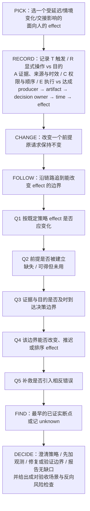

# When No Worries Went Wrong（arXiv:2610.38400）

**When No Worries Went Wrong**（*When "No Worries" Went Wrong: HRI Lessons for Foundation-Model Robots*，[arXiv:2610.38400](https://arxiv.org/abs/2610.38400)，[项目页](https://elikh.github.io/social-hri-framework/)）来自 [具身智能小站 2026-10-30 盘点](../../sources/blogs/wechat_embodied_station_28_papers_event2reward_progress_rewards_2026-10-30.md)，属「多机器人协作与人机交互」组。

## 一句话定义

**从长期人机交互工程案例提炼注意、知识、承诺、具身时序与动作权限等设计经验。**

## 英文缩写速查

| 缩写 | 英文全称 | 简要说明 |
|------|----------|----------|
| When No Worries Went Wrong | When "No Worries" Went Wrong: HRI Lessons for Foundation-Model Robots | 本文方法 / 基准的简称 |

## 为什么重要

- 一句“没关系”，也需要正确的动作时机。TRACE 通过改变交互前提追踪决策边界，适合审查系统架构中的责任断点。
- 开源结论：**项目页未列 GitHub**（步骤 2.5，2026-10-30）。项目页 HTTP 200，未列 GitHub，也无 coming soon 字样（脚本扫描）。
- 同期同组工作见 [进度奖励、接触监督与规划验证：具身智能小站 10-30 期 28 篇阅读坐标](../overview/embodied-station-2026-10-30-28-papers-technology-map.md)。

## 流程总览

图依据：论文 §VII（TRACE 评审卡）、§VI 五项责任；Q1–Q5 与步骤名取自该节评审卡。

## 核心机制

| 项 | 内容 |
|----|------|
| **arXiv** | [2610.38400](https://arxiv.org/abs/2610.38400) |
| **开源** | **项目页未列 GitHub** |
| **要点** | 从长期人机交互工程案例提炼注意、知识、承诺、具身时序与动作权限等设计经验。 |
| **文内指标** | 公众号转述：TRACE 通过改变交互前提追踪决策边界，适合审查系统架构中的责任断点。 |

## 源码运行时序图

**不适用（项目页未列 GitHub）** — 项目页 HTTP 200，未列 GitHub，也无 coming soon 字样（脚本扫描）。 不编造运行脚本；代码公开后再补。

## 实验与评测

- 公众号转述：TRACE 通过改变交互前提追踪决策边界，适合审查系统架构中的责任断点。
- **读法：** 本页为索引级摘要，依据公众号转述的官方摘要与仓库信息整理；逐项数字与 baseline 以原文 PDF 为准。

## 与其他工作对比

- 横向索引见 [进度奖励、接触监督与规划验证：具身智能小站 10-30 期 28 篇阅读坐标](../overview/embodied-station-2026-10-30-28-papers-technology-map.md)；同 arXiv 不重复造页。

## 结论

**一句“没关系”，也需要正确的动作时机：TRACE 通过改变交互前提追踪决策边界，适合审查系统架构中的责任断点。**

1. 开源边界：**项目页未列 GitHub** — 项目页 HTTP 200，未列 GitHub，也无 coming soon 字样（脚本扫描）。
2. 核心机制：从长期人机交互工程案例提炼注意、知识、承诺、具身时序与动作权限等设计经验。
3. 复现与选型前核对任务协议、硬件与基准口径，勿直接横比公众号摘录数字。

## 关联页面

- [locomotion](../tasks/locomotion.md)
- [vision-language-navigation](../tasks/vision-language-navigation.md)
- [llm-robotics-control-interfaces](../concepts/llm-robotics-control-interfaces.md)
- [llm-robotics-control-interfaces](../concepts/llm-robotics-control-interfaces.md)
- [embodied-station-2026-10-30-28-papers-technology-map](../overview/embodied-station-2026-10-30-28-papers-technology-map.md)

## 参考来源

- [when_no_worries_went_wrong_arxiv_2610_38400.md](../../sources/papers/when_no_worries_went_wrong_arxiv_2610_38400.md)
- [wechat_embodied_station_28_papers_event2reward_progress_rewards_2026-10-30.md](../../sources/blogs/wechat_embodied_station_28_papers_event2reward_progress_rewards_2026-10-30.md)
- [arXiv:2610.38400](https://arxiv.org/abs/2610.38400)
- [arXiv PDF](https://arxiv.org/pdf/2610.38400)：已通读方法部分（实验与附录以略读为准）：摘要、§I–VII（TRACE 与 Table I）、§VIII

## 推荐继续阅读

- [arXiv PDF](https://arxiv.org/pdf/2610.38400)
- [项目页](https://elikh.github.io/social-hri-framework/)
