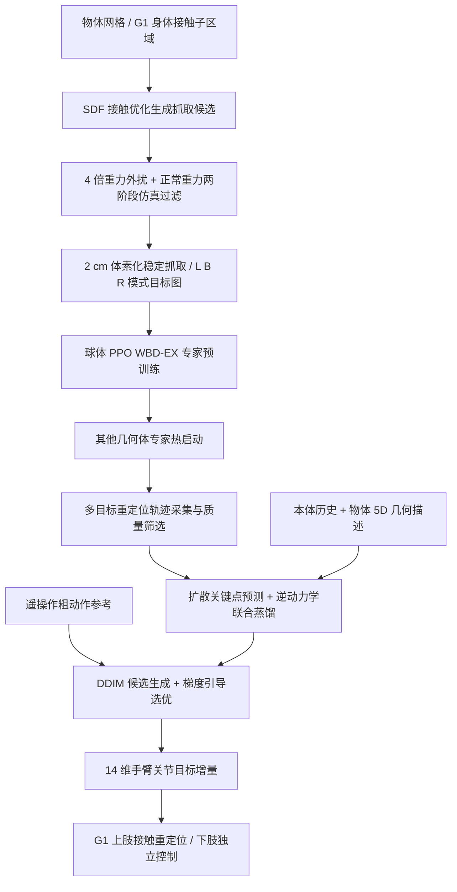

# Whole-Body Dexterity：让人形机器人用身体重定位物体

**Whole-Body Dexterity（WBD）**（[arXiv:2610.22184](https://arxiv.org/abs/2610.22184)，[项目页](https://www.wholebodydex.com/)）把手臂、躯干等身体部位视为可用接触面，让人形机器人通过不断改变支撑位置来搬运大件物体。作者来自 Amazon、加州大学圣地亚哥分校与密歇根大学。

## 一句话定义

用身体多处接触支撑物体，并学习在这些接触区域之间重定位的全身灵巧操作框架。

## 英文缩写速查

| 缩写 | 英文全称 | 简要说明 |
|------|----------|----------|
| WBD | Whole-Body Dexterity | 将机器人身体表面作为接触面，实现物体重定位 |
| WBD-EX | Whole-Body Dexterity Expert | 每种物体独立训练的目标条件强化学习专家 |
| RL | Reinforcement Learning | 用于训练全身抓取重定位专家策略 |
| PPO | Proximal Policy Optimization | WBD-EX 的策略优化算法 |
| DDIM | Denoising Diffusion Implicit Models | 部署扩散模型的多步采样方式 |
| GMR | General Motion Retargeting | 真机直接动作重定向对比基线 |
| Sim2Real | Simulation to Real | 从仿真训练迁移到 Unitree G1 真机 |
| G1 | Unitree G1 Humanoid Robot | 论文真机验证所用的人形机器人平台 |

## 为什么重要

- **扩展操作接触面：** 操作不再只依赖双手抓握，机器人可把物体靠在手臂或躯干上支撑、滑动和转移。
- **目标是接触间重定位：** 框架覆盖从一种可行全身抓取到另一种抓取的任意到任意重定位，而不是维持单次稳定抓取。
- **与示教跟踪分工：** 操作员提供粗粒度运动参考，学习到的策略负责身体接触变化与物体重定位。

## 流程总览

主流程来自论文 Fig. 2、Section III 与附录 A–G。注意 **WBD-EX 专家训练时使用仿真物体状态和接触信息**，最终蒸馏控制器不依赖逐帧物体位姿，却仍需要预先测得的物体几何描述；两者不可混淆。

## 核心原理

### 1. 模式约束的全身抓取数据

- 接触候选由物体三角网格 SDF、指定的手臂与躯干子接触区域生成；4× 重力和外扰筛选后，用正常重力再次验证（最终位移小于 10 cm、旋转小于 45°）。
- 保留 **251 万**个仿真稳定抓取；物体位置以 **2 cm** 体素化，抓取模式是左臂 L、双臂 B、右臂 R。**L 与 R 不能直接切换，必须经过 B**，确保交接时存在双臂支撑。
- 抓取生成方法可配置腿部接触，但本论文用于专家训练的数据**只取手臂与躯干抓取**；未训练膝盖支撑/腿部再抓取。

### 2. 目标条件强化学习专家 WBD-EX

- 在 mjlab 中对每个物体训练 PPO 专家：目标是**物体位置 + 目标抓取模式**，不强制目标关节姿态与物体朝向。成功要求 2 cm 内、物体停稳、正确接触以及非工作臂释放。
- 以 2→8 cm 逐步增加重定位目标距离；抓取交接允许 0.48 s 的短暂接触中断。专家 actor 使用含物体姿态、速度、接触状态的 **89 维仿真观测**，critic 为 **95 维**，因此不能称为专家本体感觉-only。
- 动作是 **14 维关节目标增量**：每步 `tanh(action) × 0.025 rad`，目标相对测得关节位置钳制在 0.35 rad 内；200 Hz 仿真物理步、50 Hz 控制更新。
- 先训练球体专家，再用球体策略热启动其他形状；6 物体匹配训练预算的消融中，总迭代数由 30 万降到 24 万（**减少 20%**），但各几何体的路线成功率并不一致。

### 3. 扩散 + 逆动力学蒸馏

- 使用 **27.4 万条质量筛选轨迹、8.73 亿帧**训练共享控制器。扩散模型输入四个历史观测时刻的关键点、关节测量、应用目标和跟踪误差，外加 **5 维静态物体几何**（三条包围盒边长的对数、体积对数、球形度），合计 **269 维**。
- 扩散网络预测未来 **100/200 ms** 的手臂关键点位移；逆动力学网络把关键点运动转换成 14 维关节目标增量。粗遥操作命令只作为采样引导，不直接替代接触稳定控制。
- 部署时无需每帧外部物体状态估计；但训练过程有特权物体/接触数据，执行还需要人工粗动作与物体尺寸信息。

## 工程实践

| 环节 | 论文报告的配置或约束 |
|---|---|
| 抓取候选 | 4096 GPU 并行候选、4000 次 AdamW 优化；两阶段动力学验证 |
| 专家强化学习 | PPO；14 维动作、50 Hz 控制；生产训练使用 8×H100、每卡 8192 环境 |
| 专家域随机化 | 物体质量 0.4–1.2 kg、质心 ±5 mm，外扰力逐步增强至 20 N |
| 蒸馏训练 | 扩散 + 逆动力学联合训练 130k 次更新；15 种基础几何体 |
| 推理 | **16 个候选 × 12 步 DDIM**；依据粗命令的关键点位移引导选优 |
| 真机链路 | RTX 5090 推理、50 Hz 关节命令发布；新预测平均到达 **34.9 Hz** |
| 延迟 | 单次推理中位 **11.8 ms**；状态发布至命令缓冲中位 **50.1 ms**（不含传感与电机延迟） |
| 控制分工 | Xsens/SMPL 产生上身粗命令；WBD 修正手臂增量；下身由独立控制器负责 |

**落地检查重点：**先复现实验的接触模式、目标判据和两阶段抓取筛选，再验证手臂命令钳制和端到端延迟；论文的 50 Hz 控制发布频率**不是**每秒 50 次新扩散预测。

## 实验与评测

项目页汇总真实全身操作试验的总体完成率如下：

| 方法 | 完成次数 | 完成率 |
|------|----------|--------|
| **WBD 蒸馏策略** | 45/50 | **90%** |
| 直接运动重定向（GMR） | 9/50 | 18% |
| SONIC 通用全身控制器 | 2/50 | 4% |

论文的 **45/50** 来自四类肩部/腋下往返任务 **38/40** 和货架到桌面最终放置 **7/10**。长程任务 WBD 各阶段为拾取 10/10、夹持 9/10、搬运 9/10、解夹 9/10、放置 7/10；均有遥操作员在场。真机操作者是**一名接受至少 8 小时任务训练的熟练人员**，任务成功率不代表完全自主执行或新操作者的普适表现。

**仿真对比（Appendix G, Table X）：**在噪声强度 α=2.5 时，每回合平均完成目标数：噪声专家 8.47、EMA 平滑 7.82、WBD 修正 **23.79**；α=4 时分别为 6.24、6.32、**21.79**。这表明在所测噪声与轨迹分布下，WBD 不只是低通滤波；不能把该仿真指标与真机的 90% 混为一谈。

**形状边界（Appendix D, Table VIII）：**专家的十四路线平均完成率从 220 mm 球体的 88.14% 到细长 80×160×220 mm 长方体的 25.05% 不等；200 mm 立方体的复杂 loop 路线成功率为 **0%**。形状泛化仍是显著难点。

## 结论

**WBD 的主要创新不是“只靠手臂模仿人”，而是把接触模式转换成目标图，再让扩散控制器把粗动作命令修正为可持续支撑物体的关节运动。**

- **目标定义：**重点核验 L/B/R 模式交接与“非活动臂放开”的判据；只看末端抓取或位置跟踪误差不够。
- **训练信息：**专家使用物体位姿/接触等仿真信息；部署控制器用 proprio 历史 + 静态 5D 几何输入，不能笼统宣称整条链路不需要物体状态。
- **数据与成本：**2.51M 稳定抓取 → 274k 轨迹 → 873M 帧；球体热启动是降低多物体专家训练成本的关键。
- **真实系统：**50 Hz 指命令发布，实测新策略更新约 34.9 Hz、端到端命令缓冲延迟中位 50.1 ms；这需要计入接触稳定性评估。
- **实验口径：**45/50 是受训遥操作员引导的限定任务集，而不是无人值守的自主任务成功率。
- **开源状态：**截至 2026-11-13，作者项目页没有完整可运行源码或训练数据入口，无法独立验证复现实验。

## 源码运行时序图

**不适用：**截至 2026-11-13，官方项目页没有公开可运行训练/推理仓库或 README 入口。本文流程图仅依据论文方法，不把推断的训练函数或模块调用伪装成源码时序图。

## 局限与风险

- **遥操作参与任务执行：** 人类通过 Xsens/SMPL 提供动作参考，因此高完成率不等于机器人从语言或目标指令自主完成整项任务。
- **公开复现材料有限：** 目前仍无作者公开的可运行训练代码、部署代码或数据下载；论文披露了关键超参数，但没有实际可执行入口。
- **实验覆盖范围有限：** 真机仅展示 G1、篮球和纸箱；14 路线仿真里长方体/大立方体有低成功率，不能直接宣称任意形状或本体泛化。
- **输入/训练边界：** 部署控制器仍需静态 5D 物体几何特征（作者将其与逐帧物体状态相区分）；训练专家有物体位姿/接触特权输入，且固定了下身和躯干。
- **遥操作与时延：** 仅一名熟练操作者、粗动作命令并非自主规划；推理与通信延迟以及掉物体情况需进一步验证。

## 与其他工作对比

| 方法 | 关键区别 |
|---|---|
| WBD | 接触模式图 + PPO 专家 + 扩散/逆动力学修正粗命令，强调**身体内物体重定位** |
| [Blind Dexterity](./paper-blind-dexterity.md) | 无视觉的本体接触探索，强调编码器/柔顺控制中的感知信息；任务定义与监督不同 |
| [PanTact](./paper-pantact-whole-body-contact-interface.md) | 用人类可穿戴接触界面收集全身接触行为，与 WBD 的仿真抓取专家路线互补 |
| GMR / SONIC（论文对照） | 直接重定向 / 通用全身控制，不具备 WBD 在本文任务中所验证的专门物体接触修正能力 |

## 关联页面

- [Loco-Manipulation](../tasks/loco-manipulation.md) — 全身移动与接触操作的任务脉络。
- [PanTact](./paper-pantact-whole-body-contact-interface.md) — 从人类穿戴接触界面示范全身接触任务，与 WBD 的仿真抓取重定位训练形成对照。
- [Blind Dexterity](./paper-blind-dexterity.md) — 对比纯本体接触探索与本文受粗命令引导的接触重定位。
- [VisualMimic](./paper-notebook-visualmimic.md) — 以视觉策略与关键点跟踪实现全身 loco-manipulation。
- [接触丰富操作](../concepts/contact-rich-manipulation.md) — 接触状态与多约束操作的相关概念。

## 参考来源

- [Whole-Body Dexterity 论文来源](../../sources/papers/whole_body_dexterity_arxiv_2610_22184.md)
- [Whole-Body Dexterity 项目页归档](../../sources/sites/wholebodydex-project.md)
- 论文：<https://arxiv.org/abs/2610.22184>（v1，全文核对：<https://arxiv.org/html/2610.22184v1>，含附录 A–G）
- 项目页：<https://www.wholebodydex.com/>

## 推荐继续阅读

- [Whole-Body Dexterity 项目页](https://www.wholebodydex.com/)
- [arXiv 论文](https://arxiv.org/abs/2610.22184)
- [PanTact](./paper-pantact-whole-body-contact-interface.md) — 以可穿戴接触示范教会机器人用身体操作。
