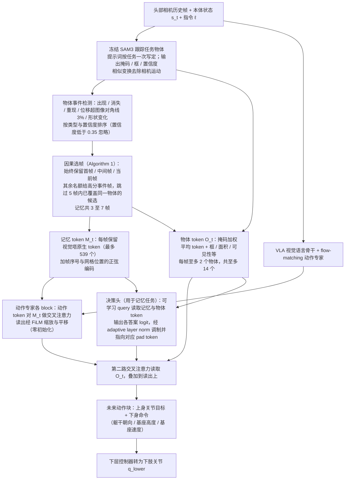

# WholeBodyMem：人形移动操作的目标前历史记忆

**一句话定义：** WholeBodyMem 让人形 VLA 保留执行目标前观察到的物体事件，减少遮挡、物体变化和视角转动造成的历史线索丢失。

## 流程总览

图依据：论文 §IV-A/B/C（Fig. 3、Algorithm 1、式 1–3）；决策头仅用于 HuMeGo 记忆任务，其与动作专家的连接按 §IV-C 叙述归纳。

## 英文缩写速查

| 缩写 | 英文全称 | 简要说明 |
|------|----------|----------|
| VLA | Vision-Language-Action | 被增强记忆的人形策略类型 |
| SAM3 | Segment Anything Model 3 | 跟踪任务物体并触发事件 |
| HuMeGo | 论文基准名 | 六项仿真 + 六项真机 G1 任务的记忆依赖基准 |
| G1 | Unitree G1 humanoid robot | 真机平台 |
| RA-L | IEEE Robotics and Automation Letters | 论文投稿期刊 |

| 机构 | 穆罕默德·本·扎耶德人工智能大学（MBZUAI；[arXiv HTML v1](https://arxiv.org/html/2610.31166v1) 列出的作者单位） |

## 核心方法

SAM3 跟踪任务物体，并由物体事件从历史观察中自适应选择关键帧。动作专家通过交叉注意力读取关键帧和物体 token；token 编码目标物体的外观、几何与时间信息。论文称其目标是记住与当前任务有关的关键历史，而不是简单堆叠更多帧。

## HuMeGo 基准与结果

HuMeGo 包含六项仿真和六项真实 Unitree G1 任务。论文摘要报告，WholeBodyMem 将基础策略成功率从仿真 29.1% 提升至 72.6%，真实机器人从 36.7% 提升至 88.3%；SIMPLE 标准任务从 70.2% 提升至 86.9%。比较结果以论文所定义的任务和评测口径为准。

## 方法栈

`相机历史 → SAM3 物体跟踪与事件筛选 → 关键帧 + 物体 token → 动作专家交叉注意力 → 全身动作`

## 与其他工作对比

- **相对只看当前帧的基础策略：** HuMeGo 与 SIMPLE 的提升即以此为对照（见上节）。
- **相对 [KEMO](./paper-kemo-event-driven-keyframe-memory-vla.md)：** 两者都用事件触发的关键帧记忆并经交叉注意力注入；KEMO 由运动学减速峰与视觉去重选帧、面向双臂操作，WholeBodyMem 由 SAM3 物体事件选帧、额外编码物体 token，面向人形全身移动操作。
- **相对 [MemER](./paper-memer.md)：** MemER 由高层 VLM 检索关键帧并生成子任务，WholeBodyMem 把记忆直接接入动作专家，不经语言子任务中转。

## 工程启示

- 记忆检索可由目标物体事件触发，保留的帧数不必与历史长度成正比。
- 物体 token 同时带入外观、几何和时间信息，帮助策略区分“看到过什么”与“何时发生”。
- 应分别评估物体跟踪、关键帧选择、记忆读取与最终任务成功率，定位记忆模块的失败来源。

## 结论

**WholeBodyMem 的要点是「记住与目标物体相关的事件」而非「堆更多帧」；摘要报告的成功率提升幅度较大，但只在其定义的 HuMeGo / SIMPLE 任务上成立。**

1. 记忆质量受物体跟踪上游约束，SAM3 跟丢时记忆也会失效。
2. 比较数字前需核对论文的基础策略、任务定义与试验次数。
3. 归档的项目页未列代码链接，代码可用性需另行核查。

## 参考来源

- [WholeBodyMem 论文归档](../../sources/papers/wholebodymem_arxiv_2610_31166.md)
- [WholeBodyMem 项目页归档](../../sources/sites/wholebodymem.md)
- [arXiv:2610.31166](https://arxiv.org/abs/2610.31166)
- [官方项目页](https://memory-before-goal.github.io/)
- [arXiv PDF](https://arxiv.org/pdf/2610.31166)：已通读方法部分（实验与附录以略读为准）：§I–III 略读、§IV（A–C，Algorithm 1）、§V-A 实验设定

## 关联页面

- [VLA](../methods/vla.md)
- [Loco-Manipulation](../tasks/loco-manipulation.md)
- [KEMO](./paper-kemo-event-driven-keyframe-memory-vla.md) — 事件驱动关键帧记忆 VLA
- [MemER](./paper-memer.md) — 高层关键帧检索 + 低层 VLA
