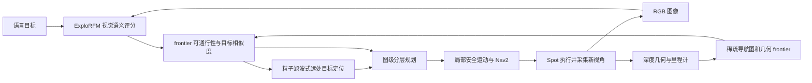
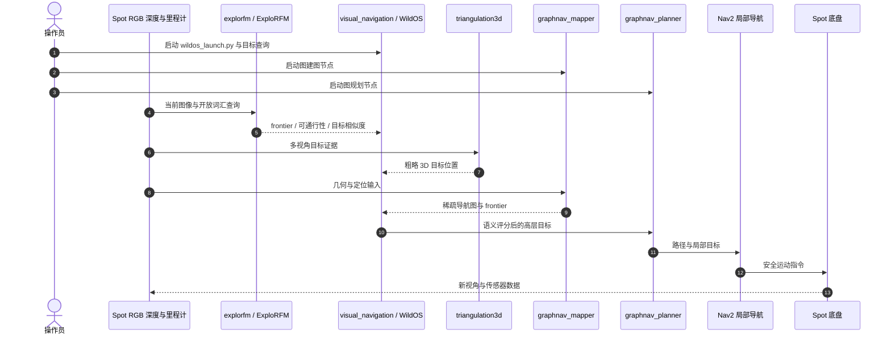

# WildOS：在野外用开放词汇目标搜索

**WildOS**（*Open-Vocabulary Object Search in the Wild*，[arXiv:2602.19308](https://arxiv.org/abs/2602.19308)，[项目页](https://leggedrobotics.github.io/wildos/)，[官方代码](https://github.com/nasa-jpl/nebula2-wildos)）由 NASA JPL 与 ETH Zurich RSL 等团队提出；它把视觉语义对远处“往哪走、哪里可通行”的判断接入几何导航图，让四足机器人根据开放词汇目标进行长距离搜索。

## 一句话定义

**几何导航图负责空间记忆与局部安全，视觉基础模型在深度感知范围之外评估 frontier 和语言目标，两者共同驱动长程户外搜索。**

## 英文缩写速查

| 缩写 | 英文全称 | 简要说明 |
|------|----------|----------|
| OVS | Open-Vocabulary Search | 用自然语言描述目标并在开放场景中搜索 |
| VLM | Vision-Language Model | 将图像和文本目标映射到共享语义空间 |
| FOV | Field of View | 相机一次可见的空间范围，限制视觉证据 |
| ROS 2 | Robot Operating System 2 | WildOS 将视觉、建图和规划组件组织成机器人节点 |
| LIO | LiDAR-Inertial Odometry | 系统依赖的激光—惯性里程计类别 |

## 为什么重要

几何 frontier 会把机器人引向地图边缘，却无法判断远处方向是否可走或是否有目标线索。WildOS 将“看起来能走、可能通向目标、值得优先探索”的视觉证据映射回稀疏图节点，同时以几何建图和局部规划约束实际运动。

核心工程取舍是让视觉模型提供高层方向偏好，而不是让像素语义替代几何安全：视觉判断可以越过深度范围，但碰撞约束和局部行驶仍依赖几何地图与本地导航链路。

## 方法栈 / 流程总览

### 关键模块

1. **几何图是长期记忆。** 机器人由几何感知逐步建立稀疏图并维护 frontier。已走过区域和待探索分支保留在图中，使系统可以在死胡同后重新规划。
2. **ExploRFM 将视觉判断延伸到深度视野外。** 给定当前图像和文本查询，预测视觉 frontier、可通行性和开放词汇目标相似度。仓库采用改造的 RADIO 主干并结合 NACLIP 与 SigLIP2 对齐。
3. **把视觉线索变成空间目标估计。** 多视角目标相似性经粒子滤波式三角定位，给出当前深度范围外的粗略 3D 位置，再参与图节点评分。
4. **分层规划保留几何约束。** 视觉模块决定值得探索的方向；导航图和图规划组织路径，局部导航生成安全运动。

## 源码运行时序图

官方仓库 [nasa-jpl/nebula2-wildos](https://github.com/nasa-jpl/nebula2-wildos) 提供 ROS 2 视觉导航与图建图/规划入口：

运行链路要点：visual_navigation 编排语义评分与导航；graphnav_mapper / graphnav_planner 提供空间记忆与图级路径；triangulation3d 估计视野外目标位置；运行还依赖 Elevation Mapping CuPy、DLIO 和 Nav2 等外部节点。

## 工程实践

| 项目 | 复现要点 |
|------|----------|
| 运行环境 | README 测试 ROS 2 Jazzy、Python 3.10+、uv、CUDA GPU；实地实验使用 Docker |
| 感知模型 | 仓库有 frontier 与 traversability 头部 checkpoint；C-RADIOv3-B 主干与 SigLIP2 adaptor 需另行下载 |
| 训练参考 | README 报告用 RTX 4090 训练 ExploRFM 头部 |
| 机载部署 | README 报告 Jetson AGX Orin GPU 部署 |
| 机器人与导航 | Spot 实地实验；依赖 Elevation Mapping CuPy、DLIO、Nav2，并需匹配 ROS topic / namespace |
| 数据集 | HF 提供 frontier 标注；不是完整的野外多传感器序列 |
| 开源状态 | **已开源，Apache-2.0**：训练/推理、ROS 2 系统、图构建与规划器公开；部分上游权重需单独下载 |

## 实验与评测

- **开放词汇目标搜索：** 项目页用 “Orange Flag” 与 “NASA Logo” 等文本查询展示目标相似度、目标定位与自主导航闭环。
- **Fence Approach：** 视觉方法提前识别围栏通道，纯几何 GraphNav 则在局部地图出现围栏后才绕行。页面称 WildOS 平均距离、时间更低且波动更小，但未给完整数字表。
- **Dead-End Recovery：** WildOS 利用持久图记忆从死胡同回到未探索 frontier；页面展示对照的无记忆 LRN 在演示中需要人工介入。
- **跨地形：** 页面展示越野与城市运行，并称不需环境专用重训或调参；这是作者报告，不等同于对所有户外环境的泛化保证。

## 结论

**WildOS 的关键是把视觉语义用作稀疏几何图的高层导航偏好，同时保留几何规划与局部控制对安全的约束。**

1. **视觉 frontier 补足深度视野，而非替代地图。** 它让机器人优先查看视觉上值得探索的远处区域。
2. **目标相似度需要空间化。** 多视角粒子滤波把 2D 线索转为粗略 3D 目标位置，供长距离规划使用。
3. **持久图解决记忆问题。** Dead-end 案例体现环境记忆对恢复与重规划的作用。
4. **部署是系统工程。** 复现需要 ROS 2、里程计、地图、图规划和 Nav2 等组件协调运行。
5. **演示视频不是统一基准。** 项目页未给出所有试验可对齐的完整数字表。

## 局限与风险

- 开放词汇图像相似度本身不能证明地面可通行；遮挡、外观相似目标和光照变化可能造成偏差。
- 粒子滤波式目标位置是规划线索，不是精确测距或完整 3D 重建。
- ROS 外部组件、坐标系、时间戳和 topic 配置带来较高集成成本。
- 运动安全仍依赖几何感知、定位质量和局部规划。
- 本归档未复现完整 Docker / Spot 实验，也未独立运行 ROS launch。

## 与其他工作对比

| 工作 | 关联与区别 |
|------|------|
| [零样本目标导航](../tasks/zero-shot-object-navigation.md) | WildOS 是户外长程场景下的稀疏图 + 视觉 frontier 系统 |
| [TravExplorer](./paper-travexplorer.md) | 都利用语义线索指导导航；WildOS 面向户外开放词汇目标搜索，TravExplorer 侧重可通行性探索 |
| [Robot Lab](./robot-lab.md) | 共享 ETH Zurich RSL 生态，任务与系统不同 |
| [视觉–语言导航](../tasks/vision-language-navigation.md) | WildOS 用语言指定物体目标；VLN 通常跟随逐步路径指令 |

## 关联页面

- [零样本目标导航](../tasks/zero-shot-object-navigation.md)
- [TravExplorer](./paper-travexplorer.md)
- [Robot Lab](./robot-lab.md)
- [视觉–语言导航](../tasks/vision-language-navigation.md)
- [机器人视觉感知栈选型闭环](../queries/robot-perception-stack-selection-loop.md) — 开放词汇检测 / 语义分割在户外目标搜索中的选型位置

## 参考来源

- [WildOS 论文来源归档](../../sources/papers/wildos_arxiv_2602_19308.md)
- [WildOS 项目页核查](../../sources/sites/wildos-project.md)
- [WildOS 官方仓库归档](../../sources/repos/nebula2-wildos.md)
- [WildOS Frontier 数据集归档](../../sources/datasets/wildos-frontiers.md)
- [arXiv:2602.19308](https://arxiv.org/abs/2602.19308)

## 推荐继续阅读

- [WildOS 项目页](https://leggedrobotics.github.io/wildos/)
- [WildOS 官方代码](https://github.com/nasa-jpl/nebula2-wildos)
- [WildOS Frontiers Dataset](https://huggingface.co/datasets/leggedrobotics/wildos)
- [GrandTour: A Legged Robotics Dataset in the Wild](https://grand-tour.leggedrobotics.com/)
