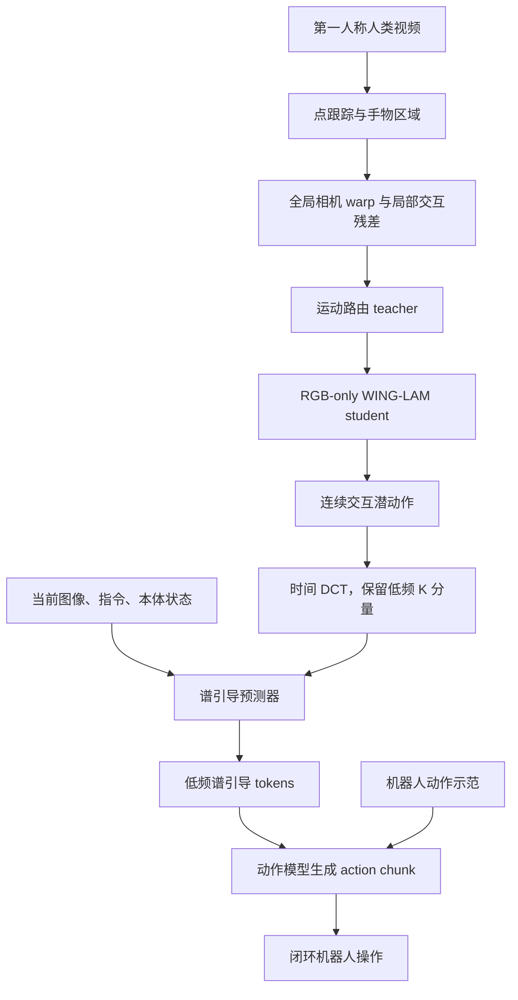

# WING：用交互中心的谱潜变量学习世界动作

## 一句话定义

**WING 把第一人称视频中的手物交互蒸馏为潜动作，再以人机共享的低频时间结构引导机器人生成可执行动作。**

## 英文缩写速查

| 缩写 | 英文全称 | 简要说明 |
|------|----------|----------|
| WING | World Action Learning via INteraction-Centric Spectral Latent Guidance | 本文方法名：交互中心潜动作 + 谱引导 |
| WAM | World-Action Model | 联合利用世界预测/表征与动作生成的模型范式 |
| LAM | Latent Action Model | 从观测变化中学习潜在动作表示 |
| DCT | Discrete Cosine Transform | 把潜动作时间序列分解为不同频率分量 |
| LIBERO | Language Instructed Benchmark for Everyday Robot Operation | 机械臂语言条件操作仿真基准 |

## 为什么重要

- **视频迁移的干扰因素被明确拆开。** 第一人称相机随人头运动，像素变化会混入与任务无关的视角移动。WING-LAM 将观察者运动与局部手物交互分路，再将交互分支蒸馏给 RGB-only student。
- **跨具身对齐不要求逐帧节奏一致。** 人和机器人可以用不同速度、停顿和控制粒度完成同一操作。WING 选择跨人机更一致的慢变化低频潜动作，而不强行迁移完整时间序列。
- **ego 视频是辅助信号，非机器人动作标签替代物。** 低频谱系数作为 action expert 的条件引导；机器人示范仍监督可执行动作。论文的对照显示把潜动作直接当动作目标不如用它作辅助 guidance。
- **将表示诊断连到闭环结果。** 论文不仅报告成功率，还测 latent 中相机运动/交互运动可解码性、相机扰动敏感性及跨人机匹配相似度，并分别消融 WING-LAM 与 DCT guidance。

## 核心信息

| 项目 | 内容 |
|------|------|
| **论文** | *World Action Learning via Interaction-Centric Spectral Latent Guidance*（arXiv:2610.03607，2026-10-02） |
| **机构** | 香港科技大学（The Hong Kong University of Science and Technology） |
| **项目页** | <https://mikuz12.github.io/wing/> |
| **代码状态** | 页面显示 Code Coming Soon；论文承诺部署代码后续发布，当前未发现公开代码仓库 |
| **权重/数据** | 项目页未列可下载权重或数据链接 |
| **预训练骨干** | Wan2.2 视频专家；论文采用约 200 小时 ego-video 预训练预算做策略对比 |
| **真机平台** | AgileX Cobot Magic 双臂，3 台 Orbbec DaBai DC1 相机，14 维动作空间 |

## 方法流程

可以把 WING 看成两种数据职责的配合：人类视频提供「如何与物体交互」的跨任务经验；机器人示范把这个表征落到具体机器人可执行的动作空间。推理时 predictor 只依赖当前上下文，不需要未来视频帧。

## 核心机制

### 1. WING-LAM：把相机运动和手物交互拆开

对相邻第一人称帧做点跟踪，并用背景/手物区域把运动路由到两个分支。背景点拟合全局图像 warp，近似观察者运动；对齐后剩下的局部位移作为交互运动监督。Teacher 学习相机与交互两个潜分支，student 则只看 RGB 帧对并模仿 teacher 的 interaction latent。

作者还用保持交互目标不变的全局相机扰动训练 student，促使潜动作少编码视角变化。该设计是训练期使用特权点轨迹/区域信息、推理期仅依赖图像的一种 teacher–student 迁移。

### 2. 谱引导：迁移慢变化结构，而非人类整段动作节奏

给定连续潜动作序列，WING 沿时间维做 DCT，抽取前 K 个低频系数。论文观察到语义匹配的人类与机器人操作，在低频成分上的相似度高于高频成分或完整序列，因此将这部分系数作为结构化动作先验。

引导预测器根据当前图像、语言指令和可用的机器人本体状态估计低频系数。动作模型用门控交叉注意力读取对应 tokens，输出机器人自己的细粒度 action chunk。论文的系数消融显示 K=4 在四个 LIBERO 套件上均优于 K=2 或全谱 K=8。

### 3. 两阶段训练

1. **Ego 预训练：** 使用 Wan2.2 视频专家学习未来帧生成，同时训练谱引导预测器；论文用相同 200 小时预算比较不同 ego-video 预训练目标。
2. **机器人策略学习：** 迁移视觉骨干与 guidance predictor，并用机器人示范训练 action expert 与 predictor；WING-LAM encoder 冻结。机器人示范提供真实动作监督，视频学到的潜动作作辅助条件。

## 实验与评测

| 基准 | WING | 主要对照 | 测试设置 |
|------|------|----------|----------|
| LIBERO | 平均 99.20%（Spatial 99.0 / Object 100.0 / Goal 98.8 / Long 99.0） | LaWAM 98.6；LingBot-VA 98.5；Fast-WAM 97.6 | 四套件平均成功率 |
| RoboTwin 2.0 | clean 94.56 / randomized 93.04 / 平均 93.80% | LingBot-VA 平均 92.20；Fast-WAM 91.83 | 50 项双臂任务，clean 与随机化场景 |
| RoboCasa-GR1 | 平均 57.7% | LDA-1B 55.4；Fast-WAM（作者复现）51.9 | 24 项 GR1 桌面任务 |
| 真机标准设置 | 平均成功率 75.0% | 四项任务中为最高标准设置均值 | AgileX Cobot Magic 双臂 |
| 真机多样化设置 | 成功率与 π₀.₅ 相近，平均阶段进度略高 | 优于 FastWAM 与 GR00T-N1.7 的平均成功与进度 | 改变外观、背景、几何或初始布局，每次改变一个因素 |

**真机任务**包括 Pack Objects、Stack Cups、Battery Insertion 和 Long-Horizon Battery Assembly。每项任务每个评测设置 20 次 rollout；成功需最终目标状态保持至少 3 秒。阶段进度分数衡量中间目标达成，不能当作成功率。标准设置 75.0% 与泛化设置的比较也需分开陈述。

消融显示 WING-LAM 与 DCT guidance 各自带来贡献：控制实验中两者都启用时，LIBERO 四套件分别为 Spatial 99.6、Object 100.0、Goal 99.2、Long 96.2，真机 base/generalization 成功率为 72.5/45.0；两项都移除时相应值为 99.2、97.2、96.2、92.6 与 65.0/36.0。此消融设置不含完整 ego 预训练，不能直接与主表的总体分数横向混算。

## 源码运行时序图

**不适用（截至 2026-10-13）：** 项目页仍显示 Code Coming Soon，论文只承诺后续发布部署代码；当前没有可核对的公开运行入口、脚本或仓库，因此不能绘制与真实源码相对应的运行时序图。

## 工程实践与局限

- **先复现表征再谈端到端收益：** 方法有离线点跟踪/区域构造、teacher 训练、RGB student 蒸馏、DCT guidance 预测、机器人动作微调多个环节；代码发布后应逐环检查相机运动抑制与跨人机低频对齐是否真的改善闭环。
- **可迁移的设计原则：** 潜动作中任务相关、跨具身稳定的慢变化部分可以作为条件先验；需要验证任务速度变化、接触切换、快速操作时是否仍成立。
- **主要几何局限：** 全局单一仿射 warp 不能充分解释强视差、大深度差和明显 3D 头部运动，误差可能泄漏到交互潜变量。
- **训练和复现成本：** 论文报告额外 ego-video 预训练和两阶段模型训练，项目尚未公布代码、数据、权重、显存预算与复现脚本；不能仅凭成功率数字估算复现门槛。
- **真机外推边界：** 证据来自一套双臂平台、四个任务与每设置 20 次 rollout。需要更多机器人形态、任务和独立复现检验普适性。

## 关联页面

- [World Action Models（WAM）](../concepts/world-action-models.md)
- [生成式世界模型](../methods/generative-world-models.md) · [VLA](../methods/vla.md)
- [EgoWAM：人类视频与 WAM 共训练](./paper-egowam-egocentric-human-wam-co-training.md)
- [WAM 纵深路线](../../roadmap/depth-wam.md)

## 参考来源

- [arXiv 论文归档](../../sources/papers/wing_arxiv_2610_03607.md)
- [WING 项目页与开源核查](../../sources/sites/wing-project.md)

## 推荐继续阅读

- [论文 HTML 原文](https://arxiv.org/html/2610.03607v1)
- [WING 项目页](https://mikuz12.github.io/wing/)
