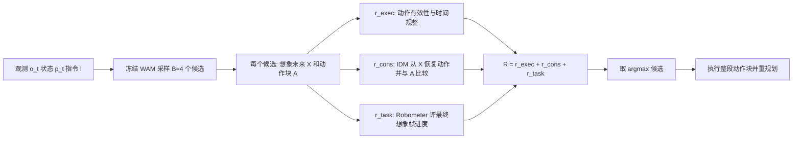

# Seeing Through the Illusion：WAM 的测试时扩展 WISE（arXiv:2611.03585）

**WISE**（World Action Inference Scaling through Evaluation；*Seeing Through the Illusion: Test-Time Scaling for World Action Models*，[arXiv:2611.03585](https://arxiv.org/abs/2611.03585)，v1 2026-11-02）。作者 Cheikh Ahmed、Mahdi Mostajabdaveh、Zirui Zhou（Huawei Technologies Canada）、Milad Yazdani（University of British Columbia）。归档见 [来源归档](../../sources/papers/wise-wam-test-time-scaling_arxiv_2611_03585.md)。

## 一句话定义

**WISE 是一个执行前的候选选择器：冻结 WAM 采样 B 个「动作块 + 想象未来」联合 rollout，用动作有效性、动作与想象运动的逆动力学一致性、任务进度三个 [0,1] 分数之和打分，只执行得分最高候选的动作块，不更新 WAM（论文 §3–§4）。**

## 英文缩写速查

| 缩写 | 英文全称 | 简要说明 |
|------|----------|----------|
| WAM | World Action Model | 联合生成动作与想象未来的世界动作模型 |
| WISE | World Action Inference Scaling through Evaluation | 本文方法名（摘要） |
| IDM | Inverse Dynamics Model | 由前后观测帧恢复动作的逆动力学模型 |
| B | number of candidates | 每个决策步的候选数，本文取 4 |
| DreamZero | — | 被评测的 WAM 之一（LIBERO 上） |
| Cosmos 3 Edge | — | 被评测的 WAM 之一（RoboLab 上） |
| LIBERO | Lifelong robot learning benchmark | 四个 suite：Spatial / Object / Goal / Long |
| RoboLab | — | RSS 2026 仿真基准，本文用其 10 个操作任务 |
| Robometer | — | 通用机器人进度奖励模型，本文用作任务进度评估器 |

## 为什么重要

- **作者自述的问题：** WAM 想象的未来即使视觉合理，也不保证共生成的动作能实现它；图 1 给出 Cosmos 3 Edge 在 RoboLab 上「想象与执行分歧」的例子（§1）。作者把「动作与想象未来不一致的候选最易偏离」写为假设，而非已证明结论。
- **定位：** 既有 WAM 决策时信号分别只评未来、只评动作，或依赖外部模拟器（§1）；WISE 评的是同一候选内动作与未来是否描述同一运动（表 1 的 cross-output coherence）。
- **我的判断：** 它是「不改模型、只花推理算力」的 WAM 增强路线，与 RL 后训练互补；但收益幅度和统计力度见下文局限节。

## 核心原理与方法栈

### 流程总览

### 三个分量（论文 §4）

| 分量 | 计算 | 出处 |
|------|------|------|
| r_exec | 位置 / 速度 / 加速度 / jerk 等检查的最坏违例 δ，经 S=exp(−δ/τ) 软化，再加权平均 | §4.2，式 4–5 |
| r_cons | IDM 由想象未来恢复动作；连续通道 exp(−标准化 L1 差)，夹爪等离散通道为阈值后一致率；二者各 1/2 | §4.3，式 6–10 |
| r_task | 冻结 Robometer 对最终想象帧的进度分（RoboLab 用 Robometer-4B，LIBERO 用 Robometer-LIBERO） | §4.4、§5.1，式 11 |

三项直接相加、无可学习融合权重（式 3）；r_exec 内部各检查的权重 w_k 与容差 τ_k 的具体取值正文未给出（我在正文中未找到，可能在代码中，推测）。

## 评测与结果

### 实验设置（§5.1）

- RoboLab：Cosmos 3 Edge，10 任务 × 5 episode = 50 episode。LIBERO：DreamZero（公开 RLinf WAN2.2-5B LIBERO SFT checkpoint，step 26,000），四 suite 各 500 episode，共 2,000。
- IDM：每个本体单独训练的纯视觉 IDM；RoboLab 用 DROID（21,000 训练 / 1,000 场景互斥验证 episode），LIBERO 用 physical-intelligence/libero 演示（1,693 episode，5% 验证）。
- 对比：Future Consensus、GeoBoN、Robometer（均 B=4），直接执行为 B=1。

### 主要结果（§5.2–§5.3）

| 设置 | B=1 | Future Consensus | GeoBoN | Robometer | WISE |
|------|-----|------------------|--------|-----------|------|
| RoboLab 成功率 % | 6.0 | 18.0 | 20.0 | 20.0 | 24.0 |
| LIBERO 平均 % | 75.1 | 75.9 | 77.3 | 77.4 | 78.3 |

- LIBERO 分 suite（WISE vs B=1）：Spatial 95.8 vs 92.6，Object 93.0 vs 88.2，Goal 53.6 vs 51.6，Long 70.8 vs 67.8（表 3）；GeoBoN 在 Goal、Robometer 在 Long 领先（§5.2）。
- RoboLab 单分量选择器：Exec-only 10.0、Cons-only 16.0、Prog-only 20.0，完整 24.0（表 5）。
- 分量分歧：三项偏好同一候选仅 7.8%（RoboLab）/ 7.0%（LIBERO）；去掉任务进度分改变 47.1% / 48.5% 的选择，去掉一致性分改变 16.8% / 30.4%，去掉执行分改变 24.7% / 12.4%（表 6–7）。
- 耗时：相对 B=1，WISE 在 RoboLab 为 3.4×（3062.5 vs 892.5 s/ep），LIBERO 为 3.5×（25.2 vs 7.1 s/ep）（表 4）。

## 结论

**WISE 相对直接执行（B=1）有稳定提升，但相对其他 B=4 选择器的优势落在抽样波动内；它的价值在于把「动作与想象未来是否自洽」变成可插拔的选择信号。**

1. **真影响指标是相对 B=1 的成功率增益**：RoboLab 6.0→24.0、LIBERO 75.1→78.3；对最强基线只多 4.0 / 0.9 个百分点（作者自承在波动内 / 约一个标准误）。
2. **任务进度分是最强单分量**：Prog-only 20.0 已与 Robometer 基线持平，完整 WISE 24.0（表 5）；一致性与执行分是增量而非主力，且增量未被单独量化。
3. **推理成本是主要代价**：3.4–3.5× 单 rollout 耗时（表 4），还需每个本体训练 IDM 并匹配 WAM 预测视野。
4. **分 suite 看而非看平均**：LIBERO Goal / Long 上 GeoBoN / Robometer 领先，选择器优劣依任务而变。
5. **部署读法**：两个 WAM–本体组合、纯仿真、RoboLab 仅 50 episode 且 B=1 绝对成功率极低；无公开代码，真机可用性未知。

## 与其他工作对比

| 选择器（均 B=4） | 打分信号 | RoboLab / LIBERO 平均（%） |
|------|------|------|
| [Future Consensus](./paper-sa-2605-07514-action-state-consistency-is-the-future-compatibl.md)（本文参考文献 [7]） | 各候选想象未来与候选均值（共识未来）的接近程度（见其页面流程图） | 18.0 / 75.9 |
| [GeoBoN](./paper-rcl-2607-17454-test-time-scaling-for-world-action-models-via-ze.md) | 对想象未来做零样本跨视角几何一致性评估（见其页面流程图） | 20.0 / 77.3 |
| [Robometer](./paper-robometer.md) | 最终想象帧的任务进度 | 20.0 / 77.4 |
| **WISE** | 执行有效性 + IDM 动作–未来一致性 + 任务进度 | 24.0 / 78.3 |

按论文 §1 与表 1 的归类，既有 WAM 决策时信号分别只评未来、只评动作或依赖外部模拟器，WISE 的差异在于评估同一候选内动作与想象未来的 cross-output coherence。同类「不改模型、测试时自校验」路线另见 [World-Coherent Decoding](./paper-rcl-2609-02159-world-coherent-decoding-self-verifying-test-time.md)，论文未与之做实验对比。

## 工程实践

- **插件式：** 只要求「时间对齐的动作与未来预测在执行前可得」，与 WAM 架构和训练目标无关（§2）。
- **需要为每个本体训练 IDM**（§1、§5.1），并需选定任务进度评估器；IDM 的预测视野必须与 WAM 匹配（33 帧↔32 步，或 9 帧双视角↔16 步，§5.1）。
- **推理成本约 B 倍以上：** 实测 3.4–3.5× 单 rollout 耗时；RoboLab 上是 B=4 选择器中最慢的，LIBERO 上与 Robometer 相当、低于 GeoBoN（§5.2，表 4）。
- **执行方式：** 选中后执行完整动作块再重规划（§5.1）；作者提出的自适应重规划留作未来工作（§5.4）。
- **开源状态：** 论文正文未给出代码或项目页链接；本页未另行核查项目页，截至 2026-11-09 视为「未确认」。
- 复现要点：沿用 B=4 与相同 episode 数，注意各方法一旦选择不同动作块，后续轨迹即分叉（§5.1）。

## 局限

**论文自述（§5.4）：**
- 依赖辅助评估器：IDM 可能误恢复动作，进度模型可能误判视觉上合理的未来。
- 单分量实验不衡量每个分量在另两项存在时的增量收益。
- RoboLab 每方法仅 50 episode，数个百分点的差距落在抽样波动内。
- 推理成本随候选数倍增，WISE 另加 IDM 与进度模型评估。

**我看到的未验证之处（判断，非论文原话）：**
- RoboLab 上 WISE 比最强基线只多 2 次成功（24.0 vs 20.0，即 12/50 vs 10/50，我按 50 episode 换算），论文本身也称在抽样波动内；LIBERO 的 +0.9 约一个标准误（§5.2）。因此「优于现有选择器」证据弱，较稳的结论是「相对 B=1 有提升」。
- 6.0% 的 B=1 基线本身极低（约 3/50），绝对成功率仍低。
- 一致性分数检验的是「动作与想象未来是否自洽」，论文也承认想象未来与真实执行的对应仍是另一个不确定性来源（§4.3），未直接验证「一致性高 ⇒ 执行与想象吻合」。
- 只评测了两个 WAM–本体组合，且均为仿真；无真机实验。
- 式 3 为无权重求和，未给出融合权重或 r_exec 内各 τ_k 的敏感性分析（推测可能存在，但正文未报告）。
- 论文称分量排序不同（>92% 决策不同），但这不直接等于分量互补带来增益；增益证据只有表 5 的单分量对比。

## 关联页面

- [世界动作模型（WAM）](../concepts/world-action-models.md)
- [逆动力学模型](../concepts/inverse-dynamics-model.md)
- [进度奖励建模](../concepts/progress-reward-modeling.md)
- [Robometer](./paper-robometer.md)（本文的任务进度评估器）
- [DreamZero（World Action Models are Zero-Shot Policies）](./paper-notebook-dreamzero-world-action-models-are-zero-shot-poli.md)
- [GeoBoN：WAM 零样本几何评估的测试时扩展（arXiv:2607.17454）](./paper-rcl-2607-17454-test-time-scaling-for-world-action-models-via-ze.md)（对比基线之一）
- [Is the Future Compatible? 诊断 WAM 动态一致性（arXiv:2605.07514）](./paper-sa-2605-07514-action-state-consistency-is-the-future-compatibl.md)（即本文参考文献 [7]，对比基线 Future Consensus 的出处）
- [World-Coherent Decoding（arXiv:2609.02159）](./paper-rcl-2609-02159-world-coherent-decoding-self-verifying-test-time.md)（同类测试时验证）
- [Cosmos 3](./cosmos-3.md)、[RoboLab](./robolab.md)、[LIBERO 基准](./libero-benchmark.md)
- [RLinf-VLA](./paper-rlinf-vla.md)（本文 LIBERO checkpoint 来自 RLinf）

## 参考来源

- [来源归档：WISE（arXiv:2611.03585）](../../sources/papers/wise-wam-test-time-scaling_arxiv_2611_03585.md)
- [arXiv:2611.03585](https://arxiv.org/abs/2611.03585)

## 继续阅读

- [arXiv PDF](https://arxiv.org/pdf/2611.03585)
- [世界动作模型概念页](../concepts/world-action-models.md)
- [进度奖励建模](../concepts/progress-reward-modeling.md)
