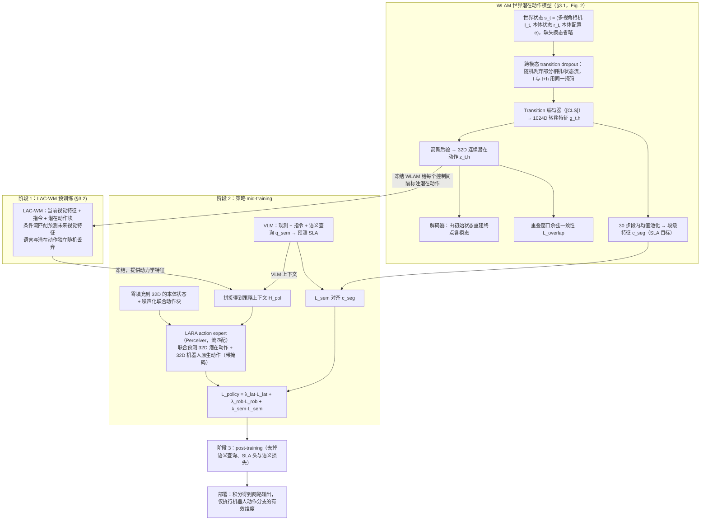

# WLA³（arXiv:2609.15870）

**WLA³**（*WLA^3: World Latent Action Modeling for Semantics, Dynamics, and Kinematics*，[arXiv:2609.15870](https://arxiv.org/abs/2609.15870)，[项目页](https://wla-3.github.io/)）来自 [具身智能小站 12 篇盘点](../../sources/blogs/wechat_embodied_station_12_papers_vla_deploy_2026-09-16.md)。

## 一句话定义

**从相邻世界状态变化学 latent action，同一表征复用于语义、动力学与运动学；人类视频可参与预训练。**

## 英文缩写速查

| 缩写 | 英文全称 | 简要说明 |
|------|----------|----------|
| WLA³ | World Latent Action Modeling | 本文三域潜动作框架 |
| LAM | Latent Action Model | 潜动作模型 |
| WM | World Model | 世界状态预测 |
| IL | Imitation Learning | 异构示范预训练 |

## 为什么重要

- 异构数据缺少统一低噪声动作监督，限制通用策略扩展。
- 开源结论：**待发布**（步骤 2.5，2026-09-16）。
- 与 [12 篇技术地图](../overview/vla-deploy-12-papers-technology-map.md) 中同类工作可横向对照。

## 流程总览

图依据：论文 §3.1–3.2 与 Fig. 2 / Fig. 3、式 1–15

## 核心机制

| 项 | 内容 |
|----|------|
| **arXiv** | [2609.15870](https://arxiv.org/abs/2609.15870) |
| **开源** | **待发布** |
| **要点** | 世界状态差分 → latent action；跨语义/动力学/运动学复用；项目页 arXiv 链入库日标注 coming soon。 |
| **文内指标** | 以原文与项目页为准。 |

## 源码运行时序图

**不适用（待发布）** — 截至 2026-09-16 项目页未列可运行官方仓库。

## 实验与评测

- 以原文与项目页为准。
- **读法：** 清单摘要；逐项对照与 baseline 以原文 PDF 为准。

## 与其他工作对比

- 横向索引见 [12 篇技术地图](../overview/vla-deploy-12-papers-technology-map.md)。

## 结论

**WLA³ 把「世界变化」当动作共同语言，适合与世界模型/潜动作文献对照阅读。**

1. 开源边界：**待发布** — 以项目页实际链接为准（入库日 2026-09-16）。
2. 核心机制：世界状态差分 → latent action；跨语义/动力学/运动学复用；项目页 arXiv 链入库日标注 coming soon。…
3. 部署前核对任务协议与硬件条件，勿直接横比公众号摘录数字。

## 关联页面

- [world-action-models](../concepts/world-action-models.md)
- [paper-act-lam](./paper-act-lam.md)
- [vla](../methods/vla.md)
- [paper-dido-wam](./paper-dido-wam.md)

## 参考来源

- [wla3_arxiv_2609_15870.md](../../sources/papers/wla3_arxiv_2609_15870.md)
- [wechat_embodied_station_12_papers_vla_deploy_2026-09-16.md](../../sources/blogs/wechat_embodied_station_12_papers_vla_deploy_2026-09-16.md)
- [arXiv:2609.15870](https://arxiv.org/abs/2609.15870)
- [arXiv PDF](https://arxiv.org/pdf/2609.15870)：已通读方法部分（实验与附录以略读为准）：摘要，§2 相关工作略读，§3 方法（WLAM、LAC-WM、SLA、LARA 与训练目标）

## 推荐继续阅读

- [arXiv PDF](https://arxiv.org/pdf/2609.15870)
- [项目页](https://wla-3.github.io/)

