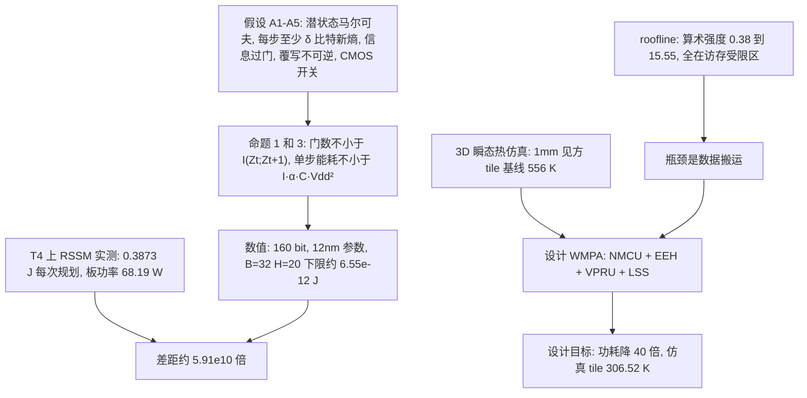

# WMPA：世界模型规划加速器（arXiv:2611.10316）

**WMPA**（*The World Model Planning Accelerator: Hardware-Algorithm Co-Design for Embedded AI in Robotics*，[arXiv:2611.10316](https://arxiv.org/abs/2611.10316)，cs.AR，v1 2026-11-06）来自美国沙迦大学与 BITS Pilani 迪拜校区（以论文首页为准）。它不是机器人策略论文，而是一篇**体系结构论文**：分析机载世界模型规划的能耗与散热瓶颈，并提出一个概念性芯片架构。

## 一句话定义

**从信息论推出世界模型潜空间 rollout 的能耗下界，量出 GPU 与该下界的巨大差距并定位到数据搬运，再提出近存计算 + 按熵变精度的 WMPA 架构；40 倍降功耗是设计目标，不是综合或流片结果。**

## 英文缩写速查

| 缩写 | 英文全称 | 简要说明 |
|------|----------|----------|
| WMPA | World Model Planning Accelerator | 本文提出的概念性规划加速器 |
| RSSM | Recurrent State Space Model | DreamerV3 风格潜空间世界模型（GRU + 类别潜变量） |
| MPC | Model Predictive Control | 滚动时域规划，反复调用世界模型 |
| MCTS | Monte Carlo Tree Search | 树搜索规划，同样反复调用世界模型 |
| NMCU | Near-Memory Compute Unit | 与 SRAM 同置的计算单元 |
| EEH | Entropy Estimation Hardware | 实时估计下一潜状态预测熵并选精度 |
| VPRU | Variable Precision Rollout Unit | FP16 / INT8 / INT4 变精度 ALU |
| LSS | Latent State Scratchpad | 写时复制的片上潜状态缓存 |
| CMOS | Complementary Metal-Oxide-Semiconductor | 主流逻辑工艺，能耗下界按其开关能耗算 |
| TDP | Thermal Design Power | 热设计功耗，T4 额定 70 W |
| PIM | Processing-in-Memory | 存内计算，论文引为已有硬件方向 |

## 为什么重要

- 世界模型规划要在机上连续算 H 步 × B 条轨迹，功耗与温度预算很紧（第 I 节）；多数世界模型工作偏算法，硬件工作面向静态推理，缺少对串行 rollout 极限的刻画（第 I 节，作者自述）。
- 论文把「理论下界 → 实测差距 → 访存瓶颈 → 热上限 → 架构」串成一条链，给出一个看「世界模型上机」代价的框架；这是作者的叙事，其中多段是假设加估计，见「局限」。
- 对读 [基于模型的强化学习](../methods/model-based-rl.md) 与 [潜空间想象](../concepts/latent-imagination.md) 的人，它提示：想象 rollout 在算力之外还有数据搬运与散热成本。

## 核心原理

### 1. 理论下界（第 II–III 节）

- 设定：潜状态 Z 为 32×32 类别变量，熵上限 log2|Z| = 160 bit（第 II-A、III-D 节）。
- 命题 1：每步门数不小于互信息 I(Zt;Zt+1)；MAC 数不小于 I/b（式 6–8）。命题 3：单步 CMOS 动态能耗不小于 I·α·Cgate·Vdd²（式 9）。
- 数值：Vdd = 0.8 V，Cgate ≈ 1 fF，α = 0.1（TSMC 12nm 引自其文献 [13]），得单步 1.024×10^-14 J，B=32、H=20 规划调用约 6.55×10^-12 J（式 10–11，已复算）。该值取 I = 160 bit 上限，所以是「下界中最大的那个」。
- 命题 2（Landauer 热力学界）论文自称依赖模型，只陈述不评估；Landauer 约 2.87×10^-21 J/bit，比所用 6.4×10^-17 J 每门低四个数量级以上，故 CMOS 下限是实际起作用的界。

### 2. GPU 实测（第 IV-A 至 IV-C 节）

- 设置：PyTorch 的 DreamerV3 风格 RSSM（512 单元 GRU，1024 维潜变量，512 维特征头），**profile 的是结构，不是训练得到的权重**；Tesla T4，B=32，H∈{5,10,15,20}；pynvml 每 50 ms 读板级功率，3 秒连续循环，10 次平均。
- 结果：H=20 时 0.3873 J 每次规划（σ=5.923 mJ），板功率 68.19 W（T4 额定 70 W），能耗随 H 线性增长，对 CMOS 下限差距 5.91×10^10；H 更短时到 6.08×10^10（图 3）。
- roofline（图 1）：算术强度 0.38–15.55 FLOPs/byte，三代 GPU 的 ridge 点 203.5 / 153.0 / 295.2 FLOPs/byte（FP16 稠密），所有算子都在访存受限区；论文由此推出「加 FLOP/s 无用，要提高有效算术强度」。
- 稀疏性（图 2）：用 softmax 温度衰减做**合成压力测试**，GRU 状态稀疏 14.0%，特征投影 29.0%。

### 3. 热仿真（第 IV-D 节）

- 模型：3D 瞬态非线性热传导，硅导热率随温度下降，tile 为 1 mm × 1 mm × 100 µm，上表面经 1.5 mm 铜扩散层加界面材料接环境 300 K，等效 h_eff = 23,850 W/(m²·K)。
- 热源：把实测板功率 68.19 W 的约 9% 分给该 tile（论文称为数量级假设），得 6.17×10^6 W/m²；持续背靠背规划约 176 次每秒，高于典型 30 Hz 控制（30 Hz 下规划能耗均值约 11.6 W），所以基线是吞吐受限的最坏情形。
- 结果：基线峰值 556.07 K（升 256.07 K），WMPA 目标 306.52 K（升 6.52 K）；一维估算 ΔT≈Q/h_eff 与有限元相差约 1%。论文自述该结果只表示相对可行性。

### 4. WMPA 架构（第 V 节，概念设计）

| 部件 | 作用 | 论文给出的数 | 论文的口径 |
|------|------|--------------|------------|
| NMCU | GRU 更新与潜变量投影在 SRAM 旁执行 | 片外流量约 -80% | 设计目标，非文献数 |
| EEH | 实时估计下一潜状态预测熵，选精度 | 90% 置信度阈值 | 稳健性启发式，非界的推论 |
| VPRU | 高熵步用 FP16，低熵步用 INT8 / INT4 | 20 步中 8 步 FP16（40%），12 步低精度（60%） | 合成代理结果，需训练智能体验证 |
| LSS | 写时复制缓存共享前缀的潜状态 | 2 MB，0.68 mm²，0.87 ns；冗余读 -60% 至 -70% | 估计值；CACTI 7.0 在 22nm 建模后按 (12/22) 缩放，非 12nm 编译器输出 |

总功耗从 68.19 W 降到 1.70 W（40×）被明确称为「设计目标，不是推导或测量结果」；NMCU 与 LSS 的节省有重叠，不能相乘（第 V-C 节）。

## 工程实践

- **怎么用这篇论文的结论：** 它给的是一个诊断框架——先用 roofline 判断世界模型规划是算力受限还是带宽受限，再用板级功率遥测量实际能耗。若在自己的机载平台上跑潜空间 rollout，可对照第 IV 节的 profiling 流程；不能直接引用 WMPA 的 40× 作为可得收益。
- **可复现性：** 论文称 profiling 与 roofline 代码公开于 [Prk10/world-models-theoretical-min](https://github.com/Prk10/world-models-theoretical-min)；本次未能访问该仓库，**未核实**其内容与运行方式。WMPA 本身没有 RTL、综合或流片产物。
- **实验平台限制：** 实测只在 Tesla T4（12nm，服务器级 GPU）上做，不是 Jetson 等机器人常用嵌入式模块；是否对嵌入式 SoC 同样成立，论文没测（我的判断）。

## 局限

**论文自己承认的（第 V、VI 节）：**

- 精度调度基于合成熵坍缩代理，不是训练好的策略；低精度对任务精度的影响「remains to be validated」。
- 40× 降功耗是设计目标，需用综合结果替代；若按功率比例缩放能耗，WMPA 仍高于 CMOS 下限约 1.5×10^9 倍。
- 热模型在铜扩散层后假设理想散热，9% 热点份额是假设；556 K 不是测量温度。
- 下界依赖假设 A1–A5，其中 H(Zt) 单调不减「作为结构假设，不证明」；A1 是开环，闭环规划（带后验更新）会降熵，需另行分析；K(b)∝b² 只是实现成本而非证明的下界。
- 需要训练智能体、综合实现和封装级热模型才能补上这些缺口。

**我看到的未验证之处（我的判断）：**

- 「差距 5.91×10^10」比较的是整块板（含 GDDR6、稳压、互连）与仅含数据通路晶体管的下界，论文自己也说不是逻辑对逻辑的比较；这个倍数更适合当作量级示意，不宜当成「GPU 效率损失」。
- 下界取 I = 160 bit 的上限，且只算开关能耗、不含存储与搬运，所以它离任何实际系统都很远；「十一个数量级」主要反映该下界的宽松程度，不是 GPU 独有的浪费。
- 没有任何任务性能数据（成功率、回报、规划质量），评估对象是未训练的 RSSM 结构，也没有与其他加速器或 PIM 方案做对比。
- 论文性质：这是仿真与分析为主的概念论文，作者为体系结构方向，没有真机或机器人任务实验。

## 关联页面

- [基于模型的强化学习](../methods/model-based-rl.md)
- [模型预测控制](../methods/model-predictive-control.md)
- [潜空间想象](../concepts/latent-imagination.md)
- [DreamerV3 论文页](../entities/paper-shenlan-wm-13-dreamerv3.md)
- [TD-MPC2](../entities/paper-td-mpc2.md)
- [边云协同机器人](../concepts/edge-cloud-robotics.md)
- [具身基础模型与硬件协同设计](../concepts/embodied-foundation-model-hardware-codesign.md)

## 参考来源

- [WMPA 来源归档（通读核对范围见此）](../../sources/papers/wmpa-world-model-planning-accelerator_arxiv_2611_10316.md)
- [arXiv:2611.10316](https://arxiv.org/abs/2611.10316)

## 推荐继续阅读

- [arXiv PDF（v1）](https://arxiv.org/pdf/2611.10316v1)
- [潜空间想象](../concepts/latent-imagination.md)
- [边云协同机器人](../concepts/edge-cloud-robotics.md)
