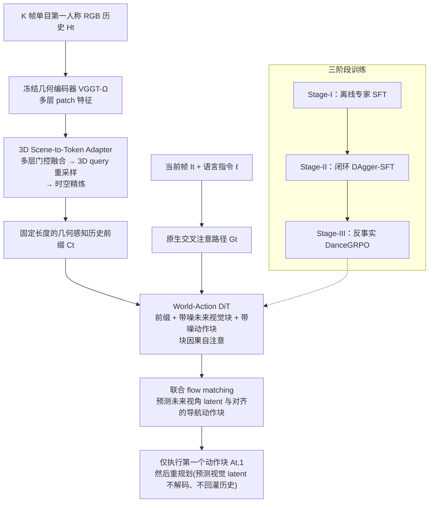

# WNM-3D（arXiv:2608.07267）

**WNM-3D**（[arXiv:2608.07267](https://arxiv.org/abs/2608.07267)）收录于 [多模空间 · 一周 VLA 研究趋势简析（2026.08.10–08.16）第一篇](../../sources/blogs/wechat_duomo_vla_weekly_trends_2026-08-10_part1.md) **空间感知** 段。

## 一句话定义

**3D 场景条件闭环 VLN 世界导航模型：冻结几何编码器整合单目历史为 token，联合生成未来视角与动作，闭环 RL 优化，优于 2D 条件与强 VLM 策略。**

## 英文缩写速查

| 缩写 | 英文全称 | 简要说明 |
|------|----------|----------|
| VLA | Vision-Language-Action | 视觉–语言–动作策略 |
| VLM | Vision-Language Model | 视觉–语言多模态模型 |
| VLN | Vision-Language Navigation | 视觉–语言导航 |
| WAM | World Action Model | 联合未来与动作生成的具身策略 |
| TTT | Test-Time Training | 部署阶段无标注数据的在线适配 |

## 为什么重要

- 3D 场景条件闭环 VLN 世界导航模型：冻结几何编码器整合单目历史为 token，联合生成未来视角与动作，闭环 RL 优化，优于 2D 条件与强 VLM 策略。
- 开源状态：**待核实**（步骤 2.5，入库日 2026-09-19）。
- 与 [vla weekly trends 2026 08 10 part1 technology map](../overview/vla-weekly-trends-2026-08-10-part1-technology-map.md) 同批工作可横向对照。

## 流程总览

图依据：论文 §3.1 至 §3.5 / Fig.1、Fig.2、Fig.3

## 核心机制

| 项 | 内容 |
|----|------|
| **arXiv** | [2608.07267](https://arxiv.org/abs/2608.07267) |
| **开源** | **待核实** |
| **文内评测** | GN-Bench |

## 源码运行时序图

**不适用**（截至入库日未提供可运行官方代码入口，或仓库尚未公开）。

## 实验与评测

- **文内口径：** GN-Bench
- **读法：** 本页为 [公众号策展](../../sources/blogs/wechat_duomo_vla_weekly_trends_2026-08-10_part1.md) 摘要；逐项指标以 **原文 PDF** 为准。

## 与其他工作对比

> 下表只做**定位对照**：本页与下列同批各页均为 [公众号策展](../../sources/blogs/wechat_duomo_vla_weekly_trends_2026-08-10_part1.md) 的索引级摘要，未逐条核对原文实验表，彼此**不共享同一评测协议**，不可据此横比数字。

| 对照 | 差异读法 |
|------|----------|
| [AnyCamVLA](./paper-anycam-vla.md) | 同批「空间感知」段两条，改的层不同：本文换**表征**（冻结几何编码器把单目历史整合成 3D 场景条件 token），AnyCamVLA 修**图像**（测试期合成回训练视角）。前者从根上不绑某个相机摆位，后者部署更轻、可套在已训好的策略上 |
| [RecoverFly](./paper-recoverfly-aerial-vln.md) | 同批同为闭环 VLN 且都用 RL 优化，分工互补：本文改条件表征并联合生成未来视角与动作，RecoverFly 改训练信号（失败感知 + 长尾课程）。表征与训练法正交，可叠加 |
| [World Action Models](../concepts/world-action-models.md) | 「联合生成未来视角与动作」正是 WAM 的接口形态；本文把它从桌面操作搬到**导航**，条件由 2D 帧换成 3D 场景——读法上属 WAM 谱系的导航分支，而非另起一套 |
| [VLN 任务页](../tasks/vision-language-navigation.md) | 该页给任务定义；本文的对照组是「2D 条件」与「强 VLM 策略」两类，「优于」须锁定 GN-Bench 同一协议，勿与其他 VLN 榜的成功率混读 |

## 结论

**WNM-3D 适合作为本期「空间感知」路线的快速索引页。**

1. 核心贡献：3D 场景条件闭环 VLN 世界导航模型：冻结几何编码器整合单目历史为 token，联合生成未来视角与动作，闭环 RL 优化，优于 2D 条件与强 VLM 策略。
2. 开源结论：**待核实** — 以项目页/仓库实际链接为准。
3. 横向对照见 [技术地图](../overview/vla-weekly-trends-2026-08-10-part1-technology-map.md)，避免与同 arXiv 重复造页。

## 关联页面

- [VLA（Vision-Language-Action）](../methods/vla.md)
- [一周 VLA 趋势技术地图](../overview/vla-weekly-trends-2026-08-10-part1-technology-map.md)
- [Generative World Models](../methods/generative-world-models.md)

## 参考来源

- [wechat_duomo_vla_weekly_trends_2026-08-10_part1.md](../../sources/blogs/wechat_duomo_vla_weekly_trends_2026-08-10_part1.md)
- [arXiv:2608.07267](https://arxiv.org/abs/2608.07267)
- [arXiv PDF](https://arxiv.org/pdf/2608.07267)：已通读方法部分（实验与附录以略读为准）：§3 Method（3.1 至 3.5）

## 推荐继续阅读

- [VLA 方法页](../methods/vla.md)
- [arXiv PDF](https://arxiv.org/pdf/2608.07267)
