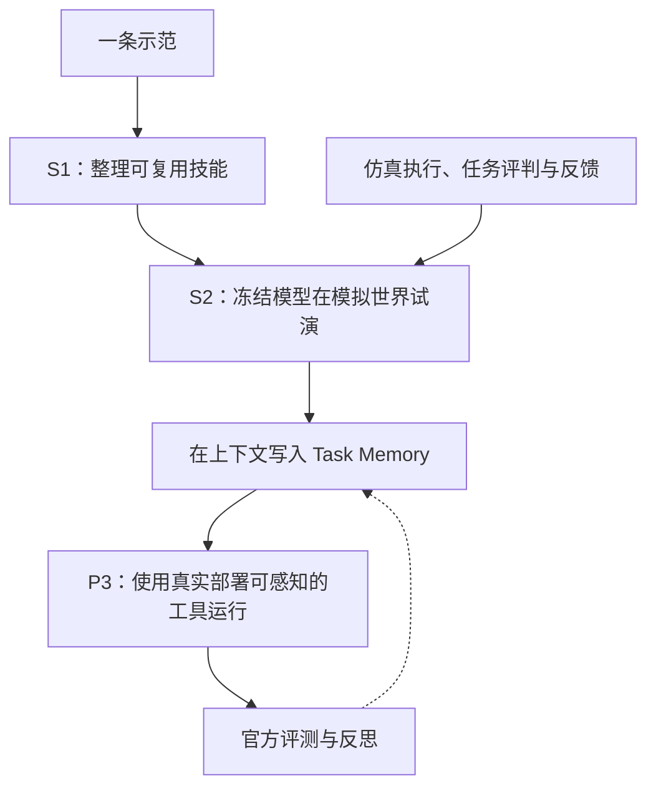
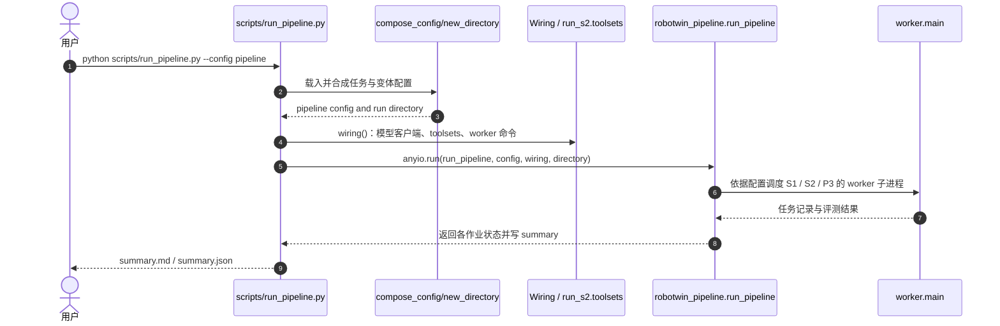

# World In-Context Learning for Agentic Robot Manipulation（WICL：面向智能体式机器人操作的世界上下文学习）

## 一句话定义

**WICL** 把机器人任务学习写进 agent 上下文的 Task Memory：只用一条演示，在仿真世界反复试演和总结，而**不通过梯度更新基础模型**。

## 英文缩写速查

| 缩写 | 英文全称 | 简要说明 |
|---|---|---|
| WICL | World In-Context Learning | 在世界交互后把经验保存在上下文 |
| VLM | Vision-Language Model | RoboScript 可通过网关调用的视觉语言模型 |
| S1/S2/P3 | Stage 1 / Stage 2 / Phase 3 | 技能准备、试演学习与正式评测阶段 |
| SR | Success Rate | 机器人任务执行成功率 |

## 为什么重要

训练每项新操作都要重新拟合策略成本较高，WICL 试图让模型通过“规划工具调用—在仿真中验证—保留任务记忆”的闭环适应新任务，重点考验任务记忆能否适用于未见场景。

## 流程总览（官方四阶段）

评判专用的真值在控制面，不直接泄漏到部署阶段的行动代理。

## 核心原理

RoboScript 把模型网关、Hub/toolsets、控制平面与模拟世界拆分成服务；学习阶段允许试演与结果反思，部署时只暴露可用工具。任务记忆存储策略与技能调用经验，而不是模型权重。

## 实验与评测（官方作者报告）

| 测试 | 结果 |
|---|---:|
| RoboTwin 2.0 全部 50 项双臂任务 | 83.4% 平均成功率 |
| clean / randomized | 83.6% / 83.2% |
| 对照：最强训练策略、50 demos/task | 61.7% |

上表不是不同预算下的完全同条件重训练对照；还需结合论文实验设置解读。

## 结论

**WICL 展示了“经验在上下文而不在权重里”的可行性，但工程瓶颈转移到仿真资产、工具执行与记忆可靠性。**

1. 核实学习阶段和评测阶段的观察权限，避免 simulator truth 泄漏。
2. 成功率来自 RoboTwin 2.0 任务池，不能直接移植到新机器人场景。
3. 真实机器人跨形态演示有价值，但开源仓 README 仍将部署代码列为 TODO。
4. 可先用官方 mock 脚本验证工具、记录和判定链，再准备 RoboTwin。

## 与其他工作对比

[SWAM](./paper-swam-cross-modal-alignment.md) 更新 world/action 模型权重；[Flip Anything](./paper-flip-anything-agentic-self-learning.md) 用 coding agent 在仿真中改技能/程序。WICL 的核心产物是**可检索、冻结的 Task Memory**。

## 源码运行时序图（已核对的 RoboTwin 管线入口）

依据官方 `examples/simBenchmarks/RoboTwin/scripts/run_pipeline.py`、对应 README；worker 内部的所有服务调用尚未逐函数复核，图中不虚构未读实现。

## 工程实践

- 先运行 Mock smoke: `cd examples/tutorials && uv run python -m quickstart_mock.run`，验证 Hub → AgentSession → ScriptedBrain → env.judge 的最小调用链。
- RoboTwin 管线按官方 `examples/simBenchmarks/RoboTwin/README.md` 准备 simulator、gateway、vision/motion service，并执行 `scripts/run_pipeline.py`。
- 使用 `--dry-run` 和 `--resume` 检查任务队列及断点；不要把模拟评判信息带进真实机器人 sensing 接口。

## 局限与风险

- 成功率由作者测试，不是本 PR 的独立运行结论。
- 成本依赖环境逼真度、运动规划工具和多轮模型调用。
- 真机视频与开源真机可执行部署代码分开看待：README 的后者仍待开放。

## 关联页面

- [SWAM](./paper-swam-cross-modal-alignment.md)
- [Flip Anything](./paper-flip-anything-agentic-self-learning.md)

## 参考来源

- [WICL 论文摘录](../../sources/papers/wicl-roboscript-2611-12885.md)
- [RoboScript 官方代码](../../sources/repos/roboscript-official.md)
- [官方项目页](../../sources/sites/roboscript-official.md)

## 推荐继续阅读

- [arXiv:2611.12885](https://arxiv.org/abs/2611.12885)
- [RoboScript 源码](https://github.com/ArcheOne-AI/RoboScript)
