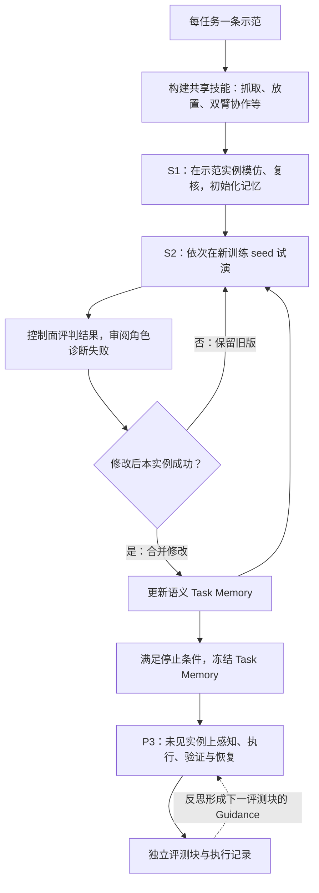
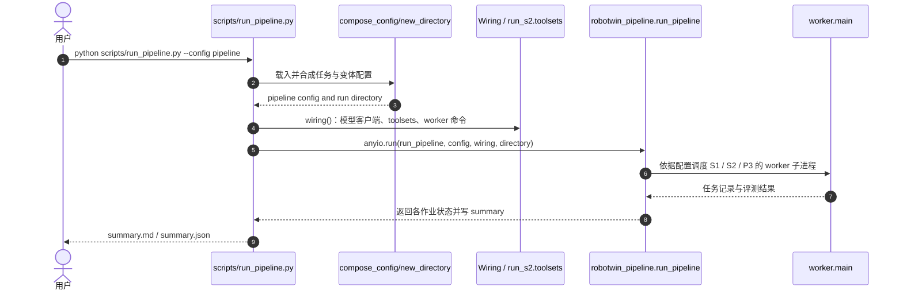

# World In-Context Learning for Agentic Robot Manipulation（WICL：面向智能体式机器人操作的世界上下文学习）

## 一句话定义

**WICL** 把机器人任务学习写进 agent 上下文的 Task Memory：只用一条演示，在仿真世界反复试演和总结，而**不通过梯度更新基础模型**。

## 英文缩写速查

| 缩写 | 英文全称 | 简要说明 |
|---|---|---|
| WICL | World In-Context Learning | 在世界交互后把经验保存在上下文 |
| VLM | Vision-Language Model | RoboScript 可通过网关调用的视觉语言模型 |
| S1/S2/P3 | Stage 1 / Stage 2 / Phase 3 | 技能准备、试演学习与正式评测阶段 |
| SR | Success Rate | 机器人任务执行成功率 |

## 为什么重要

训练每项新操作都要重新拟合策略成本较高，WICL 试图让模型通过“规划工具调用—在仿真中验证—保留任务记忆”的闭环适应新任务，重点考验任务记忆能否适用于未见场景。

## 流程总览（官方四阶段）

评判专用的真值在控制面，不直接泄漏到部署阶段的行动代理。

## 核心原理

RoboScript 把模型网关、Hub/toolsets、控制平面与模拟世界拆分成服务；学习阶段允许试演与结果反思，部署时只暴露可用工具。任务记忆存储策略与技能调用经验，而不是模型权重。**S1 不只是生成技能**：论文 §4.2 的 S1 还在演示实例上反复模仿、检查并修改初始记忆；S2 才迁移到新的训练实例，逐个检查首次尝试并控制记忆修改预算。

## 任务记忆与可部署数据边界

- **结构化记忆**：Task Memory 是 Markdown 文档，记录对象角色、分阶段工作流、相对抓取/放置规范、参数与试演教训；记忆 linter 拒绝绝对坐标、仿真真值术语和实例 ID，避免把训练场景的位置直接带到测试场景（论文 §4.2）。
- **观测与动作**：执行代理使用头部/腕部 RGB-D、机器人本体状态、工具调用反馈（如命令位姿、实际位姿、夹爪开度和是否持物）；反馈 receipt 是可从机器人获得的测量，而非直接读取仿真对象真值（§4.1）。
- **权限隔离**：S1 的演示读取、S2 的审阅/官方评判可以使用训练期特权数据，但 **acting agent** 在试演和部署都使用可部署工具。冻结的记忆再在与训练 seed 不重叠的评测 seed 上测试（§3–4）。因此不能将“全系统不看真值”误写为实验设定。

## 实验与评测（官方作者报告）

| 测试 | 结果 |
|---|---:|
| RoboTwin 2.0 全部 50 项双臂任务 | 83.4% 平均成功率 |
| clean / randomized | 83.6% / 83.2% |
| 对照：最强训练策略、50 demos/task | 61.7% |

论文每任务每设定 10 次（50 任务 × clean/randomized × 10 = 1000 次）；上表不是不同预算下的完全同条件重训练对照。论文另报告双臂 PiPER 四项任务 10/10、7/10、7/10、6/10：模拟 ALOHA 记忆仅做本体参数映射，真机以离线完整序列执行、无在线重新规划；真机部署代码仍待公开。

### 关键消融与投入成本（不要与 50 任务主结果混淆）

| 实验 | 论文口径 | 作者报告 |
|---|---|---:|
| 完整方法 | 表 2：10 任务、clean+randomized 各 10 次 | 78.5% |
| 仅将示范写入记忆、不与世界交互 | 同一批任务/seed，对照完整方法 | 69.0% |
| 去掉执行失败后的恢复 | 同一组冻结记忆与评测 seed | 69.0% |
| 从头重新学习：完整方法 | 表 2 的另一学习消融组 | 86.0% |
| 从头重新学习：不提供示范 | 对照上一行；还移除依赖示范的完成检查 | 56.5% |

表 2 的**冻结记忆部署组**与**从头重学组**基线不同，不可把 86.0% 与 78.5% 当作同一条件下的提升。无特权监督的另组消融为 86.5%（对照其组完整方法 86.0%），说明特权诊断并非这一组表现的必要条件；不等同于证明真实世界无需感知误差处理。

论文表 3：GPT-6.1-Sol 的 **单个 P3 仿真评测 episode** 平均 54.7 次模型调用、233 万 tokens、149 个仿真步骤；全部 50 任务的学习加 1000 次评测按作者采用的 API 标价估算为 **1911 美元**。这是论文预算，不是本仓独立实测，也不是每条示范的费用。

## 结论

**WICL 展示了“经验在上下文而不在权重里”的可行性，但工程瓶颈转移到仿真资产、工具执行与记忆可靠性。**

1. 核实学习阶段和评测阶段的观察权限，避免 simulator truth 泄漏。
2. 成功率来自 RoboTwin 2.0 任务池；10 任务消融要和 50 任务主指标分开，不可直接移植到新机器人场景。
3. 真实机器人跨形态演示有价值，但开源仓 README 仍将部署代码列为 TODO。
4. 可先用官方 mock 脚本验证工具、记录和判定链，再准备 RoboTwin。

## 与其他工作对比

[SWAM](./paper-swam-cross-modal-alignment.md) 更新 world/action 模型权重；[Flip Anything](./paper-flip-anything-agentic-self-learning.md) 用 coding agent 在仿真中改技能/程序。WICL 的核心产物是**可检索、冻结的 Task Memory**。

## 源码运行时序图（已核对的 RoboTwin 管线入口）

依据官方 `examples/simBenchmarks/RoboTwin/scripts/run_pipeline.py`、对应 README；worker 内部的所有服务调用尚未逐函数复核，图中不虚构未读实现。

## 工程实践

- 先运行 Mock smoke: `cd examples/tutorials && uv run python -m quickstart_mock.run`，验证 Hub → AgentSession → ScriptedBrain → env.judge 的最小调用链。
- RoboTwin 管线按官方 `examples/simBenchmarks/RoboTwin/README.md` 准备 simulator、gateway、vision/motion service，并执行 `scripts/run_pipeline.py`。
- `scripts/run_pipeline.py --dry-run` **必须配合** `--resume <run_dir>`；可用 `--resume` 恢复任务、`--summary <run_dir>` 单独重写报告。不要把模拟评判信息带进真实机器人 sensing 接口。

## 局限与风险

- 成功率由作者测试，不是本 PR 的独立运行结论。
- 成本依赖环境逼真度、运动规划工具和多轮模型调用。
- 真机视频与开源真机可执行部署代码分开看待：README 的后者仍待开放。

## 关联页面

- [机器人操作](../tasks/manipulation.md) — 延伸阅读，对照机器人操作任务。
- [模仿学习](../methods/imitation-learning.md) — 延伸阅读，了解示范数据与策略学习的关系。
- [SWAM](./paper-swam-cross-modal-alignment.md)
- [Flip Anything](./paper-flip-anything-agentic-self-learning.md)
- [具身上下文学习纵深路线 Stage 4](../../roadmap/depth-icl.md#stage-4-机制选型与推理预算零梯度上下文-vs-快权重-ttt-vs-记忆增强)

## 参考来源

- [WICL 论文摘录](../../sources/papers/wicl-roboscript-2611-12885.md)
- [RoboScript 官方代码](../../sources/repos/roboscript-official.md)
- [官方项目页](../../sources/sites/roboscript-official.md)

## 推荐继续阅读

- [arXiv:2611.12885v1（PDF，33 页）](https://arxiv.org/pdf/2611.12885)
- [RoboScript 源码](https://github.com/ArcheOne-AI/RoboScript)
