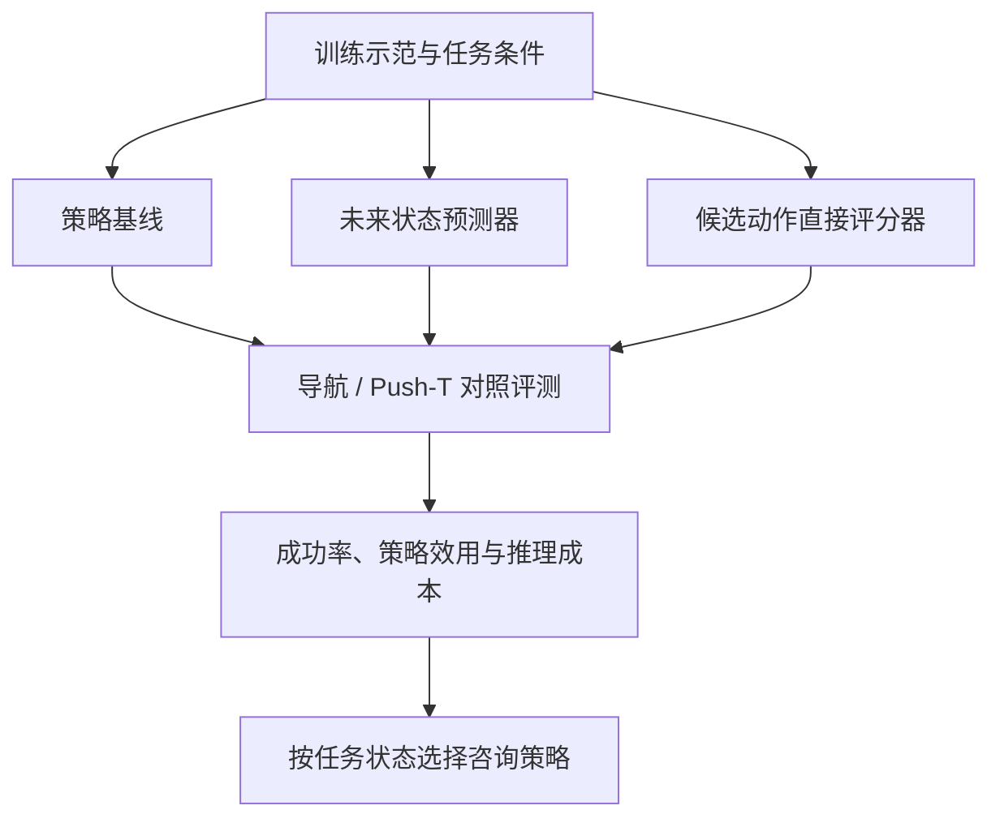
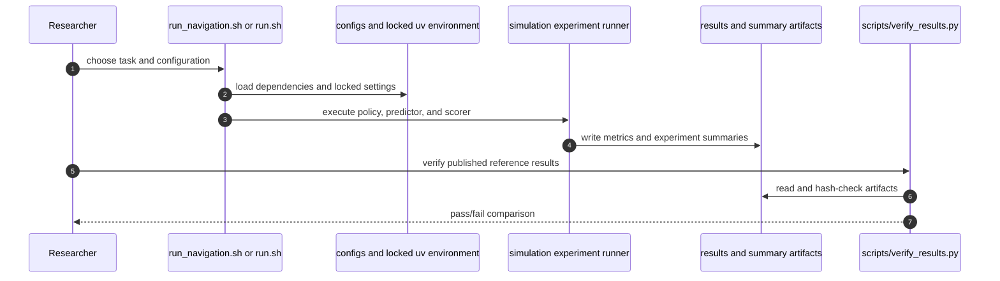

# World Model Consultation Study：何时值得咨询世界模型？

该研究把“世界模型是否值得在控制时调用”变成可比较的策略选择问题：对照直接执行已学策略、用预测未来状态挑选候选动作，以及直接给候选动作打分；并分析任务条件、预测器容量、前视长度与推理代价。

## 英文缩写速查

| 缩写 | 英文全称 | 简要说明 |
|------|----------|----------|
| WM | World Model | 预测动作后的环境状态或任务结果的模型 |
| MPC | Model Predictive Control | 预测未来并滚动重规划 |
| Push-T | Push-T benchmark | 机器人推动 T 形物体的模拟操作任务 |
| BC | Behavior Cloning | 从示范数据学习策略 |
| CI | Confidence Interval | 估计不确定区间 |

## 研究问题与对照

- **Policy execution：** 策略直接给出动作，不额外咨询模型。
- **Predictive selection：** 预测候选动作/动作块执行后的未来状态，再按预测结果选择。
- **Direct scoring：** 直接评价相同候选动作，不显式预测未来状态。

核心问题是：未来状态预测相对于同候选、同训练来源的直接评分器，是否带来决策增益；这与模型预测准确度不是同一问题。

## 主要发现

### 导航

11×11 网格、80 步上限，含开阔、绕行、钥匙/门和未见 90° 控制条件。预测式控制在部分结构化条件有显著点估计增益：开阔场景成功率由 55% 到 100%；钥匙与门场景两个变体分别达到 75% 与 66.7%，而直接评分器未显示相同幅度收益。基于验证集拟合并冻结的 episode-level 策略门控改善导航中的成功率—成本折衷；这不是所有任务上模型必然优于评分器的证明。

### Push-T 操作

扩展实验比较 easy alignment、recovery、friction shift、damping shift 四种条件下冻结权重的预测器与直接评分器。主设定约 1M 参数、32 步视野；共享训练数据量和候选生成方案。成功率点估计如下：

| 条件 | Predictive model | Direct scorer |
|------|------------------|----------------|
| Easy alignment | 43.3% | 55.3% |
| Recovery | 30.0% | 42.7% |
| Friction shift | 33.7% | 37.0% |
| Damping shift | 0.7% | 0.3% |

36 个预测器—评分器对比的 95% 区间下界均未严格大于零，因此不能据点估计断言预测器稳定胜出。Damping shift 两方法成功率都近零，区分力不足；增加容量和视野也未带来一致改善。区间逐项报告且未作多重比较校正，解释应保守。

## 运行与复现

仓库提供可运行的模拟实验和参考结果。环境要求 Python 3.11，使用 uv 锁定依赖：`uv sync --locked`；核验结果：`uv run --locked python scripts/verify_results.py`。

- CPU Navigation：`bash run_navigation.sh`
- CPU Push-T pilot：`bash run.sh --config configs/pusht/baseline.json` 或 `bash run.sh --config configs/pusht/world_model_b.json`
- GPU 扩展研究：`bash run_gpu.sh`（需要 CUDA）
- CPU 参考统计检查：`uv run --locked python scripts/analyze_gpu.py --check-reference`

核验参考结果不等于重跑完整研究；GPU 扩展需要 CUDA，CPU 脚本仅覆盖对应轻量路径。

## 源码运行时序图

下图按 README 入口概括实验运行；结果核验脚本独立检查公开参考产物。运行成本依所选任务和设备配置而异。

## 局限与使用建议

- 全部实验来自模拟导航和 Push-T，不可直接外推到真实机器人。
- 导航 gate 在验证数据上拟合后冻结；收益说明任务状态可帮助策略选择，不等同于世界模型普遍有效。
- Push-T 的候选空间、已知几何/奖励和评估条件有限；对开放环境的泛化待验证。
- 推理延迟单独测量并串行估算 episode cost；数值依硬件，不应视为跨设备常数。
- 发布策略种子有限、比较具有探索性，且逐项区间未多重校正；近零成功率结果尤其缺乏分辨率。

## 结论

**总判：** “值得咨询”取决于任务结构和计算代价：预测式控制在部分导航条件中有用，但在所测 Push-T 条件中没有证据表明固定容量/视野的预测器稳定优于直接评分器。

- 与直接评分器比较时应保持候选动作与训练数据来源一致，而非只和无模型策略比较。
- 同时报告任务收益与推理时间；净收益取决于成本权重。
- 验证集拟合的状态门控须冻结后独立评估。
- 预测精度、任务成功率和计算效率不能互相替代。
- 该研究支持有条件选用模型，不构成真实机器人泛化证据。

## 关联页面

- [Model-Based RL](../methods/model-based-rl.md)
- [World Action Models](../concepts/world-action-models.md)
- [Manipulation](../tasks/manipulation.md)

## 推荐继续阅读

- [研究仓库 README](https://github.com/VasPug/robot-world-model-study-)
- [论文 PDF](https://github.com/VasPug/robot-world-model-study-/blob/main/paper.pdf)

## 参考来源

- [论文归档](../../sources/papers/world-model-consultation-study.md)
- [代码仓库归档](../../sources/repos/robot-world-model-study.md)
