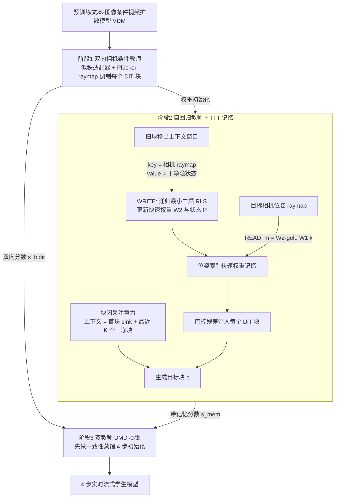

# World-T³：测试时训练作为持久记忆

## 流程总览

图依据：论文 §3 / §3.1–3.3、Fig.3、式 (1)–(8)。

## 一句话定义

**World-T³** 是相机控制的视频世界模型：它在生成过程中将历史视觉特征写入快速权重，再按目标相机位姿读取，以改善场景重访一致性。

## 英文缩写速查

| 缩写 | 英文全称 | 简要说明 |
|---|---|---|
| TTT | Test-Time Training | 推理期间更新记忆参数 |
| RLS | Recursive Least Squares | 递归最小二乘，用于在线记忆更新 |
| PSNR | Peak Signal-to-Noise Ratio | 评估重访视图的图像一致性 |
| FPS | Frames Per Second | 每秒生成帧数 |

## 核心信息

| 项 | 内容 |
|---|---|
| 论文 | [arXiv:2610.17434](https://arxiv.org/abs/2610.17434)，2026-10-12 提交 |
| 机构 | Meta Reality Labs、伊利诺伊大学芝加哥分校、布朗大学 |
| 输入与控制 | 首帧、文本提示和相机轨迹；支持六自由度相机控制 |
| 目标 | 长时生成后回到旧视角时保持场景一致 |

## 核心机制

1. **相机条件教师：** 用 Plücker raymap 编码相机并调制扩散 Transformer，建立相机控制能力。
2. **自回归教师与记忆：** 有界上下文中的旧块离开窗口时，其视觉特征以位姿为键写入快速权重；通过 RLS 增量更新，按目标位姿读取历史特征。
3. **双教师蒸馏：** 以双向教师和带记忆的自回归教师进行分布匹配，将采样压缩为四步，兼顾画面质量和长时一致性。

记忆存储及每步记忆计算量相对 rollout 长度为 O(1)；这不意味着生成整段视频的总计算量与长度无关。

## 源码运行时序图

不适用：截至 2026-10-28，项目页未列出官方代码入口，无法核实运行时模块。

## 实验与评测

项目页报告 120 条 10 秒往返相机轨迹，分辨率 1280×704、视频 16 FPS；在同一目标位姿配对去程与返程帧，间隔超过 21 个潜在帧的上下文窗口。

| 指标 | World-T³ | 最强基线 |
|---|---:|---:|
| 重访 PSNR，越高越好 | 18.31 dB | 13.52 dB |
| 绝对旋转误差，越低越好 | 1.075° | 3.344° |

作者报告单张 NVIDIA B200 在 1280×704 下达到 20.6 FPS，包含在线记忆更新。以上为作者报告，硬件及评测协议限定了直接比较的范围。

## 结论

**位姿索引的在线记忆为长时视频重访提供了有效的持久场景信息。**

1. 重访任务需关注离开上下文后的同位姿一致性，不能只看短片画质。
2. 常数开销针对记忆状态和每步记忆计算；总生成耗时仍随视频长度增长。
3. 实时性能是在 B200 和指定分辨率下测得，部署前需按目标硬件验证。
4. 相机控制和视觉一致性不直接证明机器人动作条件预测或物理交互能力。

## 与其他工作对比

- **vs 有界上下文的自回归视频模型：** 旧块离开窗口后通常丢失；World-T³ 以位姿为键把旧特征写入快速权重并按目标位姿读回，重访 PSNR 18.31 dB 对最强基线 13.52 dB，绝对旋转误差 1.075° 对 3.344°。
- **vs [视频即仿真](../concepts/video-as-simulation.md)：** 该方向要求动作条件的物理反事实预测；World-T³ 只解决 **相机条件** 下的长时场景一致性，不直接证明机器人动作条件预测能力（见 [生成式世界模型](../methods/generative-world-models.md)）。

## 局限与工程实践

截至 2026-10-28，项目页未列代码、权重或数据下载链接；能否复现尚待公开资源。本文结果针对相机轨迹重访，不能直接推断真实机器人闭环表现。

## 关联页面

- [生成式世界模型](../methods/generative-world-models.md)
- [视频作为仿真](../concepts/video-as-simulation.md)

## 参考来源

- [论文归档](../../sources/papers/world_t3_arxiv_2610_17434.md)
- [项目页归档](../../sources/sites/world-t3.md)
- [arXiv PDF](https://arxiv.org/pdf/2610.17434)：已通读方法部分（实验与附录以略读为准）：§3 方法概述、§3.1 阶段1、§3.2 阶段2（块因果、测试时记忆巩固、RLS 写入与读取）、§3.3 阶段3 双教师蒸馏、Fig.3；§4 实验略读

## 推荐继续阅读

- [论文](https://arxiv.org/abs/2610.17434)
- [项目页与重访演示](https://adreamwu.github.io/World-T3/)
