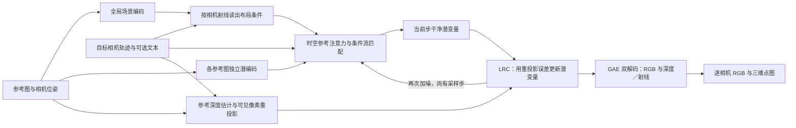

# WorldBridge: Bridging Scattered Views for Coherent 3D World Generation · 从离散视图生成一致的三维世界

## 一句话定义

给定少量相机位姿已知、相互间重叠很少的参考图，以及一条目标相机轨迹，WorldBridge 通过共享场景布局和视角条件生成沿途 RGB 与三维点图，尽量保留已观察区域，同时补出未观察区域。

## 英文缩写速查

| 缩写 | 英文全称 | 简要说明 |
|---|---|---|
| GAE | Geometry Autoencoder | 共享潜空间可分别解码外观与几何 |
| RoPE | Rotary Position Embedding | 旋转位置编码；本文按有无序列位置决定是否启用时间项 |
| LRC | Latent-Reference Consistency | 用参考重投影引导采样中的潜变量更新 |
| NVS | Novel View Synthesis | 给定已有观测合成指定的新视角 |
| PSNR | Peak Signal-to-Noise Ratio | RGB 与目标图的像素级相似度，越高越好 |
| ATE | Absolute Trajectory Error | 论文在整体尺度与轨迹对齐后比较相机平移 |

## 为什么重要

简单的重投影难以连接几乎不重叠的视角；纯视觉生成又可能把同一走廊或家具画成随相机变化的不同布局。这里把「给定轨迹上保持场景一致」与「保留每张参考细节」拆成两条可消融的路径。输出可作上游视觉场景草案，但还不是碰撞、关节或材质已验收的机器人仿真资产。

## 核心信息

| 项目 | 内容 |
|---|---|
| 机构 | 新加坡国立大学、腾讯、香港中文大学、东京大学 |
| 原文 | [arXiv:2611.34079v1](https://arxiv.org/abs/2611.34079v1)，2026-11-25 |
| 输入 | 参考 RGB、给定相机参数、目标相机轨迹；文本可选 |
| 输出 | 各目标相机的 RGB、深度和相机射线，可反投影成三维点图 |
| 开放情况 | 作者公开论文和网页样例；基准及模型据附录 B 计划于录用后发布，暂未见训练/推理实现或权重下载 |

同名 [WorldBridge（2610.40748）](./paper-worldbridge.md) 讨论视频与动作专家，独立于本文。这里给的是相机轨迹条件，不预测机器人的动作或闭环动力学。

## 核心机制与流程总览

1. **全局与局部分流。** 全局编码器把带位姿参考汇聚成场景 token；场景读取器用每个相机的 Plücker 射线查询，训练时由低分辨率 RGB 重建辅助监督。冻结的 GAE 路径另编码每张参考，保留逐图外观细节。
2. **区分时序参考和空间参考。** 轨迹内参考有序列位置；路径外参考有相机位姿但没有人工分配的时间。只有目标帧及有序列位置的参考两两作用时加入时间 RoPE，所有配对仍有空间 RoPE 与相机编码。条件 Transformer 做 flow matching，预测共享外观—几何潜空间中的速度。
3. **采样时贴回已观测内容。** MoGe-3 为参考估计深度；用所给相机把可靠像素投到目标，深度缓冲解决重叠遮挡。LRC 每个去噪步骤只对当前干净潜变量做一次梯度调整，模型参数保持冻结；随后混合估计噪声和新噪声再继续生成。离参考更远的帧可混入更多新噪声，减少对未观测内容的硬约束。

## 评测与结果

| 设置 | 作者报告 | 读数边界 |
|---|---|---|
| Short | 100 段视频、两端为参考、共 549 个中间评测视角；总体 PSNR **18.35 vs 16.13 dB**（GLD） | 目标帧筛选要求至少 50% 像素估计可由参考支持，不是全盲区准确率 |
| Long | 20 段、每段六参考和 50 个非参考目标；PSNR **17.68 vs 16.43 dB**，AbsRel **0.345 vs 0.454**（GLD） | 深度对比使用 ViPE/DA3 伪真值，按场景对齐尺度；另有附录传感器深度小样本 |
| Agent On/Off | 20 个合成场景、同路径配对 40 组；ATE **3.278 / 3.303**，几何重投影误差 **0.057 / 0.061** | 从生成图重估相机并作相似变换对齐；未测真值 RGB 或几何准确率 |
| 消融与额外开销 | 去掉全局条件，Long PSNR **17.68 → 16.61 dB**、Agent Off 几何重投影误差 **0.061 → 0.126**；启用 LRC 后 Long PSNR **17.30 → 17.68 dB** | LRC 在单 H200 生成 41 帧的规定设置中耗时增加 **18.3%**；并非所有指标均改善 |

## 与其他工作对比

以下定量对照出自 [arXiv:2611.34079v1](https://arxiv.org/html/2611.34079v1) 表 2–4（WorldBridge-Short / Long / Agent）：

| 对照路线 | 代表指标（作者报告） | 与 WorldBridge 差异及边界 |
|---|---|---|
| **[GAE](./paper-gae-geometry-native-autoencoder.md)（arXiv'26）** | Short PSNR 15.29；Long PSNR 12.86 / AbsRel 0.599 / δ₁ 44.9；Agent Off 几何重投影误差 0.134 | WorldBridge 直接在 GAE 外观-几何双解码潜空间上构建，但新增全局场景条件、时空参考注意力与 LRC，显著改善低重叠长序列一致性和几何对齐 |
| **GLD（ECCV'26）** | Short PSNR 16.13；Long PSNR 16.43 / AbsRel 0.454 / δ₁ 59.4 / ATE 1.748；Agent ATE 5.680 / 6.257 | 表 2–4 中最接近的原生几何基线；WorldBridge 在 Long 相机 ATE（0.657）与 δ₁（71.0）占优，但均基于 DA3/ViPE 伪真值与逐场景尺度对齐 |
| **SEVA（ICCV'25） / AnyRecon（SIGA'26）** | SEVA Short 15.66 / Long 15.41；AnyRecon Short 14.76 / Long 15.87（无原生几何输出 `—`） | 二者不直接输出原生深度与三维点图；WorldBridge 在保持 RGB 保真的同时联合解码相机射线与深度 |
| **Gen3R（CVPR'26） / 3DRAE（NeurIPS'26）** | Gen3R Long AbsRel 0.507；3DRAE Long AbsRel 0.475 / 几何重投影误差 0.106、Agent ATE 4.194 / 4.576 | 3DRAE 在长序列几何重投影一致性（0.106 vs WorldBridge 0.099）最接近，但在离散非轨迹参考（Agent Off）及相机控制 ATE（3.303 vs 4.576）上弱于 WorldBridge |
| **[同名 WorldBridge（2610.40748）](./paper-worldbridge.md)** | 面向视频生成与动作专家闭环策略 | 二者完全独立：本文仅接收相机轨迹条件输出 RGB 与三维点图草案，不预测机器人动作或闭环动力学 |

## 结论

**WorldBridge 适合检验几张相机位姿已知的离散参考能否约束同一场景的多视角生成；它不能证明缺失区域真实存在或可以安全通行。**

1. 采集时保留参考标定、目标轨迹与可见掩码，把已观察的颜色与生成的连接区域分开记账。
2. 既看新视角画质，也用独立传感器检查尺度和细薄结构；伪真值深度和姿态对齐指标不替代绝对几何验收。
3. 优先验证目标与空间参考的覆盖对保真的影响，再决定是否接受每步 LRC 的额外耗时。
4. 将点图上游用于 Real2Sim 时，另做碰撞形状、可通行性、物性与接触验证。

## 工程实践

基准使用 50 个去噪步、CFG 2、种子 42、空文本。短序列先补辅助相机到 41 帧再筛回目标相机；Long 与 Agent On 联合生成含参考在内的 56 帧，Agent Off 生成 50 帧，评测只取 50 个非参考目标。对比不同生成器时应固定实际得分的相机与尺度口径，避免把填充帧计入性能。

## 源码运行时序图

不适用。截至 2026-11-27 未发现作者公开的模型训练或推理实现，项目站只展示预生成样例，不能用网页播放器或上游 GAE 源码代替 WorldBridge 的运行时调用。

## 局限与风险

低重叠参考只能约束它实际可见的部分，目标中覆盖进一步下降时连接区域与细节可能漂移；椅框、墙边等薄结构仍会断裂。报告的跨视角几何误差与原生深度误差不是同一指标，前者以 VGGT-Ω 对生成图再估计，后者使用模型自己的深度。视觉一致不等于量测正确，也不等于几何闭合或物理可交互。

## 关联页面

- [GAE 几何原生潜空间](./paper-gae-geometry-native-autoencoder.md)
- [生成式世界模型](../methods/generative-world-models.md)
- [机器人仿真场景生成](../methods/robot-simulation-scene-generation.md)
- [同名但独立的机器人动作 WorldBridge](./paper-worldbridge.md)

## 参考来源

- [arXiv v1 正文与附录核验](../../sources/papers/worldbridge_arxiv_2611_34079.md)
- [作者项目页及开放状态](../../sources/sites/worldbridge-scattered-views.md)

## 推荐继续阅读

- [作者项目页：查看 On/Off 对照、视频和点云](https://davidyan2001.github.io/WorldBridge/)
- [论文 §3.4 和附录 C：注意力与指标口径](https://arxiv.org/html/2611.34079v1)
