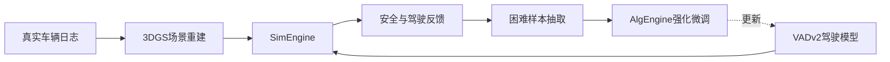
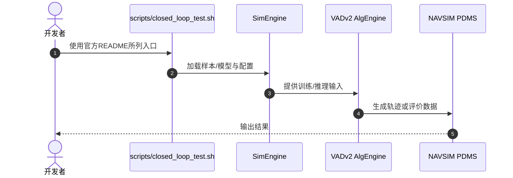

# WorldEngine：高保真闭环仿真与长尾驾驶强化后训练

**英文：** World Engine: Towards the Era of Post-Training for Autonomous Driving

## 一句话定义

真实日志经MTGS三维高斯重建形成SimEngine交互环境，AlgEngine中的VADv2闭环策略产生反馈，失败样本筛选后用于安全约束强化后训练；论文提出Behavior World Model。

## 英文缩写速查

| 缩写 | 英文全称 | 简要说明 |
|---|---|---|
| 3DGS | 3D Gaussian Splatting | 道路场景三维重建 |
| E2E | End-to-End | 从观测到规划的端到端模型 |
| RL | Reinforcement Learning | 奖励信号驱动的优化 |
| VLA | Vision-Language-Action | 视觉语言动作联合学习 |

## 为什么重要

高保真闭环仿真与长尾驾驶强化后训练专门针对单纯模仿驾驶轨迹难以解释或处理长尾交互的限制，提供可核查的论文、权重或代码入口。

## 核心原理

真实日志经MTGS三维高斯重建形成SimEngine交互环境，AlgEngine中的VADv2闭环策略产生反馈，失败样本筛选后用于安全约束强化后训练；论文提出Behavior World Model。

## 流程总览



此流程根据 [原始论文记录](../../sources/papers/ad_top10_2026_worldengine.md)，非跨项目通用套图。

## 源码运行时序图



按官方README和 [源码入口记录](../../sources/repos/ad_top10_2026_worldengine.md) 核对；**未在本次 ingest 执行完整 GPU 推理或训练**。

## 评测与指标

仓库Quick Test对288个稀有场景进行闭环测试，读取VADv2 50%数据训练的模型并算NAVSIM v1 PDMS。

## 工程实践

官方仓库：https://github.com/OpenDriveLab/WorldEngine

1. ```export WORLDENGINE_ROOT=$(pwd)```
2. ```bash scripts/closed_loop_test.sh```
3. ```bash scripts/multigpu_closed_loop_test.sh```

## 结论

**高保真闭环仿真与长尾驾驶强化后训练** 是驾驶研究中一条具有独立问题设定的复现路线。

1. 先使用官方公开checkpoint与现有评测脚本建立基线。
2. 明确划分论文提出的完整系统和当前代码实际已开放的部分。
3. 记录数据、版本、硬件与指标，避免不同评测设定的数字错比。

## 局限与风险

官方README把Behavior World Model integration仍列为待办；simengine和algengine需分开装依赖；3DGS重建画面不保证物理交互真实。

真实上路安全和合规均不能由离线分数、仿真结果或开源状态单独证明。

## 关联页面

- [2026 自动驾驶开源项目技术地图](../overview/autonomous-driving-open-source-top10-2026.md)
- [VLA](../methods/vla.md)
- [生成式世界模型](../methods/generative-world-models.md)

## 参考来源

- [论文核对记录](../../sources/papers/ad_top10_2026_worldengine.md)
- [官方源码入口](../../sources/repos/ad_top10_2026_worldengine.md)
- [深蓝AI策展原文](../../sources/blogs/wechat_shenlan_ai_autonomous_driving_top10_2026.md)

## 推荐继续阅读

- [原论文](https://arxiv.org/html/2606.19836)
- [官方代码](https://github.com/OpenDriveLab/WorldEngine)
