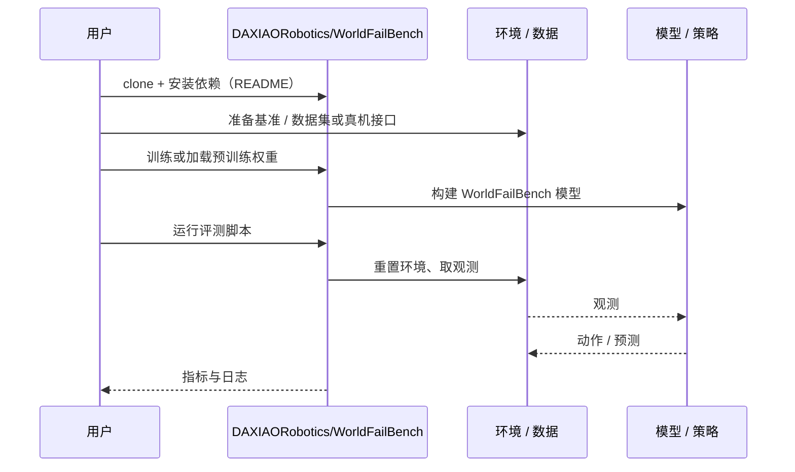

# WorldFailBench（arXiv:2610.33565）

**WorldFailBench**（*WorldFailBench: Do World Models Understand Policy Failures?*，[arXiv:2610.33565](https://arxiv.org/abs/2610.33565)，[项目页](https://huggingface.co/datasets/ACERobotics/WorldFailBench)，[代码](https://github.com/DAXIAORobotics/WorldFailBench)）来自 [具身智能小站 2026-10-28 盘点](../../sources/blogs/wechat_embodied_station_59_papers_human_video_to_robot_experience_2026-10-28.md)，属「评测与基准」组。

## 一句话定义

**从失败原因、发生阶段和成功失败边界三个维度评测，而非只看最终输赢。**

## 英文缩写速查

| 缩写 | 英文全称 | 简要说明 |
|------|----------|----------|
| WorldFailBench | WorldFailBench: Do World Models Understand Policy Failures? | 本文方法 / 基准的简称 |

## 为什么重要

- 世界模型能否复现策略怎样失败。覆盖仿真操作与人形真机任务，揭示生成环境用于策略诊断时必须额外检查的可靠性缺口。
- 开源结论：**已开源**（步骤 2.5，2026-10-28）。仓库可达（git ls-remote）。项目页 HTTP 200。
- 同期同组工作见 [潜在动作、免渲染事件仿真与机器人评测：具身智能小站 10-28 期 59 篇阅读坐标](../overview/embodied-station-2026-10-28-59-papers-technology-map.md)。

## 核心机制

| 项 | 内容 |
|----|------|
| **arXiv** | [2610.33565](https://arxiv.org/abs/2610.33565) |
| **开源** | **已开源** |
| **要点** | 从失败原因、发生阶段和成功失败边界三个维度评测，而非只看最终输赢。 |
| **文内指标** | 公众号转述：覆盖仿真操作与人形真机任务，揭示生成环境用于策略诊断时必须额外检查的可靠性缺口。 |

## 源码运行时序图

以下为按仓库入口（`DAXIAORobotics/WorldFailBench`）推断的通用运行链路；入库日仅核实仓库可达，未逐文件阅读，具体脚本名以 README 为准。

## 实验与评测

- 公众号转述：覆盖仿真操作与人形真机任务，揭示生成环境用于策略诊断时必须额外检查的可靠性缺口。
- **读法：** 本页为索引级摘要，依据公众号转述的官方摘要与仓库信息整理；逐项数字与 baseline 以原文 PDF 为准。

## 与其他工作对比

- 横向索引见 [潜在动作、免渲染事件仿真与机器人评测：具身智能小站 10-28 期 59 篇阅读坐标](../overview/embodied-station-2026-10-28-59-papers-technology-map.md)；同 arXiv 不重复造页。

## 结论

**世界模型能否复现策略怎样失败：覆盖仿真操作与人形真机任务，揭示生成环境用于策略诊断时必须额外检查的可靠性缺口。**

1. 开源边界：**已开源** — 仓库可达（git ls-remote）。项目页 HTTP 200。
2. 核心机制：从失败原因、发生阶段和成功失败边界三个维度评测，而非只看最终输赢。
3. 复现与选型前核对任务协议、硬件与基准口径，勿直接横比公众号摘录数字。

## 关联页面

- [具身大模型评测基准选型闭环](../queries/embodied-eval-benchmark-selection-loop.md) — 本页横跨其 ② 世界模型预测保真度与 ③ 策略评测层：检验世界模型能否复现策略的失败原因、阶段与成败边界
- [simulation-evaluation-infrastructure](../concepts/simulation-evaluation-infrastructure.md)
- [vla](../methods/vla.md)
- [manipulation](../tasks/manipulation.md)
- [embodied-station-2026-10-28-59-papers-technology-map](../overview/embodied-station-2026-10-28-59-papers-technology-map.md)

## 参考来源

- [worldfailbench_arxiv_2610_33565.md](../../sources/papers/worldfailbench_arxiv_2610_33565.md)
- [wechat_embodied_station_59_papers_human_video_to_robot_experience_2026-10-28.md](../../sources/blogs/wechat_embodied_station_59_papers_human_video_to_robot_experience_2026-10-28.md)
- [arXiv:2610.33565](https://arxiv.org/abs/2610.33565)

## 推荐继续阅读

- [arXiv PDF](https://arxiv.org/pdf/2610.33565)
- [项目页](https://huggingface.co/datasets/ACERobotics/WorldFailBench)
- [https://github.com/DAXIAORobotics/WorldFailBench](https://github.com/DAXIAORobotics/WorldFailBench)
