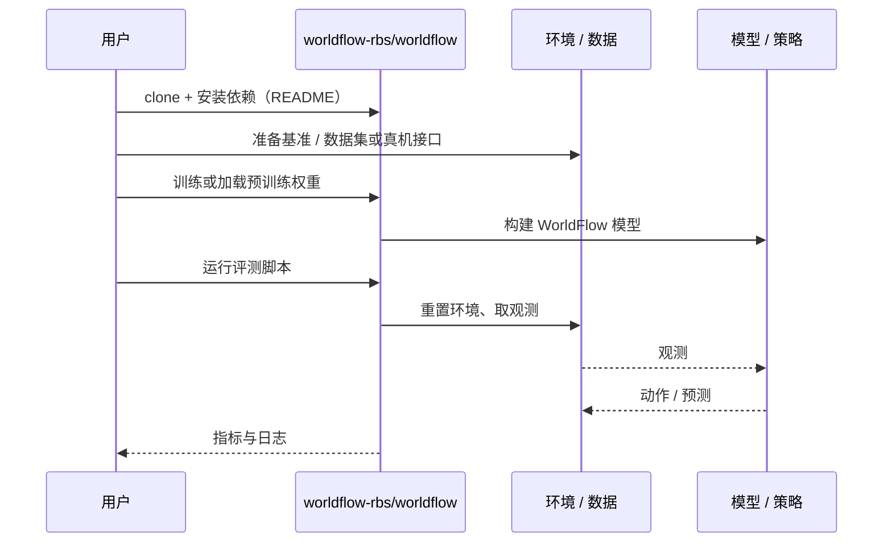

# WorldFlow（arXiv:2610.39278）

**WorldFlow**（*WorldFlow: Joint Video and 3D Motion Prediction via Large-Scale Pretraining*，[arXiv:2610.39278](https://arxiv.org/abs/2610.39278)，[项目页](https://worldflow-rbs.github.io/)，[代码](https://github.com/worldflow-rbs/worldflow)）来自 [具身智能小站 2026-10-30 盘点](../../sources/blogs/wechat_embodied_station_28_papers_event2reward_progress_rewards_2026-10-30.md)，属「世界模型与预测」组。

## 一句话定义

**WorldFlow 把三维位移与视频联合建模，让视觉演化约束几何动态。**

## 英文缩写速查

| 缩写 | 英文全称 | 简要说明 |
|------|----------|----------|
| WorldFlow | WorldFlow: Joint Video and 3D Motion Prediction via Large-Scale Pretraining | 本文方法 / 基准的简称 |
| 3D | 3D | 三维 |

## 为什么重要

- 同时预测未来画面与显式三维运动。评测关注轨迹误差与跨数据来源泛化，不能直接把预测精度改善解释为闭环操作成功率提升。
- 开源结论：**已开源**（步骤 2.5，2026-10-30）。仓库可达（git ls-remote）。项目页 HTTP 200。
- 同期同组工作见 [进度奖励、接触监督与规划验证：具身智能小站 10-30 期 28 篇阅读坐标](../overview/embodied-station-2026-10-30-28-papers-technology-map.md)。

## 核心机制

| 项 | 内容 |
|----|------|
| **arXiv** | [2610.39278](https://arxiv.org/abs/2610.39278) |
| **开源** | **已开源** |
| **要点** | WorldFlow 把三维位移与视频联合建模，让视觉演化约束几何动态。 |
| **文内指标** | 公众号转述：评测关注轨迹误差与跨数据来源泛化，不能直接把预测精度改善解释为闭环操作成功率提升。 |

## 源码运行时序图

以下为按仓库入口（`worldflow-rbs/worldflow`）推断的通用运行链路；入库日仅核实仓库可达，未逐文件阅读，具体脚本名以 README 为准。

## 实验与评测

- 公众号转述：评测关注轨迹误差与跨数据来源泛化，不能直接把预测精度改善解释为闭环操作成功率提升。
- **读法：** 本页为索引级摘要，依据公众号转述的官方摘要与仓库信息整理；逐项数字与 baseline 以原文 PDF 为准。

## 与其他工作对比

- 横向索引见 [进度奖励、接触监督与规划验证：具身智能小站 10-30 期 28 篇阅读坐标](../overview/embodied-station-2026-10-30-28-papers-technology-map.md)；同 arXiv 不重复造页。

## 结论

**同时预测未来画面与显式三维运动：评测关注轨迹误差与跨数据来源泛化，不能直接把预测精度改善解释为闭环操作成功率提升。**

1. 开源边界：**已开源** — 仓库可达（git ls-remote）。项目页 HTTP 200。
2. 核心机制：WorldFlow 把三维位移与视频联合建模，让视觉演化约束几何动态。
3. 复现与选型前核对任务协议、硬件与基准口径，勿直接横比公众号摘录数字。

## 关联页面

- [world-action-models](../concepts/world-action-models.md)
- [generative-world-models](../methods/generative-world-models.md)
- [vla](../methods/vla.md)
- [embodied-station-2026-10-30-28-papers-technology-map](../overview/embodied-station-2026-10-30-28-papers-technology-map.md)

## 参考来源

- [worldflow_arxiv_2610_39278.md](../../sources/papers/worldflow_arxiv_2610_39278.md)
- [wechat_embodied_station_28_papers_event2reward_progress_rewards_2026-10-30.md](../../sources/blogs/wechat_embodied_station_28_papers_event2reward_progress_rewards_2026-10-30.md)
- [arXiv:2610.39278](https://arxiv.org/abs/2610.39278)

## 推荐继续阅读

- [arXiv PDF](https://arxiv.org/pdf/2610.39278)
- [项目页](https://worldflow-rbs.github.io/)
- [https://github.com/worldflow-rbs/worldflow](https://github.com/worldflow-rbs/worldflow)
