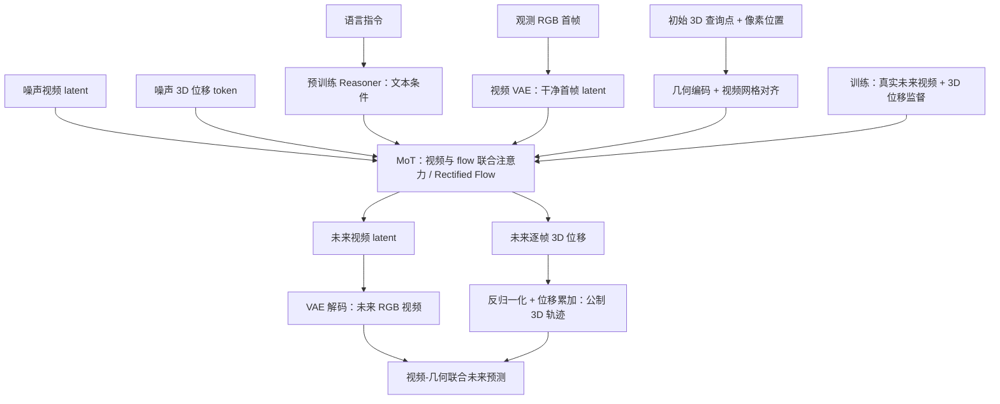

# WorldFlow：大规模预训练下联合预测视频与三维运动 / Joint Video and 3D Motion Prediction via Large-Scale Pretraining

## 一句话定义

**WorldFlow** 是基于 Cosmos-Nano 的生成式世界模型：输入单帧 RGB、语言指令和初始 3D 查询点，联合预测未来视频及这些点逐帧的 3D 位移；通过显式几何轨迹与视频视觉先验的共同监督，学习跨场景物体运动。它**不直接生成机器人动作**，因而不能与 Joint World-Action Model（WAM）混为一谈。

## 英文缩写速查

| 缩写 | 英文全称 | 简要说明 |
|---|---|---|
| MoT | Mixture-of-Transformers | 视频与 3D flow token 通过多模态注意力交互的生成骨干 |
| VAE | Variational Autoencoder | 观测帧编码及未来视频解码 |
| ADE | Average Displacement Error | 各点、各未来帧平均位置误差（米，越低越好） |
| FDE | Final Displacement Error | 最后预测帧的位置误差（米，越低越好） |
| PWT | Points Within Threshold | 1/2/5 cm 三种阈值下点-帧命中率的平均 |
| OOD | Out-of-Distribution | 训练分布外泛化评测 |

## 为什么重要

- 单纯预测视频仍需追踪/重建才能得到可规划的 3D 轨迹；单纯预测稀疏点的 3D flow 则缺少物体边界、外观和环境关系的密集监督。WorldFlow 在同一生成过程结合两者。
- 查询点将计算集中于目标物体的关键区域，不必对全场景建立密集运动 token；预测的 flow 在**首帧相机坐标系**中表示，与机器人的关节动作空间解耦。
- 论文不仅测试离线轨迹误差，还在独立的抓取、轨迹优化及机器人控制模块中替换运动预测器，检查它对下游成功率的贡献；这些属于特定实验系统的结果，不代表端到端策略已开源或可直接复现。

## 核心信息

| 项目 | 原文与核对结果 |
|---|---|
| 论文 | [arXiv:2610.39278v2](https://arxiv.org/html/2610.39278v2)，初投 2026-10-29，v2 更新 2026-11-17（预印本） |
| 作者/机构 | Yuhao Lu 等 12 人；RoboScience、National University of Singapore |
| 项目 | [WorldFlow 项目主页](https://worldflow-rbs.github.io/) |
| 官方仓库 | [roboscience-ai/worldflow](https://github.com/roboscience-ai/worldflow)，目前为介绍、论文和素材仓 |
| 输入/输出 | RGB 首帧 + 指令 + 初始 3D 点及其像素坐标 → 未来 RGB 视频 + 逐帧 3D flow |
| 训练语料 | 约 144 万条**物体级样本记录**，来自 17 个数据源；49 帧、16 FPS 标准化序列（不是去重的真实视频小时数） |
| 评测 | WorldFlowBench：1,678 条，Sim7 396、Real3 882、SpatialCog 400 |

## 核心原理

### 统一 3D flow 表达

对第 i 个查询点，未来相邻帧位移定义为 `f[t,i] = p[t,i] - p[t-1,i]`，轨迹由初始点 `p[0,i]` 加上累计位移恢复。每个未来帧、每个查询点对应一个连续 3D 位移 token。

1. 按数据域固定缩放因子归一化位移，缓解不同数据源运动尺度差异。
2. 将初始查询点绝对位置与相对查询点集合中心的位置分别经 Fourier 特征和 MLP 编码，作为共享几何条件。
3. 使用查询点的初始像素 patch、时间坐标给 flow token 分配与视频 latent 一致的时空 RoPE 位置。
4. MoT 在预训练 reasoner 语言上下文、干净首帧视频 latent、噪声视频 token 和噪声 flow token 上共享注意力；采用 rectified-flow 联合去噪。
5. 视频分支由 VAE 解码；位移分支按域恢复公制尺度并累加生成 3D 轨迹，不再依赖对生成视频做二次追踪。

### 流程总览（论文方法图，非源码执行图）

### 训练目标与配置

- 主目标：视频与 3D flow 两项加权 rectified-flow matching；另对重建干净 flow 添加相邻位移误差、累计方向误差、相对终点误差，约束局部运动与长程几何一致性（论文 §3.4、附录 C）。
- 训练样本为 49 帧、288×480、每条物体记录 64 个查询点，生成 48 步位移。视频 token 网格为 13×9×15，flow token 为 48×64。
- 第一阶段从 Cosmos-Nano 预训练权重初始化，在 SpatialCog 训练集进行 32,000 step；第二阶段混合模拟、真实及空间关系数据进行 51,100 step 的课程学习。论文报告使用 64 张 NVIDIA H800；推理采用 40 个 rectified-flow 采样步和 CFG scale 2。
- 数据构成：Sim7（7 个仿真来源）、Real3（AgiBot World/EPIC-KITCHENS/SSv2）、SpatialCog，以及 MolmoMotion-1M 的 6 个来源。Sim7/Real3 使用 SAM 2 与 Track4World 自动构建轨迹；存在伪标注噪声，训练和评测须区分。

## 实验与评测

### WorldFlowBench（论文 Table 1）

| 评测子集 | 数量 | ADE（m）↓ | FDE（m）↓ | PWT↑ |
|---|---:|---:|---:|---:|
| Sim7 | 396 | 0.051 | 0.094 | 0.564 |
| Real3 | 882 | 0.081 | 0.113 | 0.311 |
| SpatialCog | 400 | 0.060 | 0.078 | 0.449 |

- 论文称这三组的 **ADE/FDE 均为所比较学习方法中的最低值**，但 Real3 PWT=0.311，低于部分对照方法（最高为 0.332），不能概括为所有指标均第一。
- 相比相同训练配置的 *flow-only* 版本，SpatialCog ADE 由 0.136 降至 0.060 m（−55.9%），FDE 由 0.248 降至 0.078 m（−68.5%）；同一 WorldFlow 视频后接 Track4World/4RC 的 ADE 分别为 0.083/0.098 m，高于直接生成 flow 的 0.060 m。
- 这些结果是单帧输入、无运动历史的公制点轨迹预测；不能直接等同机器人闭环任务完成率。

### 机器人操作（论文 v2 §4.4、Tables 2–3）

| 设置 | WorldFlow | 同模块管线中 μ₀ 对照 | 口径 |
|---|---:|---:|---|
| RoboLab Simple / Orch | 38.54%（222/576） | 3.82%（22/576） | 64 任务×3 指令形式×3 trials，完整抓取/放置 |
| RoboLab Simple / Attach | 47.22%（272/576） | 9.20%（53/576） | 仿真辅助吸附目标物，减少抓取失效干扰 |
| 真机 / Flow 预测合理性 | 97.2%（35/36） | 25.0%（9/36） | 人工判定轨迹是否符合指令 |
| 真机 / 任务执行成功 | 66.7%（24/36） | 11.1%（4/36） | xArm 7-DoF + XHand + ZED Mini，12 任务×3 trials |

仿真采用 RoboLab 的 Franka + Robotiq 2F-85，语义分割、抓取、轨迹优化、逆运动学与控制在同组比较中固定；真机另外使用 T(R,O) Grasp 和局部刚性拟合。**只替换 flow 预测器**，其余模块共享。与排行榜独立训练策略的对比仅供上下文参照，协议并非严格配对。

## 结论

**联合视频/三维运动监督可改善查询点轨迹预测，并在论文报告的固定操作管线中提升任务成功率；它仍是独立运动世界模型，而非直接输出 action 的 Joint WAM。**

1. 对比时分别核对 ADE/FDE/PWT、仿真 Orch/Attach、真机预测合理性/最终执行成功，不能把各指标混称成功率。
2. 3D 位移处于初始相机坐标系，接入操作控制前需做查询点提取、坐标变换、抓取和末端轨迹规划。
3. 64 点/49 帧与 40 步生成带来实际推理预算，论文未提供公开可运行权重，不能据此认定已有部署时延。
4. 对跨场景泛化特别留意伪标注、遮挡、点采样、相机估计和不同源域尺度。
5. 与 [WAM 纵深路线](../../roadmap/depth-wam.md) 的 Stage 1 共同阅读：它提供世界预测与几何计划接口，而非端到端世界—动作联合生成。

## 与其他工作对比

- **对比「视频生成 + 事后 3D 追踪」两阶段管线：** 在 WorldFlowBench（Table 1）上，论文对比了 NovaFlow、`Cosmos3-Nano + Track4World (T4W) / 4RC` 与 `LingBot-Video-MoE + T4W / 4RC`。即便以同一 WorldFlow 检查点先生成未来视频再用 `T4W` / `4RC` 追踪轨迹，SpatialCog ADE 仍从直接生成 flow 的 `0.060 m` 升至 `0.083 m` 和 `0.098 m`，说明显式联合生成 3D flow token 能减少像素到三维追踪的级联误差；不过在 Real3 上，WorldFlow 的 PWT（`0.311`）仍略低于 `Cosmos3-Nano + 4RC`（`0.332`）。
- **对比「直接预测 3D flow」方法与 flow-only 消融：** 在直接流预测基线 `MolmoMotion-AR-H1`、`μ₀`、`EgoWAM` 及同架构 `WorldFlow (flow-only)` 对照中，WorldFlow 在 Sim7/Real3/SpatialCog 均取得最低 ADE/FDE（相对 `flow-only` ADE 分别降低 `48.5%`、`19.8%`、`55.9%`），证明预训练视频视觉演化的联合监督显著收紧几何预测误差。
- **对比端到端 [WAM](../concepts/world-action-models.md) 与 [VLA](../methods/vla.md) 策略：** 如 [FloMo](./paper-flomo.md) 与 [Cosmos Policy](./paper-shenlan-wm-11-cosmos-policy.md) 都在同一骨干中联合预测机器人动作 chunk；WorldFlow 则不预测关节或末端动作，只在独立抓取、IK 与控制管线中作为可替换的 3D 运动预测前端（RoboLab Orch 相比同管线 `μ₀` 从 `3.82%` 升至 `38.54%`，Table 2 中其余独立训练策略如 `Cosmos3-Nano-Policy` 仅作不同协议的背景参照）。

## 工程实践

| 环节 | 实际状态 / 建议 |
|---|---|
| 前置数据 | RGB-D + 目标 mask → 首帧 3D 查询点；训练资料需要对齐视频/点轨迹 |
| 可插拔预测器 | 统一输入 `(RGB, instruction, 3D query points)`、输出公制 3D 轨迹；单独测预测误差和操作执行 |
| 控制集成 | 仍依赖独立抓取、几何/轨迹优化、机器人逆运动学与低层控制，不能将 flow 当作关节动作直接下发 |
| 独立复现 | **尚不可按官方 README 复现训练、推理或论文操作实验**：模型实现、checkpoint、训练脚本和评测工具均在待发布清单 |

### 源码运行时序图

**不适用（2026-11-20 官方代码仍待发布）。** [官方仓库 README](https://github.com/roboscience-ai/worldflow) 的 Release Plan 仅将论文、介绍与素材标记已发布；无公开训练/推理入口，故删除历史基于仓库可达性**猜测**的通用运行时序图。上面的 Mermaid 仅描述论文方法，不冒充代码执行调用。

## 局限与风险

- 显式 3D flow 仍需预定义查询点；更可靠的自动选点与联合生成机器人动作是作者提出的后续方向。
- 数据中自动提取的三维轨迹存在跟踪、相机深度与尺度噪声；附录 A 报告样本质量筛除和时间 padding。标准化小时数不能当作去重人类/机器人视频时长。
- 运动预测误差降低不能独立证明具身规划系统安全。真机 36 次实验规模有限，且成功还受抓取、优化和稳定放置约束。
- 论文附录 D 的视频–运动一致性采用跟踪与相机估计作间接度量，结果受轨迹可见性与置信度筛选影响；不是严格的物理一致性证明。
- 官方仓库可访问仅代表**论文/展示资源公开**；截至核查日，运行代码、权重、数据和 benchmark 工具未开放。历史页面“已开源”的判断须修正。

## 关联页面

- [World Action Models：对照 action 条件化与联合预测](../concepts/world-action-models.md)
- [Generative World Models：视频世界侧与显式几何预测](../methods/generative-world-models.md)
- [VLA：任务指令到 action 的策略接口](../methods/vla.md)
- [WAM 纵深 Stage 1：世界模型基座](../../roadmap/depth-wam.md)
- [具身智能小站 10-30 期论文技术图谱](../overview/embodied-station-2026-10-30-28-papers-technology-map.md)

## 参考来源

- [arXiv v2 原文核对与数据/结果记录](../../sources/papers/worldflow_arxiv_2610_39278.md)
- [官方项目主页资料核对](../../sources/sites/worldflow.md)
- [官方仓库代码开放核查](../../sources/repos/worldflow.md)

## 推荐继续阅读

- [arXiv:2610.39278v2 HTML 全文与附录](https://arxiv.org/html/2610.39278v2)
- [论文 PDF](https://arxiv.org/pdf/2610.39278v2)
- [WorldFlow 项目页](https://worldflow-rbs.github.io/)
- [官方 GitHub 仓库与 Release Plan](https://github.com/roboscience-ai/worldflow)
