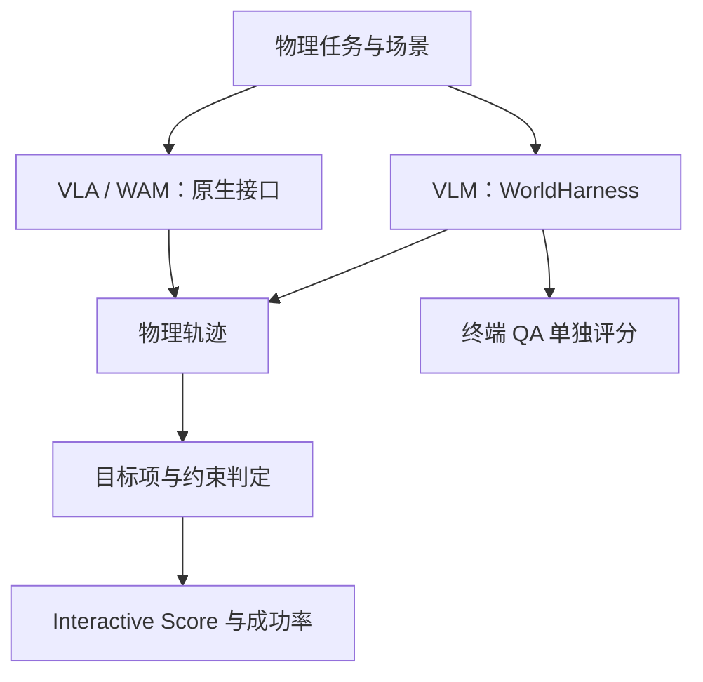
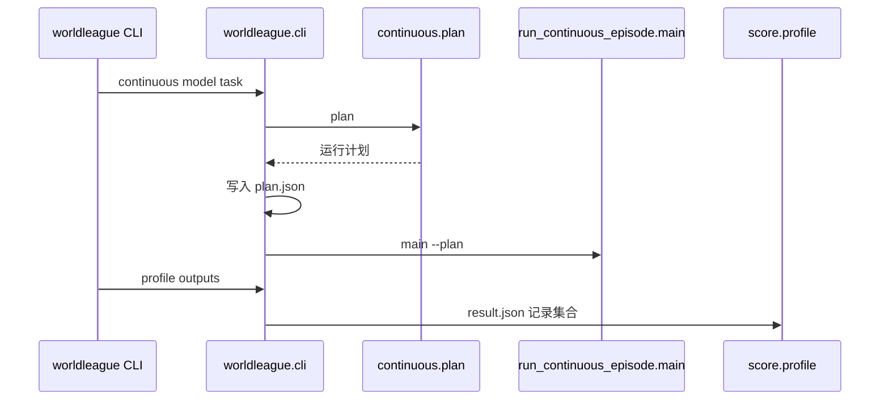

# Benchmarking Physical Agency (WorldLeague)｜具身系统物理目标达成能力评测

## 一句话定义

通过轨迹上的物理目标条件，在共享任务上比较使用不同动作接口的 VLM、VLA 与 WAM。

## 英文缩写速查

| 缩写 | 英文全称 | 简要说明 |
|---|---|---|
| VLM | Vision-Language Model | 视觉语言模型 |
| VLA | Vision-Language-Action | 视觉语言动作模型 |
| WAM | World Action Model | 世界动作模型 |
| QA | Question Answering | 问答 |

## 为什么重要

会描述场景、完成一条控制命令以及满足最终物理目标是三种不同能力。本基准从轨迹验收任务条件，能定位感知、选择、执行或恢复未闭环的环节。

## 核心信息

| 项目 | 内容 |
|---|---|
| 机构 | 新加坡国立大学 xML Lab |
| 发布 | 2026-11-23（v1） |
| 原文 | [arXiv:2611.30989](https://arxiv.org/abs/2611.30989) |
| 项目 | [主页](https://xyangzhou.github.io/WorldLeague/) |
| 源码 | [GitHub](https://github.com/xyangzhou/WorldLeague) |

## 核心原理

60 项任务分为 WorldSeek、WorldShape、WorldShift，覆盖导航、定位、几何、物理、记忆、控制。VLM 经 WorldHarness 选择动作，连续策略使用自身接口；从物理轨迹计算目标项完成度及全部条件满足率，终端 QA 单列，不代替物理分数。

## 流程总览

## 源码运行时序图

`worldleague` 指向 `worldleague.cli:main`；已读 `src/worldleague/cli.py`：eval 可进入 `evaluation.r1_session.evaluate`，continuous 生成 plan.json 后调用 `runtime.commands.run_continuous_episode.main`；profile 从 result.json 聚合；未执行。 此图仅覆盖已核对入口，内部完整调用关系待复核。

## 评测与实验

13 个系统中最高平均 Interactive Score 28.58/100，完成 13/60；347 个终端 QA 全对的 VLM 回合中 249 个物理分数为零（71.8%）。连续控制评估覆盖 59 项，跨系统比较要同时注明接口、任务覆盖和预算。

## 工程实践

为每回合保留目标分项、约束和动作反馈，不用 QA 或动作完成率替代物理成功。例如 T38 扫描并到达延后请求时只完成四项中的两项，Interactive Score 为 50 而物理失败。跨模型复测应固定共同 59 项，记录控制接口、机器人、种子、预算和模型推理期间仿真是否继续运行。

## 对比

与论文所用 ESI-Bench 场景的问答任务相比，此处还要求把对象按条件实际摆放、验证关系并稳定释放。与 [Embodied First Exam](./embodied-first-exam.md) 的系统整理互补，本论文强调相同物理目标与不同接口的对照；不能把它当成同一套机器人上、同预算逐控制步的严格排名。

## 结论

当前证据支持将此工作作为相应方法的工程参考，而非通用真机性能保证。

- 物理成功须同时满足任务目标与约束。
- 保留部分进度与终端 QA 独立指标。
- 报告各系统接口、覆盖任务和资源预算。

## 局限与风险

仅仿真，不代表真机成功率。推理期间物理环境继续运行，推理时间和接口抽象影响比较。官方代码和基准数据已列出；场景生成公开入口在 README 中仍为 TODO。

## 关联页面

- [视觉语言导航](../tasks/vision-language-navigation.md)：WorldSeek 把视觉语言理解与真实到达、访问顺序分开验收。
- [视觉语言动作模型](../methods/vla.md)：连续策略使用原生动作接口，与 VLM 的参数化动作接口保留区别。
- [具身大模型评测基准选型闭环](../queries/embodied-eval-benchmark-selection-loop.md)：区分阶段进展、物理成功与辅助问答。
- [embodied-first-exam](./embodied-first-exam.md)
- [paper-embo-harness](./paper-embo-harness.md)
- [paper-uni-robot-agent](./paper-uni-robot-agent.md)
- [纵深路线](../../roadmap/depth-embodied-eval.md)

## 推荐继续阅读

- [官方项目](https://xyangzhou.github.io/WorldLeague/)

## 参考来源

- [论文归档](../../sources/papers/worldleague.md)
- [项目页归档](../../sources/sites/worldleague.md)
- [源码归档](../../sources/repos/worldleague.md)
