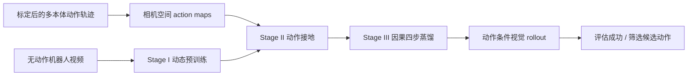

# WorldLine：动作驱动的机器人操纵视觉仿真

**WorldLine**（*Action-Driven Visual Simulation for Robotic Manipulation*，arXiv:2609.38059）是一种动作条件视频模拟器：先从大规模无动作标注机器人视频学习可迁移的机器人–物体动态，再将不同机器人的控制映射到共享图像空间，用预测 rollout 评估策略与筛选候选动作。

## 英文缩写速查

| 缩写 | 英文全称 | 简要说明 |
|------|----------|----------|
| WM | World Model | 预测动作或状态变化后的环境未来 |
| DiT | Diffusion Transformer | WorldLine 所用视频生成骨干的一类架构 |
| Rot6D | 6D Rotation Representation | 用六维表示旋转姿态，便于投影到动作图 |
| IoU | Intersection over Union | 衡量预测与真值机器人分割掩码重合度 |
| OOD | Out-of-Distribution | 训练中未见的环境、任务或本体评估设置 |

## 为什么重要

动作条件视频模型的瓶颈有两面：大规模被动视频不告诉模型某条机器人控制会导致什么结果；动作标注轨迹又少且受本体、坐标系和控制接口限制。WorldLine 将两类数据拆开使用，使无动作视频扩展动态先验，再通过少量得多的控制轨迹学习动作接地。

它的定位是可学习的**视觉模拟器 / rollout 评估器**，接收动作并预测其后果；它不是直接输出机器人动作的策略。因此可与 [World Action Models（WAM）](../concepts/world-action-models.md) 对照：WAM 讨论世界预测与动作生成的耦合，而 WorldLine 可作为策略外部的候选结果模拟与排序工具。

## 方法栈

1. **Stage I：机器人动态预训练。** 从 Cosmos3-Nano 初始化，在超过 10,000 小时的机器人操作视频上学习运动和物体交互。数据来自六个数据集，覆盖 10 余种本体和 3,500 余项任务；该阶段不使用动作条件。
2. **Stage II：动作接地后训练。** 对每条控制轨迹使用本体运动学和相机标定，将末端位置投影到视图，并编码位置热图、深度、Rot6D 姿态及夹爪状态，组成九通道图像空间 action map。数据表给出约 2,500 小时、10 余种本体；多视角同步数据及约 200 小时失败轨迹帮助模型区分交互结果。关系正则保持跨帧、跨视角特征关系。
3. **Stage III：因果低步数蒸馏。** 将固定整段动作生成转为分块自回归：每个预测块可接收新动作，四步去噪生成 4 个 latent 帧（16 个 RGB 帧），以便边观察预测边更新控制。

## 实验与评测

| 评测 | 论文报告结果 | 解读 |
|------|--------------|------|
| 失败轨迹的机器人运动一致性 | AgiBotWorld 失败轨迹上，robot-mask IoU 比最强基线高 0.1626 | 关注动作导致的机器人运动，不只看静态背景像素质量 |
| 跨数据集成功预测 | RoboTwin 与 AgiBot 平均准确率 74%，比最强基线高 1 个百分点 | Qwen3VL-8B 根据生成视频判断任务成功，结果受视觉判别器影响 |
| RoboTwin 候选动作规划 | 无 RoboTwin 训练或适配；N=32 时最高提升 21.4 个百分点 | 候选由 π₀.₅ 或 LingBot-VLA 产生，再由模拟 rollout 与 VLM 评分筛选 |
| 因果推理效率 | 129 帧从 35 步 / 90 秒降到 4 步 / 21 秒；每帧 0.698 秒降至 0.163 秒 | 约 4.3× 加速，但绝非实时机器人控制周期 |

论文在 held-out AgiBotWorld 与未参与训练的 DROID 上评估动作条件视频；规划实验使用 RoboTwin 的 10 个任务、每任务 5 个场景。候选预算增加总体有利，但 VLM 评分不完美，单任务排序收益并不总是单调或一致。

## 源码运行时序图

**不适用：** 截至 2026-10-15，官方仓库没有训练或推理实现，只有研究说明、引用文件和项目网站 / 演示入口。以下资料足以检查论文和可视化结果，不能用于复现实验运行时序。

## 结论

**WorldLine 的关键贡献是把数据规模扩展与动作接地分开；其 rollout 有离线评估价值，尚不能当作实时物理仿真器。**

1. **先学动态，再教动作。** 无动作视频可扩大交互覆盖，标定动作轨迹负责将控制和视觉后果对齐；两种数据的作用不可互换。
2. **图像空间动作图是跨本体接口。** 投影末端几何而非直接拼接异构控制向量，能让模型明确某动作在各视图中对应的位置与效果。
3. **失败样本影响候选排序。** 失败轨迹让模型见到未成功的接触结果；其收益取决于策略和任务，成功-only 数据不能视作等价替代。
4. **评估与规划要看相对排序。** 74% 的二元成功分类准确率不保证相似候选动作的排序正确；规划应另外检查候选集、任务分布和排名质量。
5. **四步蒸馏的代价仍高。** 21 秒生成 129 帧表明其适用于慢速、离线候选筛选，不适合直接接入毫秒级控制环。
6. **开源边界限制复现。** 官方公开页面与视频 demo，但训练和推理代码尚未发布；论文数字目前应作为作者报告结果读取。

## 局限与风险

- 预测视频而非显式物理状态或力/接触量；视觉上合理的 rollout 不能代替物理约束、碰撞检测或安全验证。
- 成功预测依赖 Qwen3VL-8B 的视觉判断；生成质量、任务可见性与打分器误差会共同影响候选选择。
- 四步版本在若干任务上保留大部分收益，但细微状态差别可能被蒸馏抹去，造成相似候选排序错误。
- 论文提出后续探索将其作为 RL 环境和加强不确定性估计；这些能力不是当前实验已证明的功能。
- 官方仓库当前无可运行训练/推理实现，无法独立核验数据构造、训练配方和端到端 rollout。

## 关联页面

- [生成式世界模型](../methods/generative-world-models.md) — 动作条件视频模拟器与策略 rollout 的方法分类
- [世界模型功能分类](../concepts/functional-taxonomy-world-models.md) — WorldLine 对应输出未来观测并供模拟 / 策略评估使用
- [World Action Models（WAM）](../concepts/world-action-models.md) — 对照接收动作预测后果与联合输出动作的范式边界
- [机器人操纵](../tasks/manipulation.md) — 操纵任务、数据和评价维度

## 参考来源

- [论文与核心摘录](../../sources/papers/worldline_arxiv_2609_38059.md)
- [官方项目页归档](../../sources/sites/worldline-project.md)
- [官方仓库归档](../../sources/repos/worldline.md)

## 与其他工作对比

| 维度 | WorldLine | WAM / 直接策略模型 |
|------|-----------|--------------------|
| 输入与输出 | 当前视觉 + 候选动作 → 未来视频 | 视觉/语言 → 动作，或联合预测动作与世界 |
| 主要用途 | 候选结果模拟、策略评估与排序 | 直接控制机器人或共同建模控制和未来 |
| 跨本体接口 | 相机标定后的图像空间 action map | 常见为本体专属动作空间或联合 latent |
| 当前可验证性 | 论文与演示公开，训练/推理代码未发布 | 随具体工作而异，不能由类别推断 |

因此，WorldLine 更适合当作策略外部的“想象评估器”；需要在线毫秒级控制、明确力学状态或端到端动作生成时，论文现有结果不能直接替代控制器或物理引擎。

## 推荐继续阅读

- [WorldLine 项目页与演示](https://zhengsh123.github.io/WorldLine/)
- [WorldLine 论文 PDF](https://arxiv.org/pdf/2609.38059)
