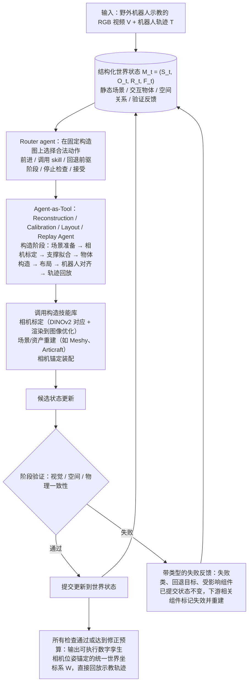

# WorldMirror（arXiv:2610.31834）

**WorldMirror**（*WorldMirror: Agentic Real-to-Sim Generation of Interactive Worlds from In-the-Wild Robot Demonstrations*，[arXiv:2610.31834](https://arxiv.org/abs/2610.31834)，[项目页](https://worldmirror-page.github.io/)）来自 [具身智能小站 2026-10-29 盘点](../../sources/blogs/wechat_embodied_station_58_papers_diverse_demonstrations_2026-10-29.md)，属「示范数据与数据引擎」组。

## 一句话定义

**WorldMirror把真实到仿真建模写成可反复修订的世界程序，结合生成工具和验证反馈；DROID实验同时检查视觉、空间关系与轨迹回放的物理一致性。**

## 英文缩写速查

| 缩写 | 英文全称 | 简要说明 |
|------|----------|----------|
| WorldMirror | WorldMirror: Agentic Real-to-Sim Generation of Interactive Worlds from In-the-Wild Robot Demonstrations | 本文方法 / 基准的简称 |

## 为什么重要

- 从真实示范重建可交互的仿真世界。
- 开源结论：**项目页未列 GitHub**（步骤 2.5，2026-10-29）。项目页 HTTP 200，未列 GitHub，也无 coming soon 字样（脚本扫描）。
- 同期同组工作见 [多样成功示范、触觉工具链与预见式感知：具身智能小站 10-29 期 58 篇阅读坐标](../overview/embodied-station-2026-10-29-58-papers-technology-map.md)。

## 流程总览

图依据：论文 §3.1–§3.5、Fig. 2。

## 核心机制

| 项 | 内容 |
|----|------|
| **arXiv** | [2610.31834](https://arxiv.org/abs/2610.31834) |
| **开源** | **项目页未列 GitHub** |
| **要点** | WorldMirror把真实到仿真建模写成可反复修订的世界程序，结合生成工具和验证反馈；DROID实验同时检查视觉、空间关系与轨迹回放的物理一致性。 |
| **文内指标** | 公众号未给具体数字，本页不引用。 |

## 源码运行时序图

**不适用（项目页未列 GitHub）** — 项目页 HTTP 200，未列 GitHub，也无 coming soon 字样（脚本扫描）。 不编造运行脚本；代码公开后再补。

## 实验与评测

- 公众号未给具体数字，本页不引用。
- **读法：** 本页为索引级摘要，依据公众号转述的官方摘要与仓库信息整理；逐项数字与 baseline 以原文 PDF 为准。

## 与其他工作对比

- 横向索引见 [多样成功示范、触觉工具链与预见式感知：具身智能小站 10-29 期 58 篇阅读坐标](../overview/embodied-station-2026-10-29-58-papers-technology-map.md)；同 arXiv 不重复造页。

## 结论

**从真实示范重建可交互的仿真世界：WorldMirror把真实到仿真建模写成可反复修订的世界程序，结合生成工具和验证反馈；DROID实验同时检查视觉、空间关系与轨迹回放的物理一致性。**

1. 开源边界：**项目页未列 GitHub** — 项目页 HTTP 200，未列 GitHub，也无 coming soon 字样（脚本扫描）。
2. 核心机制：WorldMirror把真实到仿真建模写成可反复修订的世界程序，结合生成工具和验证反馈；DROID实验同时检查视觉、空间关系与轨迹回放的物理一致性。
3. 复现与选型前核对任务协议、硬件与基准口径，勿直接横比公众号摘录数字。

## 关联页面

- [embodied-data-collection-four-layers-taxonomy](../concepts/embodied-data-collection-four-layers-taxonomy.md)
- [imitation-learning](../methods/imitation-learning.md)
- [teleoperation](../tasks/teleoperation.md)
- [sim2real](../concepts/sim2real.md)
- [embodied-station-2026-10-29-58-papers-technology-map](../overview/embodied-station-2026-10-29-58-papers-technology-map.md)

## 参考来源

- [worldmirror_arxiv_2610_31834.md](../../sources/papers/worldmirror_arxiv_2610_31834.md)
- [wechat_embodied_station_58_papers_diverse_demonstrations_2026-10-29.md](../../sources/blogs/wechat_embodied_station_58_papers_diverse_demonstrations_2026-10-29.md)
- [arXiv:2610.31834](https://arxiv.org/abs/2610.31834)
- [arXiv PDF](https://arxiv.org/pdf/2610.31834)：已通读方法部分（实验与附录以略读为准）：摘要、§2 略读、§3（3.1–3.5 与 Fig. 2）、§4 实验设定与表题

## 推荐继续阅读

- [arXiv PDF](https://arxiv.org/pdf/2610.31834)
- [项目页](https://worldmirror-page.github.io/)
