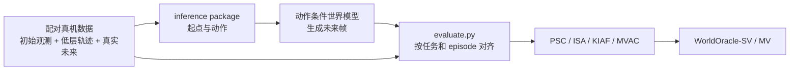
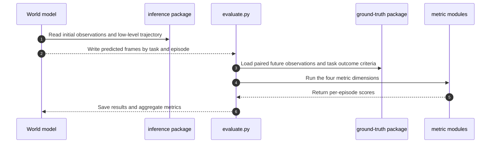

# WorldOracle（动作条件世界模型真机执行基准）

WorldOracle 把预测 rollout 与相同初始观测、相同低层动作序列下的配对真机执行对齐，判断模型是否复现真实物理后果与任务状态转移。

## 英文缩写速查

| 缩写 | 英文全称 | 简要说明 |
|------|----------|----------|
| ACWM | Action-Conditioned World Model | 输入动作条件并预测未来的世界模型 |
| PSC | Physical State Correctness | 检查预测终态与真实任务状态是否一致 |
| ISA | Interaction Spatial Alignment | 衡量预测交互位置与真机执行的空间对齐 |
| KIAF | Key Interaction Area Fidelity | 关注接触区和物体等关键区域的视觉保真 |
| MVAC | Multi-View Action Coherence | 检查同步相机视角中的动作和结果是否一致 |
| VLM | Vision-Language Model | 用于判断任务终态的视觉语言模型 |

## 为什么重要

逼真的视频仍可能没有忠实执行输入动作：物体位移、接触点或最终任务状态可能出错。WorldOracle 将评测绑定到真实执行记录，把“画面看起来合理”与“动作导致正确结果”分开测量。

与 [EWMBench](./ewmbench.md) 的问题不同：EWMBench 主实验评估具身视频生成质量（场景、运动、语义）；WorldOracle 用配对真机结果评估动作条件预测是否复现同一执行。两者互补，汇总分不可直接换算。

## 方法栈

候选模型根据初始观测和低层动作/状态轨迹生成未来视频；评测器对齐预测、配对真机未来观测与任务信息：

| 指标 | 官方字段 | 评测问题 |
|------|----------|----------|
| **PSC** | physical_judge | 预测终态和任务状态是否符合配对真值？ |
| **ISA** | interaction_spatial_alignment | 机器人与物体的交互运动是否对齐真机？ |
| **KIAF** | keyarea_visual_quality | 手臂、接触区和物体的预测视觉是否可信？ |
| **MVAC** | multiview_consistency | 同一动作在同步视角下的运动结果是否协调？ |

WorldOracle-SV 对前三项等权平均；WorldOracle-MV 对四项等权平均。实现将分项归一到 0–100，越高越好。只有同步多视角预测适用 MV；缺少视角是未测状态，不应记作零分。

## 数据集与评测分布

项目页与 README 覆盖 AgiBot G2、YAM、human-hand 三种 embodiment，以及 human-operated 和 policy-rollout 两种动作分布。评测集包含长程多段 episode、成功和失败执行。模型可见的 inference package 提供起始观测与轨迹；未来观测和物理结果判定位于 ground-truth package。

## 流程总览

## 实验与评测

论文摘要报告评测 **7 个代表性动作条件世界模型**，并分析不同模型的优势与失败模式。官方 README 说明论文物理状态评测使用 GPT-5.5；live leaderboard 将基线和新提交统一用 GPT-5.6 Luna 重评，因此在线榜与论文表格数值可能不同。横向比较时应对齐 embodiment、动作分布、视角、时长和数据拆分。

## 与其他基准对比

| 基准 | 条件与参照 | 主要问题 |
|------|------------|----------|
| **WorldOracle** | 初始观测 + 低层动作；配对真机未来 | 动作是否导致正确物理和任务结果 |
| [EWMBench](./ewmbench.md) | 具身视频生成条件与真值 | 场景、运动和语义生成质量 |
| [WorldScore](./paper-worldscore.md) | 开放域世界生成条件 | 场景生成质量与可控性 |

协议、真值、任务与指标不同，排名和总分不可横向换算。

## 源码运行时序图

该执行路径对应官方仓库的数据包、预测目录、evaluate.py 和评测模块；大规模提交可用 tools/evaluate_submission.py 管理并发与断点续跑。

## 工程实践

- **代码与数据：** 官方评测仓库已公开（Apache-2.0）；项目页链接 Hugging Face 数据入口。评测前确认 inference 与 ground-truth 数据包权限和版本。
- **运行起点：** Linux / Python 3.10，按 setup_env.sh 安装依赖，配置 V-JEPA2、DINOv3 权重后用 python evaluate.py --help 检查入口。
- **预测目录：** task_id/episode_id/video/view/frame_*.png；标准指标要求 top_head，MVAC 还需同步的 hand_left 与 hand_right。
- **评测成本：** PSC 依赖 OpenAI-compatible VLM endpoint；大规模评测需预估 API 成本并保持模型、解码设置一致。

## 局限与风险

- 基准测量特定任务和协议下的预测执行一致性，单凭分数不能证明模型是安全可用的物理仿真器。
- 单次配对执行可能受真实交互随机性影响；应检查任务覆盖和重复执行稳定性。
- MV 只适用于能同步生成多视角的模型；PSC 依赖 VLM，结果受评测器版本与设置影响。

## 结论

**一句话总判：** WorldOracle 将动作条件世界模型预测与配对真机结果放在同一协议中检验，补足“画面逼真是否等于执行可信”的评测缺口。

1. 先读 PSC、ISA、KIAF 分项，再读汇总分，定位终态、交互位置或接触区域的失效。
2. 比较前对齐 embodiment、动作分布、时长和视角；SV 与 MV 是不同评测能力。
3. 将 WorldOracle、EWMBench、WorldScore 作为互补基准，分别检查执行结果、具身视频质量和开放域场景质量。
4. 记录 VLM 评测器版本，避免把论文分数与在线排行榜直接混读。
5. 模型进入规划或控制系统前，另行验证长程稳定性、重复性与控制安全。

## 关联页面

- [Generative World Models（生成式世界模型）](../methods/generative-world-models.md)
- [EWMBench（具身世界模型生成评测）](./ewmbench.md)
- [WorldScore](./paper-worldscore.md)
- [具身大模型评测基准选型闭环](../queries/embodied-eval-benchmark-selection-loop.md)

## 参考来源

- [论文摘录](../../sources/papers/worldoracle_arxiv_2610_18826.md)
- [官方项目页](../../sources/sites/worldoracle-benchmark.md)
- [官方代码归档](../../sources/repos/worldoracle.md)

## 推荐继续阅读

- Duan et al., *WorldOracle: Benchmarking Action-Conditioned World Models against Real-World Executions*, [arXiv:2610.18826](https://arxiv.org/abs/2610.18826)
- [AgibotTech/WorldOracle README](https://github.com/AgibotTech/WorldOracle#readme)
- [WorldOracle Leaderboard](https://worldoracle-benchmark.github.io/leaderboard.html)
