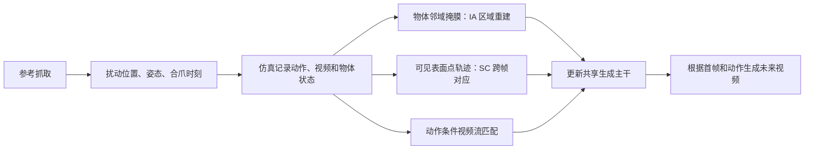
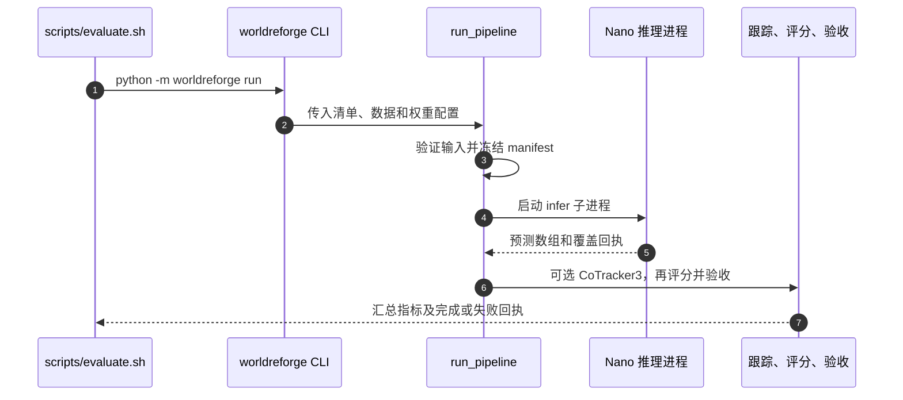

# WorldReforge：从仿真失败学习机器人世界模型 / Beyond the Happy Path: Generalizing Robot World Models from Simulated Failures

## 一句话定义

用可控地扰动抓取后得到的失败轨迹和成功保持轨迹训练视频世界模型，让它更准确地预测不同动作造成的推、倾斜、滑脱或抓稳。

## 英文缩写速查

| 缩写 | 英文全称 | 简要说明 |
| --- | --- | --- |
| IA | Interaction Alignment | 在物体和接触邻域重点重建未来潜变量 |
| SC | Surface Correspondence | 在跨帧特征上追踪同一物理表面点 |
| ADE | Average Displacement Error | 预测可见点在未来各帧的平均位移误差 |
| FDE | Final Displacement Error | 最后一帧的点位移误差 |
| RDE | Response Difference Error | 同一初始画面下两条动作分支的预测响应差异，相对真实响应差异的误差 |

## 为什么重要

一个视频模型能生成平滑的机械臂运动，却可能让被碰到的物体继续留在原地。作者对三系列五个预训练模型的测试中，物体 ADE 相对首帧静止基线的最大改善仅为 10.4%，其中两个模型反而更差。用世界模型为动作打分时，这种错误会让抓偏或合爪过迟看起来没什么后果。

| 项目 | 内容 |
| --- | --- |
| 论文 | Beyond the Happy Path: Generalizing Robot World Models from Simulated Failures |
| 机构 | 浙江大学、上海创智学院 |
| 输入与输出 | 条件首帧、末端位姿与夹爪状态序列 → 未来 RGB 视频 |

## 核心机制

先用 RoboLab 与 cuRobo 构建参考抓取，再分别扰动末端的位置、姿态和闭合时刻。记录触碰、滑脱及抓稳等结果，避免把“施加了何种扰动”和“物体实际怎么动”当成同一标签。Reforge 有 62,125 条仿真轨迹（96 个物体资产，其中 13,577 条失败相关），另有跨 10 个物体的 300 条真实失败轨迹用于评测。

- **IA**：将物体 3D 包围盒投影到两个外部视图，小幅扩至邻域。按掩膜总权重归一化潜空间重建误差，小物体不会淹没在整帧背景中。
- **SC**：用物体与相机位姿把同一个物体局部表面点投影至未来腕视角，用几何可见性过滤标签；主干特征按余弦相似度软匹配，再由匹配分布回归坐标。
- 两个辅助损失只在后训练中约束原主干。推理仍使用原生成架构，不额外输入接触或表面点真值。

## 流程总览

## 源码运行时序图

时序只对应公开的单 GPU 推理与评测入口。输入文件先校验，推理回执中的 ID 列表须与冻结清单完全一致。

## 工程实践

- 在相同首帧上成对设计动作（例如让标记笔滑落或成功提起），比较两个分支差异；单独的 PSNR 不能说明模型对动作变化敏感。
- 官方仓库提供 Cosmos3 Nano 的推理、像素/运动评分、验证脚本和 1,200 个仿真评测窗口的清单。运动指标需要 CoTracker3；`--pixels-only` 可跳过跟踪。安装、GPU 模型和数据下载只做源码/文档核对，未执行。
- 公开入口包括模型页和 Reforge-Eval 数据页；评测集链接与论文所述完整约 62k 训练语料、训练代码或仿真采集管线并不等价。详见[公开实现](../../sources/repos/worldreforge.md)。

## 实验与评测

论文表 1 的 Cosmos3 Nano：预训练、只用同数据基础目标后训练、加 IA 与 SC 后训练的物体 ADE 分别为 **9.07、6.81、6.51 px**；后者相对预训练降低 **28.2%**。后训练未见物体子集从 **9.86** 降到 **6.41 px**；同首帧分支 RDE 相对预训练下降 **43.3%**，但相对只换数据的 Reforge 下降 **3.9%**。DROID 和真实失败片段的 PSNR 分别提高 **1.04 dB** 与 **0.68 dB**。主比较包含 1,200 段仿真、200 段 DROID、100 段 Reforge-Real；每段仿真运动误差由未来 16 帧的点轨迹计算。

## 与相关工作对比

与 [HOG-WAM](paper-hog-wam.md) 用未来结构监督提高动作策略的视觉扰动鲁棒性不同，WorldReforge 用有物理标注的失败轨迹改进动作条件视频预测本身。点位移误差和动作响应差异不能当作策略成功率。

## 结论

对动作结果敏感，和把画面生成得干净，是两项需要分别验收的能力。

- 先用静止基线检查物体运动指标是否有效，再用同首帧分支测试动作敏感性。
- 训练时保留成功保持和失败接触；前者帮助状态持续，后者教模型哪些碰撞会改变物体运动。
- 分开评估数据换配方与物理辅助损失的收益；两者在该实验中都贡献了改善。
- 真实视频重建收益不能当作真机闭环策略成功率。

## 局限与风险

主要实验考察短时抓取/接触片段，不能说明模型在长时程、多物体交互或真机闭环规划中可靠。辅助信号依赖标定、物体刚体位姿及仿真几何真值；仿真轨迹上的 ADE/FDE 是由生成视频中的跟踪点在画布上测得的像素误差。

## 关联页面

- [世界–动作模型纵深路线](../../roadmap/depth-wam.md)

- [生成式世界模型](../methods/generative-world-models.md)：理解从首帧和动作预测未来画面的模型接口。
- [机器人操作](../tasks/manipulation.md)：联系常见抓取失败、滑脱与重试。
- [AI 基准评测](../methods/ai-benchmark-evaluation.md)：用静止基线、分支和拆分指标诊断视频预测。
- [具身评测与基准](../overview/hub-embodied-eval-benchmark.md)：比较世界模型物理评测与策略成败评测。
- [ROAM-Bench](./paper-roam-bench.md)：用执行证据诊断空间智能，与本页的动作后果预测属于不同评测对象。

## 参考来源

- [论文与通读记录](../../sources/papers/worldreforge_arxiv_2611_33925.md)
- [项目主页归档](../../sources/sites/worldreforge.md)
- [官方推理与评测实现](../../sources/repos/worldreforge.md)

## 推荐继续阅读

- [RoboLab 官方仓库](https://github.com/NVlabs/RoboLab)：理解仿真操作场景与参考执行的来源。
